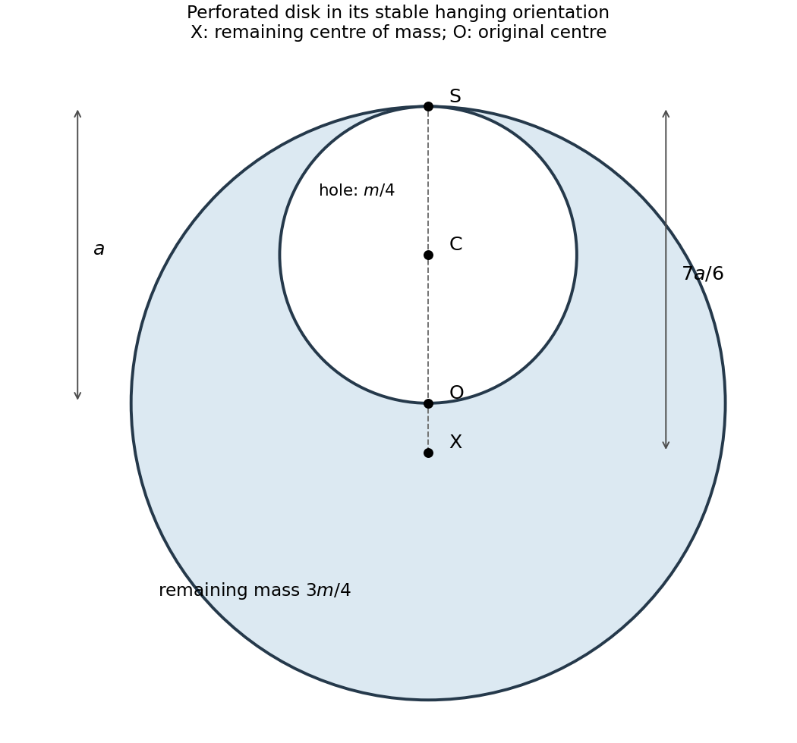

<h1 id="11/c/solution">Solution</h1>

↑ **Parent:** [C](../c.md)

Let $O$ be the original disk centre and $C$ the hole centre. The source geometry has $OS=a$, $OC=CS=a/2$, all collinear. The removed disk has [mass](../../../../mass.md) $m/4$, since its [area](../../../../surface-area.md) is one quarter of the original disk's. Use the [parallel axis theorem](../../../../parallel-axis-theorem.md) for both the original disk and the removed disk:

$$
I_S^{\rm full}=\frac12ma^2+ma^2=\frac32ma^2,
\qquad
I_S^{\rm hole}=\frac12\frac m4\left(\frac a2\right)^2+\frac m4\left(\frac a2\right)^2
=\frac{3ma^2}{32}.
$$

Subtracting the missing material's [moment of inertia](../../../../moment-of-inertia.md) gives

$$
\boxed{I_S=\frac{45ma^2}{32}.}
$$

Here $m$ continues to denote the original unperforated disk [mass](../../../../mass.md); the earring itself has [mass](../../../../mass.md) $3m/4$.

**[Figure 4](#11/c/image-equilibrium-geometry-and-mass-subtraction-for-a-perforated-disk-physical-pendulum). Equilibrium geometry and mass subtraction for a perforated-disk physical pendulum**.

## ↑ Ancestors (12)

1. [C](../c.md)
2. [11](../../11.md)
3. [2017 resit](../../../2017-resit-split.md)
4. [Past exam of the physics 1 paper of the University of Oxford](../../../split.md)
5. [Physics 1 paper of the University of Oxford](../../../../physics-1-paper-of-the-university-of-oxford.md)
6. [Year 1 of the physics course of the University of Oxford](../../../../year-1-of-the-physics-course-of-the-university-of-oxford.md)
7. [Physics course of the University of Oxford](../../../../physics-course-of-the-university-of-oxford.md)
8. [Undergraduate course of the University of Oxford](../../../../undergraduate-course-of-the-university-of-oxford.md)
9. [Course of the University of Oxford](../../../../course-of-the-university-of-oxford.md)
10. [University of Oxford](../../../../university-of-oxford-split.md)
11. [List of universities](../../../../list-of-universities.md)
12. [Codex Wiki](../../../../split.md)
