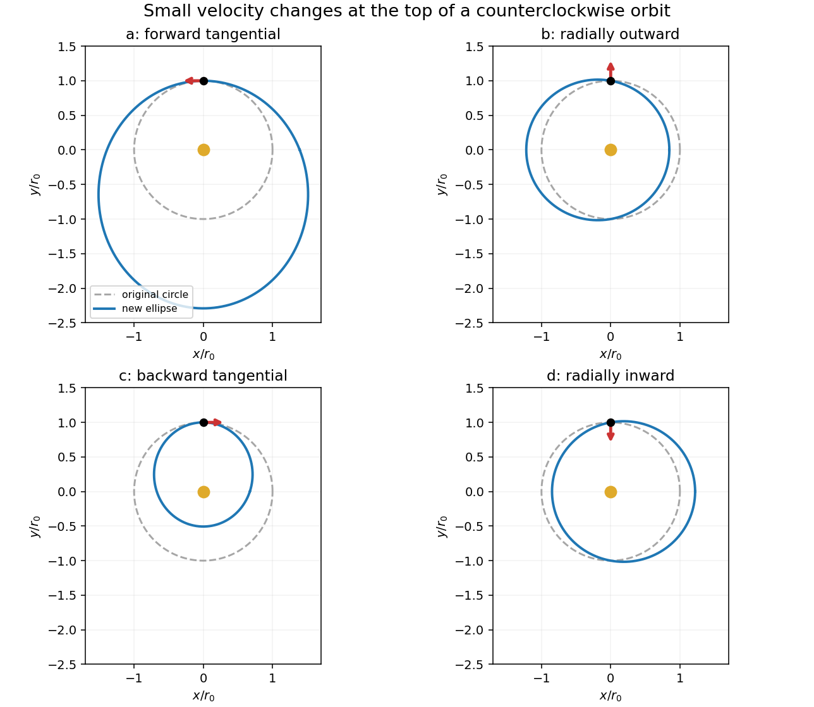

# 2

↑ **Parent:** [2017 resit](../2017-resit-split.md)

The source's tangential arrows $a,c$ respectively point along and against the original motion; $b,d$ point radially outward and inward. Write $r_0$ for the initial [orbital radius](../../orbital-radius.md), $v_c=\sqrt{GM/r_0}$ for the [circular orbital speed](../../circular-orbital-speed.md), and $\delta>0$ for the small added [speed](../../speed.md). The resulting trajectories follow the [velocity kick on a circular Kepler orbit](../../velocity-kick-on-a-circular-kepler-orbit.md) formulas. Here [orbital energy](../../orbital-energy.md) includes [kinetic energy](../../kinetic-energy.md) and [gravitational potential energy](../../gravitational-energy.md); [angular momentum](../../angular-momentum.md) refers to the central object.

**[Figure 1](#2/image-four-kepler-orbits-following-small-tangential-or-radial-velocity-changes). Four Kepler orbits following small tangential or radial velocity changes**.

**Table of contents**

- [a](2/a.md)
  - [Solution](2/a/solution.md)
- [b](2/b.md)
  - [Solution](2/b/solution.md)
- [c](2/c.md)
  - [Solution](2/c/solution.md)
- [d](2/d.md)
  - [Solution](2/d/solution.md)

## ↑ Ancestors (10)

1. [2017 resit](../2017-resit-split.md)
2. [Past exam of the physics 1 paper of the University of Oxford](../split.md)
3. [Physics 1 paper of the University of Oxford](../../physics-1-paper-of-the-university-of-oxford.md)
4. [Year 1 of the physics course of the University of Oxford](../../year-1-of-the-physics-course-of-the-university-of-oxford.md)
5. [Physics course of the University of Oxford](../../physics-course-of-the-university-of-oxford.md)
6. [Undergraduate course of the University of Oxford](../../undergraduate-course-of-the-university-of-oxford.md)
7. [Course of the University of Oxford](../../course-of-the-university-of-oxford.md)
8. [University of Oxford](../../university-of-oxford-split.md)
9. [List of universities](../../list-of-universities.md)
10. [Codex Wiki](../../split.md)
