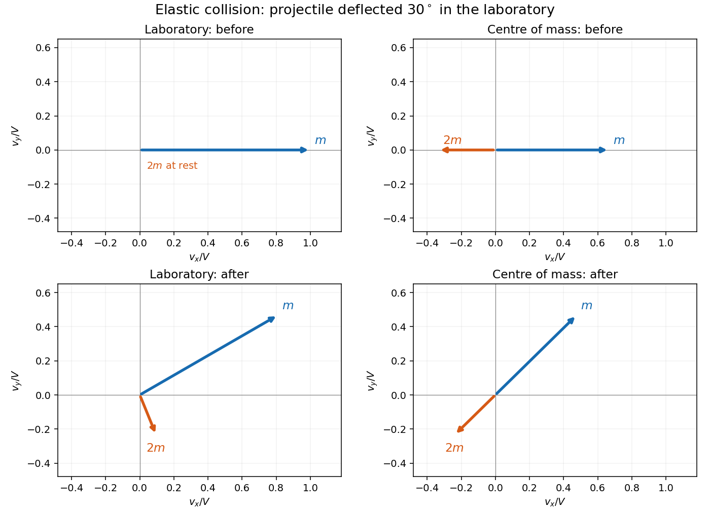

<h1 id="9/a/solution">Solution</h1>

↑ **Parent:** [A](../a.md)

For two particles, let $M=m_1+m_2$ and $\mathbf V_{\rm cm}=(m_1\mathbf v_1+m_2\mathbf v_2)/M$. The [centre-of-mass frame](../../../../center-of-momentum-frame.md) velocities are $\mathbf v_i^*=\mathbf v_i-\mathbf V_{\rm cm}$, so $m_1\mathbf v_1^*+m_2\mathbf v_2^*=0$. Thus before and after an isolated [collision](../../../../collision.md) the two [momentum](../../../../momentum-split.md) [vectors](../../../../vector.md) are equal and opposite. For an [elastic collision](../../../../elastic-collision.md) their common magnitude is also unchanged: only their direction rotates.

The [kinetic energy decomposition about the center of mass](../../../../kinetic-energy-decomposition-about-the-center-of-mass.md) separates unchanged bulk translation from relative motion:

$$
K=\frac12M V_{\rm cm}^2+\frac12\mu|\mathbf v_1-\mathbf v_2|^2,
\qquad \mu=\frac{m_1m_2}{M}.
$$

The [reduced mass](../../../../reduced-mass.md) $\mu$ reduces the calculation to one relative [velocity](../../../../velocity.md). After solving the geometry in the [centre-of-mass frame](../../../../center-of-momentum-frame.md), add $\mathbf V_{\rm cm}$ to each [velocity](../../../../velocity.md) to return to the laboratory. The four panels below illustrate this for the subsequent example.

**[Figure 2](#9/a/image-velocity-vectors-before-and-after-an-elastic-collision-in-laboratory-and-centre-of-mass-frames). Velocity vectors before and after an elastic collision in laboratory and centre-of-mass frames**.

## ↑ Ancestors (12)

1. [A](../a.md)
2. [9](../../9.md)
3. [2017 resit](../../../2017-resit-split.md)
4. [Past exam of the physics 1 paper of the University of Oxford](../../../split.md)
5. [Physics 1 paper of the University of Oxford](../../../../physics-1-paper-of-the-university-of-oxford.md)
6. [Year 1 of the physics course of the University of Oxford](../../../../year-1-of-the-physics-course-of-the-university-of-oxford.md)
7. [Physics course of the University of Oxford](../../../../physics-course-of-the-university-of-oxford.md)
8. [Undergraduate course of the University of Oxford](../../../../undergraduate-course-of-the-university-of-oxford.md)
9. [Course of the University of Oxford](../../../../course-of-the-university-of-oxford.md)
10. [University of Oxford](../../../../university-of-oxford-split.md)
11. [List of universities](../../../../list-of-universities.md)
12. [Codex Wiki](../../../../split.md)
