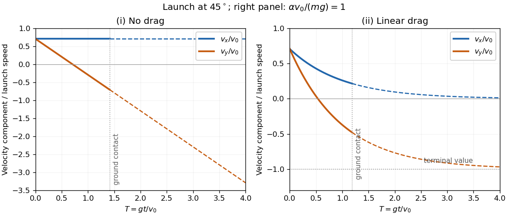
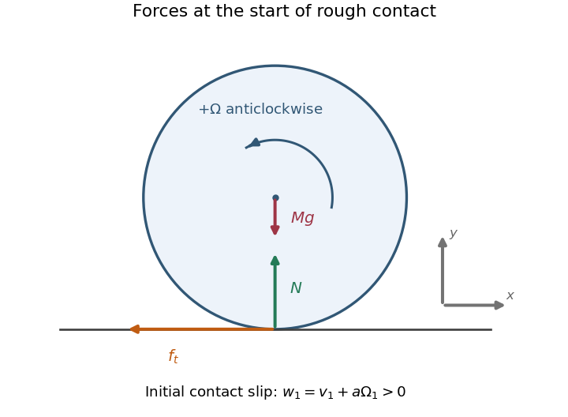

# 2017

↑ **Parent:** [Past exam of the physics 1 paper of the University of Oxford](../past-exam-of-the-physics-1-paper-of-the-university-of-oxford.md)

Source paper: [https://www.whatdotheyknow.com/request/oxford_physics_past_papers_2/response/2340696/attach/5/Physics%20Papers%202016.pdf?cookie_passthrough=1](https://www.whatdotheyknow.com/request/oxford_physics_past_papers_2/response/2340696/attach/5/Physics%20Papers%202016.pdf?cookie_passthrough=1)

The held cover dates CP1 to 5 June 2017, despite the source archive's filename. All questions and both [projectile motion](../classical-mechanics.md#projectile-motion) cases are covered. Lettered or Roman divisions are inferred where separate tasks have no printed labels.

**Table of contents**

- [1](#1)
  - [Solution](#1/solution)
- [2](#2)
  - [Solution](#2/solution)
- [3](#3)
  - [Solution](#3/solution)
- [4](#4)
  - [Solution](#4/solution)
- [5](#5)
  - [Solution](#5/solution)
- [6](#6)
  - [a](#6/a)
    - [Solution](#6/a/solution)
  - [b](#6/b)
    - [Solution](#6/b/solution)
- [7](#7)
  - [Solution](#7/solution)
  - [i](#7/i)
    - [Solution](#7/i/solution)
  - [ii](#7/ii)
    - [Solution](#7/ii/solution)
- [8](#8)
  - [a](#8/a)
    - [Solution](#8/a/solution)
  - [b](#8/b)
    - [Solution](#8/b/solution)
  - [c](#8/c)
    - [Solution](#8/c/solution)
  - [d](#8/d)
    - [Solution](#8/d/solution)
- [9](#9)
  - [a](#9/a)
    - [i](#9/a/i)
      - [Solution](#9/a/i/solution)
    - [ii](#9/a/ii)
      - [Solution](#9/a/ii/solution)
  - [b](#9/b)
    - [i](#9/b/i)
      - [Solution](#9/b/i/solution)
    - [ii](#9/b/ii)
      - [Solution](#9/b/ii/solution)
  - [c](#9/c)
    - [i](#9/c/i)
      - [Solution](#9/c/i/solution)
    - [ii](#9/c/ii)
      - [Solution](#9/c/ii/solution)
- [10](#10)
  - [a](#10/a)
    - [Solution](#10/a/solution)
  - [b](#10/b)
    - [Solution](#10/b/solution)
  - [c](#10/c)
    - [i](#10/c/i)
      - [Solution](#10/c/i/solution)
    - [ii](#10/c/ii)
      - [Solution](#10/c/ii/solution)
- [11](#11)
  - [a](#11/a)
    - [Solution](#11/a/solution)
  - [b](#11/b)
    - [Solution](#11/b/solution)
  - [c](#11/c)
    - [Solution](#11/c/solution)
  - [d](#11/d)
    - [Solution](#11/d/solution)
  - [e](#11/e)
    - [Solution](#11/e/solution)

## 1

↑ **Parent:** [2017](2017.md)

<h3 id="1/solution">Solution</h3>

↑ **Parent:** [1](#1)

Measure $\theta$ from the downward vertical. The falling [mass](../classical-mechanics.md#mass) loses [gravitational potential energy](../energy.md#gravitational-energy) $3mgl(1-\cos\theta)$. The fixed pivot does no [work](../energy.md#work), so [conservation of energy](../mathematical-physics.md#conservation-of-energy) gives its incident [speed](../classical-mechanics.md#speed) $u$:

$$
3mgl(1-\cos\theta)=\frac12(3m)u^2,
\qquad u=\sqrt{2gl(1-\cos\theta)}.
$$

At the bottom, the rod is vertical and the impact is horizontal. Its impulsive reaction therefore has no horizontal component. Let $U$ and $w$ be the subsequent horizontal [velocities](../classical-mechanics.md#velocity) of the heavy and light balls. Horizontal [momentum conservation](../momentum.md#momentum-conservation) and unit [coefficient of restitution](../classical-mechanics.md#coefficient-of-restitution) give

$$
3mu=3mU+mw,\qquad w-U=u.
$$

Thus $U=u/2$, and the light ball's outgoing [speed](../classical-mechanics.md#speed) is

$$
\boxed{w=\frac32\sqrt{2gl(1-\cos\theta)}
=3\sqrt{gl}\,\left|\sin\frac\theta2\right|.}
$$

The calculation neglects the sizes of the balls, treats the rod as massless, and uses an [elastic collision](../classical-mechanics.md#elastic-collision). The expression vanishes for release at the bottom; a ball placed exactly at the unstable upright [equilibrium](../dynamical-systems.md#equilibrium-point-of-a-dynamical-system) requires a perturbation before it can fall.

## 2

↑ **Parent:** [2017](2017.md)

<h3 id="2/solution">Solution</h3>

↑ **Parent:** [2](#2)

Write the [electron](../physics.md#electron) [electric charge](../electric-charge.md) as $-e$, with $e>0$ the [elementary charge](../electric-charge.md#elementary-charge), and choose $\mathbf B=B\hat{\mathbf z}$ and initial [velocity](../classical-mechanics.md#velocity) $u\hat{\mathbf x}$. In the nonrelativistic approximation, [Newton's second law](../force.md#newton-s-second-law) with the magnetic [Lorentz force](../relativistic-electromagnetism.md#lorentz-force) gives

$$
m_e\dot v_x=-eBv_y,\qquad m_e\dot v_y=eBv_x,\qquad \dot v_z=0.
$$

The magnetic [force](../force.md) is perpendicular to the [velocity](../classical-mechanics.md#velocity), so it does no [work](../energy.md#work): $d(m_e|\mathbf v|^2/2)/dt=0$. Setting $\omega_c=eB/m_e$, the solution with $x(0)=y(0)=0$ is

$$
v_x=u\cos\omega_ct,\qquad v_y=u\sin\omega_ct,
\qquad x=\frac u{\omega_c}\sin\omega_ct,\qquad
y=\frac u{\omega_c}(1-\cos\omega_ct).
$$

Consequently $x^2+(y-r)^2=r^2$, where $r=u/\omega_c$: this is a [cyclotron orbit](../relativistic-electromagnetism.md#gyromotion). Its [frequency](../wave.md#frequency) and [cyclotron radius](../relativistic-electromagnetism.md#cyclotron-radius) are

$$
\boxed{f=\frac{eB}{2\pi m_e},\qquad r=\frac{m_eu}{eB},\qquad
u=\sqrt{\frac{2eV}{m_e}}.}
$$

The accelerating [voltage](../random-walk.md#voltage) changes $u$ and $r$ but cancels out of $f$. Using $m_e=9.1094\times10^{-31}\,\mathrm{kg}$ and $e=1.6022\times10^{-19}\,\mathrm C$ gives

$$
B=\frac{2\pi m_e(2.5\times10^9\,\mathrm{s^{-1}})}e
\simeq0.0893\,\mathrm T,\qquad
u\simeq1.876\times10^7\,\mathrm{m\,s^{-1}},
\qquad\boxed{r\simeq1.19\times10^{-3}\,\mathrm m.}
$$

Only the magnitude of the [magnetic field](../magnetic-field.md) is determined; its direction is perpendicular to the orbital plane, with the sense of rotation fixed by the negative [electric charge](../electric-charge.md). The claimed voltage independence is a nonrelativistic result: exactly, $\gamma=1+eV/(m_ec^2)$ and $f=eB/(2\pi\gamma m_e)$. At $1\,\mathrm{kV}$ the correction is about $0.2\%$. The stated model also neglects the [energy](../energy.md) lost to emitted [electromagnetic radiation](../electromagnetic-radiation.md).

## 3

↑ **Parent:** [2017](2017.md)

<h3 id="3/solution">Solution</h3>

↑ **Parent:** [3](#3)

Let $\mu$ be the instantaneous total [mass](../classical-mechanics.md#mass) of the rocket, including its remaining [rocket propellant](../momentum.md#rocket-propellant). During a short ejection it changes by $d\mu<0$. The expelled [mass](../classical-mechanics.md#mass) $-d\mu$ has [velocity](../classical-mechanics.md#velocity) $v-v_0$ to first order in a fixed [inertial frame](../mathematical-physics.md#inertial-frame). With no external [force](../force.md), [momentum conservation](../momentum.md#momentum-conservation) reads

$$
\mu v=(\mu+d\mu)(v+dv)+(-d\mu)(v-v_0).
$$

Discarding the second-order product gives $\mu\,dv=-v_0\,d\mu$. Integrate from initial total [mass](../classical-mechanics.md#mass) $m_0+M$ to [rocket dry mass](../momentum.md#rocket-dry-mass) $m_0$:

$$
v_f=-v_0\int_{m_0+M}^{m_0}\frac{d\mu}{\mu},
\qquad\boxed{v_f=v_0\ln\left(1+\frac M{m_0}\right).}
$$

For constant [mass flow rate](../fluid-mechanics.md#mass-flow-rate) $\alpha=-\dot\mu>0$, the same [rocket equation](../momentum.md#rocket-equation) gives $\mu(t)=m_0+M-\alpha t$ and $v(t)=v_0\ln[(m_0+M)/\mu(t)]$ until $t=M/\alpha$. The final result depends on the [rocket mass ratio](../momentum.md#rocket-mass-ratio), not on how rapidly the fuel is ejected. These are Newtonian [velocities](../classical-mechanics.md#velocity); a very large [rocket mass ratio](../momentum.md#rocket-mass-ratio) would require a relativistic treatment even if the exhaust is slow in the instantaneous rocket frame.

## 4

↑ **Parent:** [2017](2017.md)

<h3 id="4/solution">Solution</h3>

↑ **Parent:** [4](#4)

Use the [inertial frame](../mathematical-physics.md#inertial-frame) in which the departure point and destination are stationary, with separation $d$. The astronauts' elapsed [proper time](../special-relativity.md#proper-time) is $\tau=t/\gamma$, whereas $d=vt$. Hence

$$
\gamma\beta=\frac d{c\tau}=\frac45,\qquad
\gamma^2-(\gamma\beta)^2=1,
\qquad \gamma=\frac{\sqrt{41}}5,\qquad \beta=\frac4{\sqrt{41}}.
$$

The Earth-frame [travel time](../dispersion-relation.md#travel-time) is $t=\sqrt{41}\,\mathrm{yr}\simeq6.40\,\mathrm{yr}$ and the [speed](../classical-mechanics.md#speed) is approximately $0.625c$. The spacecraft's [relativistic kinetic energy](../energy.md#relativistic-kinetic-energy) is therefore

$$
\boxed{K=(\gamma-1)mc^2
=\left(\frac{\sqrt{41}}5-1\right)(10^5\,\mathrm{kg})c^2
\simeq2.52\times10^{21}\,\mathrm J.}
$$

The five years are not the time to use in $v=d/t$ in the departure frame. This is the cruising [kinetic energy](../energy.md#kinetic-energy), with departure and arrival [acceleration](../classical-mechanics.md#acceleration) intervals omitted, rather than a complete propulsion [energy](../energy.md) budget.

## 5

↑ **Parent:** [2017](2017.md)

<h3 id="5/solution">Solution</h3>

↑ **Parent:** [5](#5)

Choose zero [potential energy](../energy.md#potential-energy) at the equilibrium position. For the [simple harmonic oscillator](../classical-mechanics.md#simple-harmonic-motion), the [kinetic energy](../energy.md#kinetic-energy) and [elastic potential energy](../elasticity-physics.md#elastic-energy) give the [Lagrangian](../calculus-of-variations.md#lagrangian)

$$
L=T-V=\frac12m\dot x^2-\frac12kx^2.
$$

Its [canonical momentum](../hamiltonian-mechanics.md#canonical-momentum) is $p=\partial L/\partial\dot x=m\dot x$. The [Legendre transform](../convex-optimization.md#convex-conjugate) defining the [Hamiltonian](../hamiltonian-mechanics.md#hamiltonian) consequently gives

$$
\boxed{H(x,p)=p\dot x-L=\frac{p^2}{2m}+\frac12kx^2=T+V.}
$$

The [Euler-Lagrange equation](../analysis.md#euler-lagrange-equation) is $m\ddot x+kx=0$. Thus along the motion

$$
\frac{dH}{dt}=m\dot x\ddot x+kx\dot x
=\dot x(m\ddot x+kx)=0.
$$

This proves [conservation of energy](../mathematical-physics.md#conservation-of-energy). Equivalently, the [Lagrangian](../calculus-of-variations.md#lagrangian) has no explicit time dependence, so $dH/dt=-\partial L/\partial t=0$. The [Lagrangian](../calculus-of-variations.md#lagrangian) itself need not be constant: the [kinetic energy](../energy.md#kinetic-energy) and [potential energy](../energy.md#potential-energy) exchange periodically.

## 6

↑ **Parent:** [2017](2017.md)

<h3 id="6/a">a</h3>

↑ **Parent:** [6](#6)

<h4 id="6/a/solution">Solution</h4>

↑ **Parent:** [A](#6/a)

The [parallel axis theorem](../rigid-body-dynamics.md#parallel-axis-theorem) relates the [moment of inertia](../rigid-body-dynamics.md#moment-of-inertia) $I$ about an axis to $I_{\rm CM}$ about a parallel axis through the [centre of mass](../classical-mechanics.md#center-of-mass), separated by perpendicular distance $d$:

$$
\boxed{I=I_{\rm CM}+M_{\rm tot}d^2.}
$$

In the defining mass [integral](../integral.md), expanding the squared distance produces a cross term whose first mass moment about the [centre of mass](../classical-mechanics.md#center-of-mass) is zero.

For a thin planar [rigid body](../rigid-body-dynamics.md), the [perpendicular axis theorem](../rigid-body-dynamics.md#perpendicular-axis-theorem) applies to two perpendicular axes $x,y$ in its plane and the perpendicular axis $z$, all meeting at the same point:

$$
\boxed{I_z=I_x+I_y.}
$$

Indeed, $I_x=\int y^2\,dm$, $I_y=\int x^2\,dm$, and $I_z=\int(x^2+y^2)\,dm$. The planar condition is essential; this is not an identity for an arbitrary three-dimensional [rigid body](../rigid-body-dynamics.md).

<h3 id="6/b">b</h3>

↑ **Parent:** [6](#6)

<h4 id="6/b/solution">Solution</h4>

↑ **Parent:** [B](#6/b)

Use the usual dumbbell geometry: the uniform thin rod joins the disc centres and is perpendicular to both disc faces. The required axis through the rod midpoint lies in a direction parallel to a diameter of each disc. For either disc, [rotational symmetry](../linear-algebra.md#rotational-symmetry) and the [perpendicular axis theorem](../rigid-body-dynamics.md#perpendicular-axis-theorem) give

$$
I_{\rm diameter}=\frac12I_{\rm normal}=\frac14Ma^2.
$$

Each disc centre lies a distance $l/2$ from the requested axis. The [parallel axis theorem](../rigid-body-dynamics.md#parallel-axis-theorem) therefore gives a disc contribution $Ma^2/4+M(l/2)^2$. The rod contributes

$$
I_{\rm rod}=\frac{m_0}{l}\int_{-l/2}^{l/2}x^2\,dx
=\frac1{12}m_0l^2.
$$

Add the two disc contributions and the rod's [moment of inertia](../rigid-body-dynamics.md#moment-of-inertia):

$$
\boxed{I=\frac1{12}m_0l^2+\frac12Ml^2+\frac12Ma^2.}
$$

Using $Ma^2/2$ for each disc's central contribution would instead use an axis perpendicular to its face, which is parallel to the rod and is not the requested axis.

## 7

↑ **Parent:** [2017](2017.md)

<h3 id="7/solution">Solution</h3>

↑ **Parent:** [7](#7)

Take $x$ horizontal, $y$ upward and $g>0$. Resolve [Newton's second law](../force.md#newton-s-second-law) into components for [projectile motion with linear drag](../fluid-mechanics.md#projectile-motion-with-linear-drag):

$$
m\dot v_x=-\alpha v_x,\qquad
m\dot v_y=-mg-\alpha v_y,
\qquad v_x(0)=v_0\cos\theta,\quad v_y(0)=v_0\sin\theta.
$$

For $\alpha>0$, let $\tau_d=m/\alpha$. An [integrating factor](../linear-ordinary-differential-equation.md#integrating-factor) $e^{t/\tau_d}$ gives

$$
\boxed{v_x(t)=v_0\cos\theta\,e^{-t/\tau_d},\qquad
v_y(t)=\left(v_0\sin\theta+g\tau_d\right)e^{-t/\tau_d}-g\tau_d.}
$$

The relaxation [time](../classical-mechanics.md#time-in-physics) is $\tau_d$, and the [terminal velocity](../classical-mechanics.md#terminal-velocity) is $(0,-g\tau_d)$. For fixed finite $t$, expanding the [exponential function](../calculus.md#exponential-function) as $\alpha\to0$ gives the continuous limit $v_x=v_0\cos\theta$ and $v_y=v_0\sin\theta-gt$; the two terms proportional to $\tau_d$ cancel before taking the limit.

<h3 id="7/i">i</h3>

↑ **Parent:** [7](#7)

<h4 id="7/i/solution">Solution</h4>

↑ **Parent:** [I](#7/i)

With no [drag force](../fluid-mechanics.md#drag-physics), the horizontal [velocity](../classical-mechanics.md#velocity) graph is a horizontal line at $v_0\cos\theta$. The vertical [velocity](../classical-mechanics.md#velocity) graph is a straight line with initial value $v_0\sin\theta$ and gradient $-g$:

$$
\boxed{v_x=v_0\cos\theta,\qquad v_y=v_0\sin\theta-gt.}
$$

For an upward launch, it crosses zero at the highest point, $t=v_0\sin\theta/g$. The ground-to-ground flight ends at $t=2v_0\sin\theta/g$, where $v_y=-v_0\sin\theta$. The left panel below shows these components; any continuation after ground contact is only the formal free-flight model.

<h3 id="7/ii">ii</h3>

↑ **Parent:** [7](#7)

<h4 id="7/ii/solution">Solution</h4>

↑ **Parent:** [Ii](#7/ii)

For positive [linear drag](../fluid-mechanics.md#linear-drag), $v_x$ decays exponentially toward zero. The vertical [velocity](../classical-mechanics.md#velocity) decreases monotonically toward $-mg/\alpha$, with an initially steeper gradient $-g-(\alpha/m)v_0\sin\theta$ and positive second [time derivative](../multivariable-calculus.md#time-derivative) for an upward launch. It crosses zero at

$$
\boxed{t_{\rm top}=\frac m\alpha\ln\left(1+\frac{\alpha v_0\sin\theta}{mg}\right).}
$$

The right panel shows the two components and the formal [terminal velocity](../classical-mechanics.md#terminal-velocity). To identify the end of the physical flight, integrate the vertical [velocity](../classical-mechanics.md#velocity) once:

$$
y(t)=\tau_d(v_0\sin\theta+g\tau_d)(1-e^{-t/\tau_d})-g\tau_dt.
$$

The first positive root of $y(t)=0$ is ground contact. The [terminal velocity](../classical-mechanics.md#terminal-velocity) need not be reached before that event; dashed portions in the sketch are mathematical extensions without a ground surface.

**[Figure 1](#7/ii/image-projectile-velocity-components-with-and-without-linear-drag). Projectile velocity components with and without linear drag**. An illustrative launch at $45^\circ$, with dimensionless time $T=gt/v_0$. The right panel uses $\alpha v_0/(mg)=1$. Solid curves end at the first return to the launch height; dashed curves show the free-flight continuation.

## 8

↑ **Parent:** [2017](2017.md)

<h3 id="8/a">a</h3>

↑ **Parent:** [8](#8)

<h4 id="8/a/solution">Solution</h4>

↑ **Parent:** [A](#8/a)

For a uniform thin disc, the [surface mass density](../fluid-mechanics.md#projected-surface-mass-density) is $\sigma=m/(\pi a^2)$. An annulus of radius $r$ and thickness $dr$ has [mass](../classical-mechanics.md#mass) $dm=2\pi\sigma r\,dr$, all at distance $r$ from the normal central axis. Its contribution to the [moment of inertia](../rigid-body-dynamics.md#moment-of-inertia) is $r^2dm$, so

$$
I=\int_0^a r^2(2\pi\sigma r\,dr)
=\frac{2m}{a^2}\left[\frac{r^4}{4}\right]_0^a,
\qquad\boxed{I=\frac12ma^2.}
$$

This establishes the [moment of inertia of a uniform disc](../rigid-body-dynamics.md#moment-of-inertia-of-a-uniform-disc); the normal axis and uniform [surface mass density](../fluid-mechanics.md#projected-surface-mass-density) are part of the result.

<h3 id="8/b">b</h3>

↑ **Parent:** [8](#8)

<h4 id="8/b/solution">Solution</h4>

↑ **Parent:** [B](#8/b)

Take the rotation axis as $z$. A slice of the uniform sphere at coordinate $z$ is a disc of radius $R(z)=\sqrt{a^2-z^2}$ and [mass](../classical-mechanics.md#mass) $dm=\rho\pi(a^2-z^2)\,dz$, where $\rho=3M/(4\pi a^3)$ is its [mass density](../fluid-mechanics.md#density). Applying [a](#8/a) to the slice gives

$$
dI=\frac12R(z)^2\,dm
=\frac{\rho\pi}{2}(a^2-z^2)^2\,dz.
$$

The slices' axes coincide, so no displaced-axis correction is needed. Integrating,

$$
\begin{aligned}
I&=\frac{\rho\pi}{2}\int_{-a}^a(a^4-2a^2z^2+z^4)\,dz\\
&=\frac{\rho\pi}{2}\left(2a^5-\frac43a^5+\frac25a^5\right)
=\frac{8\pi\rho a^5}{15}.
\end{aligned}
$$

Thus the [moment of inertia of a uniform solid sphere](../rigid-body-dynamics.md#moment-of-inertia-of-a-uniform-solid-sphere) is

$$
\boxed{I=\frac25Ma^2.}
$$

The sphere's [rotational symmetry](../linear-algebra.md#rotational-symmetry) makes this valid about every central axis. A thin spherical shell would have a different [mass distribution](../classical-mechanics.md#mass-distribution) and a different [moment of inertia](../rigid-body-dynamics.md#moment-of-inertia).

<h3 id="8/c">c</h3>

↑ **Parent:** [8](#8)

<h4 id="8/c/solution">Solution</h4>

↑ **Parent:** [C](#8/c)

Choose positive horizontal [velocity](../classical-mechanics.md#velocity) to the right and positive spin [angular velocity](../rigid-body-dynamics.md#angular-velocity) anticlockwise, as in the source drawing. At the bottom of the sphere, the rotational [velocity](../classical-mechanics.md#velocity) is then to the right: the initial tangential [contact-point velocity](../rigid-body-dynamics.md#contact-point-velocity) is

$$
w_1=v_1+a\Omega_1.
$$

For the illustrated positive $v_1,\Omega_1$, the contact slips to the right, so the tangential contact [force](../force.md) acts leftward. The upward [normal force](../force.md#normal-force) acts through the sphere centre and produces no spin [torque](../momentum.md#torque). The tangential contact [force](../force.md) acts at lever arm $a$ and produces a clockwise [torque](../momentum.md#torque), reducing the positive spin. The weight acts vertically downward through the [centre of mass](../classical-mechanics.md#center-of-mass).

During the short impact the contact [impulses](../classical-mechanics.md#impulse) dominate the weight's [impulse](../classical-mechanics.md#impulse). In an ideal elastic rough contact, the tangential deformation can store and return [energy](../energy.md); its contact [force](../force.md) need not be a dissipative sliding-friction law throughout the collision. For other signed incoming states, reverse the initial tangential [force](../force.md) if $w_1<0$; if $w_1=0$, no tangential [impulse](../classical-mechanics.md#impulse) is required.

**[Figure 2](#8/c/image-contact-forces-and-spin-convention-for-the-rough-elastic-sphere). Contact forces and spin convention for the rough elastic sphere**. The arrows depict the initial contact tendency for $v_1+a\Omega_1>0$. The normal contact force has zero spin torque, whereas a leftward tangential contact force produces clockwise torque about the centre.

<h3 id="8/d">d</h3>

↑ **Parent:** [8](#8)

<h4 id="8/d/solution">Solution</h4>

↑ **Parent:** [D](#8/d)

Write the sphere's [mass](../classical-mechanics.md#mass) as $M$ and use $I=2Ma^2/5$ from [b](#8/b). Let $K_n$ and $K_t$ be the upward and rightward contact [impulses](../classical-mechanics.md#impulse). The initial vertical [velocity](../classical-mechanics.md#velocity) is $-u_1$ and the outgoing vertical [velocity](../classical-mechanics.md#velocity) is $u_2$. Perfect normal elasticity gives

$$
u_2=u_1,\qquad K_n=M(u_2+u_1)=2Mu_1.
$$

The tangential and angular [impulse](../classical-mechanics.md#impulse) equations are

$$
M(v_2-v_1)=K_t,\qquad I(\Omega_2-\Omega_1)=aK_t.
$$

For the ideal [elastic rough-sphere bounce](../rigid-body-dynamics.md#elastic-rough-sphere-bounce), the tangential translational plus rotational [kinetic energy](../energy.md#kinetic-energy) is restored on separation. Substituting these two equations into that requirement gives

$$
0=K_t(v_1+a\Omega_1)
+\frac{K_t^2}{2}\left(\frac1M+\frac{a^2}{I}\right).
$$

The interacting rough-contact branch, rather than the smooth branch $K_t=0$, therefore has

$$
K_t=-\frac{2(v_1+a\Omega_1)}{1/M+a^2/I}
=-\frac47M(v_1+a\Omega_1).
$$

Consequently, with all tangential quantities signed in the convention of [c](#8/c),

$$
\boxed{u_2=u_1,\qquad
v_2=\frac{3v_1-4a\Omega_1}{7},\qquad
\Omega_2=-\frac{10v_1+3a\Omega_1}{7a}.}
$$

In particular, $v_2+a\Omega_2=-(v_1+a\Omega_1)$: the tangential [contact-point velocity](../rigid-body-dynamics.md#contact-point-velocity) reverses. The outgoing $v_2$ may be negative; the sphere rebounds backward when $a\Omega_1>3v_1/4$. Substitution also checks both total [kinetic energy](../energy.md#kinetic-energy) and [angular momentum](../momentum.md#angular-momentum) about the contact point, $I\Omega-Mav$.

This result uses the conventional perfectly elastic, fully rough contact idealization. The word _rough_ alone, with an unspecified finite [coefficient of friction](../newtonian-mechanics.md#coefficient-of-friction), would not determine the outgoing tangential state. For example, imposing sticking at separation would instead give $K_t=-2M(v_1+a\Omega_1)/7$ and dissipate $M(v_1+a\Omega_1)^2/7$, contradicting total elasticity unless $w_1=0$. The displayed elastic branch requires enough tangential [impulse](../classical-mechanics.md#impulse); a Coulomb bound $|K_t|\leq\mu K_n$ would at least require $\mu\geq2|v_1+a\Omega_1|/(7u_1)$.

## 9

↑ **Parent:** [2017](2017.md)

<h3 id="9/a">a</h3>

↑ **Parent:** [9](#9)

<h4 id="9/a/i">i</h4>

↑ **Parent:** [A](#9/a)

<h5 id="9/a/i/solution">Solution</h5>

↑ **Parent:** [I](#9/a/i)

For a massive free particle with [rest mass](../special-relativity.md#invariant-mass) $m$ and [velocity](../classical-mechanics.md#velocity) $\mathbf v$,

$$
\mathbf p=\gamma m\mathbf v,\qquad E=\gamma mc^2,
\qquad\gamma=(1-v^2/c^2)^{-1/2}.
$$

The [relativistic energy-momentum relation](../special-relativity.md#energy-momentum-relation) follows directly:

$$
E^2-c^2|\mathbf p|^2
=\gamma^2m^2c^4(1-v^2/c^2)
=\boxed{m^2c^4.}
$$

This is the squared Minkowski norm of the [four-momentum](../special-relativity.md#four-momentum) multiplied by $c^2$. The [Lorentz transformation](../special-relativity.md#lorentz-transformation) preserves that norm, so it has the same value in every [inertial frame](../mathematical-physics.md#inertial-frame). In the particle's [rest frame](../mathematical-physics.md#rest-frame), the [momentum](../momentum.md) is zero and the total [energy](../energy.md) is its [rest energy](../special-relativity.md#rest-energy) $mc^2$.

<h4 id="9/a/ii">ii</h4>

↑ **Parent:** [A](#9/a)

<h5 id="9/a/ii/solution">Solution</h5>

↑ **Parent:** [Ii](#9/a/ii)

Choose particle 1's incoming [velocity](../classical-mechanics.md#velocity) positive and particle 2's negative. The final particle is stationary, so [four-momentum conservation](../special-relativity.md#four-momentum-conservation) requires zero total incoming [momentum](../momentum.md):

$$
m\gamma_1v_1-2m\gamma_2\frac c3=0,\qquad
\gamma_2=\frac3{2\sqrt2}.
$$

It follows that $\gamma_1\beta_1=1/\sqrt2$. Squaring gives $\beta_1^2/(1-\beta_1^2)=1/2$, hence

$$
\boxed{v_1=\frac c{\sqrt3},\qquad \gamma_1=\sqrt{\frac32}.}
$$

The initial total [energy](../energy.md) becomes the final [rest energy](../special-relativity.md#rest-energy). Therefore

$$
Mc^2=mc^2\gamma_1+2mc^2\gamma_2,
\qquad\boxed{M=\frac{3+\sqrt3}{\sqrt2}\,m\simeq3.346m.}
$$

The extra [invariant mass](../special-relativity.md#invariant-mass) is the incoming [kinetic energy](../energy.md#kinetic-energy) retained as internal [energy](../energy.md) of the merged particle: $(M-3m)c^2$. It does not violate [conservation of energy](../mathematical-physics.md#conservation-of-energy) or [four-momentum conservation](../special-relativity.md#four-momentum-conservation); the sum of the separate [rest masses](../special-relativity.md#invariant-mass) is not a conserved quantity in an [inelastic collision](../classical-mechanics.md#inelastic-collision).

<h3 id="9/b">b</h3>

↑ **Parent:** [9](#9)

<h4 id="9/b/i">i</h4>

↑ **Parent:** [B](#9/b)

<h5 id="9/b/i/solution">Solution</h5>

↑ **Parent:** [I](#9/b/i)

Let $S'$ move at $+v$ along $x$ relative to $S$. The [Lorentz transformation](../special-relativity.md#lorentz-transformation) of [energy](../energy.md) and [momentum](../momentum.md), from primed to unprimed components, is

$$
E=\gamma(E'+vp_x'),\qquad
p_x=\gamma\left(p_x'+\frac{vE'}{c^2}\right),\qquad
p_y=p_y',\qquad p_z=p_z'.
$$

The inverse equations have $v$ replaced by $-v$ and the primes interchanged. A [photon](../quantum-mechanics.md#photon) making angle $\theta'$ with $+x$ in $S'$ has $p_x'=(E'/c)\cos\theta'$. Thus its general [Doppler factor](../special-relativity.md#doppler-factor) is

$$
D=\frac E{E'}=\gamma(1+\beta\cos\theta').
$$

The requested blueshifted expression assumes propagation parallel to the boost, $\theta'=0$:

$$
\boxed{D=\gamma(1+\beta)=\sqrt{\frac{1+\beta}{1-\beta}}.}
$$

The propagation-direction assumption matters: for an oppositely travelling [photon](../quantum-mechanics.md#photon), $D=\gamma(1-\beta)$, the reciprocal of the displayed factor. Relative frame [speed](../classical-mechanics.md#speed) alone does not select the longitudinal [relativistic Doppler effect](../wave.md#relativistic-doppler-effect).

<h4 id="9/b/ii">ii</h4>

↑ **Parent:** [B](#9/b)

<h5 id="9/b/ii/solution">Solution</h5>

↑ **Parent:** [Ii](#9/b/ii)

For the forward ray of [i](#9/b/i), the [ultrarelativistic longitudinal Doppler factor](../wave.md#ultrarelativistic-longitudinal-doppler-factor) follows from the exact expression in terms of the [Lorentz factor](../special-relativity.md#lorentz-factor):

$$
\boxed{D=\gamma+\sqrt{\gamma^2-1}.}
$$

Indeed, $\gamma\beta=\sqrt{\gamma^2-1}$ for a positive boost. If $\beta=1-\epsilon$, the exact formulas and their consistent [asymptotic expansions](../asymptotic-expansion.md) are

$$
D=\sqrt{\frac{2-\epsilon}{\epsilon}}
=\sqrt{\frac2\epsilon}\left(1-\frac\epsilon4+O(\epsilon^2)\right),
\qquad
\gamma=\frac1{\sqrt{2\epsilon-\epsilon^2}}
=\frac1{\sqrt{2\epsilon}}\left(1+\frac\epsilon4+O(\epsilon^2)\right).
$$

Equivalently,

$$
\boxed{D=2\gamma-\frac1{2\gamma}+O(\gamma^{-3})\sim2\gamma.}
$$

**The printed equality is not exact.** For a concrete ultrarelativistic example, $\gamma=10$ gives the correct $D=10+\sqrt{99}\simeq19.949874$, whereas $\sqrt{4\gamma^2-1}=\sqrt{399}\simeq19.974984$. The latter expands as $2\gamma-1/(4\gamma)+O(\gamma^{-3})$, with the wrong first correction.

One can obtain the printed expression by using $D^2=2/\epsilon-1$ but replacing $\gamma^2$ by only its leading approximation $1/(2\epsilon)$. This retains a constant term in the first equation while discarding a same-order term in the second. Thus $D\approx\sqrt{4\gamma^2-1}$ is admissible only as a leading relative-accuracy estimate, of the same order as $D\sim2\gamma$; it is not the stated identity or a correct next-order approximation.

<h3 id="9/c">c</h3>

↑ **Parent:** [9](#9)

<h4 id="9/c/i">i</h4>

↑ **Parent:** [C](#9/c)

<h5 id="9/c/i/solution">Solution</h5>

↑ **Parent:** [I](#9/c/i)

Let the incident [photon energies](../quantum-mechanics.md#photon-energy) be $E$ and $\varepsilon$, meeting at angle $\psi$ in the [laboratory frame](../mathematical-physics.md#laboratory-frame). Add their [four-momenta](../special-relativity.md#four-momentum); because each is null, the squared total invariant [energy](../energy.md) is

$$
\mathcal S=(E+\varepsilon)^2-c^2|\mathbf p_1+\mathbf p_2|^2
=2E\varepsilon(1-\cos\psi).
$$

For [photon-photon pair production](../perturbative-quantum-field-theory.md#photon-photon-pair-production), its threshold value is $(2m_ec^2)^2$: the [electron](../physics.md#electron) and [Positron](../physics.md#positron) have zero relative [momentum](../momentum.md) in their [centre-of-momentum frame](../special-relativity.md#center-of-momentum-frame). The minimum possible $E$ occurs for a head-on collision, $\psi=\pi$, so

$$
4E\varepsilon=4m_e^2c^4,
\qquad\boxed{E_{\min}=\frac{(m_ec^2)^2}{\varepsilon}.}
$$

With $m_ec^2\simeq0.511\,\mathrm{MeV}$ and $\varepsilon=10^{-3}\,\mathrm{eV}$,

$$
\boxed{E_{\min}\simeq2.61\times10^{14}\,\mathrm{eV}
=261\,\mathrm{TeV}\simeq41.8\,\mathrm J.}
$$

The quoted background [photon energy](../quantum-mechanics.md#photon-energy) is used directly, without substituting a different characteristic value of the [cosmic microwave background](../cosmic-microwave-background.md). A less opposed collision has a higher threshold; parallel [photons](../quantum-mechanics.md#photon) cannot produce this massive pair.

<h4 id="9/c/ii">ii</h4>

↑ **Parent:** [C](#9/c)

<h5 id="9/c/ii/solution">Solution</h5>

↑ **Parent:** [Ii](#9/c/ii)

At the threshold found in [i](#9/c/i), both products are stationary in the [centre-of-momentum frame](../special-relativity.md#center-of-momentum-frame), so they have the same [velocity](../classical-mechanics.md#velocity) in the [laboratory frame](../mathematical-physics.md#laboratory-frame). Take the energetic incident [photon](../quantum-mechanics.md#photon) along $+x$. The total [energy](../energy.md) is $E+\varepsilon$ and total [momentum](../momentum.md) is $(E-\varepsilon)/c$, so the [centre-of-momentum frame](../special-relativity.md#center-of-momentum-frame) moves at

$$
\boxed{\mathbf V=c\frac{E-\varepsilon}{E+\varepsilon}\hat{\mathbf x}.}
$$

For the numerical threshold,

$$
\frac Vc=1-\frac{2\varepsilon}{E+\varepsilon}
\simeq1-7.66\times10^{-18},\qquad
\gamma_{\rm CM}=\frac{E+\varepsilon}{2m_ec^2}\simeq2.56\times10^8.
$$

This is extremely close to, but strictly below, the [speed of light](../special-relativity.md#speed-of-light). Each product has [energy](../energy.md) $(E+\varepsilon)/2$ in the [laboratory frame](../mathematical-physics.md#laboratory-frame). Above threshold the same ratio of total [momentum](../momentum.md) to total [energy](../energy.md) determines the motion of the pair's [centre-of-momentum frame](../special-relativity.md#center-of-momentum-frame), but the individual [electron](../physics.md#electron) and [Positron](../physics.md#positron) need not have a common [velocity](../classical-mechanics.md#velocity).

## 10

↑ **Parent:** [2017](2017.md)

<h3 id="10/a">a</h3>

↑ **Parent:** [10](#10)

<h4 id="10/a/solution">Solution</h4>

↑ **Parent:** [A](#10/a)

For independent [generalized coordinates](../lagrangian-mechanics.md#generalized-coordinate) $q_i$, their [generalized velocities](../lagrangian-mechanics.md#generalized-velocity) $\dot q_i$ and a [Lagrangian](../calculus-of-variations.md#lagrangian) $L(q,\dot q,t)$, the [Euler-Lagrange equations](../analysis.md#euler-lagrange-equation) are

$$
\boxed{\frac{d}{dt}\left(\frac{\partial L}{\partial\dot q_i}\right)
-\frac{\partial L}{\partial q_i}=0.}
$$

Here the partial [derivatives](../calculus.md#derivative) treat $q_i,\dot q_i,t$ as independent arguments, whereas $d/dt$ follows the motion. For a conservative mechanical system, choose coordinates satisfying the [mechanical constraints](../classical-mechanics.md#constraint-mechanics), express the [kinetic energy](../energy.md#kinetic-energy) $T$ and [potential energy](../energy.md#potential-energy) $V$ in those coordinates, set $L=T-V$, and evaluate these equations to obtain the [equations of motion](../classical-mechanics.md#equation-of-motion). If nonconservative [generalized forces](../classical-mechanics.md#generalized-forces) $Q_i$ are present, they appear on the right-hand side.

A [cyclic coordinate](../lagrangian-mechanics.md#cyclic-coordinate) is absent explicitly from $L$: $\partial L/\partial q_i=0$, even though $L$ may depend on $\dot q_i$. Its [canonical momentum](../hamiltonian-mechanics.md#canonical-momentum) is consequently conserved,

$$
p_i=\frac{\partial L}{\partial\dot q_i},\qquad\boxed{\dot p_i=0.}
$$

This does not require $\dot q_i=0$ or even that $\dot q_i$ be constant; the relation between [canonical momentum](../hamiltonian-mechanics.md#canonical-momentum) and [generalized velocity](../lagrangian-mechanics.md#generalized-velocity) depends on the [Lagrangian](../calculus-of-variations.md#lagrangian).

<h3 id="10/b">b</h3>

↑ **Parent:** [10](#10)

<h4 id="10/b/solution">Solution</h4>

↑ **Parent:** [B](#10/b)

Take positive $x$ horizontally toward the downhill end of the plane, with $0\leq\theta<\pi/2$. The [normal force](../force.md#normal-force) is $N=mg\cos\theta$, since there is no [acceleration](../classical-mechanics.md#acceleration) perpendicular to the stationary plane. Along the plane, the only tangential [force](../force.md) is $mg\sin\theta$, so [Newton's second law](../force.md#newton-s-second-law) gives $a_\parallel=g\sin\theta$.

Its horizontal projection is therefore

$$
\boxed{a_x=g\sin\theta\cos\theta.}
$$

Equivalently, the [normal force](../force.md#normal-force) has horizontal component $N\sin\theta$ while gravity has none, giving $ma_x=N\sin\theta$. For a plane whose height increases in the positive $x$ direction, the answer instead carries a minus sign. A horizontal plane gives zero [acceleration](../classical-mechanics.md#acceleration); the horizontal projection also tends to zero for a vertical plane.

<h3 id="10/c">c</h3>

↑ **Parent:** [10](#10)

<h4 id="10/c/i">i</h4>

↑ **Parent:** [C](#10/c)

<h5 id="10/c/i/solution">Solution</h5>

↑ **Parent:** [I](#10/c/i)

Model the cart as a [particle on a fixed plane curve](../classical-mechanics.md#particle-on-a-fixed-plane-curve), remaining constrained to the track. Its vertical [velocity](../classical-mechanics.md#velocity) is $\dot y=y'(x)\dot x$, so its [kinetic energy](../energy.md#kinetic-energy), [gravitational potential energy](../energy.md#gravitational-energy) and [Lagrangian](../calculus-of-variations.md#lagrangian) are

$$
T=\frac m2[1+y'(x)^2]\dot x^2,\qquad
V=mgy(x),\qquad
L=\frac m2[1+y'^2]\dot x^2-mgy.
$$

Consequently the [canonical momentum](../hamiltonian-mechanics.md#canonical-momentum) conjugate to the horizontal coordinate is

$$
\boxed{p_x=m[1+y'^2]\dot x.}
$$

It is not simply the horizontal component $m\dot x$ of the mechanical [momentum](../momentum.md), because a change in $x$ also moves the cart vertically. Differentiate carefully in the [Euler-Lagrange equation](../analysis.md#euler-lagrange-equation):

$$
\frac{d p_x}{dt}=m(1+y'^2)\ddot x+2my'y''\dot x^2,
\qquad
\frac{\partial L}{\partial x}=my'y''\dot x^2-mgy'.
$$

Subtracting yields

$$
\boxed{(1+y'^2)\ddot x=-gy'-y'y''\dot x^2.}
$$

The term involving $y''$ accounts for the changing track geometry. An independent check is [conservation of energy](../mathematical-physics.md#conservation-of-energy):

$$
H=\frac m2(1+y'^2)\dot x^2+mgy,
\qquad
\frac{dH}{dt}=m\dot x\big[(1+y'^2)\ddot x+y'y''\dot x^2+gy'\big]=0.
$$

<h4 id="10/c/ii">ii</h4>

↑ **Parent:** [C](#10/c)

<h5 id="10/c/ii/solution">Solution</h5>

↑ **Parent:** [Ii](#10/c/ii)

If $y''=0$ over the subsequent segment, its slope is a constant $s$ and the [equation of motion](../classical-mechanics.md#equation-of-motion) reduces to

$$
\boxed{\ddot x=-\frac{gs}{1+s^2}.}
$$

There is uniform horizontal [acceleration](../classical-mechanics.md#acceleration), not generally zero [acceleration](../classical-mechanics.md#acceleration). Starting that segment at $(t_0,x_0,\dot x_0)$,

$$
x(t)=x_0+\dot x_0(t-t_0)-\frac{gs}{2(1+s^2)}(t-t_0)^2.
$$

For a downhill straight track with $s=-\tan\theta$, this gives $\ddot x=g\sin\theta\cos\theta$, agreeing with [b](#10/b). Only $s=0$ gives constant horizontal [velocity](../classical-mechanics.md#velocity).

The condition $y''\to0$ must describe an actually straight limiting segment, with bounded [velocity](../classical-mechanics.md#velocity), for that subsequent constant-[acceleration](../classical-mechanics.md#acceleration) conclusion. If $y''$ vanishes only at an isolated inflection point, the boxed expression describes the instantaneous [acceleration](../classical-mechanics.md#acceleration) there; it does not make the rest of the track straight. Likewise, a vanishing $y''$ alone does not make the product $y''\dot x^2$ negligible in a limit where $\dot x$ diverges.

## 11

↑ **Parent:** [2017](2017.md)

<h3 id="11/a">a</h3>

↑ **Parent:** [11](#11)

<h4 id="11/a/solution">Solution</h4>

↑ **Parent:** [A](#11/a)

Use a [reference frame](../mathematical-physics.md#reference-frame) moving with Jupiter, neglect the spacecraft's effect on the planet and neglect the Sun during the short encounter. The Newtonian [central force](../mathematical-physics.md#central-force) makes the [orbit](../dynamical-systems.md#orbit-dynamical-system) planar and conserves the [angular momentum](../momentum.md#angular-momentum) $J=mr^2\dot\vartheta$. In plane [polar coordinates](../multivariable-calculus.md#polar-coordinates), the [kinetic energy](../energy.md#kinetic-energy) is $m(\dot r^2+r^2\dot\vartheta^2)/2$. Choosing zero [gravitational potential energy](../energy.md#gravitational-energy) at infinity gives

$$
\boxed{E=\frac12m\dot r^2+\frac{J^2}{2mr^2}-\frac{GmM_J}{r}.}
$$

The terms are respectively radial [kinetic energy](../energy.md#kinetic-energy), transverse [kinetic energy](../energy.md#kinetic-energy), and attractive [gravitational potential energy](../energy.md#gravitational-energy). The second term is often combined with the third into the radial [effective potential](../mathematical-physics.md#effective-potential). Far from Jupiter,

$$
\boxed{E=\frac12mv_0^2,\qquad J=mbv_0.}
$$

Here $b$ is the perpendicular [impact parameter](../classical-mechanics.md#impact-parameter) of the incoming asymptote, not the eventual [periapsis distance](../celestial-mechanics.md#pericentre-distance).

<h3 id="11/b">b</h3>

↑ **Parent:** [11](#11)

<h4 id="11/b/solution">Solution</h4>

↑ **Parent:** [B](#11/b)

Put $\mu_J=GM_J$. At the [periapsis distance](../celestial-mechanics.md#pericentre-distance), the radial [velocity](../classical-mechanics.md#velocity) vanishes. Insert $E=mv_0^2/2$ and $J=mbv_0$ into [a](#11/a):

$$
\frac12v_0^2=\frac{b^2v_0^2}{2r_{\min}^2}-\frac{\mu_J}{r_{\min}},
\qquad v_0^2r_{\min}^2+2\mu_Jr_{\min}-b^2v_0^2=0.
$$

The positive root is

$$
\boxed{r_{\min}=\frac{\sqrt{\mu_J^2+b^2v_0^4}-\mu_J}{v_0^2}
=\sqrt{b^2+\left(\frac{\mu_J}{v_0^2}\right)^2}-\frac{\mu_J}{v_0^2}.}
$$

Rationalizing gives the numerically stable alternative $r_{\min}=b^2v_0^2/[\sqrt{\mu_J^2+b^2v_0^4}+\mu_J]$. Attraction makes $r_{\min}<b$. This is a point-planet [scattering](../physics.md#scattering) calculation; a noncolliding physical encounter must also have $r_{\min}$ outside Jupiter's surface. At $b=0$, the limiting formula gives a radial collision, not a flyby.

<h3 id="11/c">c</h3>

↑ **Parent:** [11](#11)

<h4 id="11/c/solution">Solution</h4>

↑ **Parent:** [C](#11/c)

Let $h=J/m=bv_0$ be the [specific angular momentum](../celestial-mechanics.md#specific-angular-momentum), and measure the orbital angle $\vartheta$ from [periapsis](../celestial-mechanics.md#periapsis). Set $w=1/r$. From $\dot\vartheta=h/r^2$, differentiating gives $\dot r=-h\,dw/d\vartheta$. The radial [equation of motion](../classical-mechanics.md#equation-of-motion) $\ddot r-r\dot\vartheta^2=-\mu_J/r^2$ becomes the [Binet equation](../celestial-mechanics.md#binet-equation)

$$
\frac{d^2w}{d\vartheta^2}+w=\frac{\mu_J}{h^2}.
$$

Its solution symmetric about [periapsis](../celestial-mechanics.md#periapsis) is

$$
w=\frac{\mu_J}{h^2}(1+e\cos\vartheta),\qquad
e=\sqrt{1+\frac{v_0^2h^2}{\mu_J^2}}
=\sqrt{1+\frac{b^2v_0^4}{\mu_J^2}}.
$$

For example, the expression for the [orbital eccentricity](../celestial-mechanics.md#orbital-eccentricity) follows by substituting $w$ and $\dot r=-hw'$ into the [energy](../energy.md) equation: $E/m=\mu_J^2(e^2-1)/(2h^2)=v_0^2/2$. Since $e>1$, this is a [hyperbolic Kepler orbit](../celestial-mechanics.md#hyperbolic-kepler-orbit).

The outgoing asymptote occurs at $\vartheta_\infty$ with $\cos\vartheta_\infty=-1/e$, where $\pi/2<\vartheta_\infty<\pi$. The incoming [velocity](../classical-mechanics.md#velocity) points inward along the incoming radial asymptote, whereas the outgoing [velocity](../classical-mechanics.md#velocity) points outward. Therefore the change in [velocity](../classical-mechanics.md#velocity) direction is $\phi=2\vartheta_\infty-\pi$, not $2\vartheta_\infty$. It follows that

$$
\sin\frac\phi2=\frac1e,\qquad
\boxed{\cot\frac\phi2=\sqrt{e^2-1}=\frac{bv_0^2}{GM_J}.}
$$

For $b>0$, this gives $0<\phi<\pi$: a large [impact parameter](../classical-mechanics.md#impact-parameter) produces a small deflection, and the ideal point-mass limit $b\to0^+$ approaches a reversal.

<h3 id="11/d">d</h3>

↑ **Parent:** [11](#11)

<h4 id="11/d/solution">Solution</h4>

↑ **Parent:** [D](#11/d)

A $90^\circ$ [gravitational scattering angle](../celestial-mechanics.md#gravitational-scattering-angle) has $\cot(\phi/2)=1$. Thus

$$
\boxed{b=\frac{GM_J}{v_0^2}
=\frac{(6.6743\times10^{-11})(2\times10^{27})}{(10^4)^2}\,\mathrm m
\simeq1.33\times10^9\,\mathrm m.}
$$

The denominator uses the squared [speed](../classical-mechanics.md#speed) in $\mathrm{m\,s^{-1}}$, not its numerical value in $\mathrm{km\,s^{-1}}$. From [b](#11/b), the corresponding [periapsis distance](../celestial-mechanics.md#pericentre-distance) is $r_{\min}=(\sqrt2-1)b\simeq5.53\times10^8\,\mathrm m$; this differs substantially from the [impact parameter](../classical-mechanics.md#impact-parameter) because of gravitational focusing.

<h3 id="11/e">e</h3>

↑ **Parent:** [11](#11)

<h4 id="11/e/solution">Solution</h4>

↑ **Parent:** [E](#11/e)

Take Jupiter's heliocentric [velocity](../classical-mechanics.md#velocity) as $\mathbf V_J=13\hat{\mathbf x}\,\mathrm{km\,s^{-1}}$. [Conservation of energy](../mathematical-physics.md#conservation-of-energy) in the Jupiter frame makes the incoming and outgoing asymptotic [speeds](../classical-mechanics.md#speed) both $10\,\mathrm{km\,s^{-1}}$. For the $90^\circ$ encounter, an outgoing [velocity](../classical-mechanics.md#velocity) in Jupiter's direction requires the incoming Jupiter-frame [velocity](../classical-mechanics.md#velocity) to be perpendicular to it:

$$
\mathbf u_{\rm in}=\pm10\hat{\mathbf y}\,\mathrm{km\,s^{-1}},\qquad
\mathbf u_{\rm out}=10\hat{\mathbf x}\,\mathrm{km\,s^{-1}}.
$$

Use a [Galilean transformation](../special-relativity.md#galilean-transformation) back to the Sun frame:

$$
\boxed{\mathbf v_{\rm in}=13\hat{\mathbf x}\pm10\hat{\mathbf y}\,\mathrm{km\,s^{-1}},\qquad
\mathbf v_{\rm out}=23\hat{\mathbf x}\,\mathrm{km\,s^{-1}}.}
$$

The heliocentric [speeds](../classical-mechanics.md#speed) are therefore

$$
\boxed{v_{\rm in}=\sqrt{13^2+10^2}\simeq16.4\,\mathrm{km\,s^{-1}},\qquad
v_{\rm out}=23.0\,\mathrm{km\,s^{-1}}.}
$$

The incoming direction makes an angle $\arctan(10/13)\simeq37.6^\circ$ with Jupiter's motion; its two signs describe mirror-image encounter planes. The [gravitational assist](../celestial-mechanics.md#gravitational-assist) transfers orbital [energy](../energy.md) from Jupiter to the spacecraft: the spacecraft's specific [kinetic energy](../energy.md#kinetic-energy) increases by $\tfrac12(23^2-16.4^2)\,\mathrm{km^2\,s^{-2}}$, or, using the unrounded squared incoming [speed](../classical-mechanics.md#speed), exactly $130\,\mathrm{km^2\,s^{-2}}=1.30\times10^8\,\mathrm{J\,kg^{-1}}$. There is no gain in asymptotic [speed](../classical-mechanics.md#speed) in the Jupiter frame; the gain is a consequence of changing frames while the planet is moving.

## ↑ Ancestors (9)

1. [Past exam of the physics 1 paper of the University of Oxford](../past-exam-of-the-physics-1-paper-of-the-university-of-oxford.md)
2. [Physics 1 paper of the University of Oxford](../university-of-oxford.md#physics-1-paper-of-the-university-of-oxford)
3. [Year 1 of the physics course of the University of Oxford](../university-of-oxford.md#year-1-of-the-physics-course-of-the-university-of-oxford)
4. [Physics course of the University of Oxford](../university-of-oxford.md#physics-course-of-the-university-of-oxford)
5. [Undergraduate course of the University of Oxford](../university-of-oxford.md#undergraduate-course-of-the-university-of-oxford)
6. [Course of the University of Oxford](../university-of-oxford.md#course-of-the-university-of-oxford)
7. [University of Oxford](../university-of-oxford.md)
8. [List of universities](../README.md#list-of-universities)
9. [Codex Wiki](../README.md)
