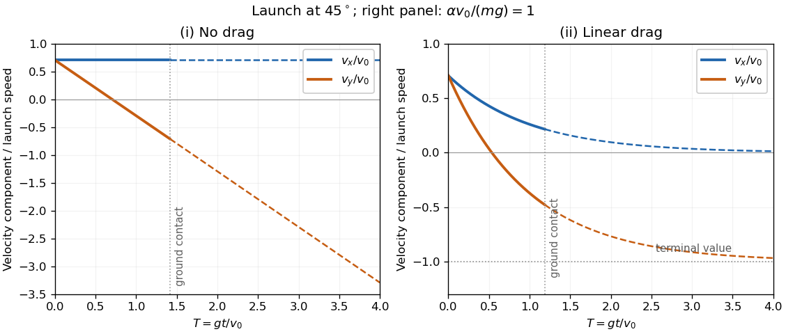

<h1 id="7/ii/solution">Solution</h1>

↑ **Parent:** [Ii](../ii.md)

For positive [linear drag](../../../../linear-drag.md), $v_x$ decays exponentially toward zero. The vertical [velocity](../../../../velocity.md) decreases monotonically toward $-mg/\alpha$, with an initially steeper gradient $-g-(\alpha/m)v_0\sin\theta$ and positive second [time derivative](../../../../time-derivative.md) for an upward launch. It crosses zero at

$$
\boxed{t_{\rm top}=\frac m\alpha\ln\left(1+\frac{\alpha v_0\sin\theta}{mg}\right).}
$$

The right panel shows the two components and the formal [terminal velocity](../../../../terminal-velocity.md). To identify the end of the physical flight, integrate the vertical [velocity](../../../../velocity.md) once:

$$
y(t)=\tau_d(v_0\sin\theta+g\tau_d)(1-e^{-t/\tau_d})-g\tau_dt.
$$

The first positive root of $y(t)=0$ is ground contact. The [terminal velocity](../../../../terminal-velocity.md) need not be reached before that event; dashed portions in the sketch are mathematical extensions without a ground surface.

**[Figure 1](#7/ii/image-projectile-velocity-components-with-and-without-linear-drag). Projectile velocity components with and without linear drag**. An illustrative launch at $45^\circ$, with dimensionless time $T=gt/v_0$. The right panel uses $\alpha v_0/(mg)=1$. Solid curves end at the first return to the launch height; dashed curves show the free-flight continuation.

## ↑ Ancestors (12)

1. [Ii](../ii.md)
2. [7](../../7.md)
3. [2017](../../../2017-split.md)
4. [Past exam of the physics 1 paper of the University of Oxford](../../../split.md)
5. [Physics 1 paper of the University of Oxford](../../../../physics-1-paper-of-the-university-of-oxford.md)
6. [Year 1 of the physics course of the University of Oxford](../../../../year-1-of-the-physics-course-of-the-university-of-oxford.md)
7. [Physics course of the University of Oxford](../../../../physics-course-of-the-university-of-oxford.md)
8. [Undergraduate course of the University of Oxford](../../../../undergraduate-course-of-the-university-of-oxford.md)
9. [Course of the University of Oxford](../../../../course-of-the-university-of-oxford.md)
10. [University of Oxford](../../../../university-of-oxford-split.md)
11. [List of universities](../../../../list-of-universities.md)
12. [Codex Wiki](../../../../split.md)
