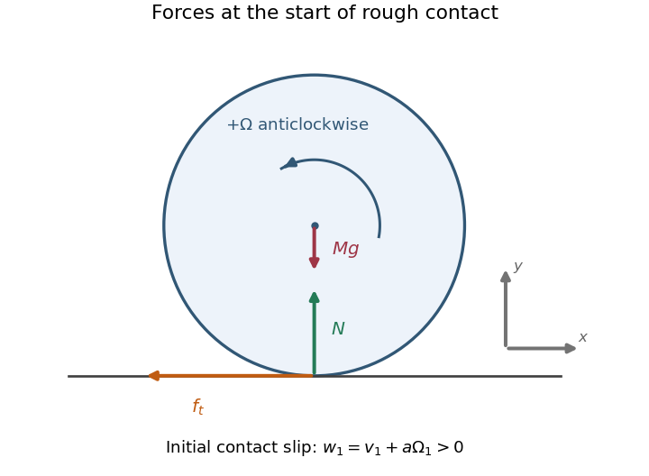

<h1 id="8/c/solution">Solution</h1>

↑ **Parent:** [C](../c.md)

Choose positive horizontal [velocity](../../../../velocity.md) to the right and positive spin [angular velocity](../../../../angular-velocity.md) anticlockwise, as in the source drawing. At the bottom of the sphere, the rotational [velocity](../../../../velocity.md) is then to the right: the initial tangential [contact-point velocity](../../../../contact-point-velocity.md) is

$$
w_1=v_1+a\Omega_1.
$$

For the illustrated positive $v_1,\Omega_1$, the contact slips to the right, so the tangential contact [force](../../../../force-split.md) acts leftward. The upward [normal force](../../../../normal-force.md) acts through the sphere centre and produces no spin [torque](../../../../torque.md). The tangential contact [force](../../../../force-split.md) acts at lever arm $a$ and produces a clockwise [torque](../../../../torque.md), reducing the positive spin. The weight acts vertically downward through the [centre of mass](../../../../center-of-mass.md).

During the short impact the contact [impulses](../../../../impulse.md) dominate the weight's [impulse](../../../../impulse.md). In an ideal elastic rough contact, the tangential deformation can store and return [energy](../../../../energy-split.md); its contact [force](../../../../force-split.md) need not be a dissipative sliding-friction law throughout the collision. For other signed incoming states, reverse the initial tangential [force](../../../../force-split.md) if $w_1<0$; if $w_1=0$, no tangential [impulse](../../../../impulse.md) is required.

**[Figure 2](#8/c/image-contact-forces-and-spin-convention-for-the-rough-elastic-sphere). Contact forces and spin convention for the rough elastic sphere**. The arrows depict the initial contact tendency for $v_1+a\Omega_1>0$. The normal contact force has zero spin torque, whereas a leftward tangential contact force produces clockwise torque about the centre.

## ↑ Ancestors (12)

1. [C](../c.md)
2. [8](../../8.md)
3. [2017](../../../2017-split.md)
4. [Past exam of the physics 1 paper of the University of Oxford](../../../split.md)
5. [Physics 1 paper of the University of Oxford](../../../../physics-1-paper-of-the-university-of-oxford.md)
6. [Year 1 of the physics course of the University of Oxford](../../../../year-1-of-the-physics-course-of-the-university-of-oxford.md)
7. [Physics course of the University of Oxford](../../../../physics-course-of-the-university-of-oxford.md)
8. [Undergraduate course of the University of Oxford](../../../../undergraduate-course-of-the-university-of-oxford.md)
9. [Course of the University of Oxford](../../../../course-of-the-university-of-oxford.md)
10. [University of Oxford](../../../../university-of-oxford-split.md)
11. [List of universities](../../../../list-of-universities.md)
12. [Codex Wiki](../../../../split.md)
