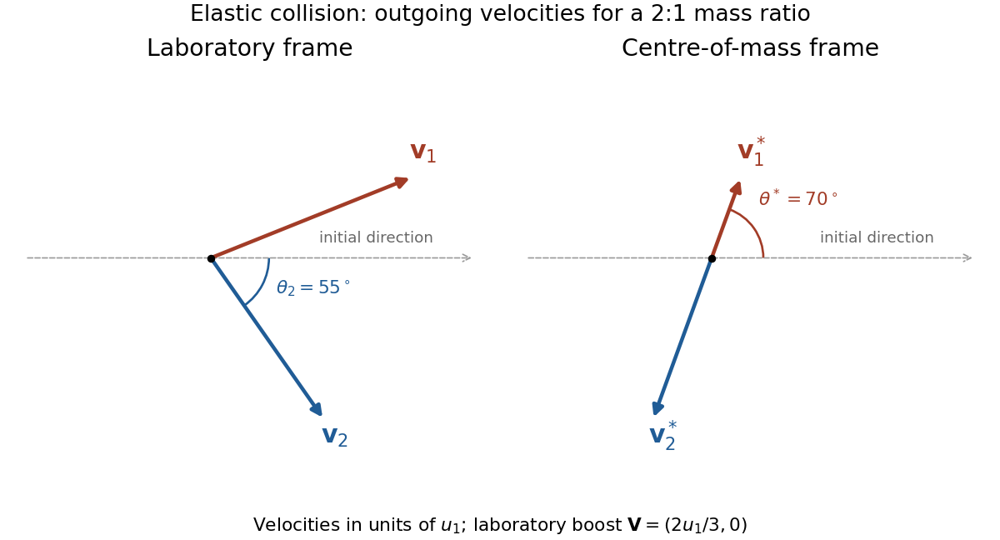
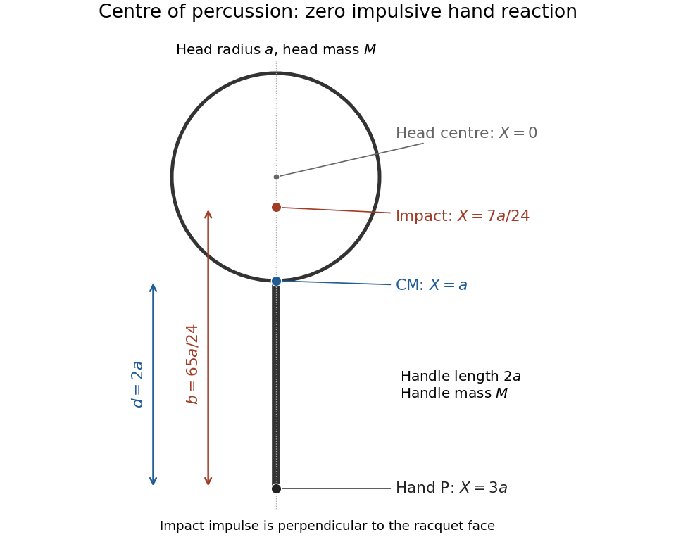

# 2018

↑ **Parent:** [Past exam of the physics 1 paper of the University of Oxford](../past-exam-of-the-physics-1-paper-of-the-university-of-oxford.md)

Source paper: [Oxford public source archive](https://www.whatdotheyknow.com/request/physics_preliminary_past_papers/response/2680788/attach/2/2014%202017%20Physics%20Prelim.zip?cookie_passthrough=1). The archive member is named `2017/T/a10287w1.pdf`, but the held cover identifies CP1, 4 June 2018; the year follows that cover. All Section B options are solved.

**Table of contents**

- [1](#1)
  - [Solution](#1/solution)
- [2](#2)
  - [Solution](#2/solution)
- [3](#3)
  - [Solution](#3/solution)
- [4](#4)
  - [Solution](#4/solution)
- [5](#5)
  - [Solution](#5/solution)
- [6](#6)
  - [Solution](#6/solution)
- [7](#7)
  - [Solution](#7/solution)
  - [a](#7/a)
    - [Solution](#7/a/solution)
  - [b](#7/b)
    - [Solution](#7/b/solution)
  - [c](#7/c)
    - [Solution](#7/c/solution)
- [8](#8)
  - [Solution](#8/solution)
- [9](#9)
  - [Solution](#9/solution)
  - [i](#9/i)
    - [Solution](#9/i/solution)
  - [ii](#9/ii)
    - [Solution](#9/ii/solution)
- [10](#10)
  - [a](#10/a)
    - [Solution](#10/a/solution)
  - [b](#10/b)
    - [Solution](#10/b/solution)

## 1

↑ **Parent:** [2018](2018.md)

<h3 id="1/solution">Solution</h3>

↑ **Parent:** [1](#1)

For ordinary conservative [classical mechanics](../classical-mechanics.md), the [Lagrangian](../calculus-of-variations.md#lagrangian) is $L(q,\dot q,t)=T-V$, where $T$ is the [kinetic energy](../energy.md#kinetic-energy) and $V$ the [potential energy](../energy.md#potential-energy). More generally it is the function whose [action](../lagrangian-mechanics.md#action) $\int L\,dt$ satisfies the [principle of stationary action](../lagrangian-mechanics.md#principle-of-stationary-action). The [canonical momenta](../hamiltonian-mechanics.md#canonical-momentum) and [Hamiltonian](../hamiltonian-mechanics.md#hamiltonian) are

$$
p_i=\frac{\partial L}{\partial\dot q_i},\qquad
\boxed{H(q,p,t)=\sum_i p_i\dot q_i-L(q,\dot q,t).}
$$

For a [regular Lagrangian](../classical-mechanics.md#regular-lagrangian), the first equations can be inverted to express the [generalized velocities](../lagrangian-mechanics.md#generalized-velocity) in terms of $q,p,t$; this defines the [Legendre transform](../convex-optimization.md#convex-conjugate) on [phase space](../hamiltonian-mechanics.md#phase-space).

Along a solution of the [Euler-Lagrange equations](../analysis.md#euler-lagrange-equation), $\dot p_i=\partial L/\partial q_i$. Taking a total [time derivative](../multivariable-calculus.md#time-derivative) gives

$$
\begin{aligned}
\frac{dH}{dt}
&=\sum_i\left(\dot p_i\dot q_i+p_i\ddot q_i\right)
-\sum_i\left(\frac{\partial L}{\partial q_i}\dot q_i+
\frac{\partial L}{\partial\dot q_i}\ddot q_i\right)
-\frac{\partial L}{\partial t}\\
&=-\frac{\partial L}{\partial t}.
\end{aligned}
$$

Thus an autonomous [Lagrangian](../calculus-of-variations.md#lagrangian) has

$$
\boxed{\frac{dH}{dt}=0.}
$$

For the usual time-independent mechanical coordinates and a velocity-independent [potential energy](../energy.md#potential-energy), the [kinetic energy](../energy.md#kinetic-energy) is quadratic in the [generalized velocities](../lagrangian-mechanics.md#generalized-velocity), so $\sum_i p_i\dot q_i=2T$ and $H=T+V$. The conservation proof itself uses the [Euler-Lagrange equations](../analysis.md#euler-lagrange-equation), rather than assuming this special expression for [energy](../energy.md).

## 2

↑ **Parent:** [2018](2018.md)

<h3 id="2/solution">Solution</h3>

↑ **Parent:** [2](#2)

Take the [rocket exhaust speed](../momentum.md#rocket-exhaust-speed) $u$ relative to the hovering ship, with exhaust directed vertically downward. If $\alpha=-\dot M>0$ is the [mass flow rate](../fluid-mechanics.md#mass-flow-rate), the upward [rocket thrust](../momentum.md#rocket-thrust) is $u\alpha$. For example, over a short interval $dt$, the expelled mass $\alpha dt$ acquires downward [momentum](../momentum.md) $-u\alpha dt$, giving the opposite recoil to the ship. Balancing its weight requires

$$
u\alpha(t)=M(t)g,\qquad\frac{dM}{dt}=-\frac gu M.
$$

Solving this [differential equation](../differential-equation.md) with $M(0)=M_0$ yields the [hovering rocket mass flow](../momentum.md#hovering-rocket-mass-flow)

$$
\boxed{M(t)=M_0e^{-gt/u},\qquad
\alpha(t)=\frac{gM_0}{u}e^{-gt/u}.}
$$

The required [mass flow rate](../fluid-mechanics.md#mass-flow-rate) decreases because the mass to support decreases. These expressions apply while fuel is available and $g,u$ remain constant. If the [rocket dry mass](../momentum.md#rocket-dry-mass) is $M_d>0$, hovering ends at $t=(u/g)\log(M_0/M_d)$; the mathematical limit $M\to0$ is not a model of an indefinitely fuelled physical ship.

## 3

↑ **Parent:** [2018](2018.md)

<h3 id="3/solution">Solution</h3>

↑ **Parent:** [3](#3)

Let $\theta$ be the displacement from the upward vertical and $v$ the [speed](../classical-mechanics.md#speed) of the ball's [centre of mass](../classical-mechanics.md#center-of-mass). Its centre follows a circle of radius $R+r$. The [rolling without slipping](../rigid-body-dynamics.md#rolling-without-slipping) constraint is $v=r\omega$, with $\omega$ the ball's spin [angular velocity](../rigid-body-dynamics.md#angular-velocity). The static contact [friction](../newtonian-mechanics.md#friction) does no work on the ball because the instantaneous contact point is stationary. Thus [conservation of energy](../mathematical-physics.md#conservation-of-energy) gives

$$
Mg(R+r)(1-\cos\theta)
=\frac12Mv^2+\frac12\left(\frac25Mr^2\right)\frac{v^2}{r^2}
=\frac7{10}Mv^2.
$$

Project [Newton's second law](../force.md#newton-s-second-law) toward the hemisphere's centre. The inward component of gravity is $Mg\cos\theta$ and the [normal force](../force.md#normal-force) $N$ points outward, so

$$
Mg\cos\theta-N=\frac{Mv^2}{R+r}.
$$

At contact loss $N=0$. Eliminating $v$ gives the ideal [sphere rolling off a hemisphere](../rigid-body-dynamics.md#sphere-rolling-off-a-hemisphere) result

$$
\frac{10}{7}(1-\cos\theta_d)=\cos\theta_d,
\qquad
\boxed{\cos\theta_d=\frac{10}{17},\quad\theta_d\simeq53.97^\circ.}
$$

The radius cancels, so replacing $R+r$ by $R$ under the stated small-ball approximation leaves the same answer.

**Finite-friction qualification.** This is an ideal rolling-constraint result. It does not describe uninterrupted pure rolling to detachment with any finite [coefficient of static friction](../force.md#coefficient-of-static-friction). The tangential [force](../force.md) and [torque](../momentum.md#torque) equations give

$$
M\dot v=Mg\sin\theta-f,\qquad
fr=\frac25Mr^2\frac{\dot v}{r},
$$

so $f=(2/7)Mg\sin\theta$ acts uphill, whereas

$$
N=\frac{Mg}{7}(17\cos\theta-10).
$$

Consequently the required ratio is

$$
\boxed{\frac fN=\frac{2\sin\theta}{17\cos\theta-10}\longrightarrow\infty
\quad\text{as }\theta\to\theta_d^-.}
$$

For a concrete example, a [coefficient of static friction](../force.md#coefficient-of-static-friction) of one allows rolling only up to about $47.54^\circ$, where $17\cos\theta-10=2\sin\theta$, before sliding begins. A subsequent physical contact-loss angle needs a sliding-friction model. The boxed $53.97^\circ$ answers the source's expressly imposed no-slip idealization.

## 4

↑ **Parent:** [2018](2018.md)

<h3 id="4/solution">Solution</h3>

↑ **Parent:** [4](#4)

Choose the initial incident [velocity](../classical-mechanics.md#velocity) as $u_1\hat{\mathbf x}$. The [centre-of-mass velocity](../classical-mechanics.md#center-of-mass-velocity) in the [laboratory frame](../mathematical-physics.md#laboratory-frame) is

$$
\mathbf V=\frac{m_1u_1}{m_1+m_2}\hat{\mathbf x}.
$$

In the [centre-of-mass frame](../special-relativity.md#center-of-momentum-frame), the initial [velocities](../classical-mechanics.md#velocity) are $\mathbf u_1^*=m_2u_1\hat{\mathbf x}/(m_1+m_2)$ and $\mathbf u_2^*=-m_1u_1\hat{\mathbf x}/(m_1+m_2)$. Conservation of [momentum](../momentum.md) and [kinetic energy](../energy.md#kinetic-energy) in an [elastic collision](../classical-mechanics.md#elastic-collision) preserves these two [speed](../classical-mechanics.md#speed) magnitudes. Let $\theta^*$ be the outgoing angle of particle 1 in that frame, measured from the initial positive $x$ direction. Then

$$
\mathbf v_1^*=\frac{m_2u_1}{m_1+m_2}(\cos\theta^*,\sin\theta^*),\qquad
\mathbf v_2^*=-\frac{m_1u_1}{m_1+m_2}(\cos\theta^*,\sin\theta^*).
$$

Adding $\mathbf V$ to transform back to the [laboratory frame](../mathematical-physics.md#laboratory-frame) gives

$$
\mathbf v_1=\frac{u_1}{m_1+m_2}(m_1+m_2\cos\theta^*,m_2\sin\theta^*),\qquad
\mathbf v_2=\frac{m_1u_1}{m_1+m_2}(1-\cos\theta^*,-\sin\theta^*).
$$

The nonnegative laboratory recoil angle $\theta_2$ is measured below the incident axis in this choice of scattering plane. Hence the [recoil angle in a two-body elastic collision](../classical-mechanics.md#recoil-angle-in-a-two-body-elastic-collision) obeys

$$
\boxed{\tan\theta_2=\frac{|v_{2y}|}{v_{2x}}
=\frac{\sin\theta^*}{1-\cos\theta^*}
=\cot\frac{\theta^*}{2},\qquad
\theta_2=\frac{\pi-\theta^*}{2}\quad(0<\theta^*\leq\pi).}
$$

The source identity therefore uses $\theta^*$ for the projectile's outgoing direction in the [centre-of-mass frame](../special-relativity.md#center-of-momentum-frame). If instead it denotes particle 2's outgoing direction, the corresponding expression has $1+\cos\theta^*$ in the denominator. A signed laboratory angle for the drawn target trajectory would carry a minus sign. At zero deflection the target remains at rest, so its direction is undefined; $\theta_2\to\pi/2$ is a limit.

**[Figure 1](#4/image-outgoing-velocity-vectors-in-the-laboratory-and-centre-of-mass-frames). Outgoing velocity vectors in the laboratory and centre-of-mass frames**. An illustrative mass ratio $m_1:m_2=2:1$ and projectile deflection $\theta^*=70^\circ$ display the angle conventions. The two outgoing [momenta](../momentum.md) cancel in the [centre-of-mass frame](../special-relativity.md#center-of-momentum-frame), although the velocity magnitudes differ. Adding the common boost $\mathbf V$ gives the laboratory vectors.

## 5

↑ **Parent:** [2018](2018.md)

<h3 id="5/solution">Solution</h3>

↑ **Parent:** [5](#5)

For a [Lorentz transformation](../special-relativity.md#lorentz-transformation) with $S'$ moving at $+v$ along $x$ relative to $S$,

$$
x'=\gamma(x-vt),\qquad y'=y,\qquad
t'=\gamma\left(t-\frac{vx}{c^2}\right),\qquad
\gamma=(1-v^2/c^2)^{-1/2}.
$$

Differentiate along the object's trajectory and divide the spatial differentials by $dt'$. Using $u_x=dx/dt$ and $u_y=dy/dt$ derives the [relativistic velocity-addition formula](../special-relativity.md#velocity-addition-formula):

$$
\boxed{u'_x=\frac{u_x-v}{1-u_xv/c^2},\qquad
u'_y=\frac{u_y}{\gamma(1-u_xv/c^2)}.}
$$

In the rest frame of ship A, take $v=c/2$ and the Earth-frame [velocity](../classical-mechanics.md#velocity) of B as $(0,-c/2)$. Here $\gamma=2/\sqrt3$ and the common denominator is one, so

$$
u'_{Bx}=-\frac c2,\qquad u'_{By}=-\frac{\sqrt3}{4}c.
$$

The required relative [speed](../classical-mechanics.md#speed) is the magnitude of this two-component [velocity](../classical-mechanics.md#velocity), not either component separately:

$$
\boxed{|\mathbf u'_B|=c\sqrt{\frac14+\frac3{16}}=\frac{\sqrt7}{4}c\simeq0.6614c.}
$$

The inverse [Lorentz factor](../special-relativity.md#lorentz-factor) check is $\gamma_{AB}=\gamma_A\gamma_B(1-\mathbf u_A\cdot\mathbf u_B/c^2)=4/3$, which gives the same relative [speed](../classical-mechanics.md#speed).

## 6

↑ **Parent:** [2018](2018.md)

<h3 id="6/solution">Solution</h3>

↑ **Parent:** [6](#6)

Interpret the quoted muon [energy](../energy.md) as total [relativistic energy](../special-relativity.md#relativistic-energy), and neglect energy loss in the atmosphere. The [Lorentz factor](../special-relativity.md#lorentz-factor), [speed](../classical-mechanics.md#speed) and Earth-frame [travel time](../dispersion-relation.md#travel-time) are

$$
\gamma=\frac{6000\,\mathrm{MeV}}{106\,\mathrm{MeV}}=56.60,\qquad
\beta=\sqrt{1-\gamma^{-2}}=0.999844,\qquad
t=\frac{h}{\beta c}.
$$

The [muon decay](../standard-model.md#muon-decay) law is exponential in [proper time](../special-relativity.md#proper-time). Equivalently, [time dilation](../special-relativity.md#time-dilation) makes the Earth-frame mean lifetime $\gamma\tau_0$. The [exponential survival probability](../probability-distribution.md#exponential-survival-probability) over the flight is

$$
P=\exp\!\left(-\frac{t}{\gamma\tau_0}\right)
=\exp\!\left(-\frac{h}{c\tau_0\sqrt{\gamma^2-1}}\right).
$$

With $h=15000\,\mathrm m$ and $\tau_0=2.2\times10^{-6}\,\mathrm s$, the elapsed [proper time](../special-relativity.md#proper-time) is $8.841\times10^{-7}\,\mathrm s$. Therefore

$$
\boxed{P\simeq e^{-0.40186}\simeq0.669,\quad\text{about }67\%.}
$$

This uses the stated single incident [energy](../energy.md) and vertical trajectories. If the number were a [kinetic energy](../energy.md#kinetic-energy), one would instead use $\gamma=1+T/(mc^2)$; the distinction is not silently absorbed into the [rest energy](../special-relativity.md#rest-energy).

## 7

↑ **Parent:** [2018](2018.md)

<h3 id="7/solution">Solution</h3>

↑ **Parent:** [7](#7)

The [parallel axis theorem](../rigid-body-dynamics.md#parallel-axis-theorem) relates the [moment of inertia](../rigid-body-dynamics.md#moment-of-inertia) about an axis through the [centre of mass](../classical-mechanics.md#center-of-mass) to that about a parallel axis a perpendicular distance $d$ away:

$$
\boxed{I=I_{\mathrm{CM}}+M_{\mathrm{tot}}d^2.}
$$

To see the cross term vanish, write each perpendicular displacement as its displacement from the [centre of mass](../classical-mechanics.md#center-of-mass) plus the fixed offset. In the defining mass [integral](../integral.md), the first moment about the [centre of mass](../classical-mechanics.md#center-of-mass) is zero.

For a thin planar [rigid body](../rigid-body-dynamics.md) in the $xy$ plane, the [perpendicular axis theorem](../rigid-body-dynamics.md#perpendicular-axis-theorem) says

$$
\boxed{I_z=I_x+I_y,}
$$

where all three axes pass through the same point, $x,y$ lie in the plane, and $z$ is perpendicular to it. This follows directly from $x^2+y^2$ being the squared distance from the $z$ axis. The thin-planar condition and common intersection point are essential; the formula is not a general identity for three-dimensional bodies.

<h3 id="7/a">a</h3>

↑ **Parent:** [7](#7)

<h4 id="7/a/solution">Solution</h4>

↑ **Parent:** [A](#7/a)

Let $X$ increase along the handle, with zero at the centre of the circular head. The ring has its [centre of mass](../classical-mechanics.md#center-of-mass) at $X=0$. The rod occupies $a\leq X\leq a+l$, so its [centre of mass](../classical-mechanics.md#center-of-mass) is at $a+l/2$. The mass-weighted mean is therefore

$$
\boxed{X_{\mathrm{CM}}=\frac{M_l(a+l/2)}{M_a+M_l}.}
$$

This uses the source diagram's rim-to-end handle length $l$, not a rod beginning at the head's centre.

<h3 id="7/b">b</h3>

↑ **Parent:** [7](#7)

<h4 id="7/b/solution">Solution</h4>

↑ **Parent:** [B](#7/b)

The [moment of inertia](../rigid-body-dynamics.md#moment-of-inertia) of a uniform thin ring about its perpendicular central axis is $M_aa^2$. Its two in-plane diameters are equivalent by [rotational symmetry](../linear-algebra.md#rotational-symmetry), so the [perpendicular axis theorem](../rigid-body-dynamics.md#perpendicular-axis-theorem) gives $M_aa^2/2$ about either diameter. The central rod contribution about an axis perpendicular to its length is $M_ll^2/12$.

The requested axis is parallel to these central axes and passes through the whole racquet's [centre of mass](../classical-mechanics.md#center-of-mass). Applying the [parallel axis theorem](../rigid-body-dynamics.md#parallel-axis-theorem) separately gives

$$
\boxed{I_{\mathrm{CM}}=\frac12M_aa^2+M_aX_{\mathrm{CM}}^2
+\frac1{12}M_ll^2+M_l\left(a+\frac l2-X_{\mathrm{CM}}\right)^2.}
$$

An equivalent reduced expression is

$$
I_{\mathrm{CM}}=\frac12M_aa^2+\frac1{12}M_ll^2
+\frac{M_aM_l}{M_a+M_l}\left(a+\frac l2\right)^2.
$$

Both refer to the in-plane axis perpendicular to the handle; the ring contribution would be different for an axis normal to the racquet face.

<h3 id="7/c">c</h3>

↑ **Parent:** [7](#7)

<h4 id="7/c/solution">Solution</h4>

↑ **Parent:** [C](#7/c)

With $M_a=M_l=M$ and $l=2a$, [a](#7/a) gives $X_{\mathrm{CM}}=a$, while the hand point is $P$ at $X=3a$. Thus the hand-to-CM distance is $d=2a$, and [b](#7/b) gives

$$
I_{\mathrm{CM}}=\frac{17}{6}Ma^2,\qquad
I_P=I_{\mathrm{CM}}+2M(2a)^2=\frac{65}{6}Ma^2.
$$

Model the short impact with the hand point fixed but free to rotate about the in-plane axis perpendicular to the handle. Let $K$ be the ball's [impulse](../classical-mechanics.md#impulse) on the racquet and $b$ its distance from $P$ toward the head. Angular [impulse](../classical-mechanics.md#impulse) about $P$ gives $I_P\Omega=Kb$. The fixed-pivot kinematics require the [centre-of-mass velocity](../classical-mechanics.md#center-of-mass-velocity) magnitude to be $d\Omega$. The hand's signed impact [impulse](../classical-mechanics.md#impulse) is consequently

$$
K_P=2M d\Omega-K
=K\left(\frac{2Mdb}{I_P}-1\right).
$$

The [centre of percussion](../rigid-body-dynamics.md#centre-of-percussion) is where $K_P=0$, hence

$$
b=\frac{I_P}{2Md}=\frac{65}{24}a.
$$

Subtract this from the head-centre distance $3a$ to obtain the requested position:

$$
\boxed{X_{\mathrm{hit}}=3a-b=\frac7{24}a\quad\text{toward the handle from the head centre}.}
$$

It lies within the circular head. By symmetry its transverse displacement is zero, so the impact is on the head's central line along the handle. This cancels the impulsive hand reaction, not every force on the hand at later times; weight and any sustained grip torque lie outside the short-impact approximation.

**[Figure 2](#7/c/image-the-centre-of-percussion-lies-inside-the-head-toward-the-handle). The centre of percussion lies inside the head, toward the handle**. The calculated geometry for equal head and handle masses and $l=2a$. The head centre is $X=0$, the complete racquet's [centre of mass](../classical-mechanics.md#center-of-mass) is $X=a$, and the hand is at $X=3a$. The zero-hand-[impulse](../classical-mechanics.md#impulse) impact lies at $X=7a/24$.

## 8

↑ **Parent:** [2018](2018.md)

<h3 id="8/solution">Solution</h3>

↑ **Parent:** [8](#8)

For a differentiable [central potential](../energy.md#central-potential), the [force](../force.md) is $\mathbf F=-V'(r)\hat{\mathbf r}$. The [angular momentum](../momentum.md#angular-momentum) is $\mathbf J=m\mathbf r\times\dot{\mathbf r}$, so

$$
\frac{d\mathbf J}{dt}=\mathbf r\times\mathbf F=0.
$$

This proves [conservation of angular momentum](../momentum.md#conservation-of-angular-momentum). For $J\ne0$, the trajectory lies in the fixed plane perpendicular to $\mathbf J$. In plane [polar coordinates](../multivariable-calculus.md#polar-coordinates), $J=mr^2\dot\phi$. Substituting this into the [kinetic energy](../energy.md#kinetic-energy) gives the radial [energy](../energy.md) equation

$$
E=\frac12m\dot r^2+V_{\mathrm{eff}}(r),\qquad
\boxed{V_{\mathrm{eff}}(r)=V(r)+\frac{J^2}{2mr^2}.}
$$

The second term is the centrifugal contribution to the [effective potential](../mathematical-physics.md#effective-potential). Its radial derivative reproduces $m\ddot r=-V'(r)+J^2/(mr^3)$. Purely radial motion is the $J=0$ case.

For the satellite, write $\mu=GM$, with $M$ Earth's mass and $m$ the satellite's mass. At [apogee](../celestial-mechanics.md#apogee) and [perigee](../celestial-mechanics.md#perigee), the radial [velocity](../classical-mechanics.md#velocity) is zero, so [angular momentum conservation](../momentum.md#conservation-of-angular-momentum) and [conservation of energy](../mathematical-physics.md#conservation-of-energy) give

$$
r_{\mathrm A}v_{\mathrm A}=r_{\mathrm P}v_{\mathrm P},\qquad
\frac12v_{\mathrm A}^2-\frac{\mu}{r_{\mathrm A}}
=\frac12v_{\mathrm P}^2-\frac{\mu}{r_{\mathrm P}}.
$$

Eliminating $v_{\mathrm P}$ yields

$$
v_{\mathrm A}^2=\frac{2\mu r_{\mathrm P}}{r_{\mathrm A}(r_{\mathrm A}+r_{\mathrm P})}.
$$

For an [elliptic orbit](../celestial-mechanics.md#elliptic-orbit), $r_{\mathrm A}+r_{\mathrm P}=2a$. Therefore the [vis-viva equation](../celestial-mechanics.md#vis-viva-equation) at [apogee](../celestial-mechanics.md#apogee) is

$$
\boxed{v_{\mathrm A}^2=GM\left(\frac2{r_{\mathrm A}}-\frac1a\right).}
$$

Substitution into the [orbital energy](../celestial-mechanics.md#orbital-energy) gives $E=-GMm/(2a)$. The circular case follows by continuity, or directly from the radial [force balance](../force.md#force-balance).

An instantaneous tangential retrograde burn at [apogee](../celestial-mechanics.md#apogee) leaves the position unchanged. For the speed change $v\mapsto(1-\epsilon)v$, the [orbital energy](../celestial-mechanics.md#orbital-energy) change is

$$
\Delta E=\frac12m\left((1-\epsilon)^2-1\right)v^2
=-\epsilon mv^2+O(\epsilon^2).
$$

Differentiating $E=-\mu m/(2a)$ gives $\Delta E=\mu m\,\Delta a/(2a^2)$ to first order. Since $r_{\mathrm A}=a(1+e)$, the [vis-viva equation](../celestial-mechanics.md#vis-viva-equation) implies $v^2=\mu(1-e)/[a(1+e)]$. Hence

$$
\Delta a=-2\epsilon a\frac{1-e}{1+e}+O(\epsilon^2),\qquad
\boxed{\text{reduction of the major axis}= -2\Delta a
=4\epsilon a\frac{1-e}{1+e}+O(\epsilon^2).}
$$

The factor of two distinguishes the major axis from the [semimajor axis](../celestial-mechanics.md#semi-major-axis). As a finite-change check, the new [semimajor axis](../celestial-mechanics.md#semi-major-axis) is exactly

$$
a'=\frac{a}{1+(2\epsilon-\epsilon^2)(1-e)/(1+e)},
$$

within the instantaneous-burn, unchanged-mass model. Expanding this expression gives the stated result.

## 9

↑ **Parent:** [2018](2018.md)

<h3 id="9/solution">Solution</h3>

↑ **Parent:** [9](#9)

A [Lorentz invariant](../special-relativity.md#lorentz-invariance) has the same value when the same physical system is described in any inertial frame. The components of its [energy-momentum four-vector](../special-relativity.md#four-momentum) change, but their [Minkowski norm](../special-relativity.md#minkowski-norm) does not. In particular the [relativistic energy-momentum relation](../special-relativity.md#energy-momentum-relation) is

$$
\boxed{E^2-c^2|\mathbf p|^2=M^2c^4,}
$$

where $M$ is the [rest mass](../special-relativity.md#invariant-mass). Individual total [energy](../energy.md) and [momentum](../momentum.md) are frame-dependent; the combination on the left is invariant.

For the fixed-target annihilation, the initial total laboratory [energy](../energy.md) is $E+Mc^2$ and its total [momentum](../momentum.md) is the incident particle's $\mathbf p$, with $c^2p^2=E^2-M^2c^4$. The [centre-of-mass energy](../special-relativity.md#center-of-mass-energy) available for new-particle creation is therefore

$$
\boxed{W=\sqrt{(E+Mc^2)^2-c^2p^2}
=\sqrt{2Mc^2(E+Mc^2)}.}
$$

In the [centre-of-mass frame](../special-relativity.md#center-of-momentum-frame) the total [momentum](../momentum.md) vanishes, so $W$ can supply the new particles' total [rest energy](../special-relativity.md#rest-energy) at threshold. One does not subtract the annihilated particles' original [rest energy](../special-relativity.md#rest-energy). The excess laboratory [energy](../energy.md) beyond $W$ is associated with motion of the whole final system in the [laboratory frame](../mathematical-physics.md#laboratory-frame).

For the subsequent [elastic collision](../classical-mechanics.md#elastic-collision), the equal and opposite transverse components of final [momentum](../momentum.md) imply equal final momentum magnitudes, and hence equal final [energies](../energy.md), for the two identical particles. By [conservation of relativistic energy](../special-relativity.md#conservation-of-relativistic-energy), each has

$$
E_f=Mc^2+\frac T2.
$$

Their final momentum magnitude $p_f$ and the incident momentum magnitude $p_i$ obey

$$
c^2p_f^2=TMc^2+\frac{T^2}{4},\qquad
c^2p_i^2=T^2+2TMc^2.
$$

Longitudinal [momentum conservation](../momentum.md#momentum-conservation) gives $p_i=2p_f\cos\theta$. It follows that the [equal-angle relativistic elastic scattering](../classical-mechanics.md#equal-angle-relativistic-elastic-scattering) relation is

$$
\boxed{\cos^2\theta=\frac{p_i^2}{4p_f^2}
=\frac{T+2Mc^2}{T+4Mc^2}.}
$$

This derivation assumes nonzero incident [kinetic energy](../energy.md#kinetic-energy) and the stated symmetric outgoing paths. The angle between those paths is $2\theta$, which is evaluated in the two following parts.

<h3 id="9/i">i</h3>

↑ **Parent:** [9](#9)

<h4 id="9/i/solution">Solution</h4>

↑ **Parent:** [I](#9/i)

For $T\gg Mc^2$, the result in [9](#9) gives

$$
\sin^2\theta=\frac{2Mc^2}{T+4Mc^2}\simeq\frac{2Mc^2}{T}.
$$

Thus the angle between the outgoing trajectories is

$$
\boxed{2\theta\simeq2\sqrt{\frac{2Mc^2}{T}}\ \mathrm{rad}\longrightarrow0.}
$$

The two particles are strongly concentrated in the forward direction. This relativistic small-angle limit differs from the right-angle separation of equal-mass particles in the low-speed limit.

<h3 id="9/ii">ii</h3>

↑ **Parent:** [9](#9)

<h4 id="9/ii/solution">Solution</h4>

↑ **Parent:** [Ii](#9/ii)

For $0<T\ll Mc^2$, the ratio in [9](#9) tends to $1/2$, giving

$$
\boxed{\theta\longrightarrow45^\circ,\qquad 2\theta\longrightarrow90^\circ.}
$$

This recovers the nonrelativistic equal-mass [elastic collision](../classical-mechanics.md#elastic-collision) result: [momentum conservation](../momentum.md#momentum-conservation) gives $\mathbf v_i=\mathbf v_1+\mathbf v_2$, while conservation of [kinetic energy](../energy.md#kinetic-energy) gives $v_i^2=v_1^2+v_2^2$. Subtracting the squared momentum relation leaves $\mathbf v_1\cdot\mathbf v_2=0$. Exactly at $T=0$ there are no outgoing nonzero velocities defining such angles; the result is the limit through positive [kinetic energies](../energy.md#kinetic-energy).

## 10

↑ **Parent:** [2018](2018.md)

<h3 id="10/a">a</h3>

↑ **Parent:** [10](#10)

<h4 id="10/a/solution">Solution</h4>

↑ **Parent:** [A](#10/a)

Take $x$ positive downward and put zero gravitational [potential energy](../energy.md#potential-energy) at the spring's support. The mass is then a distance $l+x$ below that reference, so $V_g=-mg(l+x)$. [Hooke's law](../elasticity-physics.md#hooke-s-law) gives the elastic [potential energy](../energy.md#potential-energy) $kx^2/2$. Therefore

$$
\boxed{L=\frac12m\dot x^2-\frac12kx^2+mg(l+x).}
$$

The constant term $mgl$ fixes the requested reference but does not affect the motion. The [Euler-Lagrange equation](../analysis.md#euler-lagrange-equation) is

$$
\frac{d}{dt}(m\dot x)-(-kx+mg)=0,
\qquad
\boxed{m\ddot x=mg-kx.}
$$

This is exactly [Newton's second law](../force.md#newton-s-second-law) with gravity downward and spring [force](../force.md) $kx$ upward for positive extension. The static extension is $x_0=mg/k$.

<h3 id="10/b">b</h3>

↑ **Parent:** [10](#10)

<h4 id="10/b/solution">Solution</h4>

↑ **Parent:** [B](#10/b)

For the [elastic pendulum](../lagrangian-mechanics.md#elastic-pendulum), set $r=l+x>0$ and measure $\theta$ from the downward vertical. In the vertical plane, Cartesian coordinates are $X=r\sin\theta$ and $Z=-r\cos\theta$, with $Z$ upward. Differentiating gives $\dot X^2+\dot Z^2=\dot x^2+r^2\dot\theta^2$. Thus the [Lagrangian](../calculus-of-variations.md#lagrangian) is

$$
\boxed{L=\frac12m\left(\dot x^2+(l+x)^2\dot\theta^2\right)
-\frac12kx^2+mg(l+x)\cos\theta.}
$$

For $x$, the [Euler-Lagrange equation](../analysis.md#euler-lagrange-equation) gives

$$
\boxed{m\ddot x=m(l+x)\dot\theta^2-kx+mg\cos\theta.}
$$

For $\theta$, the [canonical momentum](../hamiltonian-mechanics.md#canonical-momentum) is $p_\theta=m(l+x)^2\dot\theta$. Its [Euler-Lagrange equation](../analysis.md#euler-lagrange-equation) is

$$
\frac{d}{dt}\left[m(l+x)^2\dot\theta\right]+mg(l+x)\sin\theta=0,
$$

or, for positive length,

$$
\boxed{(l+x)\ddot\theta+2\dot x\dot\theta+g\sin\theta=0.}
$$

At an [equilibrium](../dynamical-systems.md#equilibrium-point-of-a-dynamical-system), all time derivatives vanish, so $kx=mg\cos\theta$ and $\sin\theta=0$. Modulo full rotations, the two formal possibilities are

$$
\boxed{(x,\theta)=\left(\frac{mg}{k},0\right),\qquad
(x,\theta)=\left(-\frac{mg}{k},\pi\right).}
$$

The lower configuration always has positive length. The upper one is a physical straight-spring configuration only if $l>mg/k$. For example, $l=mg/(2k)$ would give the purported upper state a negative length $-mg/(2k)$; at $l=mg/k$ its zero length makes the angular coordinate singular. Also, the straight compressed spring is an idealization; a real unsupported compressed spring can buckle.

The [potential energy](../energy.md#potential-energy) is $V=kx^2/2-mg(l+x)\cos\theta$. At either formal stationary point its mixed second derivative vanishes, while

$$
V_{xx}=k,\qquad V_{\theta\theta}=mg(l+x)\cos\theta.
$$

Both curvatures are positive at the lower state, making it a [stable equilibrium](../dynamical-systems.md#stable-equilibrium); the upper state, when it has positive length, has negative angular curvature and is unstable.

To linearize about the stable state, define the small displacement $\xi=x-mg/k$, not $x$ itself, and $r_0=l+mg/k$. Products such as $\dot\theta^2$, $\dot\xi\dot\theta$ and $\xi\ddot\theta$ are second order, while $\cos\theta=1+O(\theta^2)$ and $\sin\theta=\theta+O(\theta^3)$. The first-order [equations of motion](../classical-mechanics.md#equation-of-motion) therefore decouple:

$$
\boxed{\ddot\xi+\frac{k}{m}\xi=0,\qquad
\ddot\theta+\frac{g}{l+mg/k}\theta=0.}
$$

There are two independent [normal modes](../wave-equation.md#normal-mode). The radial one is vertical [simple harmonic motion](../classical-mechanics.md#simple-harmonic-motion) with [angular frequency](../lagrangian-mechanics.md#angular-frequency) $\omega_r=\sqrt{k/m}$. The transverse one is a [simple pendulum](../simple-pendulum.md) oscillation at fixed, statically stretched length $r_0$, with [angular frequency](../lagrangian-mechanics.md#angular-frequency) $\omega_\theta=\sqrt{g/r_0}$. Their decoupling is a first-order small-oscillation result, not an assertion about the nonlinear motion of the [elastic pendulum](../lagrangian-mechanics.md#elastic-pendulum).

## ↑ Ancestors (9)

1. [Past exam of the physics 1 paper of the University of Oxford](../past-exam-of-the-physics-1-paper-of-the-university-of-oxford.md)
2. [Physics 1 paper of the University of Oxford](../university-of-oxford.md#physics-1-paper-of-the-university-of-oxford)
3. [Year 1 of the physics course of the University of Oxford](../university-of-oxford.md#year-1-of-the-physics-course-of-the-university-of-oxford)
4. [Physics course of the University of Oxford](../university-of-oxford.md#physics-course-of-the-university-of-oxford)
5. [Undergraduate course of the University of Oxford](../university-of-oxford.md#undergraduate-course-of-the-university-of-oxford)
6. [Course of the University of Oxford](../university-of-oxford.md#course-of-the-university-of-oxford)
7. [University of Oxford](../university-of-oxford.md)
8. [List of universities](../README.md#list-of-universities)
9. [Codex Wiki](../README.md)
