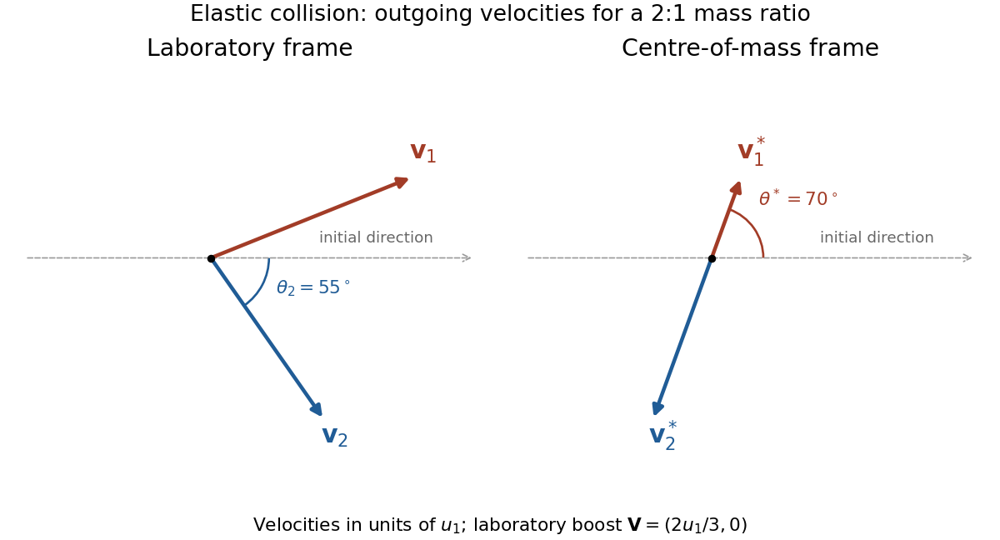

<h1 id="4/solution">Solution</h1>

↑ **Parent:** [4](../4.md)

Choose the initial incident [velocity](../../../velocity.md) as $u_1\hat{\mathbf x}$. The [centre-of-mass velocity](../../../center-of-mass-velocity.md) in the [laboratory frame](../../../laboratory-frame.md) is

$$
\mathbf V=\frac{m_1u_1}{m_1+m_2}\hat{\mathbf x}.
$$

In the [centre-of-mass frame](../../../center-of-momentum-frame.md), the initial [velocities](../../../velocity.md) are $\mathbf u_1^*=m_2u_1\hat{\mathbf x}/(m_1+m_2)$ and $\mathbf u_2^*=-m_1u_1\hat{\mathbf x}/(m_1+m_2)$. Conservation of [momentum](../../../momentum-split.md) and [kinetic energy](../../../kinetic-energy.md) in an [elastic collision](../../../elastic-collision.md) preserves these two [speed](../../../speed.md) magnitudes. Let $\theta^*$ be the outgoing angle of particle 1 in that frame, measured from the initial positive $x$ direction. Then

$$
\mathbf v_1^*=\frac{m_2u_1}{m_1+m_2}(\cos\theta^*,\sin\theta^*),\qquad
\mathbf v_2^*=-\frac{m_1u_1}{m_1+m_2}(\cos\theta^*,\sin\theta^*).
$$

Adding $\mathbf V$ to transform back to the [laboratory frame](../../../laboratory-frame.md) gives

$$
\mathbf v_1=\frac{u_1}{m_1+m_2}(m_1+m_2\cos\theta^*,m_2\sin\theta^*),\qquad
\mathbf v_2=\frac{m_1u_1}{m_1+m_2}(1-\cos\theta^*,-\sin\theta^*).
$$

The nonnegative laboratory recoil angle $\theta_2$ is measured below the incident axis in this choice of scattering plane. Hence the [recoil angle in a two-body elastic collision](../../../recoil-angle-in-a-two-body-elastic-collision.md) obeys

$$
\boxed{\tan\theta_2=\frac{|v_{2y}|}{v_{2x}}
=\frac{\sin\theta^*}{1-\cos\theta^*}
=\cot\frac{\theta^*}{2},\qquad
\theta_2=\frac{\pi-\theta^*}{2}\quad(0<\theta^*\leq\pi).}
$$

The source identity therefore uses $\theta^*$ for the projectile's outgoing direction in the [centre-of-mass frame](../../../center-of-momentum-frame.md). If instead it denotes particle 2's outgoing direction, the corresponding expression has $1+\cos\theta^*$ in the denominator. A signed laboratory angle for the drawn target trajectory would carry a minus sign. At zero deflection the target remains at rest, so its direction is undefined; $\theta_2\to\pi/2$ is a limit.

**[Figure 1](#4/image-outgoing-velocity-vectors-in-the-laboratory-and-centre-of-mass-frames). Outgoing velocity vectors in the laboratory and centre-of-mass frames**. An illustrative mass ratio $m_1:m_2=2:1$ and projectile deflection $\theta^*=70^\circ$ display the angle conventions. The two outgoing [momenta](../../../momentum-split.md) cancel in the [centre-of-mass frame](../../../center-of-momentum-frame.md), although the velocity magnitudes differ. Adding the common boost $\mathbf V$ gives the laboratory vectors.

## ↑ Ancestors (11)

1. [4](../4.md)
2. [2018](../../2018-split.md)
3. [Past exam of the physics 1 paper of the University of Oxford](../../split.md)
4. [Physics 1 paper of the University of Oxford](../../../physics-1-paper-of-the-university-of-oxford.md)
5. [Year 1 of the physics course of the University of Oxford](../../../year-1-of-the-physics-course-of-the-university-of-oxford.md)
6. [Physics course of the University of Oxford](../../../physics-course-of-the-university-of-oxford.md)
7. [Undergraduate course of the University of Oxford](../../../undergraduate-course-of-the-university-of-oxford.md)
8. [Course of the University of Oxford](../../../course-of-the-university-of-oxford.md)
9. [University of Oxford](../../../university-of-oxford-split.md)
10. [List of universities](../../../list-of-universities.md)
11. [Codex Wiki](../../../split.md)
