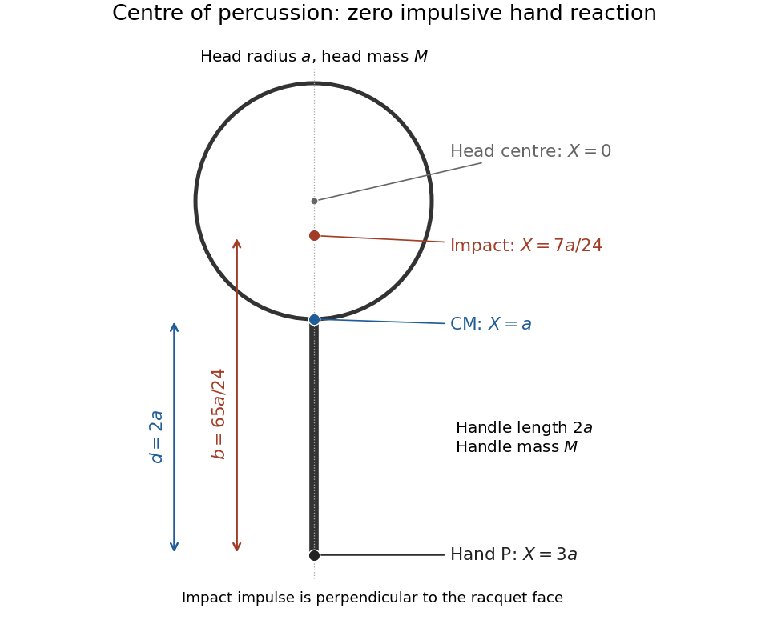

<h1 id="7/c/solution">Solution</h1>

↑ **Parent:** [C](../c.md)

With $M_a=M_l=M$ and $l=2a$, [a](../a.md) gives $X_{\mathrm{CM}}=a$, while the hand point is $P$ at $X=3a$. Thus the hand-to-CM distance is $d=2a$, and [b](../b.md) gives

$$
I_{\mathrm{CM}}=\frac{17}{6}Ma^2,\qquad
I_P=I_{\mathrm{CM}}+2M(2a)^2=\frac{65}{6}Ma^2.
$$

Model the short impact with the hand point fixed but free to rotate about the in-plane axis perpendicular to the handle. Let $K$ be the ball's [impulse](../../../../impulse.md) on the racquet and $b$ its distance from $P$ toward the head. Angular [impulse](../../../../impulse.md) about $P$ gives $I_P\Omega=Kb$. The fixed-pivot kinematics require the [centre-of-mass velocity](../../../../center-of-mass-velocity.md) magnitude to be $d\Omega$. The hand's signed impact [impulse](../../../../impulse.md) is consequently

$$
K_P=2M d\Omega-K
=K\left(\frac{2Mdb}{I_P}-1\right).
$$

The [centre of percussion](../../../../centre-of-percussion.md) is where $K_P=0$, hence

$$
b=\frac{I_P}{2Md}=\frac{65}{24}a.
$$

Subtract this from the head-centre distance $3a$ to obtain the requested position:

$$
\boxed{X_{\mathrm{hit}}=3a-b=\frac7{24}a\quad\text{toward the handle from the head centre}.}
$$

It lies within the circular head. By symmetry its transverse displacement is zero, so the impact is on the head's central line along the handle. This cancels the impulsive hand reaction, not every force on the hand at later times; weight and any sustained grip torque lie outside the short-impact approximation.

**[Figure 2](#7/c/image-the-centre-of-percussion-lies-inside-the-head-toward-the-handle). The centre of percussion lies inside the head, toward the handle**. The calculated geometry for equal head and handle masses and $l=2a$. The head centre is $X=0$, the complete racquet's [centre of mass](../../../../center-of-mass.md) is $X=a$, and the hand is at $X=3a$. The zero-hand-[impulse](../../../../impulse.md) impact lies at $X=7a/24$.

## ↑ Ancestors (12)

1. [C](../c.md)
2. [7](../../7.md)
3. [2018](../../../2018-split.md)
4. [Past exam of the physics 1 paper of the University of Oxford](../../../split.md)
5. [Physics 1 paper of the University of Oxford](../../../../physics-1-paper-of-the-university-of-oxford.md)
6. [Year 1 of the physics course of the University of Oxford](../../../../year-1-of-the-physics-course-of-the-university-of-oxford.md)
7. [Physics course of the University of Oxford](../../../../physics-course-of-the-university-of-oxford.md)
8. [Undergraduate course of the University of Oxford](../../../../undergraduate-course-of-the-university-of-oxford.md)
9. [Course of the University of Oxford](../../../../course-of-the-university-of-oxford.md)
10. [University of Oxford](../../../../university-of-oxford-split.md)
11. [List of universities](../../../../list-of-universities.md)
12. [Codex Wiki](../../../../split.md)
