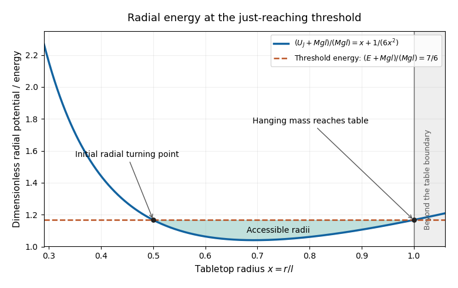

# 2019 resit

↑ **Parent:** [Past exam of the physics 1 paper of the University of Oxford](../past-exam-of-the-physics-1-paper-of-the-university-of-oxford.md)

Source paper: [https://www.whatdotheyknow.com/request/physics_past_papers_21/response/3037379/attach/2/FOI%20202505%20441%20Response.pdf?cookie_passthrough=1](https://www.whatdotheyknow.com/request/physics_past_papers_21/response/3037379/attach/2/FOI%20202505%20441%20Response.pdf?cookie_passthrough=1)

**Table of contents**

- [1](#1)
  - [Solution](#1/solution)
- [2](#2)
  - [Solution](#2/solution)
- [3](#3)
  - [Solution](#3/solution)
- [4](#4)
  - [Solution](#4/solution)
- [5](#5)
  - [Solution](#5/solution)
- [6](#6)
  - [Solution](#6/solution)
- [7](#7)
  - [Solution](#7/solution)
- [8](#8)
  - [Solution](#8/solution)
  - [i](#8/i)
    - [Solution](#8/i/solution)
  - [ii](#8/ii)
    - [Solution](#8/ii/solution)
  - [iii](#8/iii)
    - [Solution](#8/iii/solution)
  - [iv](#8/iv)
    - [Solution](#8/iv/solution)
- [9](#9)
  - [Solution](#9/solution)
- [10](#10)
  - [a](#10/a)
    - [Solution](#10/a/solution)
  - [b](#10/b)
    - [Solution](#10/b/solution)
  - [c](#10/c)
    - [i](#10/c/i)
      - [Solution](#10/c/i/solution)
    - [ii](#10/c/ii)
      - [Solution](#10/c/ii/solution)
    - [iii](#10/c/iii)
      - [Solution](#10/c/iii/solution)
- [11](#11)
  - [a](#11/a)
    - [Solution](#11/a/solution)
  - [b](#11/b)
    - [i](#11/b/i)
      - [Solution](#11/b/i/solution)
    - [ii](#11/b/ii)
      - [Solution](#11/b/ii/solution)

## 1

↑ **Parent:** [2019 resit](2019-resit.md)

<h3 id="1/solution">Solution</h3>

↑ **Parent:** [1](#1)

The dimensions of [mass density](../fluid-mechanics.md#density), [time](../classical-mechanics.md#time-in-physics) and [energy](../energy.md) are $\mathsf M\mathsf L^{-3}$, $\mathsf T$ and $\mathsf M\mathsf L^2\mathsf T^{-2}$. Matching powers in the proposed [dimensional analysis](../mathematical-physics.md#dimensional-analysis) gives

$$
\mathsf L=\mathsf M^{\alpha+\gamma}\mathsf L^{-3\alpha+2\gamma}\mathsf T^{\beta-2\gamma},\qquad
\alpha+\gamma=0,\quad -3\alpha+2\gamma=1,\quad \beta-2\gamma=0.
$$

Thus

$$
\boxed{\alpha=-\frac15,\qquad\beta=\frac25,\qquad\gamma=\frac15,\qquad R=C\left(\frac{Et^2}{\rho}\right)^{1/5}.}
$$

This is the [Sedov-Taylor blast wave](../galaxy.md#sedov-taylor-blast-wave) scaling for a fixed released [energy](../energy.md). [Dimensional analysis](../mathematical-physics.md#dimensional-analysis) cannot determine the dimensionless $C$; that requires the fluid equations and thermodynamic assumptions. The assumed list of controlling parameters excludes, for example, an independent ambient sound speed or a continuing energy supply.

## 2

↑ **Parent:** [2019 resit](2019-resit.md)

<h3 id="2/solution">Solution</h3>

↑ **Parent:** [2](#2)

Write the [linear drag](../fluid-mechanics.md#linear-drag) as $\mathbf F_d=-b\mathbf v$, with $b>0$, and let $m$ be the projectile's [mass](../classical-mechanics.md#mass). Taking upward as positive, [Newton's second law](../force.md#newton-s-second-law) gives

$$
m\dot v_y=-mg-bv_y,\qquad v_y(0)=u_0\sin\alpha.
$$

The downward [terminal velocity](../classical-mechanics.md#terminal-velocity) is $-v_t$, where

$$
\boxed{v_t=\frac{mg}{b}.}
$$

Equivalently, if the drag [acceleration](../classical-mechanics.md#acceleration) is specified as $-k\mathbf v$, then $v_t=g/k$. Solving the first-order equation,

$$
v_y(t)=(u_0\sin\alpha+v_t)e^{-bt/m}-v_t.
$$

The highest point occurs at $v_y=0$, so

$$
\boxed{t_{\rm top}=\frac mb\ln\left(1+\frac{u_0\sin\alpha}{v_t}\right)
=\frac{v_t}{g}\ln\left(1+\frac{u_0\sin\alpha}{v_t}\right).}
$$

For an upward launch this root is positive and $\dot v_y=-g$ there, confirming a maximum height. As $b\to0$, expanding the logarithm gives the drag-free result $t_{\rm top}\to u_0\sin\alpha/g$. A horizontal launch has its highest point at launch; a downward launch from the ground does not have a later airborne maximum.

## 3

↑ **Parent:** [2019 resit](2019-resit.md)

<h3 id="3/solution">Solution</h3>

↑ **Parent:** [3](#3)

Treat the asteroid as a [point mass](../classical-mechanics.md#point-mass) with negligible influence on the planet. Outside a spherical planet, [Newton's law of universal gravitation](../newton-s-law-of-universal-gravitation.md) gives the specific [gravitational potential](../newton-s-law-of-universal-gravitation.md#newtonian-potential-of-a-point-mass) $-GM/r$. The conserved specific [energy](../energy.md) and specific [angular momentum](../momentum.md#angular-momentum) are

$$
\mathcal E=\frac12v_0^2,\qquad h=dv_0.
$$

At the [periapsis](../celestial-mechanics.md#periapsis) $r_p$, the radial [velocity](../classical-mechanics.md#velocity) vanishes, so [conservation of energy](../mathematical-physics.md#conservation-of-energy) gives

$$
\frac12v_0^2=\frac{d^2v_0^2}{2r_p^2}-\frac{GM}{r_p},\qquad
\boxed{d^2=r_p^2+\frac{2GMr_p}{v_0^2}.}
$$

The right-hand side increases with $r_p>0$. The grazing threshold $r_p=R$ is therefore the [grazing impact parameter in gravitational focusing](../classical-mechanics.md#grazing-impact-parameter-in-gravitational-focusing) relation. For $d>R$ its equivalent speed is

$$
\boxed{v_{\rm graze}=\sqrt{\frac{2GMR}{d^2-R^2}},\qquad
\text{strict avoidance requires }v_0>v_{\rm graze}.}
$$

The threshold is customarily called the minimum avoiding [speed](../classical-mechanics.md#speed), with tangency counted as its limiting boundary. If any contact with the surface counts as a hit, it is an infimum, not an attained minimum. For $d\le R$, **no finite incoming speed avoids contact**: [gravitational focusing](../classical-mechanics.md#gravitational-focusing) bends the path inward, and even its infinite-speed straight-line limit has closest approach $d\le R$. The finite radius of the asteroid has been neglected.

## 4

↑ **Parent:** [2019 resit](2019-resit.md)

<h3 id="4/solution">Solution</h3>

↑ **Parent:** [4](#4)

Use Cartesian coordinates along the edges from the pivot. With [surface mass density](../fluid-mechanics.md#projected-surface-mass-density) $M/L^2$, the [moment of inertia](../rigid-body-dynamics.md#moment-of-inertia) is

$$
I_O=\frac M{L^2}\int_0^L\!\int_0^L(x^2+y^2)\,dx\,dy
=\boxed{\frac23ML^2}.
$$

Equivalently, the [moment of inertia of a uniform square plate](../rigid-body-dynamics.md#moment-of-inertia-of-a-uniform-square-plate) about its central perpendicular axis is $ML^2/6$, and the [parallel axis theorem](../rigid-body-dynamics.md#parallel-axis-theorem) adds $M(L/\sqrt2)^2$.

The source figure measures $\theta$ from the upward vertical to $OC$, with $OC=L/\sqrt2$. The centre's height above the pivot is $(L/\sqrt2)\cos\theta$. The smooth fixed pivot does no work. [Conservation of energy](../mathematical-physics.md#conservation-of-energy), with the initially upright configuration as reference, gives

$$
\frac12I_O\dot\theta^2
=\frac{MgL}{\sqrt2}(1-\cos\theta),\qquad
\boxed{|\dot\theta|=\sqrt{\frac{3g}{\sqrt2L}(1-\cos\theta)}.}
$$

For rotation in the positive $\theta$ direction on the first descent, take the positive root. Its equivalent form is $\dot\theta=\sqrt{3\sqrt2g/L}\sin(\theta/2)$ for $0<\theta<\pi$.

Strictly, release from rest at a small angle $\theta_0$ replaces $1-\cos\theta$ by $\cos\theta_0-\cos\theta$. The displayed result is the $\theta_0\to0$ limiting [energy](../energy.md) relation. Exactly upright and exactly at rest is an unstable [equilibrium](../dynamical-systems.md#equilibrium-point-of-a-dynamical-system); without a perturbation it stays there. This distinction prevents the infinitesimal displacement convention from being mistaken for spontaneous motion.

## 5

↑ **Parent:** [2019 resit](2019-resit.md)

<h3 id="5/solution">Solution</h3>

↑ **Parent:** [5](#5)

The retained [mass](../classical-mechanics.md#mass) at time $t$ is $M(t)=M_0+kt$. Incoming rain has zero horizontal [momentum](../momentum.md) in the ground [reference frame](../mathematical-physics.md#reference-frame). During $dt$, horizontal [momentum conservation](../momentum.md#momentum-conservation) for the carriage and the rain about to enter gives

$$
M(t)u(t)=[M(t)+k\,dt][u(t)+du]+O(dt^2),
$$

so

$$
M\dot u+ku=0,\qquad
\boxed{u(t)=\frac{M_0u_0}{M_0+kt}.}
$$

This is a [variable-mass system](../classical-mechanics.md#variable-mass-system): the entering [mass](../classical-mechanics.md#mass) must be accelerated horizontally, even though no external horizontal [force](../force.md) acts on the carriage-plus-rain system. Integrating the [velocity](../classical-mechanics.md#velocity),

$$
\boxed{x(t)-x(0)=\int_0^t\frac{M_0u_0}{M_0+ks}\,ds
=\frac{M_0u_0}{k}\ln\left(1+\frac{kt}{M_0}\right).}
$$

For $u_0\ge0$ this is also the distance travelled. Its $k\to0$ limit is $u_0t$. Vertical impact can dissipate [kinetic energy](../energy.md#kinetic-energy); horizontal [momentum conservation](../momentum.md#momentum-conservation) does not require [kinetic energy](../energy.md#kinetic-energy) conservation.

## 6

↑ **Parent:** [2019 resit](2019-resit.md)

<h3 id="6/solution">Solution</h3>

↑ **Parent:** [6](#6)

Put $\beta=v/c$ and $\gamma=(1-\beta^2)^{-1/2}$, the common [Lorentz factor](../special-relativity.md#lorentz-factor). The initial total [relativistic energy](../special-relativity.md#relativistic-energy) and [momentum](../momentum.md) are

$$
E=\gamma mc^2+\gamma\frac m2c^2=\frac32\gamma mc^2,\qquad
P_x=\gamma mv-\gamma\frac m2v=\frac12\gamma mv.
$$

Assume that coalescence emits no additional radiation. By [four-momentum conservation](../special-relativity.md#four-momentum-conservation), the final [rest mass](../special-relativity.md#invariant-mass) $m_f$ is the [rest mass of a coalescing relativistic collision](../special-relativity.md#rest-mass-of-a-coalescing-relativistic-collision):

$$
m_f^2c^4=E^2-c^2P_x^2,
\qquad
\boxed{m_f=\frac{\gamma m}{2}\sqrt{9-\beta^2}
=\frac m2\sqrt{\frac{9-\beta^2}{1-\beta^2}}.}
$$

The final [velocity](../classical-mechanics.md#velocity) is $V=c^2P_x/E=v/3$, the [centre-of-momentum frame](../special-relativity.md#center-of-momentum-frame) [velocity](../classical-mechanics.md#velocity).

For $v\ll c$,

$$
\boxed{m_f=\frac32m+\frac23m\frac{v^2}{c^2}+O(v^4/c^4).}
$$

The leading term is the classical sum of [masses](../classical-mechanics.md#mass). The first correction is the internal [energy](../energy.md) retained after sticking, divided by $c^2$: the initial classical [kinetic energy](../energy.md#kinetic-energy) is $3mv^2/4$, while the common-motion [kinetic energy](../energy.md#kinetic-energy) is $\tfrac12(3m/2)(v/3)^2=mv^2/12$. Their difference is $2mv^2/3$, consistent with [mass-energy equivalence](../special-relativity.md#mass-energy-equivalence).

## 7

↑ **Parent:** [2019 resit](2019-resit.md)

<h3 id="7/solution">Solution</h3>

↑ **Parent:** [7](#7)

Let $L_0=100\,\mathrm m$ be the train's [proper length](../special-relativity.md#proper-length), $D=90\,\mathrm m$ the tunnel's length in the track [reference frame](../mathematical-physics.md#reference-frame), and $v=0.99c$. The [Lorentz factor](../special-relativity.md#lorentz-factor) is $\gamma=7.0888$. At one track-frame [time](../classical-mechanics.md#time-in-physics), [length contraction](../special-relativity.md#length-contraction) makes the train

$$
L=\frac{L_0}{\gamma}=14.107\,\mathrm m<D.
$$

**Yes, the whole train fits inside at a single track-frame time.** Set $t=0$ when the rear enters the near portal. Until the front reaches the far portal, the rear and front are at $vt$ and $vt+L$, respectively. Complete containment lasts

$$
0\le t\le\frac{D-L}{v},
$$

a track-frame interval of approximately $256\,\mathrm{ns}$, counting boundary contact.

In the train's [reference frame](../mathematical-physics.md#reference-frame), its length is $100\,\mathrm m$, while the moving tunnel has simultaneous length $D/\gamma=12.696\,\mathrm m$. **No single train-frame time has the whole train between the portals.** The two answers refer to different simultaneity slices.

For an explicit check, denote the rear-entry event by $A$ and the front-exit event by $B$. In track coordinates,

$$
\Delta t=\frac{D-L}{v}>0,\qquad \Delta x=D.
$$

The [Lorentz transformation](../special-relativity.md#lorentz-transformation) gives

$$
\boxed{\Delta t'=\gamma\left(\Delta t-\frac{vD}{c^2}\right)
=\frac{D/\gamma-L_0}{v}<0.}
$$

Thus the front leaves before the rear enters in train coordinates. These spatially separated events have a frame-dependent order, as allowed by [relativity of simultaneity](../special-relativity.md#relativity-of-simultaneity); neither answer asserts a different local event at a portal. No collision with closed doors has been stipulated.

## 8

↑ **Parent:** [2019 resit](2019-resit.md)

<h3 id="8/solution">Solution</h3>

↑ **Parent:** [8](#8)

In the [laboratory frame](../mathematical-physics.md#laboratory-frame), the initial target is at rest and the outgoing directions are directly related to detector positions. The [centre-of-momentum frame](../special-relativity.md#center-of-momentum-frame) has zero total [momentum](../momentum.md), so the two outgoing [momenta](../momentum.md) are equal and opposite; it cleanly separates bulk motion from relative [kinetic energy](../energy.md#kinetic-energy). Transforming back is needed to predict laboratory angles and [speeds](../classical-mechanics.md#speed). Neither [reference frame](../mathematical-physics.md#reference-frame) removes the need for an appropriate collision law.

Take the incident direction as $\widehat{\mathbf x}$ and put $S=M_1+M_2$. [Momentum conservation](../momentum.md#momentum-conservation) fixes the [centre-of-momentum frame](../special-relativity.md#center-of-momentum-frame) [velocity](../classical-mechanics.md#velocity), and a [Galilean transformation](../special-relativity.md#galilean-transformation) gives the initial [velocities](../classical-mechanics.md#velocity) in that frame:

$$
\boxed{\mathbf V=\frac{M_1u_1}{S}\widehat{\mathbf x},\qquad
\mathbf w_1=\frac{M_2u_1}{S}\widehat{\mathbf x},\qquad
\mathbf w_2=-\frac{M_1u_1}{S}\widehat{\mathbf x}.}
$$

After the [collision](../classical-mechanics.md#collision), $M_1\mathbf w'_1+M_2\mathbf w'_2=0$. Hence both particles have the same final-to-initial [speed](../classical-mechanics.md#speed) ratio,

$$
q=\frac{|\mathbf w'_1|}{|\mathbf w_1|}
=\frac{|\mathbf w'_2|}{|\mathbf w_2|}
=\frac{|\mathbf v'_1-\mathbf v'_2|}{u_1}.
$$

The relative [kinetic energy](../energy.md#kinetic-energy) is multiplied by $q^2$. This common ratio exists independently of how the outgoing direction is selected.

**The meaning of restitution matters here.** The usual [coefficient of restitution](../classical-mechanics.md#coefficient-of-restitution) $e_n$ is a ratio of normal separation and approach [speeds](../classical-mechanics.md#speed), not total [speeds](../classical-mechanics.md#speed). In a smooth [oblique collision](../classical-mechanics.md#oblique-collision), the tangential relative [velocity](../classical-mechanics.md#velocity) is unchanged. If the incoming relative [velocity](../classical-mechanics.md#velocity) makes angle $\chi$ to the contact normal, then

$$
\boxed{q^2=e_n^2\cos^2\chi+\sin^2\chi.}
$$

For example, $e_n=1/2$ and $\chi=\pi/4$ give $q=\sqrt{5/8}\ne1/2$. Therefore the requested identification is not generally true with the standard normal definition. The printed equation is valid if its $e$ denotes the [relative speed retention in an oblique collision](../classical-mechanics.md#relative-speed-retention-in-an-oblique-collision), namely $e=q$, or if an additional collision model supplies that equality. The elastic cases have $q=e_n=1$ and are unaffected by this qualification.

To derive the scattering formula under that convention, write $\mathbf v'_1=\mathbf V+\mathbf w'_1$. Its components give the [laboratory scattering circle](../classical-mechanics.md#laboratory-scattering-circle)

$$
(v_1\cos\theta_1-V)^2+(v_1\sin\theta_1)^2
=q^2\left(\frac{M_2u_1}{S}\right)^2.
$$

Solving the resulting quadratic for the nonnegative [speed](../classical-mechanics.md#speed) yields

$$
\boxed{\frac{v_1}{u_1}=\frac{M_1}{S}\left[\cos\theta_1\pm
\sqrt{\cos^2\theta_1-1+q^2\left(\frac{M_2}{M_1}\right)^2}\right].}
$$

With $q=e$, this is the requested formula. A real square root and $v_1\ge0$ are both necessary: a negative algebraic root is not a second physical [speed](../classical-mechanics.md#speed), and $v_1=0$ does not define a [scattering angle](../quantum-scattering.md#scattering-angle). The subsequent limits are taken using this [laboratory scattering circle](../classical-mechanics.md#laboratory-scattering-circle).

<h3 id="8/i">i</h3>

↑ **Parent:** [8](#8)

<h4 id="8/i/solution">Solution</h4>

↑ **Parent:** [I](#8/i)

For equal [masses](../classical-mechanics.md#mass) and an [elastic collision](../classical-mechanics.md#elastic-collision), $q=1$ and

$$
\frac{v_1}{u_1}=\frac12(\cos\theta_1\pm|\cos\theta_1|).
$$

Thus the nonzero outgoing branch is

$$
\boxed{v_1=u_1\cos\theta_1,\qquad 0\le\theta_1<\frac\pi2,}
$$

and the other nonnegative algebraic root is $v_1=0$. The latter is the head-on transfer of the incoming [momentum](../momentum.md) and [kinetic energy](../energy.md#kinetic-energy) to particle 2: $v_2=u_1$. A stationary particle has no defined outgoing direction, so this root is not a separate physical outcome for every chosen $\theta_1$.

On the nonzero branch, [momentum conservation](../momentum.md#momentum-conservation) gives

$$
\mathbf v'_2=u_1\widehat{\mathbf x}-\mathbf v'_1,
\qquad v_2=u_1\sin\theta_1.
$$

The two nonzero outgoing [velocities](../classical-mechanics.md#velocity) are perpendicular: squaring [momentum conservation](../momentum.md#momentum-conservation) and comparing with [kinetic energy](../energy.md#kinetic-energy) conservation gives $\mathbf v'_1\cdot\mathbf v'_2=0$. For $\cos\theta_1<0$, the nonzero root is negative and must be rejected; backward scattering of a moving incident particle is impossible in this equal-mass, initially stationary-target case.

<h3 id="8/ii">ii</h3>

↑ **Parent:** [8](#8)

<h4 id="8/ii/solution">Solution</h4>

↑ **Parent:** [Ii](#8/ii)

For an [elastic collision](../classical-mechanics.md#elastic-collision) with $M_2>M_1$, the positive root in the [laboratory scattering circle](../classical-mechanics.md#laboratory-scattering-circle) formula is the only nonnegative one. With $\varepsilon=M_1/M_2\ll1$,

$$
\frac{v_1}{u_1}
=\frac{\varepsilon\cos\theta_1+\sqrt{1-\varepsilon^2\sin^2\theta_1}}{1+\varepsilon}
=1-\varepsilon(1-\cos\theta_1)+O(\varepsilon^2).
$$

Consequently

$$
\boxed{v_1\longrightarrow u_1\quad\text{as }M_2/M_1\to\infty.}
$$

The heavy target can absorb a finite [momentum](../momentum.md) with negligible [velocity](../classical-mechanics.md#velocity) and negligible [kinetic energy](../energy.md#kinetic-energy). Thus the projectile may change direction substantially while retaining its [speed](../classical-mechanics.md#speed); a backward reflection also has $v_1\simeq u_1$.

<h3 id="8/iii">iii</h3>

↑ **Parent:** [8](#8)

<h4 id="8/iii/solution">Solution</h4>

↑ **Parent:** [Iii](#8/iii)

A totally [inelastic collision](../classical-mechanics.md#inelastic-collision) in the sticking sense has zero final relative [velocity](../classical-mechanics.md#velocity), so $q=0$. Both [velocities](../classical-mechanics.md#velocity) are the conserved [centre-of-momentum frame](../special-relativity.md#center-of-momentum-frame) [velocity](../classical-mechanics.md#velocity):

$$
\boxed{\mathbf v'_1=\mathbf v'_2=\frac{M_1u_1}{M_1+M_2}\widehat{\mathbf x}.}
$$

Thus the bodies move together along the original incident direction; the moving projectile has $\theta_1=0$. The common outgoing state is stationary in the [centre-of-momentum frame](../special-relativity.md#center-of-momentum-frame). The lost translational [kinetic energy](../energy.md#kinetic-energy) is

$$
\Delta K=\frac12\frac{M_1M_2}{M_1+M_2}u_1^2,
$$

which can become internal [energy](../energy.md). As explained in part [8](#8), setting only the normal [coefficient of restitution](../classical-mechanics.md#coefficient-of-restitution) to zero in a smooth [oblique collision](../classical-mechanics.md#oblique-collision) does **not** force sticking: tangential relative motion can remain.

<h3 id="8/iv">iv</h3>

↑ **Parent:** [8](#8)

<h4 id="8/iv/solution">Solution</h4>

↑ **Parent:** [Iv](#8/iv)

Set $q=1$ in the [laboratory scattering circle](../classical-mechanics.md#laboratory-scattering-circle) formula. For $M_1>M_2$, a real outgoing [speed](../classical-mechanics.md#speed) requires

$$
\cos^2\theta_1-1+\left(\frac{M_2}{M_1}\right)^2\ge0,
\qquad \sin^2\theta_1\le\left(\frac{M_2}{M_1}\right)^2.
$$

Also $v_1\ge0$ excludes the backward-angle interval: the square root is smaller than $|\cos\theta_1|$ when $M_2/M_1<1$, so both roots would be negative for $\cos\theta_1<0$. Therefore

$$
\boxed{\theta_1^{\max}=\sin^{-1}\left(\frac{M_2}{M_1}\right)<\frac\pi2.}
$$

At this boundary the two possible [speeds](../classical-mechanics.md#speed) coincide, with $v_1/u_1=\sqrt{(M_1-M_2)/(M_1+M_2)}$. Geometrically the outgoing ray is tangent to the [laboratory scattering circle](../classical-mechanics.md#laboratory-scattering-circle). As $M_2/M_1\to0$ the maximum tends to zero, while it approaches $\pi/2$ as the masses approach equality from $M_1>M_2$.

## 9

↑ **Parent:** [2019 resit](2019-resit.md)

<h3 id="9/solution">Solution</h3>

↑ **Parent:** [9](#9)

For a particle of [rest mass](../special-relativity.md#invariant-mass) $m_0$ and [velocity](../classical-mechanics.md#velocity) $\mathbf u$, the [relativistic energy](../special-relativity.md#relativistic-energy) and [momentum](../momentum.md) are

$$
\boxed{E=\gamma_um_0c^2,\qquad\mathbf p=\gamma_um_0\mathbf u,\qquad
\gamma_u=(1-u^2/c^2)^{-1/2}.}
$$

For a [photon](../quantum-mechanics.md#photon) of wavelength $\lambda$ travelling along $\widehat{\mathbf n}$,

$$
\boxed{E_\gamma=\frac{hc}{\lambda},\qquad\mathbf p_\gamma=\frac h\lambda\widehat{\mathbf n},\qquad E_\gamma=c|\mathbf p_\gamma|.}
$$

Here $h$ is [Planck constant](../quantum-mechanics.md#planck-constant) and $c$ is the [speed of light](../special-relativity.md#speed-of-light).

Let $\varepsilon$ and $\varepsilon'$ be the incident and scattered [photon](../quantum-mechanics.md#photon) [energies](../energy.md). The stationary [electron](../physics.md#electron) initially has [energy](../energy.md) $m_ec^2$. By [four-momentum conservation](../special-relativity.md#four-momentum-conservation), its final [energy](../energy.md) and [momentum](../momentum.md) are

$$
E_e'=m_ec^2+\varepsilon-\varepsilon',\qquad
\mathbf p_e'=\frac{\varepsilon}{c}\widehat{\mathbf n}
-\frac{\varepsilon'}c\widehat{\mathbf n}',
\quad\widehat{\mathbf n}\cdot\widehat{\mathbf n}'=\cos\theta.
$$

Use the electron's [relativistic energy-momentum relation](../special-relativity.md#energy-momentum-relation), rather than assuming its recoil is nonrelativistic:

$$
(m_ec^2+\varepsilon-\varepsilon')^2
=m_e^2c^4+\varepsilon^2+\varepsilon'^2-2\varepsilon\varepsilon'\cos\theta.
$$

Cancelling common terms gives

$$
m_ec^2(\varepsilon-\varepsilon')
=\varepsilon\varepsilon'(1-\cos\theta),\qquad
\frac1{\varepsilon'}-\frac1\varepsilon=\frac{1-\cos\theta}{m_ec^2}.
$$

Since $\lambda=hc/\varepsilon$, the [Compton wavelength shift](../mathematical-physics.md#compton-wavelength-shift) is

$$
\boxed{\lambda'-\lambda=\frac{h}{m_ec}(1-\cos\theta).}
$$

The word elastic here means that the final [electron](../physics.md#electron) has the same [rest mass](../special-relativity.md#invariant-mass) as initially and the complete photon-electron system conserves total [energy](../energy.md); the [photon](../quantum-mechanics.md#photon) alone loses [energy](../energy.md) to recoil.

For backscattering, $1-\cos\theta=2$, and hence

$$
\boxed{\varepsilon'=\frac{\varepsilon}{1+2\varepsilon/(m_ec^2)}
=\frac{0.511}{2.511}\,\mathrm{MeV}=0.2035\,\mathrm{MeV}.}
$$

Choose the incident direction as $+x$, so that the scattered [photon](../quantum-mechanics.md#photon) travels in the $-x$ direction. An observer moving with [velocity](../classical-mechanics.md#velocity) $+\beta c\widehat{\mathbf x}$ meets that [photon](../quantum-mechanics.md#photon) head-on. The [Lorentz transformation](../special-relativity.md#lorentz-transformation) of [four-momentum](../special-relativity.md#four-momentum) gives the observed [energy](../energy.md)

$$
\varepsilon_{\rm obs}=\gamma_\beta(\varepsilon'-\beta c p_x')
=\gamma_\beta\varepsilon'(1+\beta)
=\varepsilon'\sqrt{\frac{1+\beta}{1-\beta}}.
$$

This is the approaching-observer [relativistic Doppler effect](../wave.md#relativistic-doppler-effect). Set $D=\varepsilon/\varepsilon'=2.511/0.511$ and solve:

$$
\boxed{\beta=\frac{D^2-1}{D^2+1}=0.9205\ \text{approximately}.}
$$

The observer must move **opposite to the scattered photon**, along the original incident direction, at approximately $0.9205c$. Moving with the scattered [photon](../quantum-mechanics.md#photon) would redshift it instead.

## 10

↑ **Parent:** [2019 resit](2019-resit.md)

<h3 id="10/a">a</h3>

↑ **Parent:** [10](#10)

<h4 id="10/a/solution">Solution</h4>

↑ **Parent:** [A](#10/a)

The [massless inextensible string](../force.md#massless-inextensible-string) has hanging length $y=l-r$, measured downward from the table. Thus $\dot y=-\dot r$. In [polar coordinates](../multivariable-calculus.md#polar-coordinates), the tabletop [mass](../classical-mechanics.md#mass) has squared [speed](../classical-mechanics.md#speed) $\dot r^2+r^2\dot\theta^2$. Adding the two [kinetic energies](../energy.md#kinetic-energy) and setting the hanging [gravitational potential energy](../energy.md#gravitational-energy) to $-Mgy$ gives

$$
T=\frac12(M+m)\dot r^2+\frac12mr^2\dot\theta^2,\qquad
V=-Mg(l-r),
$$

and the [Lagrangian](../calculus-of-variations.md#lagrangian) is

$$
\boxed{L=T-V=\frac12(M+m)\dot r^2+\frac12mr^2\dot\theta^2+Mg(l-r).}
$$

The [canonical momenta](../hamiltonian-mechanics.md#canonical-momentum) are $p_r=(M+m)\dot r$ and $p_\theta=mr^2\dot\theta$. Performing the [Legendre transform](../convex-optimization.md#convex-conjugate) gives the [Hamiltonian](../hamiltonian-mechanics.md#hamiltonian)

$$
\boxed{\mathcal H=p_r\dot r+p_\theta\dot\theta-L
=\frac{p_r^2}{2(M+m)}+\frac{p_\theta^2}{2mr^2}-Mg(l-r).}
$$

It equals the total mechanical [energy](../energy.md) and is conserved because $L$ has no explicit [time](../classical-mechanics.md#time-in-physics) dependence. Also $\theta$ is a [cyclic coordinate](../lagrangian-mechanics.md#cyclic-coordinate), so $J=p_\theta=mr^2\dot\theta$ is conserved [angular momentum](../momentum.md#angular-momentum) about the vertical through the hole. The table and the string guide supply external [forces](../force.md); conservation of the system's total linear [momentum](../momentum.md) does not follow. These are the two independent generic integrals needed for the reduced [tabletop mass coupled to a hanging mass](../lagrangian-mechanics.md#tabletop-mass-coupled-to-a-hanging-mass).

<h3 id="10/b">b</h3>

↑ **Parent:** [10](#10)

<h4 id="10/b/solution">Solution</h4>

↑ **Parent:** [B](#10/b)

The radial and angular [Euler-Lagrange equations](../analysis.md#euler-lagrange-equation) are

$$
(M+m)\ddot r=mr\dot\theta^2-Mg,\qquad
\frac d{dt}(mr^2\dot\theta)=0.
$$

Writing the conserved [angular momentum](../momentum.md#angular-momentum) as

$$
\boxed{J=mr^2\dot\theta,}
$$

we obtain

$$
\boxed{(M+m)\ddot r=\frac{J^2}{mr^3}-Mg.}
$$

A positive constant radius requires zero radial [acceleration](../classical-mechanics.md#acceleration). Hence the [circular motion](../classical-mechanics.md#circular-motion) has

$$
\boxed{r_0=\left(\frac{J^2}{mMg}\right)^{1/3},}
$$

provided $J\ne0$ and $0<r_0<l$. Its angular [velocity](../classical-mechanics.md#velocity) is $\dot\theta_0=J/(mr_0^2)$. No positive circular radius exists for $J=0$ with $M,g>0$.

For later use, the conserved radial [energy](../energy.md) is

$$
\mathcal H=\frac12(M+m)\dot r^2+U_J(r),\qquad
\boxed{U_J(r)=\frac{J^2}{2mr^2}+Mgr-Mgl.}
$$

The [effective potential](../mathematical-physics.md#effective-potential) has $U_J''(r)=3J^2/(mr^4)>0$, so its stationary radius is a stable minimum. The [tension](../force.md#tension) remains positive in the ideal allowed region: the hanging [Newton's second law](../force.md#newton-s-second-law) gives $T_s=M(g+\ddot r)=Mm(g+r\dot\theta^2)/(M+m)>0$.

<h3 id="10/c">c</h3>

↑ **Parent:** [10](#10)

<h4 id="10/c/i">i</h4>

↑ **Parent:** [C](#10/c)

<h5 id="10/c/i/solution">Solution</h5>

↑ **Parent:** [I](#10/c/i)

Initially $r_i=l/2$, $\dot r_i=0$ and $\dot\theta_i=v_0/r_i$, so the conserved [angular momentum](../momentum.md#angular-momentum) is $J=mlv_0/2$. For $v_0\ne0$, the [effective potential](../mathematical-physics.md#effective-potential) contains the [centrifugal barrier](../mathematical-physics.md#centrifugal-barrier)

$$
U_J(r)\sim\frac{J^2}{2mr^2}\longrightarrow+\infty\quad(r\to0^+).
$$

The finite conserved [energy](../energy.md) therefore forbids the hole from being reached:

$$
\boxed{v_0\ne0\ \Longrightarrow\ r(t)>0\ \text{throughout the ideal motion}.}
$$

The exceptional case $v_0=0$ has no [centrifugal barrier](../mathematical-physics.md#centrifugal-barrier). Then $J=0$ and $\ddot r=-Mg/(M+m)$; starting at rest at $l/2$, the tabletop [mass](../classical-mechanics.md#mass) reaches the hole after $t=\sqrt{(M+m)l/(Mg)}$. The model ends at that event. Thus the usual nonzero initial tangential [speed](../classical-mechanics.md#speed) assumption matters.

<h4 id="10/c/ii">ii</h4>

↑ **Parent:** [C](#10/c)

<h5 id="10/c/ii/solution">Solution</h5>

↑ **Parent:** [Ii](#10/c/ii)

The initial [angular momentum](../momentum.md#angular-momentum) is $J=mlv_0/2$, and the initial total [energy](../energy.md) is

$$
\mathcal H_i=\frac12mv_0^2-\frac12Mgl.
$$

When the hanging [mass](../classical-mechanics.md#mass) reaches the table, $r=l$. Conservation of [angular momentum](../momentum.md#angular-momentum) fixes the tabletop tangential [speed](../classical-mechanics.md#speed) there to $J/(ml)=v_0/2$. At the limiting case of just reaching, radial [velocity](../classical-mechanics.md#velocity) is zero. Equating the two [energies](../energy.md),

$$
\frac12mv_0^2-\frac12Mgl=\frac12m\left(\frac{v_0}{2}\right)^2,
$$

yields

$$
\boxed{v_{0,\rm just}^{\,2}=\frac{4Mgl}{3m}.}
$$

More generally, the boundary radial [kinetic energy](../energy.md#kinetic-energy) is

$$
\frac12(M+m)\dot r(l)^2=\frac38mv_0^2-\frac12Mgl,
$$

so reaching requires $v_0^2\ge4Mgl/(3m)$, with equality for just reaching and strict inequality for nonzero outward radial [speed](../classical-mechanics.md#speed) at contact. This condition is also sufficient: $U_J$ is strictly convex, and the allowed interval connecting the initial radius to $l$ has no intervening higher [effective potential](../mathematical-physics.md#effective-potential) barrier. At the threshold the initial radial [acceleration](../classical-mechanics.md#acceleration) is outward and $r=l$ is the outer [turning point](../energy.md#turning-point).

**[Figure 1](#10/c/ii/image-effective-radial-potential-at-the-threshold-for-the-hanging-mass-to-reach-the-table). Effective radial potential at the threshold for the hanging mass to reach the table**. The horizontal energy level intersects the effective potential at r/l equal to one half and one. The interval between them is accessible. The curve is shifted by the irrelevant constant Mgl and normalized by Mgl; the physical region ends at r/l equal to one.

<h4 id="10/c/iii">iii</h4>

↑ **Parent:** [C](#10/c)

<h5 id="10/c/iii/solution">Solution</h5>

↑ **Parent:** [Iii](#10/c/iii)

For the initial radius $r_0=l/2$ to be circular, the radial equation requires

$$
\frac{mv_0^2}{r_0}=Mg,\qquad
v_0^2=\frac{Mgl}{2m}.
$$

Consider a small radial perturbation at fixed conserved [angular momentum](../momentum.md#angular-momentum) $J$. Using $J^2/(mr_0^3)=Mg$ and $r=r_0+\epsilon$ in the radial equation gives

$$
(M+m)\ddot\epsilon
=Mg\left[\left(1+\frac\epsilon{r_0}\right)^{-3}-1\right]
=-\frac{3Mg}{r_0}\epsilon+O(\epsilon^2).
$$

Consequently the linearized radial motion is [simple harmonic motion](../classical-mechanics.md#simple-harmonic-motion):

$$
\boxed{\ddot\epsilon+\omega_r^2\epsilon=0,\qquad
\omega_r=\sqrt{\frac{3Mg}{(M+m)r_0}}=\sqrt{\frac{6Mg}{(M+m)l}}.}
$$

The positive curvature of the [effective potential](../mathematical-physics.md#effective-potential) establishes radial stability. This is the small-amplitude limit, not an exact finite-amplitude sinusoid. A perturbation that changes $J$ shifts the circular radius; its radial oscillations are about the new radius to the same order. A radial displacement or radial impulse preserving $J$ gives the stated oscillations about $l/2$.

## 11

↑ **Parent:** [2019 resit](2019-resit.md)

<h3 id="11/a">a</h3>

↑ **Parent:** [11](#11)

<h4 id="11/a/solution">Solution</h4>

↑ **Parent:** [A](#11/a)

About a fixed origin in an [inertial frame](../mathematical-physics.md#inertial-frame), the [angular momentum](../momentum.md#angular-momentum) and [torque](../momentum.md#torque) are

$$
\boxed{\mathbf L=\mathbf r\times m\mathbf v,\qquad
\boldsymbol\tau=\mathbf r\times\mathbf F.}
$$

For a specified fixed axis with unit vector $\widehat{\mathbf n}$, use the projections $L_n=\widehat{\mathbf n}\cdot\mathbf L$ and $\tau_n=\widehat{\mathbf n}\cdot\boldsymbol\tau$. The [mass](../classical-mechanics.md#mass) is constant. Differentiating and applying [Newton's second law](../force.md#newton-s-second-law),

$$
\frac{d\mathbf L}{dt}
=\mathbf v\times m\mathbf v+\mathbf r\times m\dot{\mathbf v}
=0+\mathbf r\times\mathbf F
=\boxed{\boldsymbol\tau}.
$$

Hence $\dot L_n=\tau_n$ for the fixed axis. If the net [torque](../momentum.md#torque) vanishes, the corresponding [angular momentum](../momentum.md#angular-momentum) is conserved. Fixing the origin and axis is essential to this unmodified form of the law.

<h3 id="11/b">b</h3>

↑ **Parent:** [11](#11)

<h4 id="11/b/i">i</h4>

↑ **Parent:** [B](#11/b)

<h5 id="11/b/i/solution">Solution</h5>

↑ **Parent:** [I](#11/b/i)

Take rightward translation as positive and counterclockwise [angular acceleration](../rigid-body-dynamics.md#angular-acceleration) $\alpha$ as positive. Let $f$ denote signed ground [friction](../newtonian-mechanics.md#friction), positive to the right. The source's lower-tangent winding makes the [tension](../force.md#tension) exert counterclockwise [torque](../momentum.md#torque) $Tr$. For a horizontal pull, translation and rotation obey

$$
Ma=T+f,\qquad I\alpha=Tr+Rf,\qquad a=-R\alpha.
$$

The final relation is the [rolling without slipping](../rigid-body-dynamics.md#rolling-without-slipping) constraint. Eliminating $f$ and $\alpha$ gives

$$
\boxed{a=\frac{TR(R-r)}{I+MR^2}>0,\qquad
f=-T\frac{I+MrR}{I+MR^2}.}
$$

Thus the requested magnitude of [static friction](../force.md#static-friction) is

$$
\boxed{F=|f|=T\frac{I+MrR}{I+MR^2}.}
$$

It acts leftward. Released from rest, the spool accelerates **rightward, toward the pulling hand**, and rotates clockwise. There is no contradiction between leftward [friction](../newtonian-mechanics.md#friction) and rightward motion: [static friction](../force.md#static-friction) prevents slipping of the contact point, and the horizontal [tension](../force.md#tension) is larger than $|f|$ because $r<R$.

<h4 id="11/b/ii">ii</h4>

↑ **Parent:** [B](#11/b)

<h5 id="11/b/ii/solution">Solution</h5>

↑ **Parent:** [Ii](#11/b/ii)

Keep the signs of part [i](#11/b/i). The [tension](../force.md#tension) has horizontal component $T\cos\theta$ but still has counterclockwise [torque](../momentum.md#torque) $Tr$, since it is tangent to the axle. Thus

$$
Ma=T\cos\theta+f,\qquad I\alpha=Tr+Rf,\qquad a=-R\alpha.
$$

Solving these equations gives the [critical pulling angle of a rolling spool](../rigid-body-dynamics.md#critical-pulling-angle-of-a-rolling-spool) law

$$
\boxed{a=\frac{TR(R\cos\theta-r)}{I+MR^2},\qquad
f=-T\frac{I\cos\theta+MrR}{I+MR^2}.}
$$

The zero-acceleration angle is therefore

$$
\boxed{\theta_c=\cos^{-1}\left(\frac rR\right).}
$$

At this angle the line of action of the pull passes through the ground contact, so its [torque](../momentum.md#torque) about that point vanishes. A spool initially at rest stays at rest while the contact constraints hold; one already rolling has zero [acceleration](../classical-mechanics.md#acceleration), rather than being brought to rest.

For equilibrium the vertical [normal force](../force.md#normal-force) is $N=Mg-T\sin\theta_c$ and $|f|=T\cos\theta_c$. The [static friction](../force.md#static-friction) inequality $|f|\le\mu N$ becomes

$$
T(\cos\theta_c+\mu\sin\theta_c)\le\mu Mg.
$$

Hence, for $0<r<R$,

$$
\boxed{T_{\max}=\frac{\mu Mg}{\cos\theta_c+\mu\sin\theta_c}
=\frac{\mu MgR}{r+\mu\sqrt{R^2-r^2}}.}
$$

At this limit the [normal force](../force.md#normal-force) is still nonnegative; for finite $\mu$ and positive $r$ it is positive. For $\theta_c<\theta\le\pi/2$, the numerator of $a$ is negative. Released from rest, the spool rolls leftward, **away from the pulling hand**, with counterclockwise rotation, provided the assumed [rolling without slipping](../rigid-body-dynamics.md#rolling-without-slipping) and ground contact remain possible. The nonzero [acceleration](../classical-mechanics.md#acceleration) is not obtained by assuming that [friction](../newtonian-mechanics.md#friction) simply opposes the centre's motion.

## ↑ Ancestors (9)

1. [Past exam of the physics 1 paper of the University of Oxford](../past-exam-of-the-physics-1-paper-of-the-university-of-oxford.md)
2. [Physics 1 paper of the University of Oxford](../university-of-oxford.md#physics-1-paper-of-the-university-of-oxford)
3. [Year 1 of the physics course of the University of Oxford](../university-of-oxford.md#year-1-of-the-physics-course-of-the-university-of-oxford)
4. [Physics course of the University of Oxford](../university-of-oxford.md#physics-course-of-the-university-of-oxford)
5. [Undergraduate course of the University of Oxford](../university-of-oxford.md#undergraduate-course-of-the-university-of-oxford)
6. [Course of the University of Oxford](../university-of-oxford.md#course-of-the-university-of-oxford)
7. [University of Oxford](../university-of-oxford.md)
8. [List of universities](../README.md#list-of-universities)
9. [Codex Wiki](../README.md)
