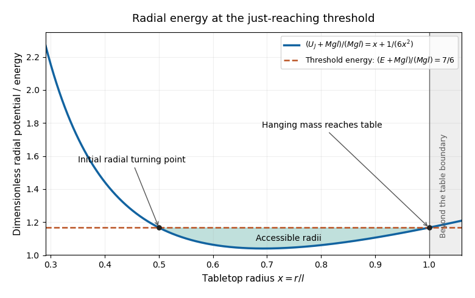

<h1 id="10/c/ii/solution">Solution</h1>

↑ **Parent:** [Ii](../ii.md)

The initial [angular momentum](../../../../../angular-momentum.md) is $J=mlv_0/2$, and the initial total [energy](../../../../../energy-split.md) is

$$
\mathcal H_i=\frac12mv_0^2-\frac12Mgl.
$$

When the hanging [mass](../../../../../mass.md) reaches the table, $r=l$. Conservation of [angular momentum](../../../../../angular-momentum.md) fixes the tabletop tangential [speed](../../../../../speed.md) there to $J/(ml)=v_0/2$. At the limiting case of just reaching, radial [velocity](../../../../../velocity.md) is zero. Equating the two [energies](../../../../../energy-split.md),

$$
\frac12mv_0^2-\frac12Mgl=\frac12m\left(\frac{v_0}{2}\right)^2,
$$

yields

$$
\boxed{v_{0,\rm just}^{\,2}=\frac{4Mgl}{3m}.}
$$

More generally, the boundary radial [kinetic energy](../../../../../kinetic-energy.md) is

$$
\frac12(M+m)\dot r(l)^2=\frac38mv_0^2-\frac12Mgl,
$$

so reaching requires $v_0^2\ge4Mgl/(3m)$, with equality for just reaching and strict inequality for nonzero outward radial [speed](../../../../../speed.md) at contact. This condition is also sufficient: $U_J$ is strictly convex, and the allowed interval connecting the initial radius to $l$ has no intervening higher [effective potential](../../../../../effective-potential.md) barrier. At the threshold the initial radial [acceleration](../../../../../acceleration.md) is outward and $r=l$ is the outer [turning point](../../../../../turning-point.md).

**[Figure 1](#10/c/ii/image-effective-radial-potential-at-the-threshold-for-the-hanging-mass-to-reach-the-table). Effective radial potential at the threshold for the hanging mass to reach the table**. The horizontal energy level intersects the effective potential at r/l equal to one half and one. The interval between them is accessible. The curve is shifted by the irrelevant constant Mgl and normalized by Mgl; the physical region ends at r/l equal to one.

## ↑ Ancestors (13)

1. [Ii](../ii.md)
2. [C](../../c.md)
3. [10](../../../10.md)
4. [2019 resit](../../../../2019-resit-split.md)
5. [Past exam of the physics 1 paper of the University of Oxford](../../../../split.md)
6. [Physics 1 paper of the University of Oxford](../../../../../physics-1-paper-of-the-university-of-oxford.md)
7. [Year 1 of the physics course of the University of Oxford](../../../../../year-1-of-the-physics-course-of-the-university-of-oxford.md)
8. [Physics course of the University of Oxford](../../../../../physics-course-of-the-university-of-oxford.md)
9. [Undergraduate course of the University of Oxford](../../../../../undergraduate-course-of-the-university-of-oxford.md)
10. [Course of the University of Oxford](../../../../../course-of-the-university-of-oxford.md)
11. [University of Oxford](../../../../../university-of-oxford-split.md)
12. [List of universities](../../../../../list-of-universities.md)
13. [Codex Wiki](../../../../../split.md)
