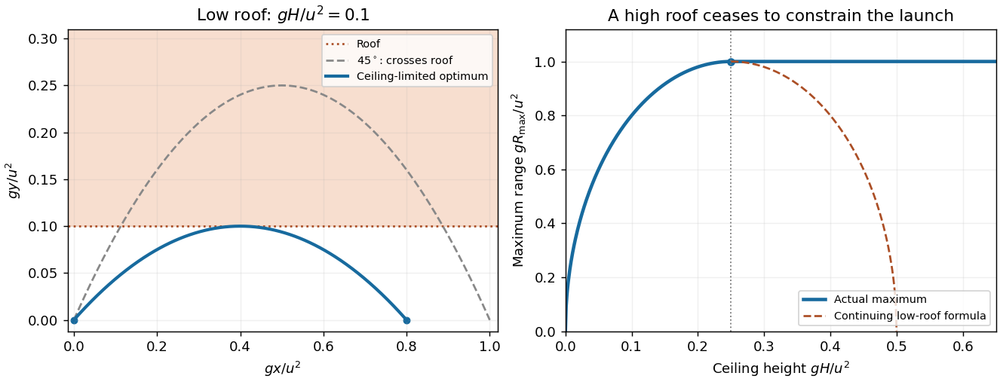
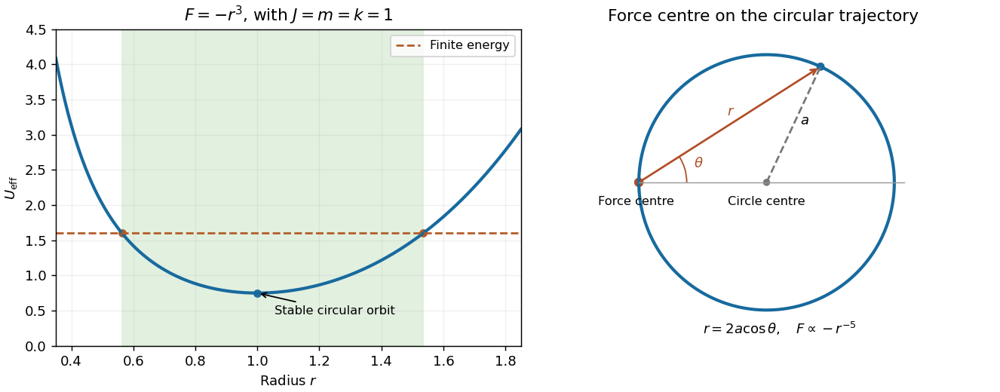
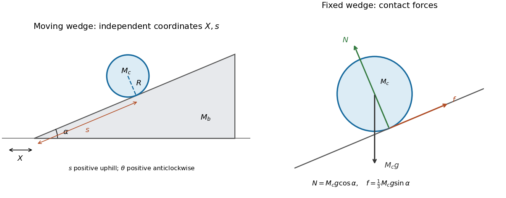

# 2019

↑ **Parent:** [Past exam of the physics 1 paper of the University of Oxford](../past-exam-of-the-physics-1-paper-of-the-university-of-oxford.md)

Source paper: [https://www.whatdotheyknow.com/request/oxford_physics_past_papers_2/response/2340696/attach/7/Physics%20Papers%202018.pdf?cookie_passthrough=1](https://www.whatdotheyknow.com/request/oxford_physics_past_papers_2/response/2340696/attach/7/Physics%20Papers%202018.pdf?cookie_passthrough=1)

These solutions use the ordinary sitting. The cover gives 2019 although the annual release is named 2018. The tunnel formula in question 1 requires a ceiling-height regime, and the offset [circular orbit](../classical-mechanics.md#circular-orbit) in question 8(c) is singular where it meets the force centre.

**Table of contents**

- [1](#1)
  - [Solution](#1/solution)
- [2](#2)
  - [Solution](#2/solution)
- [3](#3)
  - [a](#3/a)
    - [Solution](#3/a/solution)
  - [b](#3/b)
    - [Solution](#3/b/solution)
- [4](#4)
  - [Solution](#4/solution)
- [5](#5)
  - [Solution](#5/solution)
- [6](#6)
  - [Solution](#6/solution)
- [7](#7)
  - [a](#7/a)
    - [Solution](#7/a/solution)
  - [b](#7/b)
    - [Solution](#7/b/solution)
- [8](#8)
  - [a](#8/a)
    - [Solution](#8/a/solution)
  - [b](#8/b)
    - [Solution](#8/b/solution)
  - [c](#8/c)
    - [Solution](#8/c/solution)
- [9](#9)
  - [a](#9/a)
    - [Solution](#9/a/solution)
    - [i](#9/a/i)
      - [Solution](#9/a/i/solution)
    - [ii](#9/a/ii)
      - [Solution](#9/a/ii/solution)
  - [b](#9/b)
    - [Solution](#9/b/solution)
  - [c](#9/c)
    - [Solution](#9/c/solution)
- [10](#10)
  - [a](#10/a)
    - [Solution](#10/a/solution)
  - [b](#10/b)
    - [Solution](#10/b/solution)
  - [c](#10/c)
    - [Solution](#10/c/solution)

## 1

↑ **Parent:** [2019](2019.md)

<h3 id="1/solution">Solution</h3>

↑ **Parent:** [1](#1)

For a launch angle $\theta$, the [projectile motion](../classical-mechanics.md#projectile-motion) equations give a flight time $2u\sin\theta/g$, a [projectile range](../classical-mechanics.md#projectile-range) $R=u^2\sin(2\theta)/g$, and an apex height $u^2\sin^2\theta/(2g)$. Thus the ceiling requires $\sin^2\theta\leq2gH/u^2$.

Set $z=\sin^2\theta$. Then $R^2=4u^4z(1-z)/g^2$, which increases up to $z=1/2$. The optimum is therefore $z=\min(1/2,2gH/u^2)$, giving the [projectile range under a ceiling](../classical-mechanics.md#projectile-range-under-a-ceiling)

$$
\boxed{R_{\max}=\begin{cases}
\sqrt{8H(u^2/g-2H)},&0\leq H\leq u^2/(4g),\\
u^2/g,&H\geq u^2/(4g).
\end{cases}}
$$

The printed expression is valid in the first regime. A higher ceiling leaves the usual $45^\circ$ launch admissible, so it cannot reduce the maximum range. The angle in the ceiling-limited regime is $\arcsin\sqrt{2gH/u^2}$. Equality at the roof is allowed in this ideal geometrical model; if touching the roof is forbidden, the same value is a [supremum](../real-analysis.md#supremum) approached from below.

**[Figure 1](#1/image-the-tunnel-ceiling-limits-low-launches-while-a-sufficiently-high-roof-leaves-the-ordinary-maximum-range-unchanged). The tunnel ceiling limits low launches, while a sufficiently high roof leaves the ordinary maximum range unchanged**.

## 2

↑ **Parent:** [2019](2019.md)

<h3 id="2/solution">Solution</h3>

↑ **Parent:** [2](#2)

Let $\mathbf w=\mathbf v_1-\mathbf v_2$ be the [relative velocity](../classical-mechanics.md#relative-velocity) and $\mathbf V=(M_1\mathbf v_1+M_2\mathbf v_2)/(M_1+M_2)$ the [centre-of-mass velocity](../classical-mechanics.md#center-of-mass-velocity). Inverting gives

$$
\mathbf v_1=\mathbf V+\frac{M_2}{M_1+M_2}\mathbf w,\qquad
\mathbf v_2=\mathbf V-\frac{M_1}{M_1+M_2}\mathbf w.
$$

Substitute into the sum of the two [kinetic energies](../energy.md#kinetic-energy). The cross terms cancel, while the coefficient of $|\mathbf w|^2/2$ is the [reduced mass](../classical-mechanics.md#reduced-mass) $\mu=M_1M_2/(M_1+M_2)$. Hence

$$
T=\frac12(M_1+M_2)|\mathbf V|^2+\frac12\mu|\mathbf w|^2.
$$

The first term is translation of the [centre of mass](../classical-mechanics.md#center-of-mass); the second is the [kinetic energy](../energy.md#kinetic-energy) measured in the [centre-of-momentum frame](../special-relativity.md#center-of-momentum-frame). For an isolated [perfectly inelastic collision](../classical-mechanics.md#perfectly-inelastic-collision), the bodies finish with a common [velocity](../classical-mechanics.md#velocity), while their total [momentum](../momentum.md) and thus $\mathbf V$ are unchanged. The [kinetic energy](../energy.md#kinetic-energy) converted to internal forms is therefore

$$
\boxed{T_i-T_f=\frac12\mu v^2,}
$$

where $v$ is their initial relative [speed](../classical-mechanics.md#speed). Total [energy](../energy.md) remains conserved; it is the translational-plus-relative [kinetic energy](../energy.md#kinetic-energy) that decreases.

## 3

↑ **Parent:** [2019](2019.md)

<h3 id="3/a">a</h3>

↑ **Parent:** [3](#3)

<h4 id="3/a/solution">Solution</h4>

↑ **Parent:** [A](#3/a)

Measure position $x$ along the ideal thin rod from its [centre of mass](../classical-mechanics.md#center-of-mass). Its perpendicular distance from the inclined axis is $|x|\sin\alpha$, and its [linear mass density](../fluid-mechanics.md#linear-mass-density) is $M/L$. The [moment of inertia](../rigid-body-dynamics.md#moment-of-inertia) is therefore

$$
I=\frac ML\int_{-L/2}^{L/2}x^2\sin^2\alpha\,dx
=\boxed{\frac{ML^2}{12}\sin^2\alpha.}
$$

This tends to zero for an axis along an infinitely thin rod and to $ML^2/12$ for a perpendicular central axis. A finite rod thickness would add a contribution absent from the stated thin-rod model.

<h3 id="3/b">b</h3>

↑ **Parent:** [3](#3)

<h4 id="3/b/solution">Solution</h4>

↑ **Parent:** [B](#3/b)

The parallel axis through the centre is the rod's own long axis, with zero [moment of inertia](../rigid-body-dynamics.md#moment-of-inertia) in the thin-rod approximation. By the [parallel axis theorem](../rigid-body-dynamics.md#parallel-axis-theorem), the displaced parallel axis has

$$
\boxed{I_D=0+MD^2=MD^2.}
$$

Equivalently, every [mass](../classical-mechanics.md#mass) element is the same perpendicular distance $D$ from that axis, so the defining integral immediately gives this result.

## 4

↑ **Parent:** [2019](2019.md)

<h3 id="4/solution">Solution</h3>

↑ **Parent:** [4](#4)

Write the incoming particle [speed](../classical-mechanics.md#speed) as $u>0$, its final signed [speed](../classical-mechanics.md#speed) as $v$, and the rod's final [centre-of-mass velocity](../classical-mechanics.md#center-of-mass-velocity) along the impact direction as $V$. Let $b$ be the signed impact distance from the centre, and choose the sign of the [angular velocity](../rigid-body-dynamics.md#angular-velocity) $\Omega$ so that the contact point's [velocity](../classical-mechanics.md#velocity) component is $V+b\Omega$. The rod's central [moment of inertia](../rigid-body-dynamics.md#moment-of-inertia) is $I=ML^2/12$.

The [impulse](../classical-mechanics.md#impulse) delivered to the rod is $MV$. Conservation of linear and angular [momentum](../momentum.md) gives

$$
u=v+V,\qquad I\Omega=MbV.
$$

Using these in conservation of [kinetic energy](../energy.md#kinetic-energy),

$$
u^2=v^2+V^2+\frac IM\Omega^2
\quad\Longrightarrow\quad
V=\frac{2u}{2+Mb^2/I},\qquad
v=\frac{(Mb^2/I)u}{2+Mb^2/I}.
$$

This is the equal-mass instance of the [effective contact mass](../rigid-body-dynamics.md#effective-contact-mass) calculation. For $u>0$, both final speeds are nonnegative, so equal speeds require $v=V=u/2$. Therefore $Mb^2/I=2$ and

$$
\boxed{|b|=\frac L{\sqrt6}.}
$$

Both symmetric impact points lie on the rod, since $L/\sqrt6<L/2$.

More generally, the relative contact [velocity](../classical-mechanics.md#velocity) immediately afterwards is

$$
v-(V+b\Omega)=u-(2+Mb^2/I)V=-u.
$$

Thus its magnitude equals the incoming relative [speed](../classical-mechanics.md#speed) $u$ and its direction reverses. At the specified impact point, $V+b\Omega=3u/2$ and $v=u/2$, which makes the reversal particularly explicit.

## 5

↑ **Parent:** [2019](2019.md)

<h3 id="5/solution">Solution</h3>

↑ **Parent:** [5](#5)

With metric convention $(+---)$, the invariant interval is $c^2\Delta\tau^2=c^2\Delta t^2-|\Delta\mathbf r|^2$ along an inertially moving clock. For constant [speed](../classical-mechanics.md#speed) $v$ in the ground frame, $|\Delta\mathbf r|=v\Delta t$, so

$$
\boxed{\Delta t=\gamma\Delta\tau,\qquad\gamma=(1-v^2/c^2)^{-1/2}.}
$$

The aircraft records [proper time](../special-relativity.md#proper-time) $\Delta\tau=1000\,\mathrm s$. The ground duration is measured by a network of [clocks](../classical-mechanics.md#clock) at rest in the ideal ground frame, with [Einstein synchronisation](../special-relativity.md#einstein-synchronisation). Its excess is

$$
\Delta t-\Delta\tau=1000(\gamma-1)\,\mathrm s
\simeq1000\frac{300^2}{2c^2}\,\mathrm s
\simeq5.0\times10^{-10}\,\mathrm s.
$$

Thus **the ground-frame duration is longer by about $0.50\,\mathrm{ns}$**. This is the special-relativistic [time dilation](../special-relativity.md#time-dilation) contribution under the stated constant-speed assumptions; gravitational potential differences and Earth's rotation are outside this model.

## 6

↑ **Parent:** [2019](2019.md)

<h3 id="6/solution">Solution</h3>

↑ **Parent:** [6](#6)

First work in the receiver's [rest frame](../mathematical-physics.md#rest-frame). If a source recedes at [speed](../classical-mechanics.md#speed) $\beta c$, two successive emissions separated by source [proper time](../special-relativity.md#proper-time) $T_0$ occur $\gamma T_0$ apart in this frame. During that interval the source retreats by $\beta c\gamma T_0$, so the arrival interval is $T_R=\gamma T_0(1+\beta)$. The longitudinal [relativistic Doppler effect](../wave.md#relativistic-doppler-effect) is consequently

$$
\boxed{\frac{\nu_R}{\nu_0}=\sqrt{\frac{1-\beta}{1+\beta}},\qquad
\frac{\lambda_R}{\lambda_0}=\sqrt{\frac{1+\beta}{1-\beta}}.}
$$

A negative $\beta$ describes approach and gives a blueshift.

Interpret $633\,\mathrm{nm}$ as the laser's rest-frame wavelength and the stated detector [velocity](../classical-mechanics.md#velocity) as measured in the initial laboratory frame. Choose $+x$ from source to sensor, with detector [velocity](../classical-mechanics.md#velocity) $-0.2c$. The required relative recession [speed](../classical-mechanics.md#speed) follows from

$$
q=(1000/633)^2,\qquad\beta_{\rm rec}=\frac{q-1}{q+1}=0.4278687\ldots.
$$

By [relativistic velocity addition](../special-relativity.md#velocity-addition-formula), the source [velocity](../classical-mechanics.md#velocity) $\beta_Sc$ in the laboratory obeys $(\beta_S+0.2)/(1+0.2\beta_S)=-\beta_{\rm rec}$. Hence

$$
\boxed{\beta_S=-\frac{\beta_{\rm rec}+0.2}{1+0.2\beta_{\rm rec}}=-0.578375\ldots.}
$$

The laser must move **away from the sensor at about $0.5784c$ in that laboratory frame**. Although the sensor moves toward the source's initial location, the retreating source produces the required net redshift. The frame qualification matters: a [velocity](../classical-mechanics.md#velocity) permanently fixed relative to the moving source would specify the Doppler factor already, rather than leave it adjustable.

## 7

↑ **Parent:** [2019](2019.md)

<h3 id="7/a">a</h3>

↑ **Parent:** [7](#7)

<h4 id="7/a/solution">Solution</h4>

↑ **Parent:** [A](#7/a)

During $dt$, the remaining rocket has [mass](../classical-mechanics.md#mass) $M+dM$ and [velocity](../classical-mechanics.md#velocity) $v+dv$, while the expelled positive [mass](../classical-mechanics.md#mass) $-dM$ has [velocity](../classical-mechanics.md#velocity) $v-u$ to first order. Subtract the initial [momentum](../momentum.md) $Mv$ from their final [momentum](../momentum.md) to obtain $M\,dv+u\,dM$. Equating this to the external [impulse](../classical-mechanics.md#impulse) gives the [rocket equation](../momentum.md#rocket-equation)

$$
F=M\dot v+u\dot M.
$$

With $F=-Mg-kMv$ and $\dot M/M=-b$, this reduces to $\dot v+kv=ub-g$. Therefore, for initial [velocity](../classical-mechanics.md#velocity) $v_0$ and $k>0$,

$$
v(t)=\frac{ub-g}{k}+\left(v_0-\frac{ub-g}{k}\right)e^{-kt}.
$$

For a launch from rest,

$$
\boxed{v(t)=\frac{ub-g}{k}(1-e^{-kt}),\qquad b>g/u\text{ for upward launch}.}
$$

The inequality makes the initial upward [acceleration](../classical-mechanics.md#acceleration) positive. Equality gives no upward launch from rest. In the zero-drag limit, $v=(ub-g)t$. These expressions apply while the prescribed burn law and constant-$g$ approximation remain valid.

<h3 id="7/b">b</h3>

↑ **Parent:** [7](#7)

<h4 id="7/b/solution">Solution</h4>

↑ **Parent:** [B](#7/b)

The escaping sand initially has the bucket's [velocity](../classical-mechanics.md#velocity), so it produces no relative-velocity thrust. This distinction is essential in a [leaking Atwood machine](../lagrangian-mechanics.md#leaking-atwood-machine). With upward [velocity](../classical-mechanics.md#velocity) $v$ for the leaky side, the two bucket equations are

$$
M\dot v=T-Mg,\qquad M_0\dot v=M_0g-T.
$$

Their sum gives $\dot v=g(M_0-M)/(M+M_0)$. Since $\dot M=-\alpha$, it follows that

$$
\frac{dv}{dM}=\frac g\alpha\frac{M-M_0}{M+M_0}.
$$

Integrate from $M_0$, where the [velocity](../classical-mechanics.md#velocity) is zero:

$$
v(M)=\frac g\alpha\left[M-M_0-2M_0\log\left(\frac{M+M_0}{2M_0}\right)\right].
$$

At emptying, $M=(1-\epsilon)M_0$, giving

$$
\boxed{v_{\rm empty}=\frac{gM_0}{\alpha}\left[-\epsilon-2\log(1-\epsilon/2)\right].}
$$

This is upward and positive for $0<\epsilon<1$. For no initial sand, $\epsilon=0$, the emptying time is zero and the [speed](../classical-mechanics.md#speed) is zero. As the dry bucket [mass](../classical-mechanics.md#mass) tends to zero,

$$
\boxed{\lim_{\epsilon\to1^-}v_{\rm empty}=\frac{gM_0}{\alpha}(2\log2-1).}
$$

This finite limit refers to the idealized model; the endpoint itself would describe a massless empty bucket. For small $\epsilon$, $v_{\rm empty}\sim gM_0\epsilon^2/(4\alpha)$, consistent with initially zero [acceleration](../classical-mechanics.md#acceleration) that grows as [mass](../classical-mechanics.md#mass) is lost.

## 8

↑ **Parent:** [2019](2019.md)

<h3 id="8/a">a</h3>

↑ **Parent:** [8](#8)

<h4 id="8/a/solution">Solution</h4>

↑ **Parent:** [A](#8/a)

A [central force](../mathematical-physics.md#central-force) exerts zero [torque](../momentum.md#torque) about its centre, so [angular momentum](../momentum.md#angular-momentum) is conserved and the motion is planar. In [plane polar coordinates](../classical-mechanics.md#plane-polar-coordinates), $J=mr^2\dot\theta$ and

$$
T=\frac12m(\dot r^2+r^2\dot\theta^2),\qquad
\boxed{E=\frac12m\dot r^2+\frac{J^2}{2mr^2}+U(r).}
$$

Use $F=-U'$ and either the radial [Euler-Lagrange equation](../analysis.md#euler-lagrange-equation) or [differentiation](../calculus.md#differentiation) of the [energy](../energy.md) away from [turning points](../energy.md#turning-point) to get

$$
\boxed{m\ddot r=F(r)+\frac{J^2}{mr^3}.}
$$

The radial [acceleration](../classical-mechanics.md#acceleration) is $\ddot r-r\dot\theta^2$, so this is exactly $m(\ddot r-r\dot\theta^2)=F(r)$, not an additional physical outward force in an inertial frame. The variational derivation remains valid at [turning points](../energy.md#turning-point) where dividing an [energy](../energy.md) [derivative](../calculus.md#derivative) by $\dot r$ would be illegitimate.

<h3 id="8/b">b</h3>

↑ **Parent:** [8](#8)

<h4 id="8/b/solution">Solution</h4>

↑ **Parent:** [B](#8/b)

The [effective potential](../mathematical-physics.md#effective-potential) includes the angular part of the [kinetic energy](../energy.md#kinetic-energy). Taking $U(0)=0$ gives $U=kr^4/4$, hence

$$
U_{\rm eff}(r)=\frac{J^2}{2mr^2}+\frac{k r^4}{4}.
$$

For $J\ne0$, this diverges at both zero and infinity and has a unique minimum. Finite-energy motion therefore remains between two radial [turning points](../energy.md#turning-point), or at the minimum itself. For $J=0$, the [centrifugal barrier](../mathematical-physics.md#centrifugal-barrier) is absent, but $U\to\infty$ still bounds every finite-energy trajectory; radial motion can pass through the force centre.

A [circular orbit](../classical-mechanics.md#circular-orbit) requires $U_{\rm eff}'(r_c)=0$, so

$$
\boxed{r_c=\left(\frac{J^2}{mk}\right)^{1/6},\qquad
E_c=\frac34kr_c^4=\frac34 k^{1/3}\left(\frac{J^2}{m}\right)^{2/3}.}
$$

It is stable because $U_{\rm eff}''(r_c)=6kr_c^2>0$. These are nonzero-radius orbits for $J\ne0$; $J=0$ also permits the stationary particle at the origin. Boundedness does not mean that every noncircular orbit is closed.

<h3 id="8/c">c</h3>

↑ **Parent:** [8](#8)

<h4 id="8/c/solution">Solution</h4>

↑ **Parent:** [C](#8/c)

The diagram places the force centre on the circumference, not at the centre of the circle. Choose the polar axis through the circle's geometric centre. Its equation is $r=2a\cos\theta$, so $u=\sec\theta/(2a)$ and

$$
u''+u=\frac{\sec^3\theta}{a}=8a^2u^3.
$$

Substitute into [Binet's equation](../celestial-mechanics.md#binet-equation):

$$
F(1/u)=-\frac{J^2u^2}{m}(u''+u)
=-\frac{8J^2a^2}{m}u^5.
$$

Consequently a [circular orbit through the force centre](../celestial-mechanics.md#circular-orbit-through-an-inverse-fifth-power-singularity) is generated by

$$
\boxed{n=-5,\qquad C=\frac{8J^2a^2}{m},\qquad F(r)=-\frac{8J^2a^2}{mr^5}.}
$$

The result applies to the regular arc where $r>0$ and $J\ne0$. The force is singular at the point where the geometrical circle meets the origin, so the curve is not a regular periodic orbit continued through that point. Indeed, $U=-C/(4r^4)$ and this trajectory has zero total [energy](../energy.md), with kinetic and negative potential terms diverging as the centre is approached.

**[Figure 2](#8/c/image-bounded-radial-motion-for-an-attractive-cubic-force-and-the-distinct-offset-circle-geometry-produced-by-an-inverse-fifth-power-force). Bounded radial motion for an attractive cubic force and the distinct offset-circle geometry produced by an inverse-fifth-power force**.

## 9

↑ **Parent:** [2019](2019.md)

<h3 id="9/a">a</h3>

↑ **Parent:** [9](#9)

<h4 id="9/a/solution">Solution</h4>

↑ **Parent:** [A](#9/a)

For a [Lagrangian](../calculus-of-variations.md#lagrangian) $L(q_i,\dot q_i,t)$ expressed in independent [generalized coordinates](../lagrangian-mechanics.md#generalized-coordinate), stationary [action](../lagrangian-mechanics.md#action) gives the [Euler-Lagrange equations](../analysis.md#euler-lagrange-equation)

$$
\boxed{\frac d{dt}\frac{\partial L}{\partial\dot q_i}-\frac{\partial L}{\partial q_i}=0.}
$$

Ideal constraints can either be incorporated into the independent coordinates or treated using [Lagrange multipliers](../mathematical-optimization.md#lagrange-multiplier), as in [solution](#9/c/solution).

<h4 id="9/a/i">i</h4>

↑ **Parent:** [A](#9/a)

<h5 id="9/a/i/solution">Solution</h5>

↑ **Parent:** [I](#9/a/i)

A [cyclic coordinate](../lagrangian-mechanics.md#cyclic-coordinate) is absent from the [Lagrangian](../calculus-of-variations.md#lagrangian) itself: $\partial L/\partial q_i=0$. Its [conjugate momentum](../hamiltonian-mechanics.md#canonical-momentum) $p_i=\partial L/\partial\dot q_i$ therefore obeys $\dot p_i=0$. In the rolling-wedge calculation, the cyclic horizontal translation gives conservation of the system's horizontal [momentum](../momentum.md).

<h4 id="9/a/ii">ii</h4>

↑ **Parent:** [A](#9/a)

<h5 id="9/a/ii/solution">Solution</h5>

↑ **Parent:** [Ii](#9/a/ii)

A [holonomic constraint](../classical-mechanics.md#holonomic-constraint) can be expressed as $f(q_1,\ldots,q_n,t)=0$, rather than as a genuinely nonintegrable relation among velocities. A fixed rod length is an example. Rolling along a single straight incline also gives an integrable relation $s+R\theta=\text{constant}$ with the sign convention used below; arbitrary rolling in more dimensions need not be holonomic.

<h3 id="9/b">b</h3>

↑ **Parent:** [9](#9)

<h4 id="9/b/solution">Solution</h4>

↑ **Parent:** [B](#9/b)

Take $s$ positive uphill, $X$ positive to the right, and the cylinder's rotation positive anticlockwise. Contact with the fixed-angle surface determines its normal position; no slipping gives $\dot\theta=-\dot s/R$. These two constraints leave $X,s$ as the two independent coordinates of the [cylinder rolling on a freely translating wedge](../rigid-body-dynamics.md#cylinder-rolling-on-a-freely-translating-wedge).

The cylinder centre is at $(X+s\cos\alpha-R\sin\alpha,\ s\sin\alpha+R\cos\alpha)$. Since the angle is constant, its squared [speed](../classical-mechanics.md#speed) is $\dot X^2+2\dot X\dot s\cos\alpha+\dot s^2$. Including the block's [kinetic energy](../energy.md#kinetic-energy) and $I_c=M_cR^2/2$, and dropping a constant from the potential, gives

$$
\boxed{L=\frac12(M_b+M_c)\dot X^2+M_c\cos\alpha\,\dot X\dot s+\frac34M_c\dot s^2-M_cgs\sin\alpha.}
$$

The [cyclic coordinate](../lagrangian-mechanics.md#cyclic-coordinate) is $X$. Its conserved [conjugate momentum](../hamiltonian-mechanics.md#canonical-momentum) is $p_X=(M_b+M_c)\dot X+M_c\cos\alpha\dot s$, the total horizontal [momentum](../momentum.md). The two [Euler-Lagrange equations](../analysis.md#euler-lagrange-equation) are

$$
(M_b+M_c)\ddot X+M_c\cos\alpha\ddot s=0,\qquad
\cos\alpha\ddot X+\frac32\ddot s=-g\sin\alpha.
$$

Eliminating the accelerations, with $D=3(M_b+M_c)-2M_c\cos^2\alpha>0$, gives

$$
\boxed{\ddot s=-\frac{2(M_b+M_c)g\sin\alpha}{D},\qquad
\ddot X=\frac{2M_cg\sin\alpha\cos\alpha}{D}.}
$$

Thus the cylinder rolls downhill and the wedge accelerates rightward. For $M_b\gg M_c$, $\ddot X\to0$ and $\ddot s\to-(2/3)g\sin\alpha$, the ordinary fixed-incline result.

<h3 id="9/c">c</h3>

↑ **Parent:** [9](#9)

<h4 id="9/c/solution">Solution</h4>

↑ **Parent:** [C](#9/c)

With the wedge fixed, let $r$ be the signed gap between the cylinder bottom and the surface, positive outwards. The centre height is $s\sin\alpha+(R+r)\cos\alpha$. Retaining all three coordinates before imposing constraints gives

$$
L=\frac12M_c(\dot r^2+\dot s^2)+\frac12I_c\dot\theta^2
-M_cg[s\sin\alpha+(R+r)\cos\alpha].
$$

Use the [holonomic constraints](../classical-mechanics.md#holonomic-constraint) $f_1=r=0$ and $f_2=s+R\theta-s_0=0$. With the convention $d(\partial L/\partial\dot q)/dt-\partial L/\partial q=\sum_j\lambda_j\partial f_j/\partial q$, the [Lagrange multiplier](../mathematical-optimization.md#lagrange-multiplier) equations are

$$
M_c\ddot r+M_cg\cos\alpha=\lambda_1,\qquad
M_c\ddot s+M_cg\sin\alpha=\lambda_2,\qquad
I_c\ddot\theta=R\lambda_2.
$$

The constraint gradients identify $\lambda_1=N$, the [normal reaction](../force.md#normal-force), and $\lambda_2=f$, the uphill [static friction](../force.md#static-friction) force. The latter supplies the rolling [torque](../momentum.md#torque). Setting $\ddot r=0$ and $\ddot\theta=-\ddot s/R$ yields

$$
\boxed{N=M_cg\cos\alpha,\qquad \ddot s=-\frac23g\sin\alpha,\qquad f=\frac13M_cg\sin\alpha.}
$$

The [static friction](../force.md#static-friction) condition $|f|\leq\mu_sN$ therefore becomes

$$
\boxed{\mu_s\geq\frac13\tan\alpha,}
$$

for $0\leq\alpha<\pi/2$. [Static friction](../force.md#static-friction) is required to create rotation, but does not dissipate [energy](../energy.md) here because the contact point is instantaneously at rest on the fixed plane.

**[Figure 3](#9/c/image-coordinates-for-a-rolling-cylinder-on-a-moving-wedge-and-the-normal-friction-and-weight-forces-for-the-fixed-wedge-case). Coordinates for a rolling cylinder on a moving wedge and the normal, friction and weight forces for the fixed-wedge case**.

## 10

↑ **Parent:** [2019](2019.md)

<h3 id="10/a">a</h3>

↑ **Parent:** [10](#10)

<h4 id="10/a/solution">Solution</h4>

↑ **Parent:** [A](#10/a)

For a boost along $+x$ at [speed](../classical-mechanics.md#speed) $v$, the [energy-momentum four-vector](../special-relativity.md#four-momentum) transforms as

$$
\boxed{E'=\gamma(E-vp_x),\quad p_x'=\gamma(p_x-vE/c^2),\quad p_y'=p_y,\quad p_z'=p_z.}
$$

The total four-vector is the sum over the particles. Write $E=\sum_iE_i$ and $\mathbf P=\sum_i\mathbf p_i$. A centre-of-momentum [rest frame](../mathematical-physics.md#rest-frame) exists when this total is timelike, with $\mathbf V_{\rm CM}=c^2\mathbf P/E$. Boost along $\mathbf P$ and use $P=EV_{\rm CM}/c^2$:

$$
E_{\rm CM}=\gamma_{\rm CM}(E-V_{\rm CM}P)=E/\gamma_{\rm CM}.
$$

Therefore

$$
\boxed{\gamma_{\rm CM}=\frac{\sum_iE_i}{E_{\rm CM}}=\frac1{\sqrt{1-V_{\rm CM}^2/c^2}}.}
$$

The timelike qualification is needed: exactly parallel [photons](../quantum-mechanics.md#photon) alone have null total [four-momentum](../special-relativity.md#four-momentum) and no such [rest frame](../mathematical-physics.md#rest-frame).

<h3 id="10/b">b</h3>

↑ **Parent:** [10](#10)

<h4 id="10/b/solution">Solution</h4>

↑ **Parent:** [B](#10/b)

Use the squared total [energy-momentum four-vector](../special-relativity.md#four-momentum), expressed in energy-squared units. With the [proton](../physics.md#proton) initially at rest,

$$
W^2=(m_pc^2+E_\gamma)^2-E_\gamma^2=m_p^2c^4+2m_pc^2E_\gamma.
$$

At the [reaction threshold](../special-relativity.md#reaction-threshold), the outgoing [proton](../physics.md#proton) and [pion](../standard-model.md#pion) have no relative [kinetic energy](../energy.md#kinetic-energy) in their [centre-of-momentum frame](../special-relativity.md#center-of-momentum-frame), so $W=(m_p+m_\pi)c^2$. Solving gives

$$
\boxed{E_\gamma^{\rm th}=m_\pi c^2\left(1+\frac{m_\pi}{2m_p}\right)=144.715\,\mathrm{MeV}.}
$$

The numerical value uses the supplied $938$ and $135\,\mathrm{MeV}$ [rest energies](../special-relativity.md#rest-energy). The threshold exceeds the [pion](../standard-model.md#pion)'s [rest energy](../special-relativity.md#rest-energy) because the outgoing system must carry the incident [photon](../quantum-mechanics.md#photon)'s nonzero laboratory [momentum](../momentum.md).

<h3 id="10/c">c</h3>

↑ **Parent:** [10](#10)

<h4 id="10/c/solution">Solution</h4>

↑ **Parent:** [C](#10/c)

At threshold, the [pion](../standard-model.md#pion) is at rest in the final [centre-of-momentum frame](../special-relativity.md#center-of-momentum-frame), which moves in the laboratory with

$$
\beta=\frac{E_\gamma^{\rm th}}{m_pc^2+E_\gamma^{\rm th}}=0.1336592\ldots,\qquad
\gamma=\frac{m_pc^2+E_\gamma^{\rm th}}{(m_p+m_\pi)c^2}=1.0090539\ldots.
$$

In the [pion](../standard-model.md#pion)'s [rest frame](../mathematical-physics.md#rest-frame), its [two-photon decay](../physics.md#two-photon-decay) produces opposite [photons](../quantum-mechanics.md#photon) of equal [energy](../energy.md) $m_\pi c^2/2$. The specified forward and backward directions remain collinear under this boost, so

$$
E_\pm=\frac{m_\pi c^2}{2}\gamma(1\pm\beta).
$$

At threshold, $\gamma(1+\beta)=(m_p+m_\pi)/m_p$ and $\gamma(1-\beta)=m_p/(m_p+m_\pi)$. Hence

$$
\boxed{E_+=77.2148\,\mathrm{MeV},\qquad E_-=59.0075\,\mathrm{MeV}.}
$$

The forward [photon](../quantum-mechanics.md#photon) is the more energetic one. Their product remains $(m_\pi c^2/2)^2$, as required by the invariant [mass](../classical-mechanics.md#mass) of an oppositely directed [photon](../quantum-mechanics.md#photon) pair, while their sum equals the laboratory [pion](../standard-model.md#pion) [energy](../energy.md).

## ↑ Ancestors (9)

1. [Past exam of the physics 1 paper of the University of Oxford](../past-exam-of-the-physics-1-paper-of-the-university-of-oxford.md)
2. [Physics 1 paper of the University of Oxford](../university-of-oxford.md#physics-1-paper-of-the-university-of-oxford)
3. [Year 1 of the physics course of the University of Oxford](../university-of-oxford.md#year-1-of-the-physics-course-of-the-university-of-oxford)
4. [Physics course of the University of Oxford](../university-of-oxford.md#physics-course-of-the-university-of-oxford)
5. [Undergraduate course of the University of Oxford](../university-of-oxford.md#undergraduate-course-of-the-university-of-oxford)
6. [Course of the University of Oxford](../university-of-oxford.md#course-of-the-university-of-oxford)
7. [University of Oxford](../university-of-oxford.md)
8. [List of universities](../README.md#list-of-universities)
9. [Codex Wiki](../README.md)
