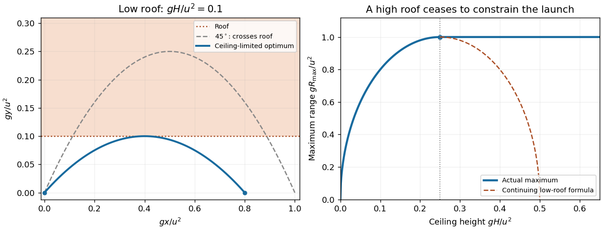

<h1 id="1/solution">Solution</h1>

↑ **Parent:** [1](../1.md)

For a launch angle $\theta$, the [projectile motion](../../../projectile-motion.md) equations give a flight time $2u\sin\theta/g$, a [projectile range](../../../projectile-range.md) $R=u^2\sin(2\theta)/g$, and an apex height $u^2\sin^2\theta/(2g)$. Thus the ceiling requires $\sin^2\theta\leq2gH/u^2$.

Set $z=\sin^2\theta$. Then $R^2=4u^4z(1-z)/g^2$, which increases up to $z=1/2$. The optimum is therefore $z=\min(1/2,2gH/u^2)$, giving the [projectile range under a ceiling](../../../projectile-range-under-a-ceiling.md)

$$
\boxed{R_{\max}=\begin{cases}
\sqrt{8H(u^2/g-2H)},&0\leq H\leq u^2/(4g),\\
u^2/g,&H\geq u^2/(4g).
\end{cases}}
$$

The printed expression is valid in the first regime. A higher ceiling leaves the usual $45^\circ$ launch admissible, so it cannot reduce the maximum range. The angle in the ceiling-limited regime is $\arcsin\sqrt{2gH/u^2}$. Equality at the roof is allowed in this ideal geometrical model; if touching the roof is forbidden, the same value is a [supremum](../../../supremum.md) approached from below.

**[Figure 1](#1/image-the-tunnel-ceiling-limits-low-launches-while-a-sufficiently-high-roof-leaves-the-ordinary-maximum-range-unchanged). The tunnel ceiling limits low launches, while a sufficiently high roof leaves the ordinary maximum range unchanged**.

## ↑ Ancestors (11)

1. [1](../1.md)
2. [2019](../../2019-split.md)
3. [Past exam of the physics 1 paper of the University of Oxford](../../split.md)
4. [Physics 1 paper of the University of Oxford](../../../physics-1-paper-of-the-university-of-oxford.md)
5. [Year 1 of the physics course of the University of Oxford](../../../year-1-of-the-physics-course-of-the-university-of-oxford.md)
6. [Physics course of the University of Oxford](../../../physics-course-of-the-university-of-oxford.md)
7. [Undergraduate course of the University of Oxford](../../../undergraduate-course-of-the-university-of-oxford.md)
8. [Course of the University of Oxford](../../../course-of-the-university-of-oxford.md)
9. [University of Oxford](../../../university-of-oxford-split.md)
10. [List of universities](../../../list-of-universities.md)
11. [Codex Wiki](../../../split.md)
