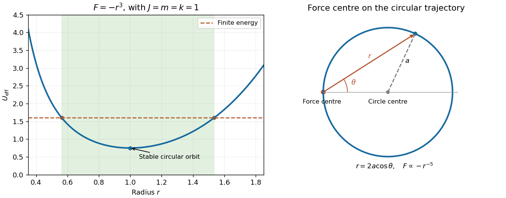

<h1 id="8/c/solution">Solution</h1>

↑ **Parent:** [C](../c.md)

The diagram places the force centre on the circumference, not at the centre of the circle. Choose the polar axis through the circle's geometric centre. Its equation is $r=2a\cos\theta$, so $u=\sec\theta/(2a)$ and

$$
u''+u=\frac{\sec^3\theta}{a}=8a^2u^3.
$$

Substitute into [Binet's equation](../../../../binet-equation.md):

$$
F(1/u)=-\frac{J^2u^2}{m}(u''+u)
=-\frac{8J^2a^2}{m}u^5.
$$

Consequently a [circular orbit through the force centre](../../../../circular-orbit-through-an-inverse-fifth-power-singularity.md) is generated by

$$
\boxed{n=-5,\qquad C=\frac{8J^2a^2}{m},\qquad F(r)=-\frac{8J^2a^2}{mr^5}.}
$$

The result applies to the regular arc where $r>0$ and $J\ne0$. The force is singular at the point where the geometrical circle meets the origin, so the curve is not a regular periodic orbit continued through that point. Indeed, $U=-C/(4r^4)$ and this trajectory has zero total [energy](../../../../energy-split.md), with kinetic and negative potential terms diverging as the centre is approached.

**[Figure 2](#8/c/image-bounded-radial-motion-for-an-attractive-cubic-force-and-the-distinct-offset-circle-geometry-produced-by-an-inverse-fifth-power-force). Bounded radial motion for an attractive cubic force and the distinct offset-circle geometry produced by an inverse-fifth-power force**.

## ↑ Ancestors (12)

1. [C](../c.md)
2. [8](../../8.md)
3. [2019](../../../2019-split.md)
4. [Past exam of the physics 1 paper of the University of Oxford](../../../split.md)
5. [Physics 1 paper of the University of Oxford](../../../../physics-1-paper-of-the-university-of-oxford.md)
6. [Year 1 of the physics course of the University of Oxford](../../../../year-1-of-the-physics-course-of-the-university-of-oxford.md)
7. [Physics course of the University of Oxford](../../../../physics-course-of-the-university-of-oxford.md)
8. [Undergraduate course of the University of Oxford](../../../../undergraduate-course-of-the-university-of-oxford.md)
9. [Course of the University of Oxford](../../../../course-of-the-university-of-oxford.md)
10. [University of Oxford](../../../../university-of-oxford-split.md)
11. [List of universities](../../../../list-of-universities.md)
12. [Codex Wiki](../../../../split.md)
