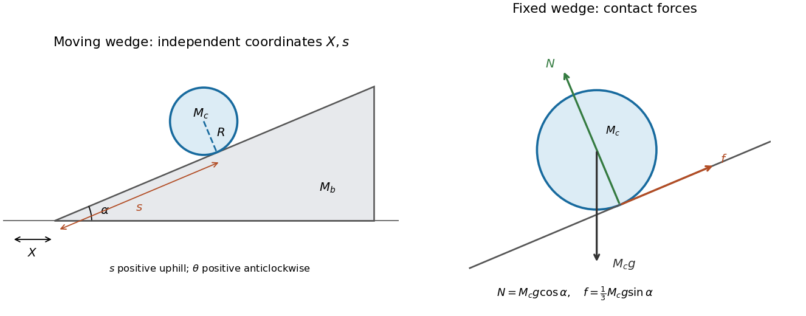

<h1 id="9/c/solution">Solution</h1>

↑ **Parent:** [C](../c.md)

With the wedge fixed, let $r$ be the signed gap between the cylinder bottom and the surface, positive outwards. The centre height is $s\sin\alpha+(R+r)\cos\alpha$. Retaining all three coordinates before imposing constraints gives

$$
L=\frac12M_c(\dot r^2+\dot s^2)+\frac12I_c\dot\theta^2
-M_cg[s\sin\alpha+(R+r)\cos\alpha].
$$

Use the [holonomic constraints](../../../../holonomic-constraint.md) $f_1=r=0$ and $f_2=s+R\theta-s_0=0$. With the convention $d(\partial L/\partial\dot q)/dt-\partial L/\partial q=\sum_j\lambda_j\partial f_j/\partial q$, the [Lagrange multiplier](../../../../lagrange-multiplier.md) equations are

$$
M_c\ddot r+M_cg\cos\alpha=\lambda_1,\qquad
M_c\ddot s+M_cg\sin\alpha=\lambda_2,\qquad
I_c\ddot\theta=R\lambda_2.
$$

The constraint gradients identify $\lambda_1=N$, the [normal reaction](../../../../normal-force.md), and $\lambda_2=f$, the uphill [static friction](../../../../static-friction.md) force. The latter supplies the rolling [torque](../../../../torque.md). Setting $\ddot r=0$ and $\ddot\theta=-\ddot s/R$ yields

$$
\boxed{N=M_cg\cos\alpha,\qquad \ddot s=-\frac23g\sin\alpha,\qquad f=\frac13M_cg\sin\alpha.}
$$

The [static friction](../../../../static-friction.md) condition $|f|\leq\mu_sN$ therefore becomes

$$
\boxed{\mu_s\geq\frac13\tan\alpha,}
$$

for $0\leq\alpha<\pi/2$. [Static friction](../../../../static-friction.md) is required to create rotation, but does not dissipate [energy](../../../../energy-split.md) here because the contact point is instantaneously at rest on the fixed plane.

**[Figure 3](#9/c/image-coordinates-for-a-rolling-cylinder-on-a-moving-wedge-and-the-normal-friction-and-weight-forces-for-the-fixed-wedge-case). Coordinates for a rolling cylinder on a moving wedge and the normal, friction and weight forces for the fixed-wedge case**.

## ↑ Ancestors (12)

1. [C](../c.md)
2. [9](../../9.md)
3. [2019](../../../2019-split.md)
4. [Past exam of the physics 1 paper of the University of Oxford](../../../split.md)
5. [Physics 1 paper of the University of Oxford](../../../../physics-1-paper-of-the-university-of-oxford.md)
6. [Year 1 of the physics course of the University of Oxford](../../../../year-1-of-the-physics-course-of-the-university-of-oxford.md)
7. [Physics course of the University of Oxford](../../../../physics-course-of-the-university-of-oxford.md)
8. [Undergraduate course of the University of Oxford](../../../../undergraduate-course-of-the-university-of-oxford.md)
9. [Course of the University of Oxford](../../../../course-of-the-university-of-oxford.md)
10. [University of Oxford](../../../../university-of-oxford-split.md)
11. [List of universities](../../../../list-of-universities.md)
12. [Codex Wiki](../../../../split.md)

## ← Incoming links (1)

- [Solution](../a/solution.md)
