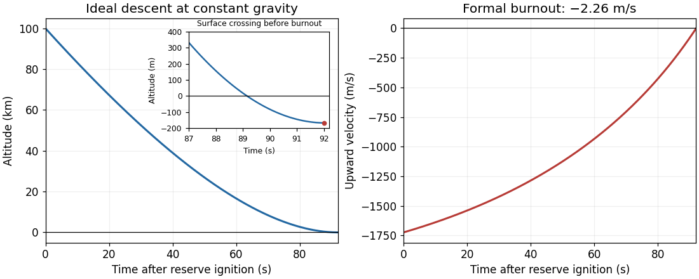

<h1 id="7/solution">Solution</h1>

↑ **Parent:** [7](../7.md)

**Powered ascent.** Use upward signed [velocity](../../../velocity.md), constant [gravitational acceleration](../../../gravitational-acceleration.md) $g=9.81\,\mathrm{m\,s^{-2}}$, constant relative [rocket exhaust speed](../../../rocket-exhaust-speed.md) $u=2500\,\mathrm{m\,s^{-1}}$, vertical flight from rest, no [drag force](../../../drag-physics.md), and no [impulse](../../../impulse.md) at stage separation. The constant-$g$ approximation is an explicit modelling assumption; a varying [Newtonian gravitational field](../../../newtonian-gravitational-field.md) would require integrating a different ascent equation. Put $m_0=540000\,\mathrm{kg}$ and $q=2500\,\mathrm{kg\,s^{-1}}$. During ascent $m(t)=m_0-qt$, and [momentum](../../../momentum-split.md) balance gives the [rocket equation](../../../rocket-equation.md) with [gravity](../../../gravity.md):

$$
m\dot v=uq-mg,
\qquad v(t)=u\ln\frac{m_0}{m_0-qt}-gt.
$$

The launch [rocket thrust](../../../rocket-thrust.md) $uq=6.25\times10^6\,\mathrm N$ exceeds $m_0g$, so immediate lift-off is consistent. At ascent burnout the entire attached vehicle still has [mass](../../../mass.md) $m_b=140000\,\mathrm{kg}$, not $40000\,\mathrm{kg}$; the latter is the separated first stage. The burn duration and endpoint [speed](../../../speed.md) are

$$
t_b=\frac{400000}{2500}=160\,\mathrm s,
\qquad
\boxed{v_b=u\ln\frac{m_0}{m_b}-gt_b
=1805.22\,\mathrm{m\,s^{-1}}.}
$$

**Coasting height.** Integrating the ascent [velocity](../../../velocity.md) from zero height gives

$$
z(t)=u\left[t-\frac{m_0-qt}{q}\ln\frac{m_0}{m_0-qt}\right]-\frac12gt^2.
$$

For example this follows by substituting $m=m_0-qt$ in $\int_0^t\ln[m_0/(m_0-qs)]\,ds$. At separation,

$$
z_b=u\left[t_b-\frac{m_b}{q}\ln\frac{m_0}{m_b}\right]-\frac12gt_b^2
=85442.26\,\mathrm m.
$$

The separated stage then undergoes [free fall in a constant gravitational field](../../../free-fall-in-a-constant-gravitational-field.md) with initial upward [speed](../../../speed.md) $v_b$. [Conservation of mechanical energy](../../../conservation-of-mechanical-energy.md) during this coast gives

$$
\boxed{H=z_b+\frac{v_b^2}{2g}=251538.47\,\mathrm m\simeq251.54\,\mathrm{km}.}
$$

Its smaller [mass](../../../mass.md) after separation does not change that coasting height.

**Reserve burn.** On descending to $z_i=100000\,\mathrm m$, [conservation of mechanical energy](../../../conservation-of-mechanical-energy.md) gives downward [speed](../../../speed.md)

$$
w_i=\sqrt{2g(H-z_i)}=1724.29255\,\mathrm{m\,s^{-1}}.
$$

Reset time to $s=0$ at reserve ignition. Now $m_i=40000\,\mathrm{kg}$, $m_f=14000\,\mathrm{kg}$ and $q_r=26000/92\,\mathrm{kg\,s^{-1}}$. Downward ejection supplies upward [rocket thrust](../../../rocket-thrust.md). The upward signed [velocity](../../../velocity.md) is

$$
v_r(s)=-w_i+u\ln\frac{m_i}{m_i-q_rs}-gs.
$$

Thus the formal free-flight burnout value is

$$
\boxed{v_r(92)=-w_i+u\ln\frac{40000}{14000}-92g
=-2.25724\,\mathrm{m\,s^{-1}},}
$$

corresponding to a **formal downward speed of $2.26\,\mathrm{m\,s^{-1}}$**. Keeping $g=9.8\,\mathrm{m\,s^{-2}}$ throughout instead gives $3.82\,\mathrm{m\,s^{-1}}$ downward; premature rounding is especially damaging because three large [velocity](../../../velocity.md) terms almost cancel.

**The free-flight endpoint is below ground.** Integrating the same reserve-burn [velocity](../../../velocity.md) gives

$$
z_r(s)=z_i-w_is+u\left[s-\frac{m_i-q_rs}{q_r}\ln\frac{m_i}{m_i-q_rs}\right]-\frac12gs^2.
$$

At the stated endpoint this gives $z_r(92)=-167.27\,\mathrm m$ for $g=9.81\,\mathrm{m\,s^{-2}}$. The surface is crossed at approximately $s=89.15\,\mathrm s$, before reserve burnout. The stage has already hit the surface, so a physical post-impact burnout [speed](../../../speed.md) cannot be inferred without a ground-contact model. The boxed [velocity](../../../velocity.md) is the intended ideal continuation, not an achievable free-flight landing result under these exact assumptions. In particular, the given numbers do not describe an exact soft landing. The [constant-rate retro-rocket landing](../../../constant-rate-retro-rocket-landing.md) must satisfy both its [velocity](../../../velocity.md) and height conditions.

**[Figure 1](#7/image-constant-gravity-reserve-descent-the-formal-trajectory-crosses-ground-before-its-nominal-burnout). Constant-gravity reserve descent: the formal trajectory crosses ground before its nominal burnout**.

## ↑ Ancestors (11)

1. [7](../7.md)
2. [2021 resit](../../2021-resit-split.md)
3. [Past exam of the physics 1 paper of the University of Oxford](../../split.md)
4. [Physics 1 paper of the University of Oxford](../../../physics-1-paper-of-the-university-of-oxford.md)
5. [Year 1 of the physics course of the University of Oxford](../../../year-1-of-the-physics-course-of-the-university-of-oxford.md)
6. [Physics course of the University of Oxford](../../../physics-course-of-the-university-of-oxford.md)
7. [Undergraduate course of the University of Oxford](../../../undergraduate-course-of-the-university-of-oxford.md)
8. [Course of the University of Oxford](../../../course-of-the-university-of-oxford.md)
9. [University of Oxford](../../../university-of-oxford-split.md)
10. [List of universities](../../../list-of-universities.md)
11. [Codex Wiki](../../../split.md)
