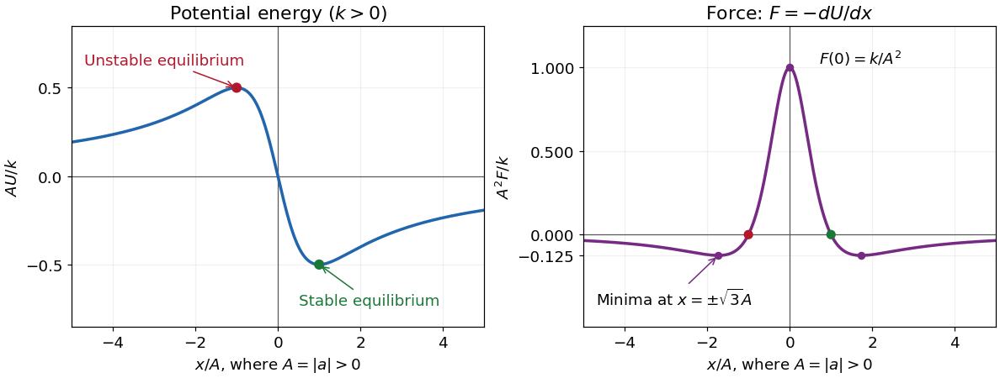

# 2021

↑ **Parent:** [Past exam of the physics 1 paper of the University of Oxford](../past-exam-of-the-physics-1-paper-of-the-university-of-oxford.md)

Source paper: [https://www.whatdotheyknow.com/request/oxford_physics_past_papers_2/response/2340696/attach/9/Physics%20Papers%202020.pdf?cookie_passthrough=1](https://www.whatdotheyknow.com/request/oxford_physics_past_papers_2/response/2340696/attach/9/Physics%20Papers%202020.pdf?cookie_passthrough=1)

The cover identifies the ordinary sitting of 7 June 2021, despite the public bundle's filename. Solutions cover all ten questions, including every alternative in Section B.

**Table of contents**

- [1](#1)
  - [Solution](#1/solution)
- [2](#2)
  - [Solution](#2/solution)
- [3](#3)
  - [Solution](#3/solution)
- [4](#4)
  - [Solution](#4/solution)
- [5](#5)
  - [Solution](#5/solution)
- [6](#6)
  - [Solution](#6/solution)
- [7](#7)
  - [Solution](#7/solution)
- [8](#8)
  - [Solution](#8/solution)
- [9](#9)
  - [Solution](#9/solution)
- [10](#10)
  - [Solution](#10/solution)

## 1

↑ **Parent:** [2021](2021.md)

<h3 id="1/solution">Solution</h3>

↑ **Parent:** [1](#1)

Neglecting the planets' [masses](../classical-mechanics.md#mass) compared with the [Sun](../stellar-astrophysics.md#sun)'s [mass](../classical-mechanics.md#mass), [Newton's law of universal gravitation](../newton-s-law-of-universal-gravitation.md) supplies the [centripetal acceleration](../classical-mechanics.md#centripetal-acceleration) of each [circular orbit](../classical-mechanics.md#circular-orbit):

$$
\frac{GM_\odot}{r^2}=\frac{4\pi^2r}{T^2}.
$$

Thus [Kepler's third law](../mathematical-physics.md#kepler-s-third-law), calibrated by the [Earth](../planetary-science.md#earth)'s [orbital period](../celestial-mechanics.md#orbital-period) of one year and [orbital radius](../dynamical-systems.md#orbital-radius) of one [astronomical unit](../planetary-science.md#astronomical-unit), gives

$$
\frac{T}{1\,\mathrm{yr}}=\left(\frac{r}{1\,\mathrm{AU}}\right)^{3/2},\qquad
\boxed{T_J=5.2^{3/2}=11.86\,\mathrm{yr},\quad T_S=9.5^{3/2}=29.28\,\mathrm{yr}.}
$$

Both [orbits](../dynamical-systems.md#orbit-dynamical-system) are taken to have the same direction. Their relative [angular speed](../rigid-body-dynamics.md#angular-speed) is $2\pi(1/T_J-1/T_S)$, so the [Sun](../stellar-astrophysics.md#sun)-centred interval between successive [conjunctions](../planetary-science.md#conjunction-astronomy) is the [synodic period](../celestial-mechanics.md#synodic-period)

$$
\boxed{T_{\rm syn}=\frac{1}{1/T_J-1/T_S}=19.93\,\mathrm{yr}.}
$$

Using the supplied rounded [orbital radii](../dynamical-systems.md#orbital-radius) explains the small difference from the commonly quoted approximately twenty-year interval.

From the [Earth](../planetary-science.md#earth), the two lines of sight are displaced differently because [Jupiter](../planetary-science.md#jupiter) and [Saturn](../astrophysics.md#saturn) are at different [distances](../geometry-and-topology.md#distance). The [Earth](../planetary-science.md#earth)'s annual [motion](../classical-mechanics.md#motion) along its [orbit](../dynamical-systems.md#orbit-dynamical-system) therefore shifts the dates of apparent [conjunctions](../planetary-science.md#conjunction-astronomy) by amounts of order months. The broad recurrence remains about twenty years, but successive apparent [conjunctions](../planetary-science.md#conjunction-astronomy) need not be equally spaced: [apparent retrograde motion](../planetary-science.md#apparent-retrograde-motion) can produce a group of three [conjunctions](../planetary-science.md#conjunction-astronomy) separated by months during one encounter. The [Earth](../planetary-science.md#earth)'s daily rotation adds a much smaller change of viewpoint. This is a geometrical comparison in the stipulated coplanar model; daylight and the horizon can prevent a particular [conjunction](../planetary-science.md#conjunction-astronomy) from being visible at a chosen surface location.

## 2

↑ **Parent:** [2021](2021.md)

<h3 id="2/solution">Solution</h3>

↑ **Parent:** [2](#2)

Take downward [distance](../geometry-and-topology.md#distance) $s$ and downward [speed](../classical-mechanics.md#speed) $v=ds/dt\geq0$, with constant [gravitational acceleration](../newton-s-law-of-universal-gravitation.md#gravitational-acceleration) $g>0$ and [quadratic drag](../fluid-mechanics.md#quadratic-drag) coefficient $k>0$. The printed vector square has no standard vector meaning; the directionally consistent [drag force](../fluid-mechanics.md#drag-physics) is $\mathbf F_d=-mk|\mathbf v|\mathbf v$. For this downward fall, [Newton's second law](../force.md#newton-s-second-law) becomes

$$
\frac{dv}{dt}=g-kv^2.
$$

The [terminal velocity](../classical-mechanics.md#terminal-velocity) is obtained by setting the net [force](../force.md) to zero:

$$
\boxed{v_\infty=\sqrt{g/k}\quad\text{downward}.}
$$

From rest, the [speed](../classical-mechanics.md#speed) increases monotonically towards this limiting value. In fact $v(t)=v_\infty\tanh(\sqrt{gk}\,t)$; thus it is a [supremum](../real-analysis.md#supremum) approached at infinite time, and a tower of finite height need not permit it to be reached.

For the required [distance](../geometry-and-topology.md#distance), use the [chain rule](../calculus.md#chain-rule) $dv/dt=v\,dv/ds$. Writing $w=v^2$ gives a [linear ordinary differential equation](../linear-ordinary-differential-equation.md):

$$
\frac{dw}{ds}+2kw=2g,\qquad w(0)=0,
\qquad
v^2(s)=\frac gk\left(1-e^{-2ks}\right).
$$

Consequently,

$$
\frac{v^2}{v_\infty^2}=\frac14=1-e^{-2ks},\qquad
\boxed{s_{1/2}=\frac{1}{2k}\log\frac43.}
$$

Here $k$ has units of inverse [length](../physics.md#length), so the result has the required units of [distance](../geometry-and-topology.md#distance) and is independent of the falling [mass](../classical-mechanics.md#mass).

## 3

↑ **Parent:** [2021](2021.md)

<h3 id="3/solution">Solution</h3>

↑ **Parent:** [3](#3)

First take $a\ne0$, put $A=|a|$, and suppose $k>0$. The [force](../force.md) is the negative [derivative](../calculus.md#derivative) of the [potential energy](../energy.md#potential-energy):

$$
U(x)=-\frac{kx}{A^2+x^2},\qquad
\boxed{F(x)=-U'(x)=\frac{k(A^2-x^2)}{(A^2+x^2)^2}.}
$$

The [potential energy](../energy.md#potential-energy) is an [odd function](../calculus.md#odd-function), passes through $U(0)=0$, and approaches zero from above as $x\to-\infty$ and from below as $x\to+\infty$. Its [stationary points](../calculus-of-variations.md#stationary-point) are $x=\pm A$:

$$
U(-A)=\frac{k}{2A},\qquad U(A)=-\frac{k}{2A},\qquad
U''(-A)=-\frac{k}{2A^3},\qquad U''(A)=\frac{k}{2A^3}.
$$

Thus the sole [stable equilibrium](../dynamical-systems.md#stable-equilibrium) is the [local minimum](../analysis.md#local-minimum) at $x=A$; the [local maximum](../analysis.md#local-maximum) at $x=-A$ is an [unstable equilibrium](../dynamical-systems.md#unstable-equilibrium). The requested values at the [stable equilibrium](../dynamical-systems.md#stable-equilibrium) are

$$
\boxed{x_{\rm stable}=A,\qquad U_{\rm stable}=-\frac{k}{2A},\qquad F_{\rm stable}=0.}
$$

The [force](../force.md) is an [even function](../calculus.md#even-function), positive for $|x|<A$, negative for $|x|>A$, and zero at $x=\pm A$. Its central maximum is $F(0)=k/A^2$. Since

$$
F'(x)=\frac{2kx(x^2-3A^2)}{(A^2+x^2)^3},
$$

its two minima occur at $x=\pm\sqrt3A$, with $F=-k/(8A^2)$, and $F\to0^-$ at both ends. These values fix the shapes of both requested sketches.

**[Figure 1](#3/image-dimensionless-potential-energy-and-force-for-positive-k-and-nonzero-a-with-the-stable-and-unstable-equilibria-marked). Dimensionless potential energy and force for positive k and nonzero a, with the stable and unstable equilibria marked**.

In one dimension, **attraction towards the origin** means $xF(x)<0$, while **repulsion from the origin** means $xF(x)>0$. With that explicitly stated convention,

$$
\boxed{\begin{aligned}
\text{attraction:}&\quad -A<x<0\quad\text{or}\quad x>A,\\
\text{repulsion:}&\quad x<-A\quad\text{or}\quad 0<x<A.
\end{aligned}}
$$

A positive [force](../force.md) alone means rightward, not necessarily outward. At the origin $F(0)\ne0$, so it is not an [equilibrium](../dynamical-systems.md#equilibrium-point-of-a-dynamical-system); the inward/outward distinction is undefined exactly there.

The sign assumptions matter because the paper calls $a,k$ merely constants. For $k<0$ both curves reverse sign, the [stable equilibrium](../dynamical-systems.md#stable-equilibrium) is $x=-A$, its [potential energy](../energy.md#potential-energy) is $-|k|/(2A)$, and the attraction/repulsion intervals interchange. For $k=0$ the [force](../force.md) vanishes everywhere on the nonsingular domain and there is no isolated [potential energy](../energy.md#potential-energy) minimum. If $a=0$ and $k\ne0$, then $U=-k/x$ for $x\ne0$ and $F=-k/x^2$, with no finite [equilibrium](../dynamical-systems.md#equilibrium-point-of-a-dynamical-system).

## 4

↑ **Parent:** [2021](2021.md)

<h3 id="4/solution">Solution</h3>

↑ **Parent:** [4](#4)

Choose the vertical $z$ axis downward, and measure the [polar angle](../multivariable-calculus.md#polar-angle) $\theta$ from it. With [azimuth](../astrophysics.md#azimuth) $\phi$ and fixed rod [length](../physics.md#length) $r$, the [Cartesian coordinates](../linear-algebra.md#cartesian-coordinate-system) are

$$
\boxed{x=r\sin\theta\cos\phi,\qquad y=r\sin\theta\sin\phi,\qquad z=r\cos\theta.}
$$

The massless rod has no [kinetic energy](../energy.md#kinetic-energy). Differentiating these [coordinates](../vector-space.md#coordinate-linear-algebra) and adding the squared components of [velocity](../classical-mechanics.md#velocity) yields

$$
v^2=\dot x^2+\dot y^2+\dot z^2
=r^2\left(\dot\theta^2+\sin^2\theta\,\dot\phi^2\right).
$$

The [gravitational potential energy](../energy.md#gravitational-energy) is $V=-mgz=-mgr\cos\theta$, up to an arbitrary constant. The [Lagrangian](../calculus-of-variations.md#lagrangian) of this [spherical pendulum](../simple-pendulum.md#spherical-pendulum) is therefore

$$
\boxed{L=\frac12mr^2\left(\dot\theta^2+\sin^2\theta\,\dot\phi^2\right)+mgr\cos\theta.}
$$

Applying the [Euler-Lagrange equation](../analysis.md#euler-lagrange-equation) to the two [generalized coordinates](../lagrangian-mechanics.md#generalized-coordinate) gives

$$
mr^2\ddot\theta-mr^2\sin\theta\cos\theta\,\dot\phi^2+mgr\sin\theta=0,
\qquad
\frac{d}{dt}\left(mr^2\sin^2\theta\,\dot\phi\right)=0.
$$

Equivalently, away from the [coordinate singularities](../general-relativity.md#coordinate-singularity) at the poles,

$$
\boxed{\ddot\theta=\sin\theta\cos\theta\,\dot\phi^2-\frac gr\sin\theta,\qquad
\ddot\phi+2\cot\theta\,\dot\theta\dot\phi=0.}
$$

Since $L$ is independent of $\phi$, the [azimuth](../astrophysics.md#azimuth) is a [cyclic coordinate](../lagrangian-mechanics.md#cyclic-coordinate). Its [conjugate momentum](../hamiltonian-mechanics.md#canonical-momentum)

$$
p_\phi=mr^2\sin^2\theta\,\dot\phi
$$

is the conserved component of [angular momentum](../momentum.md#angular-momentum) about the downward vertical axis. The [polar angle](../multivariable-calculus.md#polar-angle) is not a [cyclic coordinate](../lagrangian-mechanics.md#cyclic-coordinate). Using an upward $z$ axis instead reverses the sign of the cosine term in $L$ and of the corresponding gravity term; it describes the same motion with the opposite [polar angle](../multivariable-calculus.md#polar-angle) convention.

## 5

↑ **Parent:** [2021](2021.md)

<h3 id="5/solution">Solution</h3>

↑ **Parent:** [5](#5)

Orient the $x$ axis along the displacement from the earlier event to the later one, so $\Delta x=d=1000\,\mathrm m$ and $\Delta t=10^{-6}\,\mathrm s$. For a parallel [Lorentz transformation](../special-relativity.md#lorentz-transformation), [simultaneity](../special-relativity.md#simultaneity) in the second [inertial frame](../mathematical-physics.md#inertial-frame) requires

$$
\Delta t'=\gamma\left(\Delta t-\frac{v\Delta x}{c^2}\right)=0,
\qquad
\boxed{v=\frac{c^2\Delta t}{d}=8.99\times10^7\,\mathrm{m\,s^{-1}}\simeq0.300c.}
$$

The second [inertial frame](../mathematical-physics.md#inertial-frame) moves towards the later event's location. The positive value $d^2-c^2\Delta t^2$ establishes [spacelike separation](../special-relativity.md#spacelike-separation), which permits this change of [simultaneity](../special-relativity.md#simultaneity). For a general [velocity](../classical-mechanics.md#velocity) $\mathbf V$, the condition is $\mathbf V\cdot\Delta\mathbf r=c^2\Delta t$: only its component along the separation is fixed at the displayed value, and transverse components are allowed provided $|\mathbf V|<c$. Thus the parallel [velocity](../classical-mechanics.md#velocity) has the smallest possible [speed](../classical-mechanics.md#speed).

A physical [inertial frame](../mathematical-physics.md#inertial-frame) must have $|v|<c$, giving

$$
\boxed{|\Delta t|<\frac dc=3.336\,\mu\mathrm s.}
$$

**There is no attained maximum:** $d/c$ is the [supremum](../real-analysis.md#supremum). For the concrete boundary case $\Delta t=1000\,\mathrm m/c$, the events have [null separation](../special-relativity.md#null-separation) and the formula would require $v=c$; no [inertial frame](../mathematical-physics.md#inertial-frame) can make them simultaneous.

## 6

↑ **Parent:** [2021](2021.md)

<h3 id="6/solution">Solution</h3>

↑ **Parent:** [6](#6)

Use the [Earth](../planetary-science.md#earth)'s [inertial frame](../mathematical-physics.md#inertial-frame), with the [Earth](../planetary-science.md#earth) at $x=0$ and the star at $x=D=4.2$ light years, neglecting their relative motion. Take the stated relative [velocity](../classical-mechanics.md#velocity) of $B$ to be forward along the same direction as $A$. The [relativistic velocity addition](../special-relativity.md#velocity-addition-formula) law gives

$$
\boxed{v_B=\frac{0.25c+0.50c}{1+(0.25)(0.50)}=\frac23c.}
$$

In units of light years and years, $c=1$ and the spacecraft [worldlines](../special-relativity.md#world-line) are $x_A=t/4$ and $x_B=2t/3$. Their passages at the star occur at

$$
t_{B*}=\frac{4.2}{2/3}=6.3\,\mathrm{yr},\qquad
t_{A*}=\frac{4.2}{1/4}=16.8\,\mathrm{yr}.
$$

The return [radio wave](../electromagnetic-radiation.md#radio-wave) from $B$ follows the leftward light [worldline](../special-relativity.md#world-line)

$$
x=4.2-(t-6.3)=10.5-t.
$$

Intersecting this with $A$'s [worldline](../special-relativity.md#world-line) gives $t/4=10.5-t$, hence

$$
\boxed{t_{A\leftarrow B}=8.4\,\mathrm{yr},\qquad x_{A\leftarrow B}=2.1\,\text{light years}.}
$$

This is the [Earth](../planetary-science.md#earth)-frame coordinate time of reception on $A$, as requested; it is not the reading of $A$'s own clock. If an observer on the [Earth](../planetary-science.md#earth) watched that reception through a returning light signal, they would see it later.

Each transmission from the star takes another $D/c=4.2$ years to reach the [Earth](../planetary-science.md#earth). Therefore

$$
\boxed{t_{\oplus\leftarrow B}=10.5\,\mathrm{yr},\qquad
 t_{\oplus\leftarrow A}=21.0\,\mathrm{yr}.}
$$

All times are measured from the common passage by the [Earth](../planetary-science.md#earth); the spacecraft continue at their stated [velocities](../classical-mechanics.md#velocity) during the calculation.

## 7

↑ **Parent:** [2021](2021.md)

<h3 id="7/solution">Solution</h3>

↑ **Parent:** [7](#7)

[Inertia](../classical-mechanics.md#inertia) is resistance to a change of motion. Translational [inertia](../classical-mechanics.md#inertia) is measured by [mass](../classical-mechanics.md#mass) in [Newton's second law](../force.md#newton-s-second-law); rotational [inertia](../classical-mechanics.md#inertia) about a specified fixed axis is measured by the [moment of inertia](../rigid-body-dynamics.md#moment-of-inertia)

$$
I=\int r_\perp^2\,dm,
$$

where $r_\perp$ is perpendicular [distance](../geometry-and-topology.md#distance) from that axis. For a thin uniform rod, take axes perpendicular to the rod. With [linear mass density](../fluid-mechanics.md#linear-mass-density) $\lambda=m/l$,

$$
I_{\rm CM}=\frac ml\int_{-l/2}^{l/2}x^2\,dx=\frac{ml^2}{12},\qquad
\boxed{I_{\rm end}=I_{\rm CM}+m\left(\frac l2\right)^2=\frac{ml^2}{3}.}
$$

The second result uses the [parallel axis theorem](../rigid-body-dynamics.md#parallel-axis-theorem); direct [integration](../integral.md) over $0\leq x\leq l$ gives the same value. The axis specification is essential: an ideal thin rod has zero [moment of inertia](../rigid-body-dynamics.md#moment-of-inertia) about its own longitudinal axis.

During the short [elastic collision](../classical-mechanics.md#elastic-collision), neglect the [impulse](../classical-mechanics.md#impulse) from gravity. The pivot can exert an external [impulse](../classical-mechanics.md#impulse), so total linear [momentum](../momentum.md) of rod plus particle need not be conserved. Its [torque](../momentum.md#torque) about the pivot is zero, so [conservation of angular momentum](../momentum.md#conservation-of-angular-momentum) about that point applies. Let $w$ be the particle's signed outgoing horizontal [velocity](../classical-mechanics.md#velocity), and $\omega$ the rod's outgoing [angular velocity](../rigid-body-dynamics.md#angular-velocity), positive towards the incident motion. Then

$$
mlv_0=mlw+I_{\rm end}\omega,\qquad
\frac12mv_0^2=\frac12mw^2+\frac12I_{\rm end}\omega^2.
$$

Substituting $\omega=3(v_0-w)/l$ into the [kinetic energy](../energy.md#kinetic-energy) equation gives

$$
v_0^2=w^2+3(v_0-w)^2,
\qquad (v_0-w)(v_0-2w)=0.
$$

Discarding the zero-[impulse](../classical-mechanics.md#impulse) branch $w=v_0$, the actual [collision](../classical-mechanics.md#collision) gives

$$
\boxed{w=\frac{v_0}{2}\quad\text{forward},\qquad
\omega=\frac{3v_0}{2l}.}
$$

The rod's lower end initially moves forward at $l\omega=3v_0/2$, so the bodies separate. Afterwards the free particle undergoes [projectile motion](../classical-mechanics.md#projectile-motion). With the pivot as origin and $z$ downward, its [trajectory](../classical-mechanics.md#trajectory) is $x=(v_0/2)t$, $z=l+gt^2/2$, where $t=0$ at the [collision](../classical-mechanics.md#collision). The rod instead swings about the fixed pivot in a vertical plane as a [physical pendulum](../mathematical-physics.md#physical-pendulum).

The rod's initial rotational [kinetic energy](../energy.md#kinetic-energy) is $I_{\rm end}\omega^2/2=3mv_0^2/8$. Reaching the horizontal raises its [centre of mass](../classical-mechanics.md#center-of-mass) by $l/2$, increasing [gravitational potential energy](../energy.md#gravitational-energy) by $mgl/2$. Consequently,

$$
\boxed{v_0^2\geq\frac{4gl}{3}\ \text{to reach the horizontal},\qquad
v_0=\sqrt{\frac{4gl}{3}}\ \text{to just reach it at rest}.}
$$

For the threshold case, measure the rod's [angle](../geometry-and-topology.md#angle) $\theta$ from the downward vertical and reset $t=0$ at its first horizontal [turning point](../energy.md#turning-point), so $\theta(0)=\pi/2$ and $\dot\theta(0)=0$. The restoring [torque](../momentum.md#torque) about the pivot gives the exact [equation of motion](../classical-mechanics.md#equation-of-motion)

$$
\boxed{\ddot\theta+\frac{3g}{2l}\sin\theta=0.}
$$

At the horizontal, $\ddot\theta=-3g/(2l)$, so the rod immediately swings back. [Conservation of mechanical energy](../energy.md#conservation-of-mechanical-energy) yields

$$
\frac12\frac{ml^2}{3}\dot\theta^2+\frac{mgl}{2}(1-\cos\theta)=\frac{mgl}{2},
\qquad
\dot\theta^2=\frac{3g}{l}\cos\theta.
$$

On the initial descent its explicit time dependence is specified by the [definite integral](../integral.md#definite-integral)

$$
\boxed{t=\sqrt{\frac{l}{3g}}\int_{\theta(t)}^{\pi/2}\frac{d\alpha}{\sqrt{\cos\alpha}}.}
$$

It continues through the vertical to $-\pi/2$, reverses, and repeats without damping. An alternative expression valid throughout the oscillation uses the [Jacobi elliptic sine](../complex-analysis.md#jacobi-elliptic-sine). Put $k=1/\sqrt2$, $\omega_r=\sqrt{3g/(2l)}$, and let $K(k)$ denote the [complete elliptic integral of the first kind](../complex-analysis.md#complete-elliptic-integral-of-the-first-kind). Then

$$
\boxed{\theta(t)=2\arcsin\!\left[k\,\operatorname{sn}\!\left(K(k)-\omega_rt,k\right)\right],\qquad
T_r=4\sqrt{\frac{2l}{3g}}\,K\!\left(\frac1{\sqrt2}\right).}
$$

This is not [simple harmonic motion](../classical-mechanics.md#simple-harmonic-motion) at an [amplitude](../wave.md#wave-amplitude) of $\pi/2$. Its [oscillation period](../classical-mechanics.md#period-of-an-oscillation) exceeds its own small-[amplitude](../wave.md#wave-amplitude) value $2\pi\sqrt{2l/(3g)}$ by the factor $2K(1/\sqrt2)/\pi\simeq1.18034$.

A [simple pendulum](../simple-pendulum.md) of [length](../physics.md#length) $l/2$ obeys $\ddot\theta+(2g/l)\sin\theta=0$. At the same [amplitude](../wave.md#wave-amplitude) $\pi/2$, its [oscillation period](../classical-mechanics.md#period-of-an-oscillation) is $T_p=4\sqrt{l/(2g)}K(1/\sqrt2)$, so

$$
\boxed{\frac{T_r}{T_p}=\frac{2}{\sqrt3}>1.}
$$

The rod swings more slowly. Its equivalent [simple pendulum](../simple-pendulum.md) [length](../physics.md#length) is $I_{\rm end}/[m(l/2)]=2l/3$, not the [distance](../geometry-and-topology.md#distance) $l/2$ to its [centre of mass](../classical-mechanics.md#center-of-mass). The same [oscillation period](../classical-mechanics.md#period-of-an-oscillation) ratio holds in the common small-[amplitude](../wave.md#wave-amplitude) limit, but replacing the actual 90-degree motion by that limit would underestimate both [oscillation periods](../classical-mechanics.md#period-of-an-oscillation).

## 8

↑ **Parent:** [2021](2021.md)

<h3 id="8/solution">Solution</h3>

↑ **Parent:** [8](#8)

For a satellite of [mass](../classical-mechanics.md#mass) $m$ moving in the [Newtonian gravitational field](../newton-s-law-of-universal-gravitation.md#newtonian-gravitational-field) of a much larger, effectively fixed [mass](../classical-mechanics.md#mass) $M$, put $\mu=GM$. Its conserved [mechanical energy](../energy.md#mechanical-energy), with [gravitational potential energy](../energy.md#gravitational-energy) zero at infinity, is

$$
\boxed{E=\frac12mv^2-\frac{GMm}{r}=-\frac{GMm}{2a}.}
$$

Here $r$ is the instantaneous centre-to-centre [distance](../geometry-and-topology.md#distance), $v$ the satellite's [speed](../classical-mechanics.md#speed), $G$ the [gravitational constant](../newton-s-law-of-universal-gravitation.md#gravitational-constant), and $a$ the [semi-major axis](../celestial-mechanics.md#semi-major-axis) of its bound [elliptic orbit](../celestial-mechanics.md#elliptic-orbit). The [kinetic energy](../energy.md#kinetic-energy) and [potential energy](../energy.md#potential-energy) vary around the [orbit](../dynamical-systems.md#orbit-dynamical-system), while their sum remains constant. Dividing by $m$ and solving for $v$ gives the [vis-viva equation](../celestial-mechanics.md#vis-viva-equation), $v^2=\mu(2/r-1/a)$.

For this [Hohmann transfer orbit](../celestial-mechanics.md#hohmann-transfer-orbit), the [periapsis](../celestial-mechanics.md#periapsis) and [apoapsis](../celestial-mechanics.md#apoapsis) [distances](../geometry-and-topology.md#distance) are $r_1=1\,\mathrm{AU}$ and $r_2=1.52\,\mathrm{AU}$, so

$$
a=\frac{r_1+r_2}{2}=1.26\,\mathrm{AU},\qquad
v_1=\sqrt{\frac{\mu}{r_1}}.
$$

The [vis-viva equation](../celestial-mechanics.md#vis-viva-equation) gives the endpoint [speeds](../classical-mechanics.md#speed)

$$
\boxed{v_{\rm p}=v_1\sqrt{2-\frac1{1.26}}=v_1\sqrt{\frac{76}{63}},\qquad
v_{\rm a}=v_1\sqrt{\frac2{1.52}-\frac1{1.26}}.}
$$

As a check, [conservation of angular momentum](../momentum.md#conservation-of-angular-momentum) at the two endpoints gives $r_1v_{\rm p}=r_2v_{\rm a}$ because each [velocity](../classical-mechanics.md#velocity) is perpendicular to its radius. Using $1\,\mathrm{AU}=1.49598\times10^{11}\,\mathrm m$ and $\mu=1.32712\times10^{20}\,\mathrm{m^3\,s^{-2}}$ gives $v_1=29.78\,\mathrm{km\,s^{-1}}$ and

$$
\boxed{v_{\rm p}=32.71\,\mathrm{km\,s^{-1}},\qquad
v_{\rm a}=21.52\,\mathrm{km\,s^{-1}}.}
$$

The departure [impulse](../classical-mechanics.md#impulse) must increase the [speed](../classical-mechanics.md#speed) in the direction of the initial [circular orbit](../classical-mechanics.md#circular-orbit):

$$
\boxed{\Delta v_1=v_{\rm p}-v_1=2.93\,\mathrm{km\,s^{-1}}.}
$$

These are [Sun](../stellar-astrophysics.md#sun)-centred [speeds](../classical-mechanics.md#speed); leaving the [Earth](../planetary-science.md#earth)'s own [gravitational field](../physics.md#gravitational-field) would require an additional calculation beyond this idealized solar [orbit](../dynamical-systems.md#orbit-dynamical-system) transfer.

At $r_2$, the desired [circular orbit](../classical-mechanics.md#circular-orbit) [speed](../classical-mechanics.md#speed) is $v_2=\sqrt{\mu/r_2}=24.16\,\mathrm{km\,s^{-1}}$. The arrival [impulse](../classical-mechanics.md#impulse) is therefore

$$
\boxed{\Delta v_2=v_2-v_{\rm a}=2.64\,\mathrm{km\,s^{-1}}.}
$$

The required thrust on the spacecraft is forward, tangent to its [orbit](../dynamical-systems.md#orbit-dynamical-system), to accelerate it. The rocket ejects exhaust backwards, opposite to the spacecraft's [velocity](../classical-mechanics.md#velocity); this distinguishes the direction of thrust from the direction in which the exhaust is fired.

The [Hohmann transfer time](../celestial-mechanics.md#hohmann-transfer-time) is half the [orbital period](../celestial-mechanics.md#orbital-period) of the transfer [ellipse](../euclidean-geometry.md#ellipse). From [Kepler's third law](../mathematical-physics.md#kepler-s-third-law), relative to the [Earth](../planetary-science.md#earth)'s one-year [orbital period](../celestial-mechanics.md#orbital-period),

$$
t_H=\frac12(1.26)^{3/2}\,\mathrm{yr}=0.7072\,\mathrm{yr}\simeq258\,\text{days}.
$$

Meanwhile [Mars](../astrophysics.md#mars)'s [orbital period](../celestial-mechanics.md#orbital-period) is $T_M=1.52^{3/2}\,\mathrm{yr}=1.8740\,\mathrm{yr}$. The spacecraft arrives $\pi$ [radians](../geometry-and-topology.md#radian) from its departure [position](../classical-mechanics.md#position). For a rendezvous, [Mars](../astrophysics.md#mars) must reach that same [position](../classical-mechanics.md#position) after advancing through $2\pi t_H/T_M$. Thus its initial lead [angle](../geometry-and-topology.md#angle) over the departing spacecraft is

$$
\boxed{\phi_0=\pi-\frac{2\pi t_H}{T_M}
=\pi\left[1-\left(\frac{1.26}{1.52}\right)^{3/2}\right]
=44.15^\circ.}
$$

[Mars](../astrophysics.md#mars) must be ahead by this [angle](../geometry-and-topology.md#angle) in the common direction of [motion](../classical-mechanics.md#motion) around their [orbits](../dynamical-systems.md#orbit-dynamical-system). At departure the spacecraft and the [Earth](../planetary-science.md#earth) share the inner [orbital position](../dynamical-systems.md#orbital-position); arrival occurs on the opposite side of the [Sun](../stellar-astrophysics.md#sun).

## 9

↑ **Parent:** [2021](2021.md)

<h3 id="9/solution">Solution</h3>

↑ **Parent:** [9](#9)

Take $+y$ upwards in the source diagram. Write $w$ for $B$'s incoming [speed](../classical-mechanics.md#speed), so the initial [velocities](../classical-mechanics.md#velocity) are

$$
\mathbf u_A=(-u,0),\qquad
\mathbf u_B=\left(\frac{\sqrt3}{2}w,\frac12w\right).
$$

**A contact-direction assumption is needed for a unique answer.** The diagram specifies the incoming [velocities](../classical-mechanics.md#velocity) but does not specify the contact normal or an outgoing [angle](../geometry-and-topology.md#angle). First adopt the usual intended model: the [impulse](../classical-mechanics.md#impulse) is horizontal, so neither particle changes its $y$ component of [velocity](../classical-mechanics.md#velocity). This is the smooth [oblique collision](../classical-mechanics.md#oblique-collision) model with a horizontal line of centres at impact. Bringing $A$ to rest in the $x$ direction then brings it entirely to rest.

Let $b$ be $B$'s outgoing $x$ component of [velocity](../classical-mechanics.md#velocity). [Conservation of momentum](../momentum.md#momentum-conservation) and conservation of [kinetic energy](../energy.md#kinetic-energy) give

$$
-3u+\frac{\sqrt3}{2}w=b,
\qquad
3u^2+w^2=b^2+\frac14w^2.
$$

Put $q=(\sqrt3/2)w$. The second equation becomes $3u^2+q^2=(q-3u)^2$, so $q=u$. Therefore

$$
\boxed{w=\frac{2u}{\sqrt3},\qquad
\mathbf v_A=(0,0),\qquad
\mathbf v_B=\left(-2u,\frac{u}{\sqrt3}\right).}
$$

The outgoing [kinetic energies](../energy.md#kinetic-energy) are

$$
\boxed{K_A=0,\qquad K_B=\frac12m\left(4u^2+\frac{u^2}{3}\right)=\frac{13}{6}mu^2.}
$$

The outgoing [speed](../classical-mechanics.md#speed) of $B$ is $u\sqrt{13/3}$, directed above the negative $x$ axis at [angle](../geometry-and-topology.md#angle) $\tan^{-1}[1/(2\sqrt3)]\simeq16.1^\circ$. The initial [kinetic energy](../energy.md#kinetic-energy) is also $(3/2+2/3)mu^2=13mu^2/6$, as required for an [elastic collision](../classical-mechanics.md#elastic-collision).

For the [perfectly inelastic collision](../classical-mechanics.md#perfectly-inelastic-collision) with these same incoming [velocities](../classical-mechanics.md#velocity), both particles share a common outgoing [velocity](../classical-mechanics.md#velocity). [Conservation of momentum](../momentum.md#momentum-conservation) gives

$$
\boxed{\mathbf V=\frac{3m\mathbf u_A+m\mathbf u_B}{4m}
=\left(-\frac u2,\frac{u}{4\sqrt3}\right),\qquad
|\mathbf V|=\frac{\sqrt{13}}{4\sqrt3}u.}
$$

Its direction is again $16.1^\circ$ above the negative $x$ axis. The separate translational [kinetic energies](../energy.md#kinetic-energy) of the constituents and their total are

$$
\boxed{K_A=\frac{13}{32}mu^2,\qquad K_B=\frac{13}{96}mu^2,\qquad
K_{\rm final}=\frac{13}{24}mu^2.}
$$

The loss of translational [kinetic energy](../energy.md#kinetic-energy) is

$$
\boxed{K_{\rm initial}-K_{\rm final}=\frac{13}{8}mu^2.}
$$

This becomes internal [energy](../energy.md), for example deformation and heating; total [energy](../energy.md) is conserved. In the [elastic collision](../classical-mechanics.md#elastic-collision) no [kinetic energy](../energy.md#kinetic-energy) is lost and the particles separate with different [velocities](../classical-mechanics.md#velocity). In the [perfectly inelastic collision](../classical-mechanics.md#perfectly-inelastic-collision) relative motion disappears and the common [velocity](../classical-mechanics.md#velocity) is the original [centre of mass](../classical-mechanics.md#center-of-mass) [velocity](../classical-mechanics.md#velocity).

The limitation of the printed data can be made explicit. Without the horizontal-[impulse](../classical-mechanics.md#impulse) assumption, write the final [velocity](../classical-mechanics.md#velocity) of $A$ as $(0,h)$. Then [conservation of momentum](../momentum.md#momentum-conservation) determines

$$
\mathbf v_B=\left(\frac{\sqrt3}{2}w-3u,\frac12w-3h\right),
$$

and conservation of [kinetic energy](../energy.md#kinetic-energy) gives only

$$
\boxed{w(\sqrt3u+h)=2u^2+4h^2.}
$$

There is a family of possibilities. For a concrete second solution, $h=u/\sqrt3$ gives

$$
w=\frac{5\sqrt3}{6}u,\qquad
\mathbf v_A=\left(0,\frac{u}{\sqrt3}\right),\qquad
\mathbf v_B=\left(-\frac74u,-\frac{7\sqrt3}{12}u\right).
$$

These [velocities](../classical-mechanics.md#velocity) conserve both components of [momentum](../momentum.md) and conserve [kinetic energy](../energy.md#kinetic-energy), and they satisfy the specified vanishing $x$ component for $A$, while requiring a different incoming [speed](../classical-mechanics.md#speed). They can arise from a smooth contact normal proportional to $(1,1/\sqrt3)$. Thus the horizontal-[impulse](../classical-mechanics.md#impulse) result is conditional, rather than uniquely implied by the printed statement. For any member of this family the corresponding sticking result remains well determined once $w$ is chosen:

$$
\mathbf V=\frac14\left(-3u+\frac{\sqrt3}{2}w,\frac12w\right),\qquad
K_{\rm final}=2m|\mathbf V|^2,\qquad
\Delta K=\frac{3m}{8}\left(\left[u+\frac{\sqrt3}{2}w\right]^2+\frac{w^2}{4}\right).
$$

The last expression is the lost relative [kinetic energy](../energy.md#kinetic-energy) in a [perfectly inelastic collision](../classical-mechanics.md#perfectly-inelastic-collision) of these two [point masses](../classical-mechanics.md#point-mass).

## 10

↑ **Parent:** [2021](2021.md)

<h3 id="10/solution">Solution</h3>

↑ **Parent:** [10](#10)

The laboratory is the parent's [rest frame](../mathematical-physics.md#rest-frame). In this [relativistic two-body decay](../special-relativity.md#relativistic-two-body-decay), [conservation of momentum](../momentum.md#momentum-conservation) gives equal and opposite daughter [momenta](../momentum.md), of magnitude $p$. Their total [relativistic energies](../special-relativity.md#relativistic-energy) satisfy

$$
E_1+E_2=4mc^2,\qquad
E_1^2=p^2c^2+m^2c^4,\qquad
E_2^2=p^2c^2+4m^2c^4.
$$

Subtracting the [relativistic energy-momentum relations](../special-relativity.md#energy-momentum-relation) eliminates $p$:

$$
(E_2-E_1)(E_2+E_1)=3m^2c^4,
\qquad E_2-E_1=\frac34mc^2.
$$

Solving the two [linear equations](../linear-algebra.md#linear-equation) gives

$$
E_1=\frac{13}{8}mc^2,\qquad E_2=\frac{19}{8}mc^2,\qquad
p=\frac{\sqrt{105}}8mc.
$$

Since [three-momentum](../special-relativity.md#three-momentum) obeys $pc^2=Ev$, the daughter [speeds](../classical-mechanics.md#speed) are

$$
\boxed{v_1=\frac{\sqrt{105}}{13}c=0.7882c,\qquad
v_2=\frac{\sqrt{105}}{19}c=0.5393c.}
$$

Their directions are opposite; the initial state does not specify their common axis. The [kinetic energies](../energy.md#kinetic-energy) are $K_1=5mc^2/8$ and $K_2=3mc^2/8$. Their sum $mc^2$ is the loss of [rest energy](../special-relativity.md#rest-energy) when the total daughter [rest mass](../special-relativity.md#invariant-mass) is $3m$ instead of $4m$.

The [proper mean lifetime](../relativistic-quantum-field.md#proper-mean-lifetime) $\tau_0$ is the [mean lifetime](../relativistic-quantum-field.md#mean-lifetime-physics) measured in the unstable particle's own [rest frame](../mathematical-physics.md#rest-frame), or equivalently the mean elapsed [proper time](../special-relativity.md#proper-time) before decay. In the [exponential decay](../analysis.md#exponential-decay) model, its survival [probability](../probability-theory.md#probability) to [proper time](../special-relativity.md#proper-time) $\tau$ is $e^{-\tau/\tau_0}$. For the daughter of [rest mass](../special-relativity.md#invariant-mass) $m$, the [Lorentz factor](../special-relativity.md#lorentz-factor) is $\gamma_1=E_1/(mc^2)=13/8$, so [time dilation](../special-relativity.md#time-dilation) gives a laboratory [mean lifetime](../relativistic-quantum-field.md#mean-lifetime-physics) of $\gamma_1\tau_0=3.25\,\mu\mathrm s$.

At constant [speed](../classical-mechanics.md#speed) $v_1$, travelling a [distance](../geometry-and-topology.md#distance) $L$ requires laboratory time $L/v_1$ and [proper time](../special-relativity.md#proper-time) $L/(\gamma_1v_1)$. Its [mean decay length](../relativistic-quantum-field.md#mean-decay-length) is

$$
\ell_d=\gamma_1v_1\tau_0
=\frac{\sqrt{105}}8c\tau_0
=768.0\,\mathrm m
$$

for $\tau_0=2\times10^{-6}\,\mathrm s$. Hence

$$
\boxed{\mathbb P(\text{distance before decay}>1000\,\mathrm m)
=\exp\!\left[-\frac{1000\,\mathrm m}{\ell_d}\right]
=0.272\quad\text{approximately}.}
$$

The [mean lifetime](../relativistic-quantum-field.md#mean-lifetime-physics) sets the scale of an [exponential distribution](../continuous-probability-distribution.md#exponential-distribution); it is not a fixed deadline, so travelling beyond one [mean decay length](../relativistic-quantum-field.md#mean-decay-length) has a nonzero [probability](../probability-theory.md#probability).

## ↑ Ancestors (9)

1. [Past exam of the physics 1 paper of the University of Oxford](../past-exam-of-the-physics-1-paper-of-the-university-of-oxford.md)
2. [Physics 1 paper of the University of Oxford](../university-of-oxford.md#physics-1-paper-of-the-university-of-oxford)
3. [Year 1 of the physics course of the University of Oxford](../university-of-oxford.md#year-1-of-the-physics-course-of-the-university-of-oxford)
4. [Physics course of the University of Oxford](../university-of-oxford.md#physics-course-of-the-university-of-oxford)
5. [Undergraduate course of the University of Oxford](../university-of-oxford.md#undergraduate-course-of-the-university-of-oxford)
6. [Course of the University of Oxford](../university-of-oxford.md#course-of-the-university-of-oxford)
7. [University of Oxford](../university-of-oxford.md)
8. [List of universities](../README.md#list-of-universities)
9. [Codex Wiki](../README.md)
