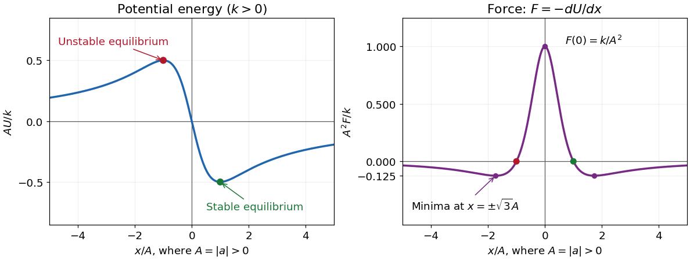

<h1 id="3/solution">Solution</h1>

↑ **Parent:** [3](../3.md)

First take $a\ne0$, put $A=|a|$, and suppose $k>0$. The [force](../../../force-split.md) is the negative [derivative](../../../derivative.md) of the [potential energy](../../../potential-energy.md):

$$
U(x)=-\frac{kx}{A^2+x^2},\qquad
\boxed{F(x)=-U'(x)=\frac{k(A^2-x^2)}{(A^2+x^2)^2}.}
$$

The [potential energy](../../../potential-energy.md) is an [odd function](../../../odd-function.md), passes through $U(0)=0$, and approaches zero from above as $x\to-\infty$ and from below as $x\to+\infty$. Its [stationary points](../../../stationary-point.md) are $x=\pm A$:

$$
U(-A)=\frac{k}{2A},\qquad U(A)=-\frac{k}{2A},\qquad
U''(-A)=-\frac{k}{2A^3},\qquad U''(A)=\frac{k}{2A^3}.
$$

Thus the sole [stable equilibrium](../../../stable-equilibrium.md) is the [local minimum](../../../local-minimum.md) at $x=A$; the [local maximum](../../../local-maximum.md) at $x=-A$ is an [unstable equilibrium](../../../unstable-equilibrium.md). The requested values at the [stable equilibrium](../../../stable-equilibrium.md) are

$$
\boxed{x_{\rm stable}=A,\qquad U_{\rm stable}=-\frac{k}{2A},\qquad F_{\rm stable}=0.}
$$

The [force](../../../force-split.md) is an [even function](../../../even-function.md), positive for $|x|<A$, negative for $|x|>A$, and zero at $x=\pm A$. Its central maximum is $F(0)=k/A^2$. Since

$$
F'(x)=\frac{2kx(x^2-3A^2)}{(A^2+x^2)^3},
$$

its two minima occur at $x=\pm\sqrt3A$, with $F=-k/(8A^2)$, and $F\to0^-$ at both ends. These values fix the shapes of both requested sketches.

**[Figure 1](#3/image-dimensionless-potential-energy-and-force-for-positive-k-and-nonzero-a-with-the-stable-and-unstable-equilibria-marked). Dimensionless potential energy and force for positive k and nonzero a, with the stable and unstable equilibria marked**.

In one dimension, **attraction towards the origin** means $xF(x)<0$, while **repulsion from the origin** means $xF(x)>0$. With that explicitly stated convention,

$$
\boxed{\begin{aligned}
\text{attraction:}&\quad -A<x<0\quad\text{or}\quad x>A,\\
\text{repulsion:}&\quad x<-A\quad\text{or}\quad 0<x<A.
\end{aligned}}
$$

A positive [force](../../../force-split.md) alone means rightward, not necessarily outward. At the origin $F(0)\ne0$, so it is not an [equilibrium](../../../equilibrium-point-of-a-dynamical-system.md); the inward/outward distinction is undefined exactly there.

The sign assumptions matter because the paper calls $a,k$ merely constants. For $k<0$ both curves reverse sign, the [stable equilibrium](../../../stable-equilibrium.md) is $x=-A$, its [potential energy](../../../potential-energy.md) is $-|k|/(2A)$, and the attraction/repulsion intervals interchange. For $k=0$ the [force](../../../force-split.md) vanishes everywhere on the nonsingular domain and there is no isolated [potential energy](../../../potential-energy.md) minimum. If $a=0$ and $k\ne0$, then $U=-k/x$ for $x\ne0$ and $F=-k/x^2$, with no finite [equilibrium](../../../equilibrium-point-of-a-dynamical-system.md).

## ↑ Ancestors (11)

1. [3](../3.md)
2. [2021](../../2021-split.md)
3. [Past exam of the physics 1 paper of the University of Oxford](../../split.md)
4. [Physics 1 paper of the University of Oxford](../../../physics-1-paper-of-the-university-of-oxford.md)
5. [Year 1 of the physics course of the University of Oxford](../../../year-1-of-the-physics-course-of-the-university-of-oxford.md)
6. [Physics course of the University of Oxford](../../../physics-course-of-the-university-of-oxford.md)
7. [Undergraduate course of the University of Oxford](../../../undergraduate-course-of-the-university-of-oxford.md)
8. [Course of the University of Oxford](../../../course-of-the-university-of-oxford.md)
9. [University of Oxford](../../../university-of-oxford-split.md)
10. [List of universities](../../../list-of-universities.md)
11. [Codex Wiki](../../../split.md)
