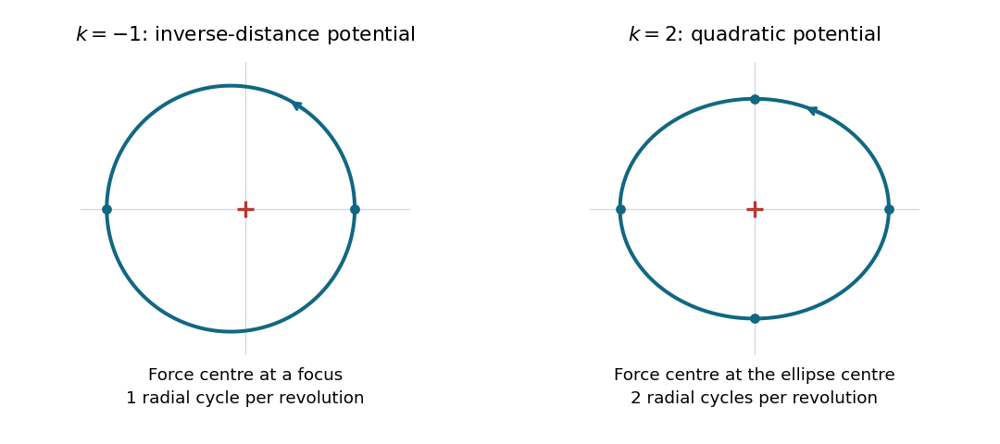

# 2022

↑ **Parent:** [Past exam of the physics 1 paper of the University of Oxford](../past-exam-of-the-physics-1-paper-of-the-university-of-oxford.md)

Source: [https://www.whatdotheyknow.com/request/physics_preliminary_past_papers/response/2680788/attach/3/2018%202021%20Physics%20prelims.zip?cookie_passthrough=1](https://www.whatdotheyknow.com/request/physics_preliminary_past_papers/response/2680788/attach/3/2018%202021%20Physics%20prelims.zip?cookie_passthrough=1)

The cover dates this paper to 6 June 2022; the archive member is misleadingly filed under 2021/T. **Source gap:** printed page 2 is missing from the damaged public PDF. Questions 1–3 cannot be reconstructed; the remaining solutions cover every recoverable part of questions 4–10.

**Table of contents**

- [1](#1)
  - [Solution](#1/solution)
- [2](#2)
  - [Solution](#2/solution)
- [3](#3)
  - [Solution](#3/solution)
- [4](#4)
  - [a](#4/a)
    - [Solution](#4/a/solution)
  - [b](#4/b)
    - [Solution](#4/b/solution)
- [5](#5)
  - [a](#5/a)
    - [Solution](#5/a/solution)
  - [b](#5/b)
    - [Solution](#5/b/solution)
- [6](#6)
  - [a](#6/a)
    - [Solution](#6/a/solution)
  - [b](#6/b)
    - [Solution](#6/b/solution)
- [7](#7)
  - [a](#7/a)
    - [Solution](#7/a/solution)
  - [b](#7/b)
    - [Solution](#7/b/solution)
  - [c](#7/c)
    - [Solution](#7/c/solution)
- [8](#8)
  - [a](#8/a)
    - [Solution](#8/a/solution)
  - [b](#8/b)
    - [Solution](#8/b/solution)
  - [c](#8/c)
    - [Solution](#8/c/solution)
  - [d](#8/d)
    - [Solution](#8/d/solution)
  - [e](#8/e)
    - [Solution](#8/e/solution)
- [9](#9)
  - [a](#9/a)
    - [Solution](#9/a/solution)
  - [b](#9/b)
    - [Solution](#9/b/solution)
- [10](#10)
  - [a](#10/a)
    - [Solution](#10/a/solution)
  - [b](#10/b)
    - [Solution](#10/b/solution)
  - [c](#10/c)
    - [Solution](#10/c/solution)

## 1

↑ **Parent:** [2022](2022.md)

<h3 id="1/solution">Solution</h3>

↑ **Parent:** [1](#1)

**TODO: source missing.** Printed page 2, containing question 1, is absent from the supplied damaged PDF. Its statement, subparts and numerical data are unavailable, so no solution can be inferred responsibly.

## 2

↑ **Parent:** [2022](2022.md)

<h3 id="2/solution">Solution</h3>

↑ **Parent:** [2](#2)

**TODO: source missing.** Printed page 2, containing question 2, is absent from the supplied damaged PDF. Its statement, subparts and numerical data are unavailable, so no solution can be inferred responsibly.

## 3

↑ **Parent:** [2022](2022.md)

<h3 id="3/solution">Solution</h3>

↑ **Parent:** [3](#3)

**TODO: source missing.** Printed page 2, containing question 3, is absent from the supplied damaged PDF. Its statement, subparts and numerical data are unavailable, so no solution can be inferred responsibly.

## 4

↑ **Parent:** [2022](2022.md)

<h3 id="4/a">a</h3>

↑ **Parent:** [4](#4)

<h4 id="4/a/solution">Solution</h4>

↑ **Parent:** [A](#4/a)

For motion in a [central potential](../energy.md#central-potential), [conservation of angular momentum](../momentum.md#conservation-of-angular-momentum) gives $L=mr^2\dot\theta$. In [polar coordinates](../multivariable-calculus.md#polar-coordinates), the conserved [mechanical energy](../energy.md#mechanical-energy) is

$$
E=\frac m2\dot r^2+\frac m2r^2\dot\theta^2-G(r)
=\frac m2\dot r^2+\frac{L^2}{2mr^2}-G(r).
$$

Consequently, for $L\ne0$,

$$
\dot r=\pm\sqrt{\frac{2}{m}[E+G(r)]-\frac{L^2}{m^2r^2}},\qquad
\boxed{\frac{dr}{d\theta}=\frac{mr^2}{L}\dot r
=\pm\frac{r^2}{L}\sqrt{2m[E+G(r)]-\frac{L^2}{r^2}}.}
$$

The sign in $\dot r$ distinguishes inward and outward motion. Choosing the orientation so $L>0$, it is also the sign of $dr/d\theta$. The expression under the [square root](../algebra.md#square-root) must be nonnegative. If $L=0$, the motion is radial and $\theta$ is constant, so $r$ cannot be parametrized by $\theta$ this way.

<h3 id="4/b">b</h3>

↑ **Parent:** [4](#4)

<h4 id="4/b/solution">Solution</h4>

↑ **Parent:** [B](#4/b)

Take $\beta>0$. At a radial [turning point](../energy.md#turning-point), $\dot r=0$, and the [effective potential](../mathematical-physics.md#effective-potential) gives

$$
E=\frac{L^2}{2mr^2}-\frac\beta r,\qquad
\boxed{Er_{\min}^2+\beta r_{\min}-\frac{L^2}{2m}=0.}
$$

For $L\ne0$, the smaller positive radial [turning point](../energy.md#turning-point) is conveniently written without division by $E$:

$$
\boxed{r_{\min}=\frac{L^2}{m\beta+\sqrt{m^2\beta^2+2mEL^2}}.}
$$

This includes $E=0$, where $r_{\min}=L^2/(2m\beta)$. For $E<0$ there is also an outer radial [turning point](../energy.md#turning-point); the two coincide for the [circular orbit](../classical-mechanics.md#circular-orbit) at $E=-m\beta^2/(2L^2)$. Smaller [energies](../energy.md) are inaccessible at that $L$. For $E>0$ there is just one positive radial [turning point](../energy.md#turning-point). If $L=0$, there is no [centrifugal barrier](../mathematical-physics.md#centrifugal-barrier) and an inward trajectory can reach the singular centre; its limiting closest distance is zero.

**The requested omission of $\beta$ is not possible.** For example, at $E=0$ and fixed nonzero $L,m$, doubling $\beta$ halves $r_{\min}$. Thus $E,L,m$ alone cannot determine closest approach.

## 5

↑ **Parent:** [2022](2022.md)

<h3 id="5/a">a</h3>

↑ **Parent:** [5](#5)

<h4 id="5/a/solution">Solution</h4>

↑ **Parent:** [A](#5/a)

Use upward [generalized coordinates](../lagrangian-mechanics.md#generalized-coordinate). Let $h$ be the displacement of the lower [pulley](../classical-mechanics.md#pulley) and $z$ that of the $4m$ [mass](../classical-mechanics.md#mass). The two inextensible [mechanical strings](../continuum-mechanics.md#mechanical-string) impose

$$
x+y-2h=0,\qquad z+h=0,
\qquad h=\frac{x+y}{2},\qquad z=-\frac{x+y}{2}.
$$

For ideal massless [pulleys](../classical-mechanics.md#pulley) and [mechanical strings](../continuum-mechanics.md#mechanical-string), only the three [masses](../classical-mechanics.md#mass) contribute [kinetic energy](../energy.md#kinetic-energy). Hence

$$
\begin{aligned}
K&=\frac12(4m)\left(\frac{\dot x+\dot y}{2}\right)^2
+\frac12(5m)\dot x^2+\frac12(3m)\dot y^2\\
&=m(3\dot x^2+\dot x\dot y+2\dot y^2).
\end{aligned}
$$

Up to a constant, their [gravitational potential energy](../energy.md#gravitational-energy) is

$$
U=4mgz+5mgx+3mgy=mg(3x+y).
$$

The [Lagrangian](../calculus-of-variations.md#lagrangian) of this [compound Atwood machine](../lagrangian-mechanics.md#compound-atwood-machine) is therefore

$$
\boxed{\mathcal L=K-U=m(3\dot x^2+\dot x\dot y+2\dot y^2)-mg(3x+y).}
$$

<h3 id="5/b">b</h3>

↑ **Parent:** [5](#5)

<h4 id="5/b/solution">Solution</h4>

↑ **Parent:** [B](#5/b)

A constant displacement proportional to $(1,-3)$ leaves the [velocities](../classical-mechanics.md#velocity) unchanged and changes $3x+y$ by zero. It is therefore a continuous symmetry of the [Lagrangian](../calculus-of-variations.md#lagrangian). The [generalized momentum](../lagrangian-mechanics.md#generalized-momentum) components are

$$
p_x=\frac{\partial\mathcal L}{\partial\dot x}=m(6\dot x+\dot y),\qquad
p_y=\frac{\partial\mathcal L}{\partial\dot y}=m(\dot x+4\dot y).
$$

[Noether's theorem](../calculus-of-variations.md#noether-conserved-quantity-for-a-mechanical-point-symmetry) gives the conserved quantity

$$
\boxed{P=p_x-3p_y=m(3\dot x-11\dot y)=\text{constant}.}
$$

A direct check using the [Euler-Lagrange equations](../analysis.md#euler-lagrange-equation) is

$$
6\ddot x+\ddot y=-3g,\qquad \ddot x+4\ddot y=-g
\quad\Longrightarrow\quad 3\ddot x-11\ddot y=0.
$$

The normalization of a symmetry generator is arbitrary. One can take the transformation parameter to have [length](../physics.md#length) units and $(K_x,K_y)=(1,-3)$ dimensionless, giving $P$ the units of [momentum](../momentum.md). Alternatively, for the paper's convention with dimensionless parameter and [length](../physics.md#length)-valued $K_i$, use $(K_x,K_y)=(\ell,-3\ell)$; the conserved quantity is then $\ell P$. The conserved content is identical.

## 6

↑ **Parent:** [2022](2022.md)

<h3 id="6/a">a</h3>

↑ **Parent:** [6](#6)

<h4 id="6/a/solution">Solution</h4>

↑ **Parent:** [A](#6/a)

The [special relativity](../special-relativity.md) expression for [momentum](../momentum.md) is $p=\gamma mv$, with [Lorentz factor](../special-relativity.md#lorentz-factor) $\gamma=(1-v^2/c^2)^{-1/2}$. Equal [speeds](../classical-mechanics.md#speed) imply equal [Lorentz factors](../special-relativity.md#lorentz-factor), so the [pion](../standard-model.md#pion) and [proton](../physics.md#proton) [momenta](../momentum.md) are in the ratio of their [rest masses](../special-relativity.md#invariant-mass):

$$
\boxed{p_\pi=p_p\frac{m_\pi}{m_p}=400\frac{0.14}{0.94}
\simeq59.6\,\mathrm{GeV}/c.}
$$

The common dimensionless product is $\gamma v/c=p_p/(m_pc)=400/0.94\simeq425.53$, giving $\gamma\simeq425.53$ and $v/c\simeq0.99999724$.

<h3 id="6/b">b</h3>

↑ **Parent:** [6](#6)

<h4 id="6/b/solution">Solution</h4>

↑ **Parent:** [B](#6/b)

By [time dilation](../special-relativity.md#time-dilation), the laboratory [mean lifetime](../relativistic-quantum-field.md#mean-lifetime-physics) is $\tau=\gamma\tau_0$, where $\tau_0=2.6\times10^{-8}\,\mathrm s$. The [exponential decay](../analysis.md#exponential-decay) law evaluated at travel time $d/v$ gives the surviving [pion](../standard-model.md#pion) fraction

$$
\frac n{n_0}=\exp\left(-\frac{d}{\gamma v\tau_0}\right).
$$

Use the exact product $\gamma v=(400/0.94)c$ from part (a), rather than approximating the [speed](../classical-mechanics.md#speed) separately. With $c=2.99792458\times10^8\,\mathrm{m/s}$,

$$
\gamma v\tau_0\simeq3317\,\mathrm m,\qquad
\boxed{\frac n{n_0}=\exp\left[-\frac{400}{(400/0.94)c(2.6\times10^{-8})}\right]
\simeq0.886.}
$$

Thus about $88.6\%$ emerge without decaying, and about $11.4\%$ decay inside the pipe. This assumes the given common longitudinal [speed](../classical-mechanics.md#speed) and neglects losses from other interactions.

## 7

↑ **Parent:** [2022](2022.md)

<h3 id="7/a">a</h3>

↑ **Parent:** [7](#7)

<h4 id="7/a/solution">Solution</h4>

↑ **Parent:** [A](#7/a)

Align the spatial axes and make the origins coincide at $t=t'=0$. For an [inertial frame](../mathematical-physics.md#inertial-frame) moving at [velocity](../classical-mechanics.md#velocity) $+v$ along $x$, the [Lorentz transformation](../special-relativity.md#lorentz-transformation) is

$$
\boxed{x'=\gamma(x-vt),\quad t'=\gamma\left(t-\frac{vx}{c^2}\right),\quad y'=y,\quad z'=z,
\qquad\gamma=\frac1{\sqrt{1-v^2/c^2}}.}
$$

The inverse [Lorentz transformation](../special-relativity.md#lorentz-transformation) follows by interchanging primed and unprimed coordinates and replacing $v$ by $-v$.

<h3 id="7/b">b</h3>

↑ **Parent:** [7](#7)

<h4 id="7/b/solution">Solution</h4>

↑ **Parent:** [B](#7/b)

Let the object be at rest in $S'$, with [proper length](../special-relativity.md#proper-length) $L_0=x'_2-x'_1$. Measuring its length in $S$ requires two endpoint [events](../probability-space.md#event) simultaneous in $S$, so $\Delta t=0$. The [Lorentz transformation](../special-relativity.md#lorentz-transformation) then gives

$$
L_0=\Delta x'=\gamma(\Delta x-v\Delta t)=\gamma L,
\qquad
\boxed{L=\frac{L_0}{\gamma}=L_0\sqrt{1-v^2/c^2}.}
$$

This is [length contraction](../special-relativity.md#length-contraction). The simultaneous endpoint [events](../probability-space.md#event) in $S$ are not simultaneous in $S'$; that [relativity of simultaneity](../special-relativity.md#relativity-of-simultaneity) is essential to the measurement.

For the two rockets, take the first rocket's Earth-frame [velocity](../classical-mechanics.md#velocity) as $+c/2$ and the second's as $-c/2$. The [velocity-addition formula](../special-relativity.md#velocity-addition-formula) gives the second rocket's [velocity](../classical-mechanics.md#velocity) in the first rocket's [rest frame](../mathematical-physics.md#rest-frame):

$$
u=\frac{-c/2-c/2}{1-(-c/2)(c/2)/c^2}=-\frac45c.
$$

Its [Lorentz factor](../special-relativity.md#lorentz-factor) is $\gamma_{\mathrm{rel}}=5/3$, and therefore its measured length is

$$
\boxed{L_{\mathrm{other}}=\frac35L_0.}
$$

Here “appear” is interpreted as a length measured using simultaneous endpoint positions in the observer's [inertial frame](../mathematical-physics.md#inertial-frame). A photograph, involving unequal light travel times, is a different measurement.

<h3 id="7/c">c</h3>

↑ **Parent:** [7](#7)

<h4 id="7/c/solution">Solution</h4>

↑ **Parent:** [C](#7/c)

Write the incident and scattered [photon](../quantum-mechanics.md#photon) [energies](../energy.md) as $\varepsilon=hc/\lambda$ and $\varepsilon'=hc/\lambda'$. [Conservation of relativistic energy](../special-relativity.md#conservation-of-relativistic-energy) gives the recoiling [electron](../physics.md#electron) [energy](../energy.md) $E_e=mc^2+\varepsilon-\varepsilon'$. By [momentum conservation](../momentum.md#momentum-conservation), its [momentum](../momentum.md) is the difference of the two [photon](../quantum-mechanics.md#photon) [momenta](../momentum.md); hence

$$
p_e^2c^2=\varepsilon^2+\varepsilon'^2-2\varepsilon\varepsilon'\cos\theta.
$$

Insert these into the [relativistic energy-momentum relation](../special-relativity.md#energy-momentum-relation) for the [electron](../physics.md#electron):

$$
(mc^2+\varepsilon-\varepsilon')^2
=m^2c^4+\varepsilon^2+\varepsilon'^2-2\varepsilon\varepsilon'\cos\theta.
$$

Expanding and cancelling terms gives

$$
mc^2(\varepsilon-\varepsilon')=\varepsilon\varepsilon'(1-\cos\theta),\qquad
\frac1{\varepsilon'}-\frac1\varepsilon=\frac{1-\cos\theta}{mc^2}.
$$

Since $1/\varepsilon=\lambda/(hc)$, the [Compton scattering](../mathematical-physics.md#compton-scattering) formula follows:

$$
\boxed{\lambda'=\lambda+\frac{h}{mc}(1-\cos\theta).}
$$

The scale $h/(mc)$ is the [electron](../physics.md#electron) [Compton wavelength](../mathematical-physics.md#compton-wavelength). At $\theta=0$, $\lambda'=\lambda$: there is no [energy](../energy.md) or [momentum](../momentum.md) transfer in this ideal forward limit, so the [electron](../physics.md#electron) remains at rest. At $\theta=\pi$, the [wavelength](../wave-equation.md#wavelength) shift is maximal:

$$
\boxed{\Delta\lambda_{\max}=\frac{2h}{mc},\qquad
\varepsilon'_{\min}=\frac{\varepsilon}{1+2\varepsilon/(mc^2)}.}
$$

The [electron](../physics.md#electron) gains its largest [kinetic energy](../energy.md#kinetic-energy), $\varepsilon-\varepsilon'_{\min}$, and recoils forward while the [photon](../quantum-mechanics.md#photon) reverses direction.

## 8

↑ **Parent:** [2022](2022.md)

<h3 id="8/a">a</h3>

↑ **Parent:** [8](#8)

<h4 id="8/a/solution">Solution</h4>

↑ **Parent:** [A](#8/a)

Define $f(r)>0$ as the magnitude of the inward [central force](../mathematical-physics.md#central-force), so $\mathbf F=-f(r)\widehat{\mathbf r}$ and $V'(r)=f(r)$. The conserved [angular momentum](../momentum.md#angular-momentum) is $J=mr^2\dot\theta$. Eliminating $\dot\theta$ from the [mechanical energy](../energy.md#mechanical-energy) yields

$$
\boxed{V_{\mathrm{eff}}(r)=V(r)+\frac{J^2}{2mr^2},\qquad
E=\frac12m\dot r^2+V_{\mathrm{eff}}(r).}
$$

The added term in the [effective potential](../mathematical-physics.md#effective-potential) is the [centrifugal barrier](../mathematical-physics.md#centrifugal-barrier). If instead $f$ denotes the signed radial [force](../force.md) component, the convention becomes $V'=-f$.

<h3 id="8/b">b</h3>

↑ **Parent:** [8](#8)

<h4 id="8/b/solution">Solution</h4>

↑ **Parent:** [B](#8/b)

A [circular orbit](../classical-mechanics.md#circular-orbit) has constant $r=r_0>0$. Both its initial radial [velocity](../classical-mechanics.md#velocity) and radial [acceleration](../classical-mechanics.md#acceleration) must vanish, giving

$$
\boxed{r(0)=r_0,\quad\dot r(0)=0,\quad
V_{\mathrm{eff}}'(r_0)=V'(r_0)-\frac{J^2}{mr_0^3}=0.}
$$

Equivalently, the initial tangential [speed](../classical-mechanics.md#speed) and [angular velocity](../rigid-body-dynamics.md#angular-velocity) obey

$$
v_{\theta,0}^2=\frac{r_0f(r_0)}m,\qquad
\dot\theta(0)=\frac{J}{mr_0^2},\qquad
J^2=mr_0^3f(r_0).
$$

The initial [polar angle](../multivariable-calculus.md#polar-angle) is arbitrary, and the [energy](../energy.md) is fixed at $E=V_{\mathrm{eff}}(r_0)$. Either orientation is possible. These conditions give an exact [circular orbit](../classical-mechanics.md#circular-orbit) even if it is unstable; stability requires an additional positive second [derivative](../calculus.md#derivative) of the [effective potential](../mathematical-physics.md#effective-potential).

<h3 id="8/c">c</h3>

↑ **Parent:** [8](#8)

<h4 id="8/c/solution">Solution</h4>

↑ **Parent:** [C](#8/c)

For the [power law](../analysis.md#power-law) [central potential](../energy.md#central-potential) $V=\beta r^k$, differentiate the [effective potential](../mathematical-physics.md#effective-potential):

$$
V_{\mathrm{eff}}'(r)=\beta k r^{k-1}-\frac{J^2}{mr^3}.
$$

The [circular orbit](../classical-mechanics.md#circular-orbit) condition is $m\beta k r_0^{k+2}=J^2$. Thus, when $J\ne0$, $\beta k>0$ and $k\ne-2$,

$$
\boxed{r_0=\left(\frac{J^2}{m\beta k}\right)^{1/(k+2)}.}
$$

The sign condition $\beta k>0$ expresses attraction. At $k=0$ the [force](../force.md) vanishes and there is no nontrivial [circular orbit](../classical-mechanics.md#circular-orbit). At $k=-2$, attraction requires $\beta<0$ and the condition reduces to $J^2=-2m\beta$. In that exceptional case the [effective potential](../mathematical-physics.md#effective-potential) is identically zero and every $r_0>0$ is a possible circular radius for the tuned $J$; there is no isolated preferred radius. A small radial [velocity](../classical-mechanics.md#velocity) then gives $\ddot r=0$, rather than an oscillation.

<h3 id="8/d">d</h3>

↑ **Parent:** [8](#8)

<h4 id="8/d/solution">Solution</h4>

↑ **Parent:** [D](#8/d)

Put $r=r_0+\eta$, where $|\eta|\ll r_0$. The [Taylor expansion](../calculus.md#taylor-expansion) at a [circular orbit](../classical-mechanics.md#circular-orbit) is

$$
V_{\mathrm{eff}}(r_0+\eta)=V_{\mathrm{eff}}(r_0)
+\frac12V_{\mathrm{eff}}''(r_0)\eta^2+O(\eta^3).
$$

The constant $V_{\mathrm{eff}}(r_0)$ has no effect on the [force](../force.md). The paper's displayed [harmonic potential](../energy.md#harmonic-potential) should be read as this expansion after subtracting that constant and neglecting higher orders; it is not an equality for the absolute [effective potential](../mathematical-physics.md#effective-potential) in general. For example, when $m=J=\beta=1$ and $k=2$, $r_0=2^{-1/4}$ and $V_{\mathrm{eff}}(r_0)=\sqrt2$, whereas the printed quadratic expression is zero at $r_0$.

Differentiating again and then using $\beta k r_0^{k-2}=J^2/(mr_0^4)$ gives

$$
\begin{aligned}
V_{\mathrm{eff}}''(r_0)&=\beta k(k-1)r_0^{k-2}+\frac{3J^2}{mr_0^4}\\
&=(k+2)\frac{J^2}{mr_0^4}.
\end{aligned}
$$

The linearized radial [equation of motion](../classical-mechanics.md#equation-of-motion) is $m\ddot\eta=-V_{\mathrm{eff}}''(r_0)\eta$, so the [radial frequency in a power-law central potential](../mathematical-physics.md#radial-frequency-in-a-power-law-central-potential) is

$$
\boxed{\omega_r=\sqrt{k+2}\,\frac{|J|}{mr_0^2},\qquad k>-2.}
$$

For $k<-2$ the [circular orbit](../classical-mechanics.md#circular-orbit) is unstable and radial disturbances grow exponentially, with growth rate $\sqrt{-(k+2)}|J|/(mr_0^2)$. At $k=-2$ the linear restoring [force](../force.md) vanishes, as described in part (c). Thus an attractive [central force](../mathematical-physics.md#central-force) alone does not guarantee [small oscillations](../lagrangian-mechanics.md#small-oscillation).

<h3 id="8/e">e</h3>

↑ **Parent:** [8](#8)

<h4 id="8/e/solution">Solution</h4>

↑ **Parent:** [E](#8/e)

Choose the orientation $J>0$. To leading order in the radial disturbance, the azimuthal [angular frequency](../lagrangian-mechanics.md#angular-frequency) is $\omega_\theta=J/(mr_0^2)$, so

$$
\boxed{\frac{\omega_r}{\omega_\theta}=\sqrt{k+2}.}
$$

For either orientation the positive [frequency](../wave.md#frequency) ratio is $\omega_r/|\omega_\theta|$. At $k=-1$, the ratio is $1$: there is one radial oscillation per revolution. The bound [Kepler orbit](../celestial-mechanics.md#kepler-orbit) is an [ellipse](../euclidean-geometry.md#ellipse) with the force centre at a focus, with one closest and one furthest approach per revolution. Its exact [polar coordinates](../multivariable-calculus.md#polar-coordinates) equation is

$$
r(\theta)=\frac{p}{1+e\cos\theta},\qquad
p=\frac{J^2}{m|\beta|},\qquad 0<e\ll1.
$$

At $k=2$, the ratio is $2$: there are two radial oscillations per revolution. The [isotropic harmonic oscillator](../classical-mechanics.md#isotropic-harmonic-oscillator) trajectory is an [ellipse](../euclidean-geometry.md#ellipse) centred on the force centre. An exact parametrization is

$$
x(t)=a\cos\Omega t,\qquad y(t)=b\sin\Omega t,\qquad
\Omega=\sqrt{\frac{2\beta}{m}},\qquad a\simeq b.
$$

Here $r^2=a^2\cos^2\Omega t+b^2\sin^2\Omega t$ repeats twice during one full circuit. The two different placements of the force centre distinguish these [ellipses](../euclidean-geometry.md#ellipse). These are the two all-bound-orbit cases of [Bertrand's theorem](../mathematical-physics.md#bertrand-s-theorem).

**[Figure 1](#8/e/image-nearly-circular-ellipses-one-radial-cycle-about-a-focus-for-the-inverse-distance-potential-and-two-about-the-centre-for-the-quadratic-potential). Nearly circular ellipses: one radial cycle about a focus for the inverse-distance potential, and two about the centre for the quadratic potential**.

## 9

↑ **Parent:** [2022](2022.md)

<h3 id="9/a">a</h3>

↑ **Parent:** [9](#9)

<h4 id="9/a/solution">Solution</h4>

↑ **Parent:** [A](#9/a)

The diagram makes $x$ the remaining distance to the wall: $x$ decreases from $L$ to $0$. With the endpoint condition $m(0)=0$, integrating the supplied [mass](../classical-mechanics.md#mass) gradient gives

$$
m(x)=\frac{Mx}{L}.
$$

Assume escaping sand has the same horizontal [velocity](../classical-mechanics.md#velocity) as the bucket at release. There is then no horizontal recoil: the [momentum](../momentum.md) flux of the outgoing sand cancels the $\dot m\dot x$ contribution to the bucket's [momentum](../momentum.md) [derivative](../calculus.md#derivative). The [variable-mass system](../classical-mechanics.md#variable-mass-system) equation is therefore

$$
m\ddot x=-T.
$$

Set $u=-\dot x\ge0$, the [speed](../classical-mechanics.md#speed) towards the wall. Since $\ddot x=u\,du/dx$, the initial condition $u(L)=0$ gives

$$
u\frac{du}{dx}=-\frac{TL}{Mx},\qquad
\boxed{u^2(x)=\frac{2TL}{M}\ln\frac Lx.}
$$

Consequently the remaining sand has [kinetic energy](../energy.md#kinetic-energy)

$$
\boxed{K(x)=\frac12m(x)u^2(x)=Tx\ln\frac Lx.}
$$

In terms of $z=x/L$, $K/(TL)=-z\ln z$. Its [derivative](../calculus.md#derivative) is $-\ln z-1$ and its second [derivative](../calculus.md#derivative) is $-1/z<0$, giving

$$
\boxed{x_K=\frac Le,\qquad K_{\max}=\frac{TL}{e}.}
$$

The magnitude of the remaining sand's [momentum](../momentum.md) is

$$
\boxed{p(x)=m(x)u(x)=x\sqrt{\frac{2MT}{L}\ln\frac Lx}.}
$$

It is easier to maximize its square, $p^2/(2MTL)=-z^2\ln z$. Its [derivative](../calculus.md#derivative) is $-z(2\ln z+1)$, giving the unique interior maximum

$$
\boxed{x_p=\frac L{\sqrt e},\qquad p_{\max}=\sqrt{\frac{MTL}{e}}.}
$$

Both [kinetic energy](../energy.md#kinetic-energy) and [momentum](../momentum.md) tend to zero at $x\to0^+$, even though the idealized [speed](../classical-mechanics.md#speed) diverges. There is no finite-[mass](../classical-mechanics.md#mass) bucket left at the endpoint, so that divergence signals the limit of the idealization.

The [leaking bucket under constant tension](../classical-mechanics.md#leaking-bucket-under-constant-tension) has $x_K=L/e<L/\sqrt e=x_p$: the [kinetic energy](../energy.md#kinetic-energy) maximum is closer to the wall. As the bucket loses [mass](../classical-mechanics.md#mass), its increasing [speed](../classical-mechanics.md#speed) continues to boost $K=pu/2$ after $p$ has begun to fall. Equivalently, $p\propto z\sqrt{-\ln z}$ and $K\propto z(-\ln z)$, so [kinetic energy](../energy.md#kinetic-energy) has the stronger dependence on the growing [speed](../classical-mechanics.md#speed). The work $T(L-x)$ is shared between the remaining sand and the sand already lost; it is not all the bucket's instantaneous [kinetic energy](../energy.md#kinetic-energy).

<h3 id="9/b">b</h3>

↑ **Parent:** [9](#9)

<h4 id="9/b/solution">Solution</h4>

↑ **Parent:** [B](#9/b)

Take upward [velocity](../classical-mechanics.md#velocity) as positive, and let $w>0$ be the rearward [rocket exhaust speed](../momentum.md#rocket-exhaust-speed). During $dt$, the ejected parcel has [mass](../classical-mechanics.md#mass) $-dm>0$ and laboratory [velocity](../classical-mechanics.md#velocity) $v-w$ to first order. The [momentum](../momentum.md) change of the rocket and this parcel equals the gravitational [impulse](../classical-mechanics.md#impulse):

$$
(m+dm)(v+dv)+(-dm)(v-w)-mv=-mg\,dt.
$$

Discarding the second-order product $dm\,dv$ gives the vertical [rocket equation](../momentum.md#rocket-equation)

$$
\boxed{m\frac{dv}{dt}=-w\frac{dm}{dt}-mg.}
$$

With $\dot m=-\alpha$ and $m=m_0-\alpha t$, integration for free flight starting from rest at $t=0$ gives

$$
\boxed{v(t)=w\ln\frac{m_0}{m_0-\alpha t}-gt,\qquad 0\le t\le T.}
$$

The logarithmic term is the ideal [Tsiolkovsky rocket equation](../momentum.md#rocket-equation) contribution; $gt$ is the gravity loss. Immediate upward departure requires positive initial [acceleration](../classical-mechanics.md#acceleration), or

$$
\boxed{\alpha w>m_0g,\qquad w_{\mathrm{threshold}}=\frac{m_0g}{\alpha}.}
$$

At exact equality the initial [acceleration](../classical-mechanics.md#acceleration) is zero, but further burning reduces the weight and permits departure immediately thereafter. If departure is allowed to be delayed while fuel burns on the pad, the condition is instead $\alpha w>m(t)g$ at some time before burnout. With final [rocket dry mass](../momentum.md#rocket-dry-mass) $m_f$, any powered departure before burnout requires $w>gm_f/\alpha$; the free-flight formula then starts at the actual departure time $t_\ell$ with $m(t_\ell)$, giving $v=w\ln[m(t_\ell)/m(t)]-g(t-t_\ell)$.

For the specified data, the initial [mass](../classical-mechanics.md#mass) includes the payload. The [rocket fuel fraction](../momentum.md#rocket-fuel-fraction) gives

$$
m_f=(1-f)m_0=2500\,\mathrm{kg},\qquad
T=\frac{fm_0}{\alpha}=15\,\mathrm s.
$$

The $100\,\mathrm{kg}$ payload is already part of the $2500\,\mathrm{kg}$ final [mass](../classical-mechanics.md#mass); it is not the entire [rocket dry mass](../momentum.md#rocket-dry-mass) and must not be added a second time. Here $m_0g/\alpha=196\,\mathrm{m/s}$, well below the stated [rocket exhaust speed](../momentum.md#rocket-exhaust-speed), so departure is immediate. The burnout [speed](../classical-mechanics.md#speed) is

$$
\boxed{v(T)=2500\ln4-9.8(15)\simeq3319\,\mathrm{m/s}.}
$$

This is the [speed](../classical-mechanics.md#speed) at burnout. Subsequent motion under the assumed uniform [gravity](../physics.md#gravity) has $v(t)=v(T)-g(t-T)$.

## 10

↑ **Parent:** [2022](2022.md)

<h3 id="10/a">a</h3>

↑ **Parent:** [10](#10)

<h4 id="10/a/solution">Solution</h4>

↑ **Parent:** [A](#10/a)

For an [equal-speed elastic impact on a free rod](../classical-mechanics.md#equal-speed-elastic-impact-on-a-free-rod), let $h$ be the signed distance of the impact point from the rod's [center of mass](../classical-mechanics.md#center-of-mass), $I=ml^2/12$, and $\mathcal J$ the horizontal [impulse](../classical-mechanics.md#impulse) delivered to the rod. For a smooth impact the [impulse](../classical-mechanics.md#impulse) is perpendicular to the rod. If the ball's signed final [velocity](../classical-mechanics.md#velocity) is $u$, the rod's [center of mass](../classical-mechanics.md#center-of-mass) [velocity](../classical-mechanics.md#velocity) is $V$ and its [angular velocity](../rigid-body-dynamics.md#angular-velocity) is $\omega$, [momentum](../momentum.md) balance and angular [impulse](../classical-mechanics.md#impulse) give

$$
m(v_0-u)=\mathcal J=mV,\qquad I\omega=\mathcal J h.
$$

Both objects have positive final translational [velocities](../classical-mechanics.md#velocity) for a nonzero impact away from the centre. More explicitly, restitution in an [elastic collision](../classical-mechanics.md#elastic-collision) gives $V+\omega h-u=v_0$, and hence

$$
V=\frac{2v_0}{2+mh^2/I},\qquad
u=\frac{(mh^2/I)v_0}{2+mh^2/I}\ge0.
$$

Equal final [speeds](../classical-mechanics.md#speed) thus require $u=V=v_0/2$. One can also see that the alternative $u=-V$ would violate $u+V=v_0$.

By conservation of [kinetic energy](../energy.md#kinetic-energy) in the [elastic collision](../classical-mechanics.md#elastic-collision),

$$
\frac12mv_0^2=\frac12m\left(\frac{v_0}{2}\right)^2
+\frac12m\left(\frac{v_0}{2}\right)^2+\frac12I\omega^2.
$$

Thus $I\omega^2=mv_0^2/2$. Since $I\omega=mVh=mv_0h/2$, elimination of $\omega$ gives

$$
\boxed{h^2=\frac{2I}{m}=\frac{l^2}{6},\qquad |h|=\frac l{\sqrt6}.}
$$

Either side of the [center of mass](../classical-mechanics.md#center-of-mass) works; the nearer end is a distance $l(1/2-1/\sqrt6)$ away. The final [angular speed](../rigid-body-dynamics.md#angular-speed) is $|\omega|=\sqrt6\,v_0/l$. These values also satisfy the restitution condition because the struck point's [velocity](../classical-mechanics.md#velocity) is $V+\omega h=3v_0/2$, reversing the initial relative contact [velocity](../classical-mechanics.md#velocity).

<h3 id="10/b">b</h3>

↑ **Parent:** [10](#10)

<h4 id="10/b/solution">Solution</h4>

↑ **Parent:** [B](#10/b)

The free rod has the same [mass](../classical-mechanics.md#mass) $m$ and length $l$ as in part (a). There is no pivot. Put the rod's initial [center of mass](../classical-mechanics.md#center-of-mass) at $y=0$ and the impact end at $y=l/2$. At impact the combined [center of mass](../classical-mechanics.md#center-of-mass) is

$$
y_C=\frac{m(0)+m(l/2)}{2m}=\frac l4.
$$

[Conservation of momentum](../momentum.md#momentum-conservation) gives the combined [center of mass](../classical-mechanics.md#center-of-mass) [velocity](../classical-mechanics.md#velocity) $V_C=v_0/2$. Evaluate [angular momentum](../momentum.md#angular-momentum) about this combined [center of mass](../classical-mechanics.md#center-of-mass); the incident ball's perpendicular lever arm is $l/4$, so its initial magnitude is $mv_0l/4$.

After the [perfectly inelastic collision](../classical-mechanics.md#perfectly-inelastic-collision), the [parallel axis theorem](../rigid-body-dynamics.md#parallel-axis-theorem) gives the combined [moment of inertia](../rigid-body-dynamics.md#moment-of-inertia)

$$
I_C=\left(\frac{ml^2}{12}+m\frac{l^2}{16}\right)+m\frac{l^2}{16}
=\frac{5ml^2}{24}.
$$

With negligible external angular [impulse](../classical-mechanics.md#impulse), [conservation of angular momentum](../momentum.md#conservation-of-angular-momentum) therefore gives

$$
\boxed{|\omega|=\frac{mv_0l/4}{5ml^2/24}=\frac{6v_0}{5l}.}
$$

Its sense is that of the incident ball's [angular momentum](../momentum.md#angular-momentum), clockwise in the source diagram. As a consistency check, the final [kinetic energy](../energy.md#kinetic-energy) is

$$
K_f=\frac12(2m)\left(\frac{v_0}{2}\right)^2
+\frac12\frac{5ml^2}{24}\left(\frac{6v_0}{5l}\right)^2
=\frac25mv_0^2.
$$

Thus $mv_0^2/10$, or one fifth of the initial [kinetic energy](../energy.md#kinetic-energy), is dissipated in sticking. Treating the rod's original centre as a fixed pivot would give an incorrect [angular velocity](../rigid-body-dynamics.md#angular-velocity).

<h3 id="10/c">c</h3>

↑ **Parent:** [10](#10)

<h4 id="10/c/solution">Solution</h4>

↑ **Parent:** [C](#10/c)

Let $a$ be the [center of mass](../classical-mechanics.md#center-of-mass) [acceleration](../classical-mechanics.md#acceleration) downhill and $F$ the uphill [static friction](../force.md#static-friction). Translation and rotation about the [center of mass](../classical-mechanics.md#center-of-mass) obey

$$
ma=mg\sin\theta-F,\qquad I\alpha=Fr.
$$

The [rolling without slipping](../rigid-body-dynamics.md#rolling-without-slipping) constraint is $a=r\alpha$. For the coin's [moment of inertia](../rigid-body-dynamics.md#moment-of-inertia) $I=mr^2/2$, this gives $F=ma/2$, so

$$
\boxed{a=\frac23g\sin\theta,\qquad F=\frac13mg\sin\theta.}
$$

The normal [force](../force.md) is $N=mg\cos\theta$. [Static friction](../force.md#static-friction) can enforce [rolling without slipping](../rigid-body-dynamics.md#rolling-without-slipping) only if $F\le\mu N$, giving

$$
\frac13mg\sin\theta\le\mu mg\cos\theta,
\qquad
\boxed{\theta_{\max}=\arctan(3\mu).}
$$

The [static friction](../force.md#static-friction) acts uphill to provide the [torque](../momentum.md#torque); it is not automatically equal to $\mu N$, attaining that limiting value only at the threshold. For finite $\mu\ge0$ the result lies between $0$ and $\pi/2$.

## ↑ Ancestors (9)

1. [Past exam of the physics 1 paper of the University of Oxford](../past-exam-of-the-physics-1-paper-of-the-university-of-oxford.md)
2. [Physics 1 paper of the University of Oxford](../university-of-oxford.md#physics-1-paper-of-the-university-of-oxford)
3. [Year 1 of the physics course of the University of Oxford](../university-of-oxford.md#year-1-of-the-physics-course-of-the-university-of-oxford)
4. [Physics course of the University of Oxford](../university-of-oxford.md#physics-course-of-the-university-of-oxford)
5. [Undergraduate course of the University of Oxford](../university-of-oxford.md#undergraduate-course-of-the-university-of-oxford)
6. [Course of the University of Oxford](../university-of-oxford.md#course-of-the-university-of-oxford)
7. [University of Oxford](../university-of-oxford.md)
8. [List of universities](../README.md#list-of-universities)
9. [Codex Wiki](../README.md)
