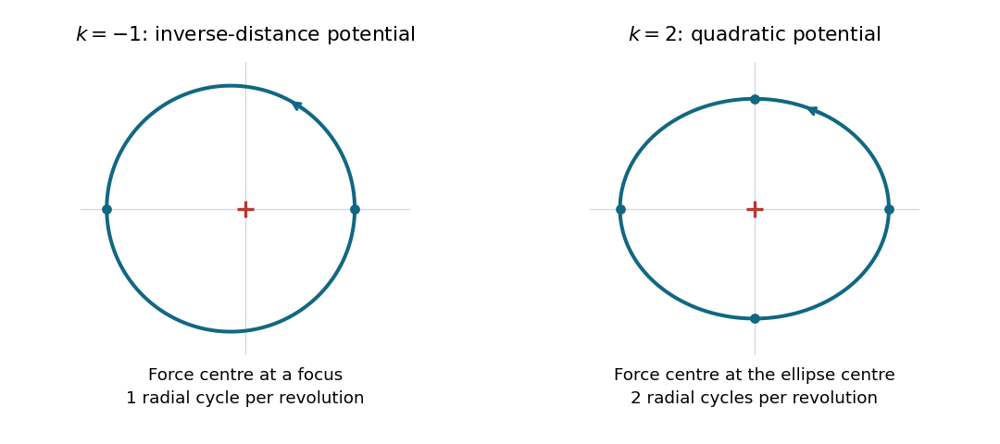

<h1 id="8/e/solution">Solution</h1>

↑ **Parent:** [E](../e.md)

Choose the orientation $J>0$. To leading order in the radial disturbance, the azimuthal [angular frequency](../../../../angular-frequency.md) is $\omega_\theta=J/(mr_0^2)$, so

$$
\boxed{\frac{\omega_r}{\omega_\theta}=\sqrt{k+2}.}
$$

For either orientation the positive [frequency](../../../../frequency.md) ratio is $\omega_r/|\omega_\theta|$. At $k=-1$, the ratio is $1$: there is one radial oscillation per revolution. The bound [Kepler orbit](../../../../kepler-orbit.md) is an [ellipse](../../../../ellipse.md) with the force centre at a focus, with one closest and one furthest approach per revolution. Its exact [polar coordinates](../../../../polar-coordinates.md) equation is

$$
r(\theta)=\frac{p}{1+e\cos\theta},\qquad
p=\frac{J^2}{m|\beta|},\qquad 0<e\ll1.
$$

At $k=2$, the ratio is $2$: there are two radial oscillations per revolution. The [isotropic harmonic oscillator](../../../../isotropic-harmonic-oscillator.md) trajectory is an [ellipse](../../../../ellipse.md) centred on the force centre. An exact parametrization is

$$
x(t)=a\cos\Omega t,\qquad y(t)=b\sin\Omega t,\qquad
\Omega=\sqrt{\frac{2\beta}{m}},\qquad a\simeq b.
$$

Here $r^2=a^2\cos^2\Omega t+b^2\sin^2\Omega t$ repeats twice during one full circuit. The two different placements of the force centre distinguish these [ellipses](../../../../ellipse.md). These are the two all-bound-orbit cases of [Bertrand's theorem](../../../../bertrand-s-theorem.md).

**[Figure 1](#8/e/image-nearly-circular-ellipses-one-radial-cycle-about-a-focus-for-the-inverse-distance-potential-and-two-about-the-centre-for-the-quadratic-potential). Nearly circular ellipses: one radial cycle about a focus for the inverse-distance potential, and two about the centre for the quadratic potential**.

## ↑ Ancestors (12)

1. [E](../e.md)
2. [8](../../8.md)
3. [2022](../../../2022-split.md)
4. [Past exam of the physics 1 paper of the University of Oxford](../../../split.md)
5. [Physics 1 paper of the University of Oxford](../../../../physics-1-paper-of-the-university-of-oxford.md)
6. [Year 1 of the physics course of the University of Oxford](../../../../year-1-of-the-physics-course-of-the-university-of-oxford.md)
7. [Physics course of the University of Oxford](../../../../physics-course-of-the-university-of-oxford.md)
8. [Undergraduate course of the University of Oxford](../../../../undergraduate-course-of-the-university-of-oxford.md)
9. [Course of the University of Oxford](../../../../course-of-the-university-of-oxford.md)
10. [University of Oxford](../../../../university-of-oxford-split.md)
11. [List of universities](../../../../list-of-universities.md)
12. [Codex Wiki](../../../../split.md)
