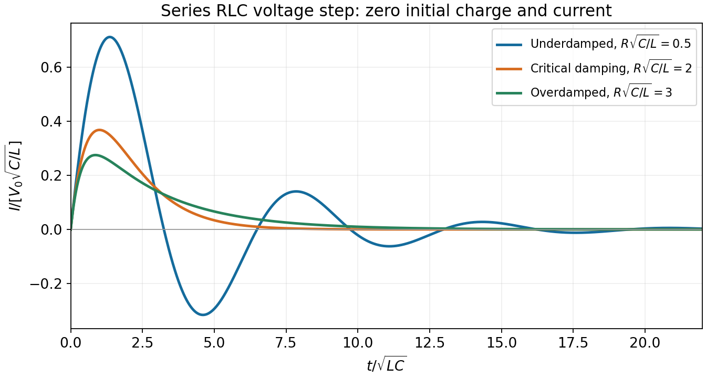

<h1 id="6/ii/solution">Solution</h1>

↑ **Parent:** [Ii](../ii.md)

For an initially uncharged capacitor and zero initial current, [Kirchhoff's voltage law](../../../../kirchhoff-cycle-law.md) is $L\dot I+RI+Q/C=V_0$, with $I=\dot Q$. Let

$$
\alpha=\frac{R}{2L},\qquad\omega_n=\frac1{\sqrt{LC}},\qquad\omega_d=\sqrt{\omega_n^2-\alpha^2}.
$$

Differentiating the circuit equation at $t>0$ gives $\ddot I+2\alpha\dot I+\omega_n^2I=0$, while the original equation fixes $I(0)=0$ and $\dot I(0)=V_0/L$. The underdamped response is

$$
\boxed{I(t)=\frac{V_0}{L\omega_d}e^{-\alpha t}\sin\omega_dt.}
$$

For critical damping, $\alpha=\omega_n$, its limit is $I=(V_0/L)t e^{-\alpha t}$. For overdamping, put $\beta=\sqrt{\alpha^2-\omega_n^2}$ and obtain $I=V_0e^{-\alpha t}\sinh(\beta t)/(L\beta)$. These forms cover every positive $R,L,C$.

The source does not explicitly specify the capacitor's initial charge. If its initial voltage is $V_{C0}$, replace $V_0$ in the numerators by $V_0-V_{C0}$; an open switch alone does not discharge a capacitor. The boxed expression uses the usual uncharged initial condition.

**[Figure 1](#6/ii/image-current-after-a-voltage-step-in-a-series-rlc-circuit). Current after a voltage step in a series RLC circuit**. Underdamped, critically damped, and overdamped responses for an initially uncharged capacitor. Time and current use the natural LC scales.

## ↑ Ancestors (12)

1. [Ii](../ii.md)
2. [6](../../6.md)
3. [2013 resit](../../../2013-resit-split.md)
4. [Past exam of the physics 2 paper of the University of Oxford](../../../split.md)
5. [Physics 2 paper of the University of Oxford](../../../../physics-2-paper-of-the-university-of-oxford.md)
6. [Year 1 of the physics course of the University of Oxford](../../../../year-1-of-the-physics-course-of-the-university-of-oxford.md)
7. [Physics course of the University of Oxford](../../../../physics-course-of-the-university-of-oxford.md)
8. [Undergraduate course of the University of Oxford](../../../../undergraduate-course-of-the-university-of-oxford.md)
9. [Course of the University of Oxford](../../../../course-of-the-university-of-oxford.md)
10. [University of Oxford](../../../../university-of-oxford-split.md)
11. [List of universities](../../../../list-of-universities.md)
12. [Codex Wiki](../../../../split.md)
