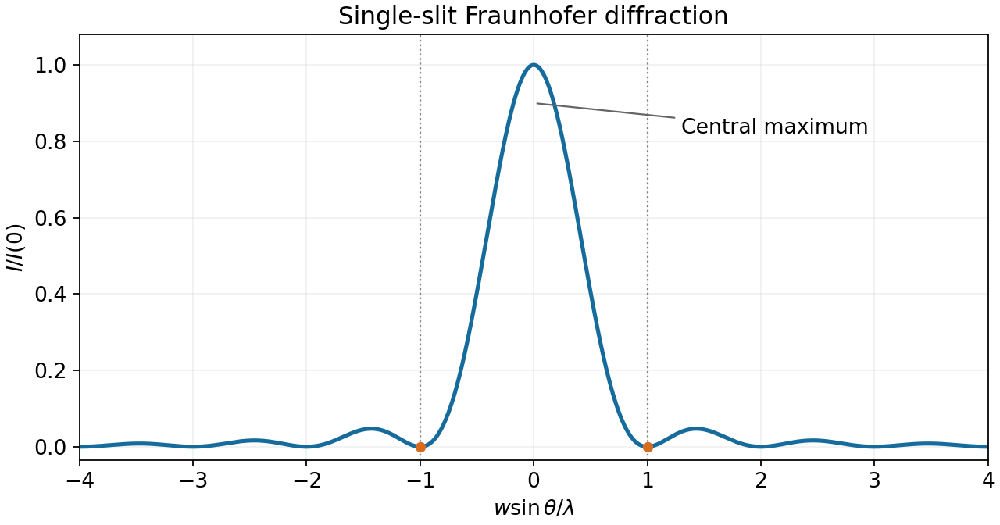

<h1 id="8/ii/solution">Solution</h1>

↑ **Parent:** [Ii](../ii.md)

The first single-slit minimum is at $\sin\theta=\lambda/w$, so the characteristic angular resolution of an aperture of width $D$ is of order $\lambda/D$. With $D=1$ m, $\lambda=550$ nm, and distance $\mathcal D=10^8$ m, this slit-based estimate is

$$
\boxed{\Delta\theta\sim5.5\times10^{-7}\,\mathrm{rad},\qquad \Delta x\sim55\,\mathrm m.}
$$

For the actual circular lens, the [Rayleigh criterion](../../../../rayleigh-criterion.md) uses the first zero of the [Airy disk](../../../../airy-disk.md), $\Delta\theta\simeq1.22\lambda/D$. It gives $6.71\times10^{-7}$ rad and a resolved separation of about $67$ m. The factor $1.22$ belongs to the circular aperture, not to the one-dimensional slit derivation.

**[Figure 2](#8/ii/image-far-field-single-slit-intensity-and-the-first-diffraction-minima). Far-field single-slit intensity and the first diffraction minima**. The horizontal coordinate is w sin(theta)/lambda, so the first zeros are at plus and minus one. The lens-resolution estimate uses the central-maximum width.

## ↑ Ancestors (12)

1. [Ii](../ii.md)
2. [8](../../8.md)
3. [2013 resit](../../../2013-resit-split.md)
4. [Past exam of the physics 2 paper of the University of Oxford](../../../split.md)
5. [Physics 2 paper of the University of Oxford](../../../../physics-2-paper-of-the-university-of-oxford.md)
6. [Year 1 of the physics course of the University of Oxford](../../../../year-1-of-the-physics-course-of-the-university-of-oxford.md)
7. [Physics course of the University of Oxford](../../../../physics-course-of-the-university-of-oxford.md)
8. [Undergraduate course of the University of Oxford](../../../../undergraduate-course-of-the-university-of-oxford.md)
9. [Course of the University of Oxford](../../../../course-of-the-university-of-oxford.md)
10. [University of Oxford](../../../../university-of-oxford-split.md)
11. [List of universities](../../../../list-of-universities.md)
12. [Codex Wiki](../../../../split.md)
