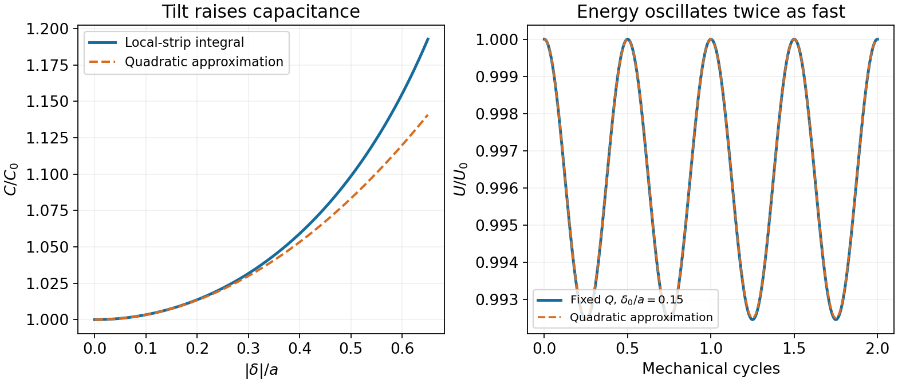

<h1 id="11/iii/solution">Solution</h1>

↑ **Parent:** [Iii](../iii.md)

Isolation fixes charge, not voltage: $Q=C_0V_0$. The [electrostatic energy](../../../../electrostatic-energy.md) is therefore $U(t)=Q^2/[2C(\delta(t))]$. Inverting the small-tilt capacitance gives

$$
\boxed{U(t)=\frac{\epsilon_0s^2V_0^2}{2a}\left[1-\frac{\delta_0^2}{3a^2}\sin^2\omega_0t+O\left(\frac{\delta_0^4}{a^4}\right)\right].}
$$

The leading variation has frequency $2\omega_0$, since tilts of opposite sign give the same capacitance. With $U_0=C_0V_0^2/2$, the result is $U_0[1-\delta_0^2/(6a^2)+(\delta_0^2/(6a^2))\cos2\omega_0t]$ to this order. Energy decreases as the gap becomes less uniform at fixed charge; the difference is exchanged mechanically with the oscillator.

**[Figure 4](#11/iii/image-capacitance-increase-and-fixed-charge-energy-decrease-under-a-small-tilt). Capacitance increase and fixed-charge energy decrease under a small tilt**. The exact local-strip capacitance is compared with its quadratic expansion. The isolated capacitor has fixed total charge and an energy modulation at twice the mechanical frequency.

## ↑ Ancestors (12)

1. [Iii](../iii.md)
2. [11](../../11.md)
3. [2013](../../../2013-split.md)
4. [Past exam of the physics 2 paper of the University of Oxford](../../../split.md)
5. [Physics 2 paper of the University of Oxford](../../../../physics-2-paper-of-the-university-of-oxford.md)
6. [Year 1 of the physics course of the University of Oxford](../../../../year-1-of-the-physics-course-of-the-university-of-oxford.md)
7. [Physics course of the University of Oxford](../../../../physics-course-of-the-university-of-oxford.md)
8. [Undergraduate course of the University of Oxford](../../../../undergraduate-course-of-the-university-of-oxford.md)
9. [Course of the University of Oxford](../../../../course-of-the-university-of-oxford.md)
10. [University of Oxford](../../../../university-of-oxford-split.md)
11. [List of universities](../../../../list-of-universities.md)
12. [Codex Wiki](../../../../split.md)
