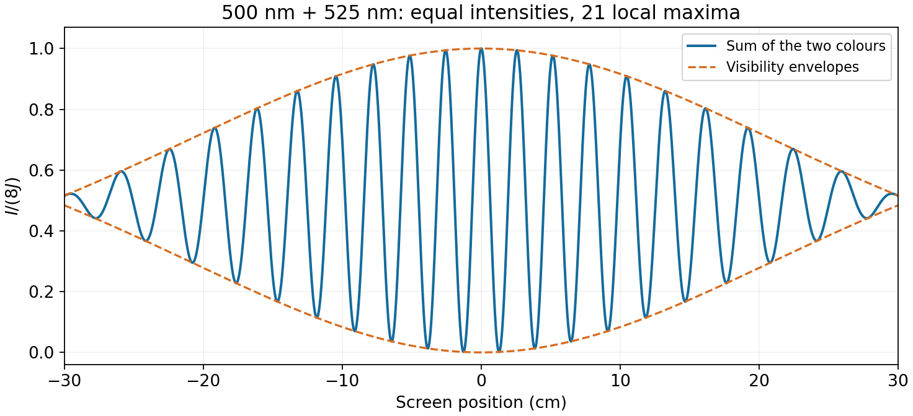

<h1 id="4/2/solution">Solution</h1>

↑ **Parent:** [2](../2.md)

For the centred screen, $|y|\le0.30$ m. Retaining the screen-angle geometry gives

$$
\Delta_{\max}=\frac{d(0.30)}{\sqrt{0.50^2+0.30^2}}=5.145\,\mu\mathrm m,\qquad
\bar\lambda=\frac1{\bar\sigma}=512.20\,\mathrm{nm}.
$$

There are about $\bar\sigma\Delta_{\max}=10.045$ carrier orders on each side. With equal spectral intensities, direct extrema of the intensity formula give

$$
\boxed{21\text{ bright fringes: the central maximum and ten on each side}.}
$$

Their contrast declines toward the edges: the first equal-intensity visibility zero occurs at $\Delta=1/(2\Delta\sigma)=5.25\,\mu\mathrm m$, just beyond the screen's $5.145\,\mu\mathrm m$ limit. Edge visibility is only about $0.031$, so fewer fringes may be discernible at a practical contrast threshold.

The screen reaches $|y|/D=0.6$, where a paraxial conversion of its full width is inaccurate. Also, wavelength-independent detector sensitivity does not itself establish equal source intensities. The boxed count specifies the usual equal-intensity idealization; without spectral weights and a visibility threshold, a unique experimental count is not fixed.

**[Figure 1](#4/2/image-two-colour-double-slit-fringes-across-the-stated-60-cm-screen). Two-colour double-slit fringes across the stated 60 cm screen**. Equal intensities at 500 and 525 nm are added incoherently between colours. The actual screen-angle geometry gives 21 local maxima, with low contrast near the edges.

## ↑ Ancestors (12)

1. [2](../2.md)
2. [4](../../4.md)
3. [2013](../../../2013-split.md)
4. [Past exam of the physics 2 paper of the University of Oxford](../../../split.md)
5. [Physics 2 paper of the University of Oxford](../../../../physics-2-paper-of-the-university-of-oxford.md)
6. [Year 1 of the physics course of the University of Oxford](../../../../year-1-of-the-physics-course-of-the-university-of-oxford.md)
7. [Physics course of the University of Oxford](../../../../physics-course-of-the-university-of-oxford.md)
8. [Undergraduate course of the University of Oxford](../../../../undergraduate-course-of-the-university-of-oxford.md)
9. [Course of the University of Oxford](../../../../course-of-the-university-of-oxford.md)
10. [University of Oxford](../../../../university-of-oxford-split.md)
11. [List of universities](../../../../list-of-universities.md)
12. [Codex Wiki](../../../../split.md)
