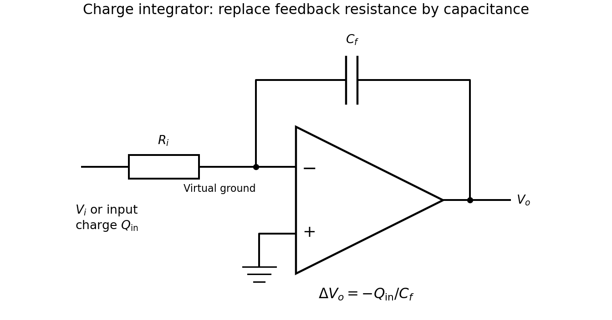

<h1 id="8/iv/solution">Solution</h1>

↑ **Parent:** [Iv](../iv.md)

Replace the feedback resistor by a capacitor $C_f$, retaining the input resistor $R_i$. The [virtual ground](../../../../virtual-ground.md) makes the input charge flow onto the feedback capacitor rather than into the ideal amplifier. Integrating its current gives

$$
V_o(t)-V_o(0)=-\frac1{C_f}\int_0^t I_i(t')\,dt',\qquad
\boxed{\frac{\Delta V_o}{Q_{\rm in}}=-\frac1{C_f}.}
$$

If the calorimeter delivers $Q_{\rm in}=\kappa\mathcal E$ for deposited energy $\mathcal E$, then $\Delta V_o=-\kappa\mathcal E/C_f$. A reset establishes the initial output; a practical large resistor across $C_f$ limits long-time drift, but is omitted from the ideal integration interval.

**[Figure 2](#8/iv/image-ideal-inverting-charge-integrator-for-the-calorimeter-signal). Ideal inverting charge integrator for the calorimeter signal**. The original feedback resistor is replaced by C\_f; the input resistor remains for the subsequent voltage-driven integrator calculation.

## ↑ Ancestors (12)

1. [Iv](../iv.md)
2. [8](../../8.md)
3. [2013](../../../2013-split.md)
4. [Past exam of the physics 2 paper of the University of Oxford](../../../split.md)
5. [Physics 2 paper of the University of Oxford](../../../../physics-2-paper-of-the-university-of-oxford.md)
6. [Year 1 of the physics course of the University of Oxford](../../../../year-1-of-the-physics-course-of-the-university-of-oxford.md)
7. [Physics course of the University of Oxford](../../../../physics-course-of-the-university-of-oxford.md)
8. [Undergraduate course of the University of Oxford](../../../../undergraduate-course-of-the-university-of-oxford.md)
9. [Course of the University of Oxford](../../../../course-of-the-university-of-oxford.md)
10. [University of Oxford](../../../../university-of-oxford-split.md)
11. [List of universities](../../../../list-of-universities.md)
12. [Codex Wiki](../../../../split.md)
