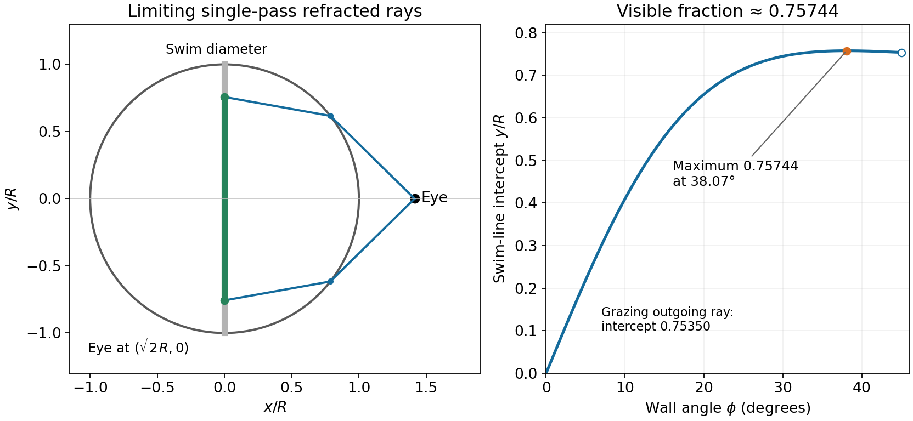

<h1 id="9/i/solution">Solution</h1>

↑ **Parent:** [I](../i.md)

Take a horizontal cross-section in units of $R$. The eye is at $E=(\sqrt2,0)$, and the tadpole swims along the perpendicular diameter $T=(0,y)$ shown in the source. Since glass and water have the same red-light index, their internal interface causes no red-light refraction. Write an exit point on the circular wall as $P=(\cos\phi,\sin\phi)$. An unobstructed outward ray to the eye has $|\phi|\le\pi/4$.

For $\phi\ge0$, let $e$ be the magnitude of the emerging ray's angle to the outward normal and $i$ its internal angle. Geometry and [Snell's law](../../../../snell-s-law.md) give

$$
\sin e=\frac{\sqrt2\sin\phi}{\sqrt{3-2\sqrt2\cos\phi}},\qquad
i=\sin^{-1}\left(\frac{\sin e}{1.33}\right).
$$

The outgoing internal ray makes angle $\beta=\phi-i$ to $+x$. Its backward continuation intersects the swim diameter at

$$
y(\phi)=\sin\phi-\cos\phi\tan(\phi-i).
$$

The directly visible positive endpoint is the largest such intercept, including all single-pass refracted rays. Maximizing this one-variable expression gives $\phi_*\simeq38.07^\circ$ and $y_*\simeq0.75744$. By symmetry the visible length is $2Ry_*$, so

$$
\boxed{\text{visible fraction}\simeq0.757\quad\text{(about three quarters)}.}
$$

Checking only the grazing exit at $\phi=45^\circ$ gives $\sqrt2/[1+\sqrt{1.33^2-1}]\simeq0.75350$, a close estimate but a slightly smaller fraction. The exact limiting ray occurs before that grazing ray, where two refracted paths merge at a [caustic](../../../../wave-caustic.md). This is a geometrical, single-pass visibility boundary; finite pupil size and detection thresholds would smooth the transition.

**[Figure 3](#9/i/image-single-pass-visibility-across-the-fish-tank-diameter). Single-pass visibility across the fish-tank diameter**. The original ray construction traces rays backward from the eye through a circular n=1.33 interface. The maximum swim-line intercept, not just the grazing outgoing ray, determines the visible interval.

## ↑ Ancestors (12)

1. [I](../i.md)
2. [9](../../9.md)
3. [2013](../../../2013-split.md)
4. [Past exam of the physics 2 paper of the University of Oxford](../../../split.md)
5. [Physics 2 paper of the University of Oxford](../../../../physics-2-paper-of-the-university-of-oxford.md)
6. [Year 1 of the physics course of the University of Oxford](../../../../year-1-of-the-physics-course-of-the-university-of-oxford.md)
7. [Physics course of the University of Oxford](../../../../physics-course-of-the-university-of-oxford.md)
8. [Undergraduate course of the University of Oxford](../../../../undergraduate-course-of-the-university-of-oxford.md)
9. [Course of the University of Oxford](../../../../course-of-the-university-of-oxford.md)
10. [University of Oxford](../../../../university-of-oxford-split.md)
11. [List of universities](../../../../list-of-universities.md)
12. [Codex Wiki](../../../../split.md)
