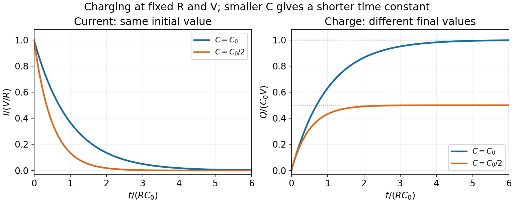
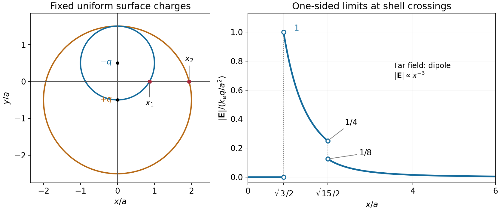

# 2014 resit

↑ **Parent:** [Past exam of the physics 2 paper of the University of Oxford](../past-exam-of-the-physics-2-paper-of-the-university-of-oxford.md)

Source paper: [Oxford source archive](https://www.whatdotheyknow.com/request/physics_preliminary_examinations/response/1162943/attach/3/Twain.7z?cookie_passthrough=1), member `2014/CP2_September_2014.pdf`. The cover dates this sitting to 9 September 2014. All ten questions are treated. Unlettered marked blocks use ordinal subparts; printed letters are retained.

**Table of contents**

- [1](#1)
  - [Solution](#1/solution)
- [2](#2)
  - [Solution](#2/solution)
- [3](#3)
  - [Solution](#3/solution)
- [4](#4)
  - [a](#4/a)
    - [Solution](#4/a/solution)
  - [b](#4/b)
    - [Solution](#4/b/solution)
- [5](#5)
  - [Solution](#5/solution)
- [6](#6)
  - [Solution](#6/solution)
- [7](#7)
  - [1](#7/1)
    - [Solution](#7/1/solution)
  - [2](#7/2)
    - [Solution](#7/2/solution)
  - [a](#7/a)
    - [Solution](#7/a/solution)
  - [b](#7/b)
    - [Solution](#7/b/solution)
- [8](#8)
  - [1](#8/1)
    - [Solution](#8/1/solution)
  - [2](#8/2)
    - [Solution](#8/2/solution)
  - [3](#8/3)
    - [Solution](#8/3/solution)
- [9](#9)
  - [1](#9/1)
    - [Solution](#9/1/solution)
  - [a](#9/a)
    - [Solution](#9/a/solution)
  - [b](#9/b)
    - [Solution](#9/b/solution)
  - [c](#9/c)
    - [Solution](#9/c/solution)
- [10](#10)
  - [1](#10/1)
    - [Solution](#10/1/solution)
  - [2](#10/2)
    - [Solution](#10/2/solution)
  - [3](#10/3)
    - [Solution](#10/3/solution)
  - [4](#10/4)
    - [Solution](#10/4/solution)

## 1

↑ **Parent:** [2014 resit](2014-resit.md)

<h3 id="1/solution">Solution</h3>

↑ **Parent:** [1](#1)

Put $+q$ at $x=0$ and $+4q$ at $x=l$, and write $k_e=1/(4\pi\epsilon_0)$. The [electric fields](../electric-field.md) of the two positive [point charges](../electric-field.md#point-charge) can cancel only between them. For $Q\ne0$, zero [Lorentz force](../relativistic-electromagnetism.md#lorentz-force) on $Q$ therefore requires

$$
\frac{q}{x^2}=\frac{4q}{(l-x)^2},\qquad l-x=2x,\qquad x=\frac l3.
$$

The force of $+4q$ on $+q$ points left, so $Q$ must be negative to pull $+q$ right. Equating these forces gives

$$
\frac{k_eq|Q|}{(l/3)^2}=\frac{4k_eq^2}{l^2},\qquad\boxed{Q=-\frac{4q}{9},\quad x_Q=\frac l3.}
$$

For $+4q$, the attraction to $Q$ at separation $2l/3$ has magnitude $k_e(4q)(4q/9)/(2l/3)^2=4k_eq^2/l^2$, exactly balancing its repulsion from $+q$. Thus all three forces vanish, not only the force on the inserted charge.

## 2

↑ **Parent:** [2014 resit](2014-resit.md)

<h3 id="2/solution">Solution</h3>

↑ **Parent:** [2](#2)

Choose the loop axis as $+x$, with positive [electric current](../electric-charge.md#electric-current) circulating by the right-hand rule. The [Biot-Savart law](../electromagnetism.md#biot-savart-law) is

$$
d\mathbf B=\frac{\mu_0I}{4\pi}\frac{d\boldsymbol\ell\times\mathbf r}{r^3}.
$$

For a loop element and an axial observation point, $r=\sqrt{a^2+x^2}$. The transverse components cancel between opposite elements. The axial component of $d\boldsymbol\ell\times\mathbf r$ is $a\,d\ell$, so

$$
B_x=\frac{\mu_0Ia}{4\pi(a^2+x^2)^{3/2}}\oint d\ell
=\frac{\mu_0Ia^2}{2(a^2+x^2)^{3/2}}.
$$

Thus

$$
\boxed{\mathbf B(x)=\frac{\mu_0Ia^2}{2(a^2+x^2)^{3/2}}\hat{\mathbf x}.}
$$

Reversing the [electric current](../electric-charge.md#electric-current) reverses the field. At the centre $B=\mu_0I/(2a)$, while the far field decreases as $|x|^{-3}$, as expected for a [magnetic dipole](../electromagnetism.md#magnetic-dipole).

## 3

↑ **Parent:** [2014 resit](2014-resit.md)

<h3 id="3/solution">Solution</h3>

↑ **Parent:** [3](#3)

Let $\theta=\omega t+\theta_0$ be the angle between the coil's area normal and the uniform [magnetic flux density](../magnetic-field.md). The linked [magnetic flux](../magnetic-field.md#magnetic-flux) is $\Phi_N=NBA\cos\theta$. [Faraday's law](../maxwell-equations.md#faraday-s-law-of-induction) gives

$$
\boxed{\mathcal E(t)=-\frac{d\Phi_N}{dt}=NBA\omega\sin(\omega t+\theta_0).}
$$

The sign uses the winding direction associated with the chosen normal; reversing the terminal convention changes it. The magnitude is largest when $\cos\theta=0$: the coil's normal is perpendicular to the [magnetic field](../magnetic-field.md), so the plane of the coil is parallel to it. At that orientation the instantaneous [magnetic flux](../magnetic-field.md#magnetic-flux) is zero but its rate of change has maximum magnitude.

## 4

↑ **Parent:** [2014 resit](2014-resit.md)

<h3 id="4/a">a</h3>

↑ **Parent:** [4](#4)

<h4 id="4/a/solution">Solution</h4>

↑ **Parent:** [A](#4/a)

Write $\psi=kx-\omega t$ and $v_p=\omega/k$. The [electric field](../electric-field.md) is

$$
\mathbf E=A\sin\psi\,(\hat{\mathbf y}+6\hat{\mathbf z}).
$$

It has [linear polarization](../electromagnetic-wave.md#linear-polarization), along the fixed line $E_z=6E_y$, at angle $\tan^{-1}6\simeq80.54^\circ$ from $+y$ toward $+z$. For the associated [plane electromagnetic wave](../electromagnetic-wave.md#plane-electromagnetic-wave), [Faraday's law](../maxwell-equations.md#faraday-s-law-of-induction) gives $\mathbf B=v_p^{-1}\hat{\mathbf x}\times\mathbf E$. Hence

$$
\boxed{\mathbf B=\frac{A}{v_p}\sin\psi\,(-6\hat{\mathbf y}+\hat{\mathbf z}),\qquad B_x=0.}
$$

In vacuum $v_p=c$. Both fields are transverse, and $\mathbf E\times\mathbf B$ points along $+x$.

<h3 id="4/b">b</h3>

↑ **Parent:** [4](#4)

<h4 id="4/b/solution">Solution</h4>

↑ **Parent:** [B](#4/b)

Here $E_y^2+E_z^2=9A^2$, so the tip of the [electric field](../electric-field.md) traces a circle at constant magnitude: this is [circular polarization](../electromagnetic-wave.md#circular-polarization). At fixed $x=0$, it starts at $+y$ when $t=0$ and initially rotates toward $+z$. This explicit rotation specifies the sense without relying on competing handedness conventions.

Using $\mathbf B=v_p^{-1}\hat{\mathbf x}\times\mathbf E$, with $v_p=\omega/k$, gives

$$
\boxed{\mathbf B=\frac{3A}{v_p}\bigl(\hat{\mathbf y}\sin\psi+\hat{\mathbf z}\cos\psi\bigr),\qquad B_x=0.}
$$

In vacuum replace $v_p$ by $c$. The [magnetic flux density](../magnetic-field.md) also has constant magnitude and is perpendicular to $\mathbf E$ at every instant.

## 5

↑ **Parent:** [2014 resit](2014-resit.md)

<h3 id="5/solution">Solution</h3>

↑ **Parent:** [5](#5)

For normal incidence, the first-order maximum of a [diffraction grating](../physical-optics.md#diffraction-grating) obeys $s\sin\theta=\lambda$. Differentiating at $\lambda_0$ gives

$$
s\cos\theta_0\,\delta\theta=\delta\lambda,\qquad \theta_0=\sin^{-1}(\lambda_0/s).
$$

Therefore the positive first-order peaks are separated by

$$
\boxed{\delta\theta\simeq\frac{\delta\lambda}{s\cos\theta_0}=\frac{\delta\lambda}{\sqrt{s^2-\lambda_0^2}}.}
$$

The larger wavelength is diffracted farther from the normal. Both first orders must exist, $\lambda_0+\delta\lambda<s$; extremely close to grazing incidence the finite difference of the two inverse sines should replace this local approximation.

## 6

↑ **Parent:** [2014 resit](2014-resit.md)

<h3 id="6/solution">Solution</h3>

↑ **Parent:** [6](#6)

Let $C$ denote the [capacitance](../electromagnetism.md#capacitance) omitted after the word “capacitance” in the source sentence. For the ideal series [RC charging circuit](../electromagnetism.md#rc-charging-circuit), [Kirchhoff's voltage law](../random-walk.md#kirchhoff-cycle-law) gives $RI+Q/C=V$, with $I=dQ/dt$ and $Q(0)=0$. Therefore

$$
\boxed{Q(t)=CV\bigl(1-e^{-t/\tau}\bigr),\qquad I(t)=\frac VR e^{-t/\tau},\qquad\tau=RC.}
$$

The [electric current](../electric-charge.md#electric-current) falls from $V/R$ to zero, while the [electric charge](../electric-charge.md) rises from zero to $CV$. Their initial slopes are $-V/(R\tau)$ and $V/R$, respectively.

Reducing $RC$ shortens the approach to the relevant final values. Which heights change depends on the component changed: reducing $R$ at fixed $C$ increases $I(0)$ but leaves $Q(\infty)$ unchanged; reducing $C$ at fixed $R$ leaves $I(0)$ unchanged but reduces $Q(\infty)$. A shorter [time constant](../analysis.md#time-constant) alone does not specify both endpoint amplitudes.

**[Figure 1](#6/image-rc-charging-with-the-same-resistance-and-two-different-capacitances). RC charging with the same resistance and two different capacitances**. The reference time is R times the larger capacitance. Reducing capacitance halves the time constant and final charge while keeping the initial current fixed.

## 7

↑ **Parent:** [2014 resit](2014-resit.md)

<h3 id="7/1">1</h3>

↑ **Parent:** [7](#7)

<h4 id="7/1/solution">Solution</h4>

↑ **Parent:** [1](#7/1)

The [Lorentz force law](../relativistic-electromagnetism.md#lorentz-force) is

$$
\boxed{\mathbf F=q(\mathbf E+\mathbf v\times\mathbf B).}
$$

Its rate of work is $dT/dt=\mathbf F\cdot\mathbf v=q\mathbf E\cdot\mathbf v$, because $\mathbf v\cdot(\mathbf v\times\mathbf B)=0$. Thus, with $\mathbf E=0$, the [kinetic energy](../energy.md#kinetic-energy) cannot increase: a static [magnetic field](../magnetic-field.md) changes the direction of motion but does no work.

<h3 id="7/2">2</h3>

↑ **Parent:** [7](#7)

<h4 id="7/2/solution">Solution</h4>

↑ **Parent:** [2](#7/2)

Take the initial [velocity](../classical-mechanics.md#velocity) perpendicular to a uniform [magnetic field](../magnetic-field.md). The magnetic [Lorentz force](../relativistic-electromagnetism.md#lorentz-force) is perpendicular to the motion, has constant magnitude $|q|vB$, and supplies the [centripetal force](../classical-mechanics.md#centripetal-force):

$$
\frac{mv^2}{r}=|q|vB,\qquad\boxed{r=\frac{mv}{|q|B},\quad\omega_c=\frac vr=\frac{|q|B}{m}.}
$$

The rotation sense is fixed by $q\mathbf v\times\mathbf B$. A component of [velocity](../classical-mechanics.md#velocity) parallel to the field remains constant and produces a [helical motion in a uniform magnetic field](../electromagnetism.md#helical-motion-in-a-uniform-magnetic-field); a circle requires that component to vanish. The speed-independent [cyclotron frequency](../quantum-theory.md#cyclotron-frequency) here assumes nonrelativistic motion.

<h3 id="7/a">a</h3>

↑ **Parent:** [7](#7)

<h4 id="7/a/solution">Solution</h4>

↑ **Parent:** [A](#7/a)

For a [proton](../physics.md#proton), the fundamental [cyclotron resonance condition](../particle-accelerator.md#cyclotron-resonance-condition) is

$$
\boxed{\omega=\frac{eB}{m_p}.}
$$

A half-orbit takes $\pi m_p/(eB)$, during which the applied voltage reverses sign once. The proton then crosses the gap in the opposite direction and receives another accelerating impulse. The electric force in the gap, rather than the magnetic bending inside a dee, provides the [kinetic energy](../energy.md#kinetic-energy). The injection phase must be chosen so the first crossing accelerates the proton.

<h3 id="7/b">b</h3>

↑ **Parent:** [7](#7)

<h4 id="7/b/solution">Solution</h4>

↑ **Parent:** [B](#7/b)

At the largest admitted orbit, $r=R$ and $m_pv_{\max}=eBR$. Consequently

$$
\boxed{v_{\max}=\frac{eBR}{m_p},\qquad T_{\max}=\frac{e^2B^2R^2}{2m_p}.}
$$

Using $e=1.602176634\times10^{-19}\,\mathrm C$ and $m_p\simeq1.67262\times10^{-27}\,\mathrm{kg}$ with the specified $B$ and $R$ yields

$$
\boxed{T_{\max}\simeq1.92\times10^{-12}\,\mathrm J\simeq11.97\,\mathrm{MeV},\qquad v_{\max}\simeq4.79\times10^7\,\mathrm{m\,s^{-1}}.}
$$

This is about $0.160c$; the displayed results use the nonrelativistic approximation explicitly requested by the paper. The drive amplitude controls the energy gain per gap crossing and hence the number of turns, but the ideal orbit-radius limit is set by $B$ and $R$.

## 8

↑ **Parent:** [2014 resit](2014-resit.md)

<h3 id="8/1">1</h3>

↑ **Parent:** [8](#8)

<h4 id="8/1/solution">Solution</h4>

↑ **Parent:** [1](#8/1)

In matter, [Gauss's law](../maxwell-equations.md#gauss-s-law) for free [electric charge](../electric-charge.md) is

$$
\boxed{\nabla\cdot\mathbf D=\rho_{\rm free},\qquad \oint_{\partial\mathcal V}\mathbf D\cdot d\mathbf S=Q_{\rm free,enclosed}.}
$$

The area normal points out of $\mathcal V$. In vacuum $\mathbf D=\epsilon_0\mathbf E$, so these become $\nabla\cdot\mathbf E=\rho/\epsilon_0$ and $\oint\mathbf E\cdot d\mathbf S=Q_{\rm enclosed}/\epsilon_0$.

<h3 id="8/2">2</h3>

↑ **Parent:** [8](#8)

<h4 id="8/2/solution">Solution</h4>

↑ **Parent:** [2](#8/2)

Put charges $+Q$ and $-Q$ on the concentric conductors. [Gauss's law](../maxwell-equations.md#gauss-s-law) gives $E(r)=Q/(4\pi\epsilon_0r^2)$ between them, $a<r<2a$. The potential difference is

$$
\Delta V=\int_a^{2a}\frac{Q}{4\pi\epsilon_0r^2}\,dr
=\frac{Q}{8\pi\epsilon_0a}.
$$

The [capacitance](../electromagnetism.md#capacitance) of this vacuum [spherical capacitor](../electromagnetism.md#spherical-capacitor) is therefore

$$
\boxed{C=\frac{Q}{\Delta V}=8\pi\epsilon_0a.}
$$

The conductors are equipotentials; a uniform dielectric filling would replace $\epsilon_0$ by its [permittivity](../permittivity.md).

<h3 id="8/3">3</h3>

↑ **Parent:** [8](#8)

<h4 id="8/3/solution">Solution</h4>

↑ **Parent:** [3](#8/3)

At $(x,0)$ the distances from the two centres are equal:

$$
r=\sqrt{x^2+a^2/4},\qquad x_1=\frac{\sqrt3}{2}a,\qquad x_2=\frac{\sqrt{15}}2a.
$$

By the electrostatic [shell theorem](../mathematical-physics.md#spherical-shell-theorem), a uniformly charged spherical shell gives zero field inside and its point-charge field outside. For $x<x_1$ the point is inside both shells. For $x_1<x<x_2$ only the small, negatively charged shell contributes. For $x>x_2$ both contribute, so

$$
\mathbf E(x)=\begin{cases}
0,&0\le x<x_1,\\
\dfrac{k_eq}{r^3}\left(-x\hat{\mathbf x}+\dfrac a2\hat{\mathbf y}\right),&x_1<x<x_2,\\
\dfrac{k_eqa}{r^3}\hat{\mathbf y},&x>x_2,
\end{cases}\qquad k_e=\frac1{4\pi\epsilon_0}.
$$

The requested magnitude is

$$
\boxed{|\mathbf E(x)|=\begin{cases}
0,&0\le x<x_1,\\
\dfrac{k_eq}{x^2+a^2/4},&x_1<x<x_2,\\
\dfrac{k_eqa}{(x^2+a^2/4)^{3/2}},&x>x_2.
\end{cases}}
$$

It jumps from zero to $k_eq/a^2$ at $x_1$, decreases to $k_eq/(4a^2)$ just before $x_2$, jumps down to $k_eq/(8a^2)$ just after $x_2$, and then falls as $x^{-3}$. The ideal surface charge makes the field discontinuous at each crossing, so the one-sided limits, rather than a unique value on the sheet, specify the graph. The far field is the equatorial field of an [electric dipole](../electrostatics.md#electric-dipole) with [electric dipole moment](../electrostatics.md#electric-dipole-moment) $\mathbf p=-qa\hat{\mathbf y}$.

**[Figure 2](#8/3/image-geometry-and-electric-field-magnitude-for-the-two-offset-charged-shells). Geometry and electric-field magnitude for the two offset charged shells**. The open endpoints give the one-sided limits at the two surface crossings. The field is zero inside both shells and has a dipolar far-field tail.

## 9

↑ **Parent:** [2014 resit](2014-resit.md)

<h3 id="9/1">1</h3>

↑ **Parent:** [9](#9)

<h4 id="9/1/solution">Solution</h4>

↑ **Parent:** [1](#9/1)

Use the [phasor](../wave.md#phasor) convention $v(t)=\operatorname{Re}(\widetilde V e^{i\omega t})$. The [complex impedance](../electrical-circuit.md#electrical-impedance) is $Z=\widetilde V/\widetilde I$ in sinusoidal steady state. From $v_R=Ri$, $i_C=C\,dv_C/dt$, and $v_L=L\,di_L/dt$,

$$
\boxed{Z_R=R,\qquad Z_C=\frac1{i\omega C}=-\frac{i}{\omega C},\qquad Z_L=i\omega L.}
$$

For this convention an ideal [inductor](../electromagnetism.md#inductor) has voltage leading current by $\pi/2$, while an ideal [capacitor](../electromagnetism.md#capacitor) has current leading voltage by $\pi/2$.

<h3 id="9/a">a</h3>

↑ **Parent:** [9](#9)

<h4 id="9/a/solution">Solution</h4>

↑ **Parent:** [A](#9/a)

The source diagram has $2R$ in series with two parallel branches: $R+L$ above and $R+C$ below. With $s=\sqrt{15}$, their [complex impedances](../electrical-circuit.md#electrical-impedance) are $Z_+=R(1+is)$ and $Z_-=R(1-is)$. Their parallel combination is

$$
Z_p=\frac{Z_+Z_-}{Z_++Z_-}=\frac{R^2(1+s^2)}{2R}=8R.
$$

Thus

$$
\boxed{Z_{AB}=2R+8R=10R.}
$$

The input [electric current](../electric-charge.md#electric-current) is in phase with $V_{AB}$ even though the two branch currents separately have nonzero, opposite phase shifts.

<h3 id="9/b">b</h3>

↑ **Parent:** [9](#9)

<h4 id="9/b/solution">Solution</h4>

↑ **Parent:** [B](#9/b)

Put $\widetilde V_B=0$ and $\widetilde V_A=V_0$, with $\widetilde V_{PQ}=\widetilde V_P-\widetilde V_Q$. The source current is $V_0/(10R)$ and the parallel-network voltage is $\widetilde V_X=4V_0/5$. Hence

$$
\widetilde I_+=\frac{V_0}{20R}(1-i\sqrt{15}),\qquad
\widetilde I_-=\frac{V_0}{20R}(1+i\sqrt{15}).
$$

The voltage from X to each branch midpoint is its resistor drop, so

$$
\widetilde V_{XZ}=\frac{V_0}{20}(1-i\sqrt{15}),\quad
\widetilde V_{XY}=\frac{V_0}{20}(1+i\sqrt{15}),\quad
\widetilde V_{XA}=-\frac{V_0}{5}.
$$

Since $|1\pm i\sqrt{15}|=4$,

$$
\boxed{|\widetilde V_{XZ}|=|\widetilde V_{XY}|=|\widetilde V_{XA}|=\frac{V_0}{5}.}
$$

Equal amplitude does not mean equal phase.

<h3 id="9/c">c</h3>

↑ **Parent:** [9](#9)

<h4 id="9/c/solution">Solution</h4>

↑ **Parent:** [C](#9/c)

Relative to the real positive source [phasor](../wave.md#phasor) $\widetilde V_{AB}=V_0$,

$$
\boxed{\arg\frac{\widetilde V_{XZ}}{\widetilde V_{AB}}=-\tan^{-1}\sqrt{15}\simeq-75.52^\circ.}
$$

Thus $V_{XZ}(t)=(V_0/5)\cos(\omega t-75.52^\circ)$ lags $V_{AB}$. Reversing the voltage ordering to $V_{ZX}$ would add $180^\circ$.

## 10

↑ **Parent:** [2014 resit](2014-resit.md)

<h3 id="10/1">1</h3>

↑ **Parent:** [10](#10)

<h4 id="10/1/solution">Solution</h4>

↑ **Parent:** [1](#10/1)

[Fermat's principle](../mathematical-physics.md#fermat-principle) states that the actual [ray](../euclidean-geometry.md#ray-geometry) makes the travel time stationary under small variations of its path with endpoints fixed. Equivalently, for a stationary medium it makes the [optical path length](../physical-optics.md#optical-path-length) $\int n\,ds$ stationary. “Stationary” allows minima, maxima, or other stationary paths; it does not require a strict minimum in every optical system.

<h3 id="10/2">2</h3>

↑ **Parent:** [10](#10)

<h4 id="10/2/solution">Solution</h4>

↑ **Parent:** [2](#10/2)

In the thin-lens approximation, the geometric [path length](../riemannian-geometry.md#arc-length) is

$$
L_{\rm geom}(d)\simeq\sqrt{a^2+d^2}+\sqrt{b^2+d^2}
\simeq a+b+\frac{d^2}{2a}+\frac{d^2}{2b}.
$$

The glass replaces approximately length $s(d)$ of air, rather than adding a further geometric segment. Its excess [optical path length](../physical-optics.md#optical-path-length) is therefore $(n-1)s(d)$. With $s(d)=s_0-\alpha d^2$,

$$
\boxed{ct(d)\simeq a\left(1+\frac{d^2}{2a^2}\right)+b\left(1+\frac{d^2}{2b^2}\right)+(n-1)(s_0-\alpha d^2).}
$$

The approximations retain terms quadratic in the small ray height and neglect products of lens thickness with the squared ray slope. The distinction between geometric and [optical path length](../physical-optics.md#optical-path-length) explains why the glass contribution contains $n-1$, not $n$.

<h3 id="10/3">3</h3>

↑ **Parent:** [10](#10)

<h4 id="10/3/solution">Solution</h4>

↑ **Parent:** [3](#10/3)

For nonzero small $d$, stationarity of the travel time gives

$$
\frac{d(ct)}{dd}=d\left[\frac1a+\frac1b-2\alpha(n-1)\right]=0.
$$

To focus a bundle, this must hold for neighbouring off-axis rays, not merely for the automatically stationary axial ray $d=0$. Comparing with the [thin lens](../geometrical-optics.md#thin-lens) equation, $1/a+1/b=1/f$, gives

$$
\boxed{f=\frac1{2\alpha(n-1)}.}
$$

For parallel incident rays $a\to\infty$, the image is at $b=f$. A centre-thick lens with $\alpha>0$ and $n>1$ is converging.

<h3 id="10/4">4</h3>

↑ **Parent:** [10](#10)

<h4 id="10/4/solution">Solution</h4>

↑ **Parent:** [4](#10/4)

In [wave optics](../physical-optics.md), a finite lens aperture produces [diffraction](../quantum-scattering.md#diffraction). Contributions interfere constructively near the geometric focus but form a finite [point spread function](../point-spread-function.md), rather than a point of infinite intensity. For a uniformly illuminated circular aperture of diameter $D$, the paraxial focal pattern is an [Airy disk](../point-spread-function.md#airy-disk), with first dark-ring radius approximately $1.22\lambda f/D$. Aberrations can broaden or distort it further; even an ideal lens retains the finite diffraction scale.

## ↑ Ancestors (9)

1. [Past exam of the physics 2 paper of the University of Oxford](../past-exam-of-the-physics-2-paper-of-the-university-of-oxford.md)
2. [Physics 2 paper of the University of Oxford](../university-of-oxford.md#physics-2-paper-of-the-university-of-oxford)
3. [Year 1 of the physics course of the University of Oxford](../university-of-oxford.md#year-1-of-the-physics-course-of-the-university-of-oxford)
4. [Physics course of the University of Oxford](../university-of-oxford.md#physics-course-of-the-university-of-oxford)
5. [Undergraduate course of the University of Oxford](../university-of-oxford.md#undergraduate-course-of-the-university-of-oxford)
6. [Course of the University of Oxford](../university-of-oxford.md#course-of-the-university-of-oxford)
7. [University of Oxford](../university-of-oxford.md)
8. [List of universities](../README.md#list-of-universities)
9. [Codex Wiki](../README.md)
