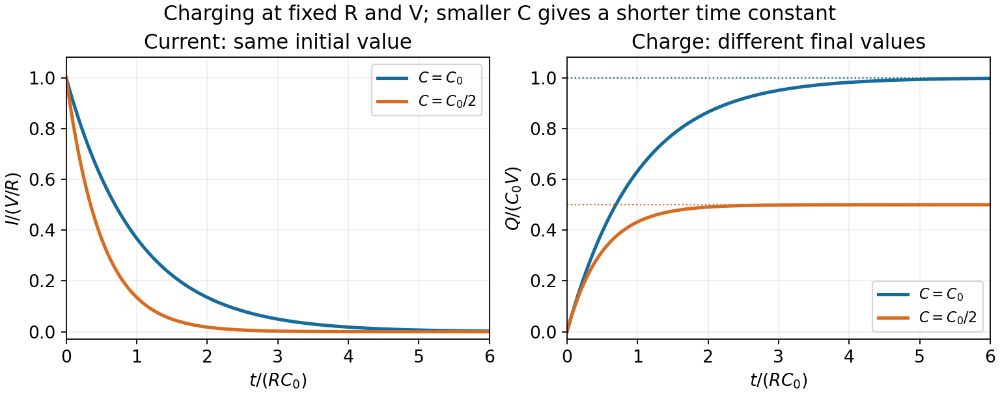

<h1 id="6/solution">Solution</h1>

↑ **Parent:** [6](../6.md)

Let $C$ denote the [capacitance](../../../capacitance.md) omitted after the word “capacitance” in the source sentence. For the ideal series [RC charging circuit](../../../rc-charging-circuit.md), [Kirchhoff's voltage law](../../../kirchhoff-cycle-law.md) gives $RI+Q/C=V$, with $I=dQ/dt$ and $Q(0)=0$. Therefore

$$
\boxed{Q(t)=CV\bigl(1-e^{-t/\tau}\bigr),\qquad I(t)=\frac VR e^{-t/\tau},\qquad\tau=RC.}
$$

The [electric current](../../../electric-current.md) falls from $V/R$ to zero, while the [electric charge](../../../electric-charge-split.md) rises from zero to $CV$. Their initial slopes are $-V/(R\tau)$ and $V/R$, respectively.

Reducing $RC$ shortens the approach to the relevant final values. Which heights change depends on the component changed: reducing $R$ at fixed $C$ increases $I(0)$ but leaves $Q(\infty)$ unchanged; reducing $C$ at fixed $R$ leaves $I(0)$ unchanged but reduces $Q(\infty)$. A shorter [time constant](../../../time-constant.md) alone does not specify both endpoint amplitudes.

**[Figure 1](#6/image-rc-charging-with-the-same-resistance-and-two-different-capacitances). RC charging with the same resistance and two different capacitances**. The reference time is R times the larger capacitance. Reducing capacitance halves the time constant and final charge while keeping the initial current fixed.

## ↑ Ancestors (11)

1. [6](../6.md)
2. [2014 resit](../../2014-resit-split.md)
3. [Past exam of the physics 2 paper of the University of Oxford](../../split.md)
4. [Physics 2 paper of the University of Oxford](../../../physics-2-paper-of-the-university-of-oxford.md)
5. [Year 1 of the physics course of the University of Oxford](../../../year-1-of-the-physics-course-of-the-university-of-oxford.md)
6. [Physics course of the University of Oxford](../../../physics-course-of-the-university-of-oxford.md)
7. [Undergraduate course of the University of Oxford](../../../undergraduate-course-of-the-university-of-oxford.md)
8. [Course of the University of Oxford](../../../course-of-the-university-of-oxford.md)
9. [University of Oxford](../../../university-of-oxford-split.md)
10. [List of universities](../../../list-of-universities.md)
11. [Codex Wiki](../../../split.md)
