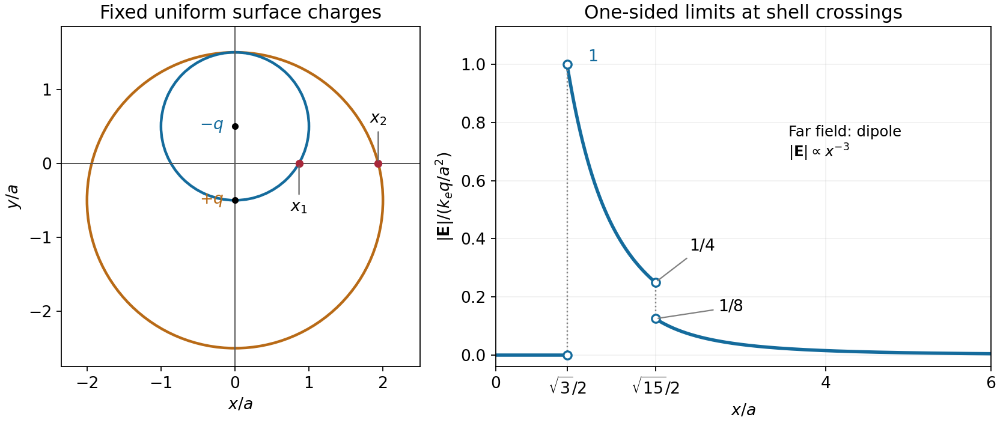

<h1 id="8/3/solution">Solution</h1>

↑ **Parent:** [3](../3.md)

At $(x,0)$ the distances from the two centres are equal:

$$
r=\sqrt{x^2+a^2/4},\qquad x_1=\frac{\sqrt3}{2}a,\qquad x_2=\frac{\sqrt{15}}2a.
$$

By the electrostatic [shell theorem](../../../../spherical-shell-theorem.md), a uniformly charged spherical shell gives zero field inside and its point-charge field outside. For $x<x_1$ the point is inside both shells. For $x_1<x<x_2$ only the small, negatively charged shell contributes. For $x>x_2$ both contribute, so

$$
\mathbf E(x)=\begin{cases}
0,&0\le x<x_1,\\
\dfrac{k_eq}{r^3}\left(-x\hat{\mathbf x}+\dfrac a2\hat{\mathbf y}\right),&x_1<x<x_2,\\
\dfrac{k_eqa}{r^3}\hat{\mathbf y},&x>x_2,
\end{cases}\qquad k_e=\frac1{4\pi\epsilon_0}.
$$

The requested magnitude is

$$
\boxed{|\mathbf E(x)|=\begin{cases}
0,&0\le x<x_1,\\
\dfrac{k_eq}{x^2+a^2/4},&x_1<x<x_2,\\
\dfrac{k_eqa}{(x^2+a^2/4)^{3/2}},&x>x_2.
\end{cases}}
$$

It jumps from zero to $k_eq/a^2$ at $x_1$, decreases to $k_eq/(4a^2)$ just before $x_2$, jumps down to $k_eq/(8a^2)$ just after $x_2$, and then falls as $x^{-3}$. The ideal surface charge makes the field discontinuous at each crossing, so the one-sided limits, rather than a unique value on the sheet, specify the graph. The far field is the equatorial field of an [electric dipole](../../../../electric-dipole.md) with [electric dipole moment](../../../../electric-dipole-moment.md) $\mathbf p=-qa\hat{\mathbf y}$.

**[Figure 2](#8/3/image-geometry-and-electric-field-magnitude-for-the-two-offset-charged-shells). Geometry and electric-field magnitude for the two offset charged shells**. The open endpoints give the one-sided limits at the two surface crossings. The field is zero inside both shells and has a dipolar far-field tail.

## ↑ Ancestors (12)

1. [3](../3.md)
2. [8](../../8.md)
3. [2014 resit](../../../2014-resit-split.md)
4. [Past exam of the physics 2 paper of the University of Oxford](../../../split.md)
5. [Physics 2 paper of the University of Oxford](../../../../physics-2-paper-of-the-university-of-oxford.md)
6. [Year 1 of the physics course of the University of Oxford](../../../../year-1-of-the-physics-course-of-the-university-of-oxford.md)
7. [Physics course of the University of Oxford](../../../../physics-course-of-the-university-of-oxford.md)
8. [Undergraduate course of the University of Oxford](../../../../undergraduate-course-of-the-university-of-oxford.md)
9. [Course of the University of Oxford](../../../../course-of-the-university-of-oxford.md)
10. [University of Oxford](../../../../university-of-oxford-split.md)
11. [List of universities](../../../../list-of-universities.md)
12. [Codex Wiki](../../../../split.md)
