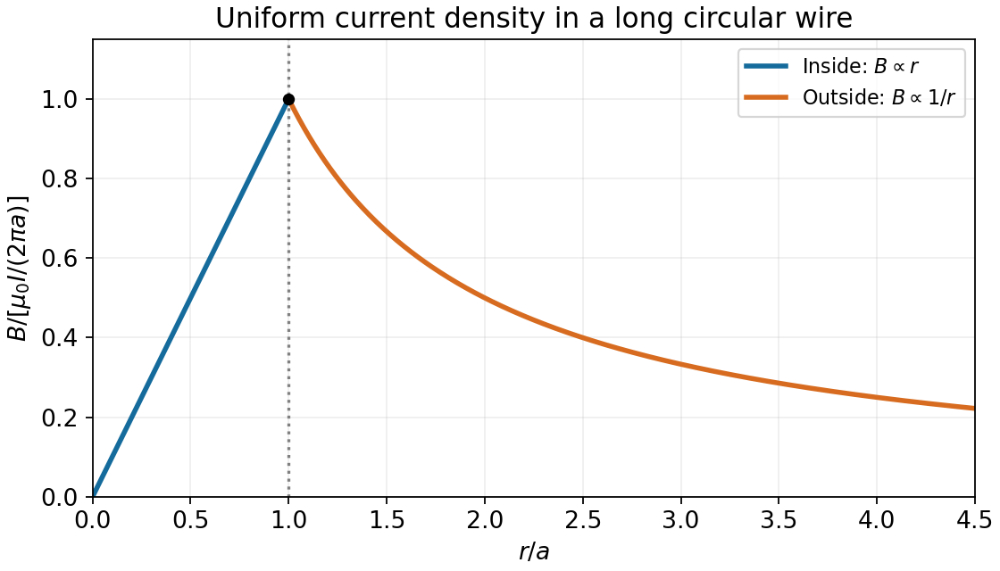
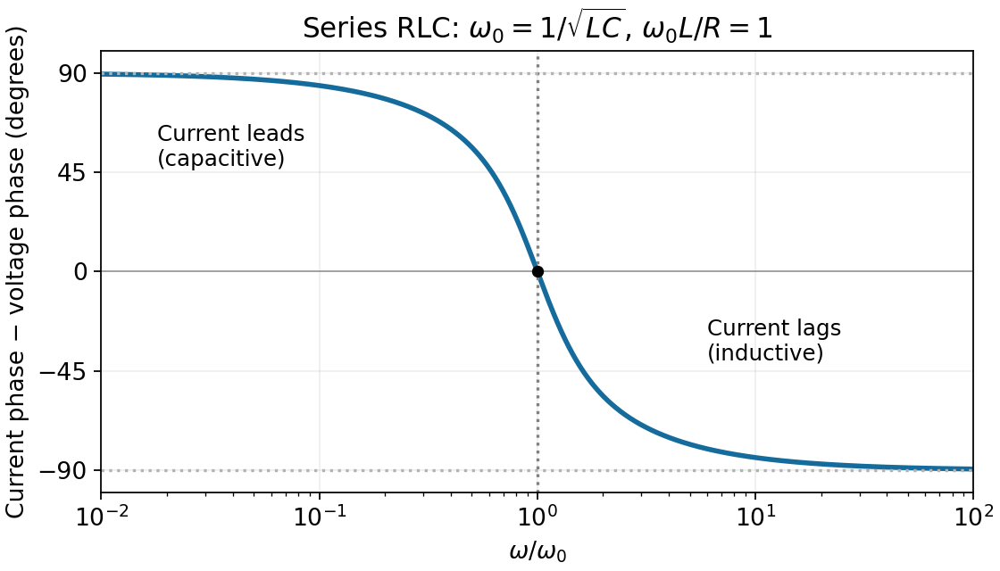
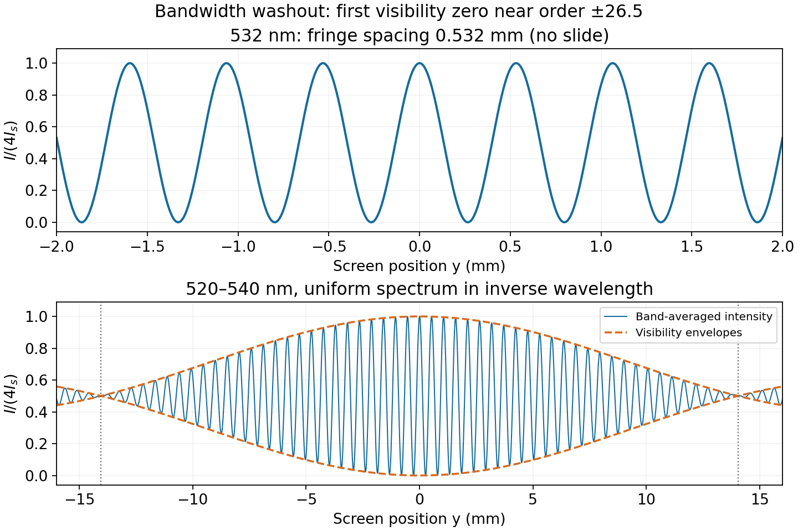
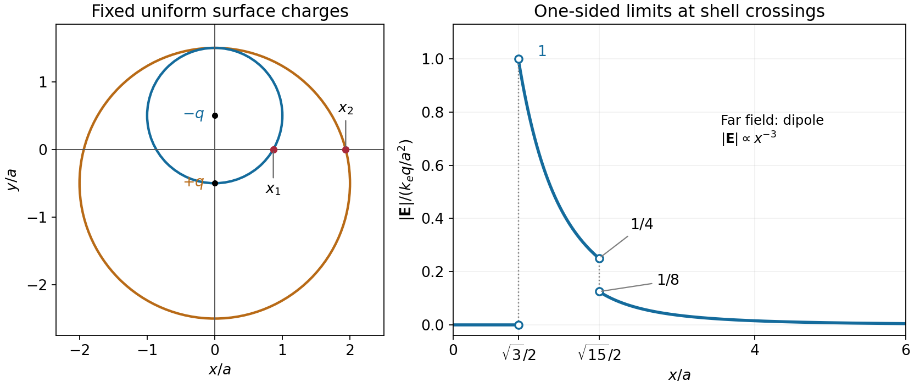
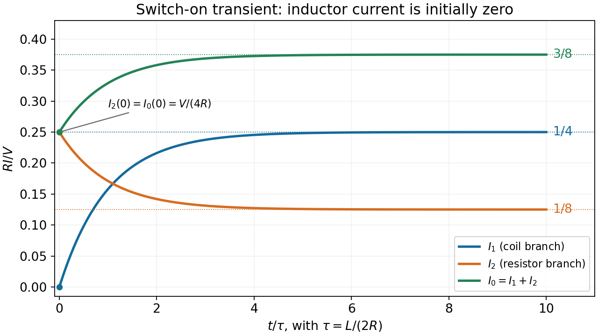

# 2014

↑ **Parent:** [Past exam of the physics 2 paper of the University of Oxford](../past-exam-of-the-physics-2-paper-of-the-university-of-oxford.md)

Source paper: [Oxford source archive](https://www.whatdotheyknow.com/request/physics_preliminary_examinations/response/1162943/attach/3/Twain.7z?cookie_passthrough=1), member `2014/CP2_June_2014.pdf`. The dated cover establishes the 10 June 2014 ordinary sitting. All ten questions are treated. Unlettered marked blocks use ordinal subparts; printed letters and Roman numerals are retained.

**Table of contents**

- [1](#1)
  - [Solution](#1/solution)
- [2](#2)
  - [1](#2/1)
    - [Solution](#2/1/solution)
  - [2](#2/2)
    - [Solution](#2/2/solution)
- [3](#3)
  - [Solution](#3/solution)
- [4](#4)
  - [1](#4/1)
    - [Solution](#4/1/solution)
  - [2](#4/2)
    - [Solution](#4/2/solution)
- [5](#5)
  - [i](#5/i)
    - [Solution](#5/i/solution)
  - [ii](#5/ii)
    - [Solution](#5/ii/solution)
- [6](#6)
  - [Solution](#6/solution)
- [7](#7)
  - [a](#7/a)
    - [1](#7/a/1)
      - [Solution](#7/a/1/solution)
    - [2](#7/a/2)
      - [Solution](#7/a/2/solution)
  - [b](#7/b)
    - [Solution](#7/b/solution)
- [8](#8)
  - [1](#8/1)
    - [Solution](#8/1/solution)
  - [2](#8/2)
    - [Solution](#8/2/solution)
  - [3](#8/3)
    - [Solution](#8/3/solution)
- [9](#9)
  - [i](#9/i)
    - [Solution](#9/i/solution)
  - [ii](#9/ii)
    - [Solution](#9/ii/solution)
  - [iii](#9/iii)
    - [Solution](#9/iii/solution)
  - [iv](#9/iv)
    - [Solution](#9/iv/solution)
- [10](#10)
  - [1](#10/1)
    - [Solution](#10/1/solution)
  - [2](#10/2)
    - [Solution](#10/2/solution)
  - [3](#10/3)
    - [Solution](#10/3/solution)
  - [4](#10/4)
    - [Solution](#10/4/solution)

## 1

↑ **Parent:** [2014](2014.md)

<h3 id="1/solution">Solution</h3>

↑ **Parent:** [1](#1)

Take the conducting plane as $y=0$, with the real [point charges](../electric-field.md#point-charge) $Q$ at $(0,b)$ and $-2Q$ at $(a,b)$. The [method of images](../mathematics.md#method-of-images) replaces the plane by image charges $-Q$ at $(0,-b)$ and $+2Q$ at $(a,-b)$. This makes the plane an equipotential; the physical field above it is the sum of the real- and image-charge fields. No factor of $1/2$ enters the force on a real charge.

Set $k_e=1/(4\pi\epsilon_0)$ and $d=\sqrt{a^2+4b^2}$, and use positive $x$ from $Q$ toward $-2Q$, positive $y$ upward. The horizontal forces combine the mutual attraction and the force from the other charge's image:

$$
\boxed{F_{Q,x}=2k_eQ^2\left(\frac1{a^2}-\frac a{d^3}\right),\qquad F_{-2Q,x}=-F_{Q,x}.}
$$

For the vertical components, the own-image attractions act downward; each cross-image term acts upward. Thus

$$
\boxed{F_{Q,y}=k_eQ^2\left(-\frac1{4b^2}+\frac{4b}{d^3}\right),\qquad F_{-2Q,y}=k_eQ^2\left(-\frac1{b^2}+\frac{4b}{d^3}\right).}
$$

These are the electrostatic forces; the external forces holding the charges fixed are their negatives. The smaller positive charge's vertical force need not always point downward, because the other charge's induced surface charge also contributes. The construction assumes the usual ideal large-plane limit with no imposed background field.

## 2

↑ **Parent:** [2014](2014.md)

<h3 id="2/1">1</h3>

↑ **Parent:** [2](#2)

<h4 id="2/1/solution">Solution</h4>

↑ **Parent:** [1](#2/1)

[Faraday's law](../maxwell-equations.md#faraday-s-law-of-induction) states that the induced [electromotive force](../electric-charge.md#electromotive-force) equals minus the rate of change of linked [magnetic flux](../magnetic-field.md#magnetic-flux):

$$
\boxed{\mathcal E=-\frac{d(N\Phi)}{dt}.}
$$

The minus sign expresses [Lenz's law](../maxwell-equations.md#lenz-s-law): the induced [electric current](../electric-charge.md#electric-current) acts to oppose the change in [magnetic flux](../magnetic-field.md#magnetic-flux). For a fixed contour this is equivalent to $\oint\mathbf E\cdot d\boldsymbol\ell=-d\int\mathbf B\cdot d\mathbf S/dt$.

<h3 id="2/2">2</h3>

↑ **Parent:** [2](#2)

<h4 id="2/2/solution">Solution</h4>

↑ **Parent:** [2](#2/2)

The loop area is $A=\pi(5\times10^{-3})^2\,\mathrm{m^2}$. Integrating [Ohm's law](../electric-charge.md#ohm-s-law) and [Faraday's law](../maxwell-equations.md#faraday-s-law-of-induction) through the whole decay gives

$$
RQ_{\rm passed}=\int\mathcal E\,dt=NA B_0.
$$

Therefore

$$
\boxed{B_0=\frac{RQ_{\rm passed}}{NA}=\frac{30(5\times10^{-6})}{50\pi(5\times10^{-3})^2}\simeq3.82\times10^{-2}\,\mathrm T.}
$$

The switching time cancels: a faster linear flux decay produces a larger [electric current](../electric-charge.md#electric-current) for a proportionally shorter interval. If the coil's self-[inductance](../electromagnetism.md#inductance) is retained, integrating $L\,dI/dt$ gives zero provided the initial and final currents vanish and the stated total charge includes the decay tail.

## 3

↑ **Parent:** [2014](2014.md)

<h3 id="3/solution">Solution</h3>

↑ **Parent:** [3](#3)

Let the wire radius be $a$, and take its [electric current](../electric-charge.md#electric-current) along $+z$. Cylindrical symmetry makes the [magnetic flux density](../magnetic-field.md) azimuthal. For a circular [Amperian loop](../maxwell-equations.md#amperian-loop) of radius $r$, [Ampère's law](../maxwell-equations.md#ampere-s-circuital-law) gives $2\pi rB=\mu_0 I_{\rm enclosed}$. Uniform [current density](../electric-charge.md#current-density) means $I_{\rm enclosed}=Ir^2/a^2$ inside and $I$ outside. Consequently

$$
\boxed{\mathbf B(r)=\begin{cases}
\dfrac{\mu_0Ir}{2\pi a^2}\hat{\boldsymbol\phi},&0\le r\le a,\\
\dfrac{\mu_0I}{2\pi r}\hat{\boldsymbol\phi},&r\ge a.
\end{cases}}
$$

Its direction follows the right-hand rule. The magnitude rises linearly from zero to $\mu_0I/(2\pi a)$ at the surface, is continuous there, and then falls as $1/r$.

**[Figure 1](#3/image-magnetic-field-magnitude-inside-and-outside-a-uniformly-current-filled-wire). Magnetic-field magnitude inside and outside a uniformly current-filled wire**. The radius and field are normalized by the wire radius and the surface field, respectively.

## 4

↑ **Parent:** [2014](2014.md)

<h3 id="4/1">1</h3>

↑ **Parent:** [4](#4)

<h4 id="4/1/solution">Solution</h4>

↑ **Parent:** [1](#4/1)

For the intended force-balanced straight-line motion, the [Lorentz force](../relativistic-electromagnetism.md#lorentz-force) vanishes:

$$
\boxed{\mathbf E+\mathbf v\times\mathbf B=0.}
$$

For a nonzero uniform [magnetic field](../magnetic-field.md), this implies $\mathbf E\cdot\mathbf B=0$ and

$$
\mathbf v_\perp=\frac{\mathbf E\times\mathbf B}{B^2},
$$

while a component parallel to $\mathbf B$ is unrestricted. A straight trajectory by itself states only that the force has no transverse component, $\mathbf v\times(\mathbf E+\mathbf v\times\mathbf B)=0$. For example, parallel electric field and motion can give straight but accelerated motion. The boxed cancellation is the usual constant-velocity interpretation of the source.

<h3 id="4/2">2</h3>

↑ **Parent:** [4](#4)

<h4 id="4/2/solution">Solution</h4>

↑ **Parent:** [2](#4/2)

After the [electric field](../electric-field.md) is removed, the uniform [magnetic field](../magnetic-field.md) preserves the speed. Decompose the instantaneous initial [velocity](../classical-mechanics.md#velocity) as $\mathbf v_0=\mathbf v_\parallel+\mathbf v_\perp$, with $\hat{\mathbf b}=\mathbf B/B$ and signed $\Omega=qB/m$. Then

$$
\mathbf v(t)=\mathbf v_\parallel+\mathbf v_\perp\cos\Omega t+(\mathbf v_\perp\times\hat{\mathbf b})\sin\Omega t,
$$

and, integrating,

$$
\boxed{\mathbf r(t)=\mathbf r_0+\mathbf v_\parallel t+\frac{\mathbf v_\perp}{\Omega}\sin\Omega t+\frac{\mathbf v_\perp\times\hat{\mathbf b}}{\Omega}(1-\cos\Omega t).}
$$

This is a [helical motion in a uniform magnetic field](../electromagnetism.md#helical-motion-in-a-uniform-magnetic-field) of radius $m|\mathbf v_\perp|/(|q|B)$ and angular frequency $|q|B/m$. It is a circle if $\mathbf v_\parallel=0$, and a straight line if $\mathbf v_\perp=0$. The formula assumes a uniform, nonzero field and nonrelativistic motion.

## 5

↑ **Parent:** [2014](2014.md)

<h3 id="5/i">i</h3>

↑ **Parent:** [5](#5)

<h4 id="5/i/solution">Solution</h4>

↑ **Parent:** [I](#5/i)

With [phasors](../wave.md#phasor) proportional to $e^{i\omega t}$, the series [RLC circuit](../electrical-circuit.md#rlc-circuit) has

$$
Z=R+i\left(\omega L-\frac1{\omega C}\right),\qquad I_0=\frac{V_0}{\sqrt{R^2+(\omega L-1/(\omega C))^2}}.
$$

For fixed $V_0$ and frequency-independent positive $R$, the maximum occurs when the reactances cancel. Thus

$$
\boxed{\omega_0=\frac1{\sqrt{LC}},\qquad I_{0,\max}=\frac{V_0}{R}.}
$$

This is the driven current [resonance](../dynamical-systems.md#resonance); a damped free-oscillation frequency is a different quantity.

<h3 id="5/ii">ii</h3>

↑ **Parent:** [5](#5)

<h4 id="5/ii/solution">Solution</h4>

↑ **Parent:** [Ii](#5/ii)

Define the phase difference as current phase minus voltage phase. Since $\widetilde I=\widetilde V/Z$,

$$
\boxed{\phi(\omega)=-\tan^{-1}\left(\frac{\omega L-1/(\omega C)}{R}\right).}
$$

It decreases continuously from $+\pi/2$ at low frequency, through zero at $\omega_0=1/\sqrt{LC}$, to $-\pi/2$ at high frequency. Thus the current leads in the capacitive limit and lags in the inductive limit. Defining voltage phase minus current phase would reverse the graph's sign.

**[Figure 2](#5/ii/image-current-phase-relative-to-the-source-voltage-in-a-series-rlc-circuit). Current phase relative to the source voltage in a series RLC circuit**. The example uses omega\_0 L/R equal to one; the limiting phases and zero crossing hold for every positive R, L and C.

## 6

↑ **Parent:** [2014](2014.md)

<h3 id="6/solution">Solution</h3>

↑ **Parent:** [6](#6)

[Huygens' principle](../physical-optics.md#huygens-principle) treats each point of a [wavefront](../physical-optics.md#wavefront) as the source of a secondary wavelet. The later [wavefront](../physical-optics.md#wavefront) is the common forward envelope of those wavelets. Consider a plane front reaching a flat interface between media with speeds $v_1$ and $v_2$. In the same interval $\Delta t$, the incident front advances $v_1\Delta t$ while the first transmitted wavelet grows to radius $v_2\Delta t$.

The two right triangles sharing the interface segment of length $d$ give $d\sin i=v_1\Delta t$ and $d\sin r=v_2\Delta t$, where $i$ and $r$ are ray angles to the normal. Hence

$$
\frac{\sin i}{\sin r}=\frac{v_1}{v_2}=\frac{n_2}{n_1},\qquad\boxed{n_1\sin i=n_2\sin r.}
$$

This is [Snell's law](../partial-differential-equation.md#snell-s-law). The frequency is unchanged at a stationary interface, while wavelength changes with the propagation speed.

## 7

↑ **Parent:** [2014](2014.md)

<h3 id="7/a">a</h3>

↑ **Parent:** [7](#7)

<h4 id="7/a/1">1</h4>

↑ **Parent:** [A](#7/a)

<h5 id="7/a/1/solution">Solution</h5>

↑ **Parent:** [1](#7/a/1)

Let $I_s$ be the intensity that either narrow slit would produce alone, and let $y$ measure screen displacement from the perpendicular bisector. The [optical path difference](../physical-optics.md#optical-path-difference) is approximately $\delta=b\sin\theta\simeq by/D$. Equal coherent field amplitudes then give

$$
I=I_s+I_s+2I_s\cos\left(\frac{2\pi\delta}{\lambda}\right)
=\boxed{4I_s\cos^2\left(\frac{\pi by}{\lambda D}\right)}.
$$

The maxima are at $y_m=m\lambda D/b$; the minima are halfway between them. Here

$$
\boxed{\Delta y=\frac{\lambda D}{b}=0.532\,\mathrm{mm}.}
$$

The expression uses the paraxial approximation and neglects the slowly varying single-slit [diffraction](../quantum-scattering.md#diffraction) envelope because the slit widths are unspecified.

<h4 id="7/a/2">2</h4>

↑ **Parent:** [A](#7/a)

<h5 id="7/a/2/solution">Solution</h5>

↑ **Parent:** [2](#7/a/2)

The slide adds an [optical path length](../physical-optics.md#optical-path-length) $\Delta=(n-1)t=50\,\mu\mathrm m$ in the covered path. If the covered slit is at positive transverse position, its geometric path to $y>0$ is shorter, giving total path difference $\Delta-by/D$. The zero-difference fringe therefore moves toward that slit:

$$
\boxed{y_0=\frac{D(n-1)t}{b}=5.0\times10^{-2}\,\mathrm m=50\,\mathrm{mm}.}
$$

This is about $94$ fringe periods. The leading grating-angle correction, $b\sin\theta=\Delta$ and $y=D\tan\theta$, gives $50.06$ mm, consistent with the paraxial result. In a strictly monochromatic periodic pattern, identifying the continuously tracked central order is essential: the final intensity pattern determines displacement only modulo one fringe spacing.

<h3 id="7/b">b</h3>

↑ **Parent:** [7](#7)

<h4 id="7/b/solution">Solution</h4>

↑ **Parent:** [B](#7/b)

The band has mean wavelength $\bar\lambda\simeq530\,\mathrm{nm}$ and width $\Delta\lambda=20\,\mathrm{nm}$. At order $m$, the positions of the extreme-wavelength maxima differ by about $|m|D\Delta\lambda/b$. Comparing this spread with a fringe spacing $D\bar\lambda/b$ gives

$$
|m|\sim\frac{\bar\lambda}{\Delta\lambda}\simeq26.5.
$$

Equivalently, the [coherence length](../physical-optics.md#optical-coherence-length) scale is $\ell_c\sim\bar\lambda^2/\Delta\lambda\simeq14\,\mu\mathrm m$. Thus the usual bandwidth estimate is

$$
\boxed{\text{about }26\text{ orders on either side, or order }50\text{ fringes in total}.}
$$

This is a washout scale, not a sharp definition of “clearly”. For a spectrum uniform in inverse wavelength $\sigma=1/\lambda$, the [interference visibility](../physical-optics.md#interferometric-visibility) is $|\operatorname{sinc}(\pi\Delta\sigma\,\delta)|$, with $\operatorname{sinc}u=\sin u/u$; its first zero occurs near order $26.5$. Fringes well inside that limit have stronger contrast. A half-fringe-smear criterion would instead retain about $13$ orders each side. The precise visible number needs the spectral distribution and a contrast threshold, neither supplied. If the slide remains in place and dispersion is neglected, the envelope is centred on the shifted zero-path-difference position and this order-count scale is unchanged.

**[Figure 3](#7/b/image-double-slit-fringes-and-bandwidth-induced-loss-of-contrast). Double-slit fringes and bandwidth-induced loss of contrast**. The band example assumes equal spectral intensity per unit inverse wavelength from 520 to 540 nm. Dashed envelopes show the visibility decline and its first zero near 26.5 central-wavelength orders.

## 8

↑ **Parent:** [2014](2014.md)

<h3 id="8/1">1</h3>

↑ **Parent:** [8](#8)

<h4 id="8/1/solution">Solution</h4>

↑ **Parent:** [1](#8/1)

In matter, [Gauss's law](../maxwell-equations.md#gauss-s-law) for free [electric charge](../electric-charge.md) is

$$
\boxed{\nabla\cdot\mathbf D=\rho_{\rm free},\qquad \oint_{\partial\mathcal V}\mathbf D\cdot d\mathbf S=Q_{\rm free,enclosed}.}
$$

The area normal points out of $\mathcal V$. In vacuum $\mathbf D=\epsilon_0\mathbf E$, so these become $\nabla\cdot\mathbf E=\rho/\epsilon_0$ and $\oint\mathbf E\cdot d\mathbf S=Q_{\rm enclosed}/\epsilon_0$.

<h3 id="8/2">2</h3>

↑ **Parent:** [8](#8)

<h4 id="8/2/solution">Solution</h4>

↑ **Parent:** [2](#8/2)

Put charges $+Q$ and $-Q$ on the concentric conductors. [Gauss's law](../maxwell-equations.md#gauss-s-law) gives $E(r)=Q/(4\pi\epsilon_0r^2)$ between them, $a<r<2a$. The potential difference is

$$
\Delta V=\int_a^{2a}\frac{Q}{4\pi\epsilon_0r^2}\,dr
=\frac{Q}{8\pi\epsilon_0a}.
$$

The [capacitance](../electromagnetism.md#capacitance) of this vacuum [spherical capacitor](../electromagnetism.md#spherical-capacitor) is therefore

$$
\boxed{C=\frac{Q}{\Delta V}=8\pi\epsilon_0a.}
$$

The conductors are equipotentials; a uniform dielectric filling would replace $\epsilon_0$ by its [permittivity](../permittivity.md).

<h3 id="8/3">3</h3>

↑ **Parent:** [8](#8)

<h4 id="8/3/solution">Solution</h4>

↑ **Parent:** [3](#8/3)

At $(x,0)$ the distances from the two centres are equal:

$$
r=\sqrt{x^2+a^2/4},\qquad x_1=\frac{\sqrt3}{2}a,\qquad x_2=\frac{\sqrt{15}}2a.
$$

By the electrostatic [shell theorem](../mathematical-physics.md#spherical-shell-theorem), a uniformly charged spherical shell gives zero field inside and its point-charge field outside. For $x<x_1$ the point is inside both shells. For $x_1<x<x_2$ only the small, negatively charged shell contributes. For $x>x_2$ both contribute, so

$$
\mathbf E(x)=\begin{cases}
0,&0\le x<x_1,\\
\dfrac{k_eq}{r^3}\left(-x\hat{\mathbf x}+\dfrac a2\hat{\mathbf y}\right),&x_1<x<x_2,\\
\dfrac{k_eqa}{r^3}\hat{\mathbf y},&x>x_2,
\end{cases}\qquad k_e=\frac1{4\pi\epsilon_0}.
$$

The requested magnitude is

$$
\boxed{|\mathbf E(x)|=\begin{cases}
0,&0\le x<x_1,\\
\dfrac{k_eq}{x^2+a^2/4},&x_1<x<x_2,\\
\dfrac{k_eqa}{(x^2+a^2/4)^{3/2}},&x>x_2.
\end{cases}}
$$

It jumps from zero to $k_eq/a^2$ at $x_1$, decreases to $k_eq/(4a^2)$ just before $x_2$, jumps down to $k_eq/(8a^2)$ just after $x_2$, and then falls as $x^{-3}$. The ideal surface charge makes the field discontinuous at each crossing, so the one-sided limits, rather than a unique value on the sheet, specify the graph. The far field is the equatorial field of an [electric dipole](../electrostatics.md#electric-dipole) with [electric dipole moment](../electrostatics.md#electric-dipole-moment) $\mathbf p=-qa\hat{\mathbf y}$.

**[Figure 4](#8/3/image-geometry-and-electric-field-magnitude-for-the-two-offset-charged-shells). Geometry and electric-field magnitude for the two offset charged shells**. The open endpoints give the one-sided limits at the two surface crossings. The field is zero inside both shells and has a dipolar far-field tail.

## 9

↑ **Parent:** [2014](2014.md)

<h3 id="9/i">i</h3>

↑ **Parent:** [9](#9)

<h4 id="9/i/solution">Solution</h4>

↑ **Parent:** [I](#9/i)

The source diagram has $2R$ in series with two parallel branches: one containing $R$ then $L$, and the other containing $2R$. Let their common voltage be $u(t)$, measured from the upper node to the lower return. [Kirchhoff's current law](../random-walk.md#kirchhoff-node-law) and the branch laws give

$$
I_0=I_1+I_2,\qquad u=2RI_2=RI_1+L\frac{dI_1}{dt},\qquad V=2RI_0+u.
$$

Using $I_2=u/(2R)$ in the source equation yields $u=V/2-RI_1$. Substitution into the coil branch gives

$$
\boxed{L\frac{dI_1}{dt}+2RI_1=\frac V2.}
$$

The switch was open for a long time, so $I_1(0^-)=0$. [Inductor current continuity](../electromagnetism.md#inductor-current-continuity) gives $I_1(0^+)=0$ for a finite applied voltage.

<h3 id="9/ii">ii</h3>

↑ **Parent:** [9](#9)

<h4 id="9/ii/solution">Solution</h4>

↑ **Parent:** [Ii](#9/ii)

The constant particular solution is $A=V/(4R)$, and the homogeneous equation has decay rate $2R/L$. Imposing $I_1(0)=0$ gives

$$
\boxed{I_1(t)=\frac{V}{4R}\left(1-e^{-t/\tau}\right),\qquad A=\frac V{4R},\quad\tau=\frac L{2R}.}
$$

As a separate check, the [Thévenin equivalent](../electrical-engineering.md#thevenin-equivalent) seen by $L$ has open-circuit voltage $V/2$ and resistance $R+(2R\parallel2R)=2R$, again giving $\tau=L/(2R)$.

<h3 id="9/iii">iii</h3>

↑ **Parent:** [9](#9)

<h4 id="9/iii/solution">Solution</h4>

↑ **Parent:** [Iii](#9/iii)

Put $e_t=e^{-t/\tau}$. From $u=V/2-RI_1$ and $I_0=I_1+I_2$,

$$
\boxed{I_1=\frac V{4R}(1-e_t),\qquad I_2=\frac V{8R}(1+e_t),\qquad I_0=\frac V{8R}(3-e_t).}
$$

At $t=0^+$ the three values are $I_1=0$ and $I_2=I_0=V/(4R)$. At late times they are $I_1=V/(4R)$, $I_2=V/(8R)$, and $I_0=3V/(8R)$. Thus $I_1$ and $I_0$ increase monotonically while $I_2$ decreases; every transient has the same [time constant](../analysis.md#time-constant). By $10\tau$, the exponential correction is only $e^{-10}\simeq4.54\times10^{-5}$ of its initial amplitude.

**[Figure 5](#9/iii/image-switch-on-currents-in-the-resistive-network-containing-one-inductor). Switch-on currents in the resistive network containing one inductor**. Currents are normalized by V/R. Values at switching and at equilibrium are marked for all three source-diagram current directions.

<h3 id="9/iv">iv</h3>

↑ **Parent:** [9](#9)

<h4 id="9/iv/solution">Solution</h4>

↑ **Parent:** [Iv](#9/iv)

Only the ideal [inductor](../electromagnetism.md#inductor) stores energy in this circuit; ideal [resistors](../electric-charge.md#resistor) dissipate energy as heat. With $I_1(\infty)=V/(4R)$,

$$
\boxed{U_{\rm stored}=\frac12LI_1(\infty)^2=\frac{LV^2}{32R^2}.}
$$

The question excludes the battery's internal energy, and the continuously generated resistor heat is not stored electromagnetic energy.

## 10

↑ **Parent:** [2014](2014.md)

<h3 id="10/1">1</h3>

↑ **Parent:** [10](#10)

<h4 id="10/1/solution">Solution</h4>

↑ **Parent:** [1](#10/1)

[Maxwell's equations](../maxwell-equations.md) in matter, with free charge and current densities, are

$$
\boxed{\nabla\cdot\mathbf D=\rho_{\rm free},\quad\nabla\cdot\mathbf B=0,\quad\nabla\times\mathbf E=-\frac{\partial\mathbf B}{\partial t},\quad\nabla\times\mathbf H=\mathbf J_{\rm free}+\frac{\partial\mathbf D}{\partial t}.}
$$

For vacuum, $\mathbf D=\epsilon_0\mathbf E$ and $\mathbf H=\mathbf B/\mu_0$, so the last equation is $\nabla\times\mathbf B=\mu_0\mathbf J+\mu_0\epsilon_0\,\partial\mathbf E/\partial t$.

<h3 id="10/2">2</h3>

↑ **Parent:** [10](#10)

<h4 id="10/2/solution">Solution</h4>

↑ **Parent:** [2](#10/2)

For a charging [parallel-plate capacitor](../electromagnetism.md#parallel-plate-capacitor) of area $A$, neglect fringing. The field in the gap is $E=Q/(\epsilon_0A)$, so the [displacement current](../maxwell-equations.md#displacement-current) through the gap is

$$
\boxed{I_D=\epsilon_0\frac{d}{dt}\int\mathbf E\cdot d\mathbf S=\epsilon_0A\frac{dE}{dt}=\frac{dQ}{dt}=I.}
$$

An [Amperian loop](../maxwell-equations.md#amperian-loop) around the feed wire can bound a surface cutting the wire, which has conduction current $I$, or a bulging surface passing through the dielectric gap, which has no conduction current. Including displacement current makes both surfaces give the same magnetic circulation. It is also required by [charge conservation](../electric-charge.md#charge-conservation): the divergence of the [Ampère-Maxwell equation](../maxwell-equations.md#ampere-s-circuital-law) and [Gauss's law](../maxwell-equations.md#gauss-s-law) yields $\nabla\cdot\mathbf J+\partial\rho/\partial t=0$, the [continuity equation](../mathematical-physics.md#continuity-equation).

<h3 id="10/3">3</h3>

↑ **Parent:** [10](#10)

<h4 id="10/3/solution">Solution</h4>

↑ **Parent:** [3](#10/3)

In charge- and current-free vacuum, $\nabla\cdot\mathbf E=\nabla\cdot\mathbf B=0$. Taking the curl of [Faraday's law](../maxwell-equations.md#faraday-s-law-of-induction) and using the [Ampère-Maxwell equation](../maxwell-equations.md#ampere-s-circuital-law) gives

$$
\nabla\times(\nabla\times\mathbf E)=-\mu_0\epsilon_0\frac{\partial^2\mathbf E}{\partial t^2}.
$$

Since $\nabla\times(\nabla\times\mathbf E)=\nabla(\nabla\cdot\mathbf E)-\nabla^2\mathbf E$, it follows that

$$
\boxed{\nabla^2\mathbf E=\mu_0\epsilon_0\frac{\partial^2\mathbf E}{\partial t^2},\qquad\nabla^2\mathbf B=\mu_0\epsilon_0\frac{\partial^2\mathbf B}{\partial t^2}.}
$$

Substituting a plane wave with phase $\mathbf k\cdot\mathbf r-\omega t$ gives $k^2=\mu_0\epsilon_0\omega^2$ and therefore

$$
\boxed{c=\frac\omega k=\frac1{\sqrt{\mu_0\epsilon_0}}\simeq3.00\times10^8\,\mathrm{m\,s^{-1}}.}
$$

The divergence equations make the waves transverse, and the curl equations fix $\mathbf B=\hat{\mathbf k}\times\mathbf E/c$.

<h3 id="10/4">4</h3>

↑ **Parent:** [10](#10)

<h4 id="10/4/solution">Solution</h4>

↑ **Parent:** [4](#10/4)

The phase $kz-\omega t$ describes propagation along $+z$. With $\psi=kz-\omega t$, the vacuum [plane electromagnetic wave](../electromagnetic-wave.md#plane-electromagnetic-wave) has

$$
\boxed{\mathbf B=\frac1c\hat{\mathbf z}\times\mathbf E=\frac Ac(-3\hat{\mathbf x}+2\hat{\mathbf y})\sin\psi.}
$$

Thus $B_x=-3A\sin\psi/c$, $B_y=2A\sin\psi/c$, and $B_z=0$. The field amplitudes are $E_0=\sqrt{13}|A|$ and $B_0=\sqrt{13}|A|/c$, giving

$$
\boxed{E_0/B_0=c.}
$$

The instantaneous magnitude ratio also equals $c$ wherever the fields are nonzero; at a node both vanish together. Their [Poynting vector](../electromagnetic-wave.md#poynting-vector) points along $+z$, checking the relative component signs.

## ↑ Ancestors (9)

1. [Past exam of the physics 2 paper of the University of Oxford](../past-exam-of-the-physics-2-paper-of-the-university-of-oxford.md)
2. [Physics 2 paper of the University of Oxford](../university-of-oxford.md#physics-2-paper-of-the-university-of-oxford)
3. [Year 1 of the physics course of the University of Oxford](../university-of-oxford.md#year-1-of-the-physics-course-of-the-university-of-oxford)
4. [Physics course of the University of Oxford](../university-of-oxford.md#physics-course-of-the-university-of-oxford)
5. [Undergraduate course of the University of Oxford](../university-of-oxford.md#undergraduate-course-of-the-university-of-oxford)
6. [Course of the University of Oxford](../university-of-oxford.md#course-of-the-university-of-oxford)
7. [University of Oxford](../university-of-oxford.md)
8. [List of universities](../README.md#list-of-universities)
9. [Codex Wiki](../README.md)
