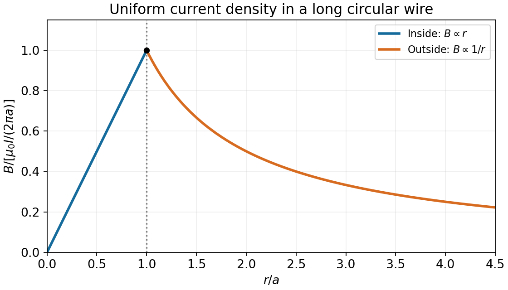

<h1 id="3/solution">Solution</h1>

↑ **Parent:** [3](../3.md)

Let the wire radius be $a$, and take its [electric current](../../../electric-current.md) along $+z$. Cylindrical symmetry makes the [magnetic flux density](../../../magnetic-field-split.md) azimuthal. For a circular [Amperian loop](../../../amperian-loop.md) of radius $r$, [Ampère's law](../../../ampere-s-circuital-law.md) gives $2\pi rB=\mu_0 I_{\rm enclosed}$. Uniform [current density](../../../current-density.md) means $I_{\rm enclosed}=Ir^2/a^2$ inside and $I$ outside. Consequently

$$
\boxed{\mathbf B(r)=\begin{cases}
\dfrac{\mu_0Ir}{2\pi a^2}\hat{\boldsymbol\phi},&0\le r\le a,\\
\dfrac{\mu_0I}{2\pi r}\hat{\boldsymbol\phi},&r\ge a.
\end{cases}}
$$

Its direction follows the right-hand rule. The magnitude rises linearly from zero to $\mu_0I/(2\pi a)$ at the surface, is continuous there, and then falls as $1/r$.

**[Figure 1](#3/image-magnetic-field-magnitude-inside-and-outside-a-uniformly-current-filled-wire). Magnetic-field magnitude inside and outside a uniformly current-filled wire**. The radius and field are normalized by the wire radius and the surface field, respectively.

## ↑ Ancestors (11)

1. [3](../3.md)
2. [2014](../../2014-split.md)
3. [Past exam of the physics 2 paper of the University of Oxford](../../split.md)
4. [Physics 2 paper of the University of Oxford](../../../physics-2-paper-of-the-university-of-oxford.md)
5. [Year 1 of the physics course of the University of Oxford](../../../year-1-of-the-physics-course-of-the-university-of-oxford.md)
6. [Physics course of the University of Oxford](../../../physics-course-of-the-university-of-oxford.md)
7. [Undergraduate course of the University of Oxford](../../../undergraduate-course-of-the-university-of-oxford.md)
8. [Course of the University of Oxford](../../../course-of-the-university-of-oxford.md)
9. [University of Oxford](../../../university-of-oxford-split.md)
10. [List of universities](../../../list-of-universities.md)
11. [Codex Wiki](../../../split.md)
