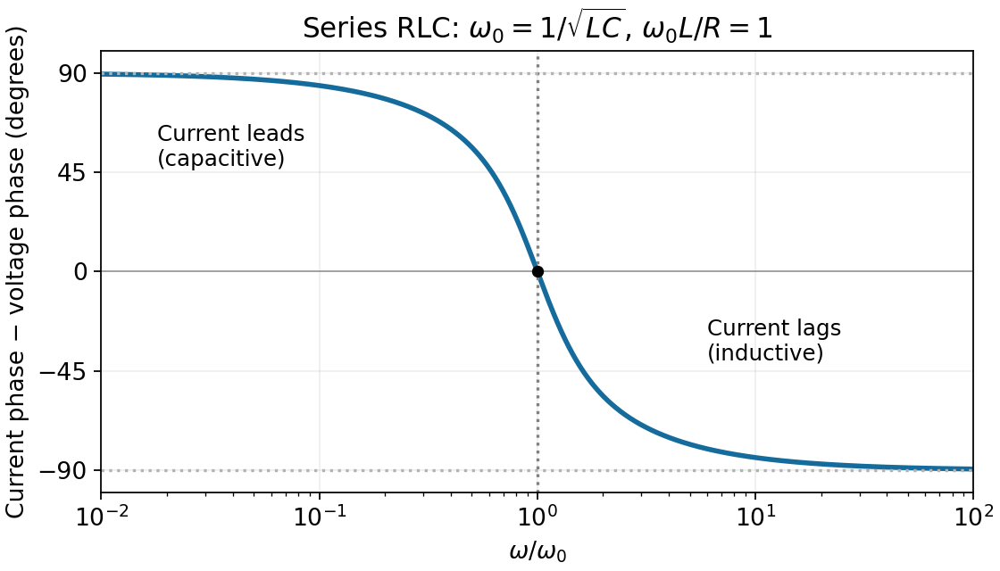

<h1 id="5/ii/solution">Solution</h1>

↑ **Parent:** [Ii](../ii.md)

Define the phase difference as current phase minus voltage phase. Since $\widetilde I=\widetilde V/Z$,

$$
\boxed{\phi(\omega)=-\tan^{-1}\left(\frac{\omega L-1/(\omega C)}{R}\right).}
$$

It decreases continuously from $+\pi/2$ at low frequency, through zero at $\omega_0=1/\sqrt{LC}$, to $-\pi/2$ at high frequency. Thus the current leads in the capacitive limit and lags in the inductive limit. Defining voltage phase minus current phase would reverse the graph's sign.

**[Figure 2](#5/ii/image-current-phase-relative-to-the-source-voltage-in-a-series-rlc-circuit). Current phase relative to the source voltage in a series RLC circuit**. The example uses omega\_0 L/R equal to one; the limiting phases and zero crossing hold for every positive R, L and C.

## ↑ Ancestors (12)

1. [Ii](../ii.md)
2. [5](../../5.md)
3. [2014](../../../2014-split.md)
4. [Past exam of the physics 2 paper of the University of Oxford](../../../split.md)
5. [Physics 2 paper of the University of Oxford](../../../../physics-2-paper-of-the-university-of-oxford.md)
6. [Year 1 of the physics course of the University of Oxford](../../../../year-1-of-the-physics-course-of-the-university-of-oxford.md)
7. [Physics course of the University of Oxford](../../../../physics-course-of-the-university-of-oxford.md)
8. [Undergraduate course of the University of Oxford](../../../../undergraduate-course-of-the-university-of-oxford.md)
9. [Course of the University of Oxford](../../../../course-of-the-university-of-oxford.md)
10. [University of Oxford](../../../../university-of-oxford-split.md)
11. [List of universities](../../../../list-of-universities.md)
12. [Codex Wiki](../../../../split.md)
