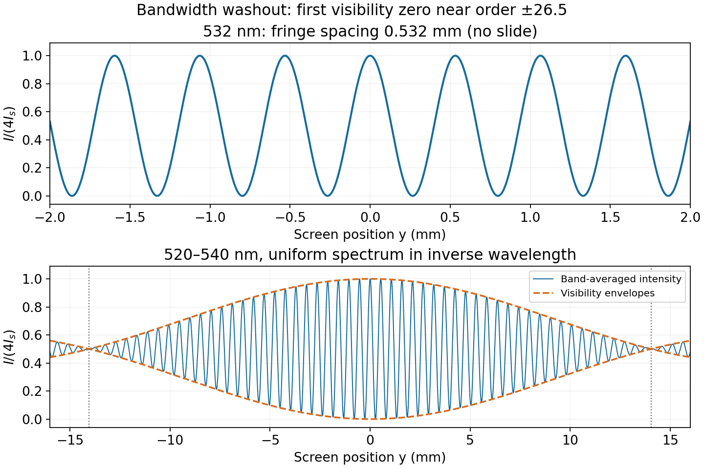

<h1 id="7/b/solution">Solution</h1>

↑ **Parent:** [B](../b.md)

The band has mean wavelength $\bar\lambda\simeq530\,\mathrm{nm}$ and width $\Delta\lambda=20\,\mathrm{nm}$. At order $m$, the positions of the extreme-wavelength maxima differ by about $|m|D\Delta\lambda/b$. Comparing this spread with a fringe spacing $D\bar\lambda/b$ gives

$$
|m|\sim\frac{\bar\lambda}{\Delta\lambda}\simeq26.5.
$$

Equivalently, the [coherence length](../../../../optical-coherence-length.md) scale is $\ell_c\sim\bar\lambda^2/\Delta\lambda\simeq14\,\mu\mathrm m$. Thus the usual bandwidth estimate is

$$
\boxed{\text{about }26\text{ orders on either side, or order }50\text{ fringes in total}.}
$$

This is a washout scale, not a sharp definition of “clearly”. For a spectrum uniform in inverse wavelength $\sigma=1/\lambda$, the [interference visibility](../../../../interferometric-visibility.md) is $|\operatorname{sinc}(\pi\Delta\sigma\,\delta)|$, with $\operatorname{sinc}u=\sin u/u$; its first zero occurs near order $26.5$. Fringes well inside that limit have stronger contrast. A half-fringe-smear criterion would instead retain about $13$ orders each side. The precise visible number needs the spectral distribution and a contrast threshold, neither supplied. If the slide remains in place and dispersion is neglected, the envelope is centred on the shifted zero-path-difference position and this order-count scale is unchanged.

**[Figure 3](#7/b/image-double-slit-fringes-and-bandwidth-induced-loss-of-contrast). Double-slit fringes and bandwidth-induced loss of contrast**. The band example assumes equal spectral intensity per unit inverse wavelength from 520 to 540 nm. Dashed envelopes show the visibility decline and its first zero near 26.5 central-wavelength orders.

## ↑ Ancestors (12)

1. [B](../b.md)
2. [7](../../7.md)
3. [2014](../../../2014-split.md)
4. [Past exam of the physics 2 paper of the University of Oxford](../../../split.md)
5. [Physics 2 paper of the University of Oxford](../../../../physics-2-paper-of-the-university-of-oxford.md)
6. [Year 1 of the physics course of the University of Oxford](../../../../year-1-of-the-physics-course-of-the-university-of-oxford.md)
7. [Physics course of the University of Oxford](../../../../physics-course-of-the-university-of-oxford.md)
8. [Undergraduate course of the University of Oxford](../../../../undergraduate-course-of-the-university-of-oxford.md)
9. [Course of the University of Oxford](../../../../course-of-the-university-of-oxford.md)
10. [University of Oxford](../../../../university-of-oxford-split.md)
11. [List of universities](../../../../list-of-universities.md)
12. [Codex Wiki](../../../../split.md)
