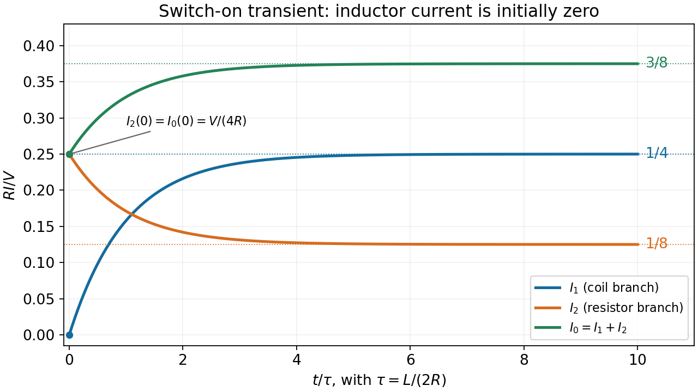

<h1 id="9/iii/solution">Solution</h1>

↑ **Parent:** [Iii](../iii.md)

Put $e_t=e^{-t/\tau}$. From $u=V/2-RI_1$ and $I_0=I_1+I_2$,

$$
\boxed{I_1=\frac V{4R}(1-e_t),\qquad I_2=\frac V{8R}(1+e_t),\qquad I_0=\frac V{8R}(3-e_t).}
$$

At $t=0^+$ the three values are $I_1=0$ and $I_2=I_0=V/(4R)$. At late times they are $I_1=V/(4R)$, $I_2=V/(8R)$, and $I_0=3V/(8R)$. Thus $I_1$ and $I_0$ increase monotonically while $I_2$ decreases; every transient has the same [time constant](../../../../time-constant.md). By $10\tau$, the exponential correction is only $e^{-10}\simeq4.54\times10^{-5}$ of its initial amplitude.

**[Figure 5](#9/iii/image-switch-on-currents-in-the-resistive-network-containing-one-inductor). Switch-on currents in the resistive network containing one inductor**. Currents are normalized by V/R. Values at switching and at equilibrium are marked for all three source-diagram current directions.

## ↑ Ancestors (12)

1. [Iii](../iii.md)
2. [9](../../9.md)
3. [2014](../../../2014-split.md)
4. [Past exam of the physics 2 paper of the University of Oxford](../../../split.md)
5. [Physics 2 paper of the University of Oxford](../../../../physics-2-paper-of-the-university-of-oxford.md)
6. [Year 1 of the physics course of the University of Oxford](../../../../year-1-of-the-physics-course-of-the-university-of-oxford.md)
7. [Physics course of the University of Oxford](../../../../physics-course-of-the-university-of-oxford.md)
8. [Undergraduate course of the University of Oxford](../../../../undergraduate-course-of-the-university-of-oxford.md)
9. [Course of the University of Oxford](../../../../course-of-the-university-of-oxford.md)
10. [University of Oxford](../../../../university-of-oxford-split.md)
11. [List of universities](../../../../list-of-universities.md)
12. [Codex Wiki](../../../../split.md)
