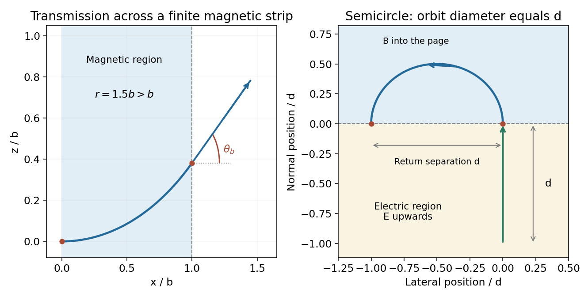
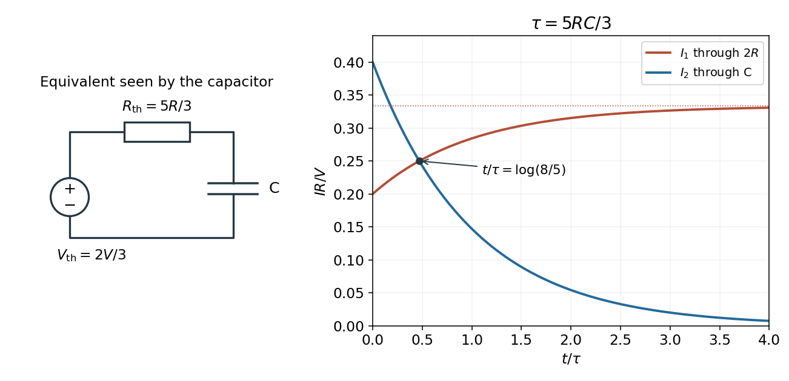
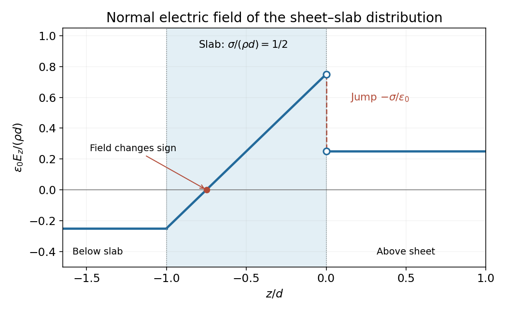
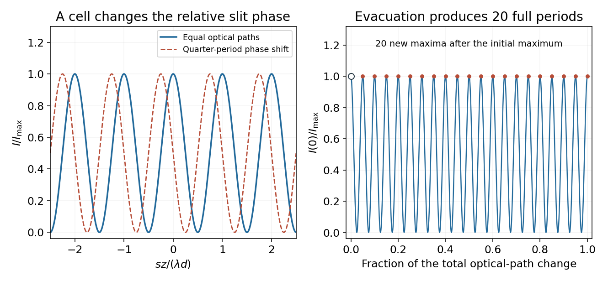

# 2015 resit

↑ **Parent:** [Past exam of the physics 2 paper of the University of Oxford](../past-exam-of-the-physics-2-paper-of-the-university-of-oxford.md)

Source paper: [Oxford source archive](https://www.whatdotheyknow.com/request/physics_preliminary_examinations/response/1162943/attach/3/Twain.7z?cookie_passthrough=1), member `2015/CP2_Sept_2015.pdf`. The dated cover establishes the 8 September 2015 resit. Unlettered marked blocks are indexed a, b and so on; all four Section B options are treated.

**Table of contents**

- [1](#1)
  - [Solution](#1/solution)
- [2](#2)
  - [Solution](#2/solution)
- [3](#3)
  - [Solution](#3/solution)
- [4](#4)
  - [Solution](#4/solution)
- [5](#5)
  - [Solution](#5/solution)
- [6](#6)
  - [Solution](#6/solution)
- [7](#7)
  - [Solution](#7/solution)
- [8](#8)
  - [a](#8/a)
    - [Solution](#8/a/solution)
  - [b](#8/b)
    - [Solution](#8/b/solution)
- [9](#9)
  - [a](#9/a)
    - [Solution](#9/a/solution)
  - [b](#9/b)
    - [Solution](#9/b/solution)
  - [c](#9/c)
    - [Solution](#9/c/solution)
- [10](#10)
  - [a](#10/a)
    - [Solution](#10/a/solution)
  - [b](#10/b)
    - [a](#10/b/a)
      - [Solution](#10/b/a/solution)
    - [b](#10/b/b)
      - [Solution](#10/b/b/solution)
    - [c](#10/b/c)
      - [Solution](#10/b/c/solution)
  - [c](#10/c)
    - [Solution](#10/c/solution)
- [11](#11)
  - [a](#11/a)
    - [Solution](#11/a/solution)
  - [b](#11/b)
    - [Solution](#11/b/solution)
  - [c](#11/c)
    - [Solution](#11/c/solution)

## 1

↑ **Parent:** [2015 resit](2015-resit.md)

<h3 id="1/solution">Solution</h3>

↑ **Parent:** [1](#1)

Take the [electric potential](../electric-field.md#electric-potential) to vanish at infinity and work at $r>0$. For a positive [point charge](../electric-field.md#point-charge) $q$ in vacuum,

$$
\boxed{V(r)=\frac{q}{4\pi\epsilon_0r},\qquad\mathbf E(r)=\frac{q}{4\pi\epsilon_0r^2}\hat{\mathbf r}}.
$$

The field is radial and outward. Since a radial scalar function has [gradient](../multivariable-calculus.md#gradient) $\nabla V=(dV/dr)\hat{\mathbf r}$,

$$
-\nabla V=-\left(-\frac{q}{4\pi\epsilon_0r^2}\right)\hat{\mathbf r}=\mathbf E.
$$

Thus the two expressions have the required vector relationship. Adding an arbitrary constant to $V$ would leave the [electric field](../electric-field.md) unchanged; the chosen reference at infinity fixes that constant. The point-charge singularity itself is excluded from the ordinary [derivative](../calculus.md#derivative) calculation.

## 2

↑ **Parent:** [2015 resit](2015-resit.md)

<h3 id="2/solution">Solution</h3>

↑ **Parent:** [2](#2)

Let $\psi=kx-\omega t$ and use bold $\mathbf B$ for the [magnetic flux density](../magnetic-field.md), to distinguish it from the scalar amplitude $B$ in $E_z$. For a [plane electromagnetic wave](../electromagnetic-wave.md#plane-electromagnetic-wave) travelling along $+x$, [Faraday's law](../maxwell-equations.md#faraday-s-law-of-induction) gives the wave-associated field

$$
\mathbf B=\frac{k}{\omega}\hat{\mathbf x}\times\mathbf E.
$$

Hence

$$
\boxed{B_x=0,\qquad B_y=-\frac{kB}{\omega}\cos\psi,\qquad B_z=\frac{kA}{\omega}\sin\psi}.
$$

For an explicit component check, $\nabla\times\mathbf E=(0,kB\sin\psi,kA\cos\psi)$, while differentiating the displayed field gives $-\partial\mathbf B/\partial t$ equal to that vector. The field is transverse and also satisfies $\nabla\cdot\mathbf B=0$.

In vacuum, [Ampère-Maxwell equation](../maxwell-equations.md#ampere-s-circuital-law) compatibility requires $\omega/k=c$, so each factor $k/\omega$ is $1/c$. More generally it is the inverse [phase velocity](../dispersion-relation.md#phase-velocity) on a suitable homogeneous-medium plane-wave branch. A time-independent background field could be added without changing the electric wave's Faraday equation; the requested propagating-wave field takes that independent background to be zero. Finally, $\mathbf E\times\mathbf B=(k/\omega)(E_y^2+E_z^2)\hat{\mathbf x}$ confirms the propagation direction and the relative signs.

## 3

↑ **Parent:** [2015 resit](2015-resit.md)

<h3 id="3/solution">Solution</h3>

↑ **Parent:** [3](#3)

For a fixed number $N$ of identical bulbs, first approximate each as a [resistor](../electric-charge.md#resistor) of [electrical resistance](../electric-charge.md#electrical-resistance) $R$ connected to a fixed ideal battery [electric potential difference](../electric-field.md#electric-potential-difference) $V$. A [series circuit](../electrical-circuit.md#series-circuit) has [electrical resistance](../electric-charge.md#electrical-resistance) $NR$, while a [parallel circuit](../electrical-circuit.md#parallel-circuit) has [electrical resistance](../electric-charge.md#electrical-resistance) $R/N$. Thus

$$
P_{\rm series}=\frac{V^2}{NR},\qquad P_{\rm parallel}=\frac{NV^2}{R},\qquad\boxed{\frac{P_{\rm parallel}}{P_{\rm series}}=N^2}.
$$

Parallel connection therefore maximizes dissipation in this model: every bulb receives the full source [electric potential difference](../electric-field.md#electric-potential-difference) instead of sharing it. For $N=1$ the two arrangements coincide.

An actual [incandescent light bulb](../electrical-engineering.md#incandescent-light-bulb) changes [electrical resistance](../electric-charge.md#electrical-resistance) as its filament heats, so a single constant $R$ need not describe both operating points. The same qualitative conclusion holds for identical stable bulbs with increasing current-voltage function $i(U)$: parallel operation gives $P_p=NV i(V)$, whereas symmetric series operation gives $P_s=V i(V/N)$. The former is larger for $N>1$. This comparison assumes a fixed collection and an ideal source as specified; an unlimited number of parallel bulbs on a zero-internal-resistance ideal battery would have no finite total-power maximum.

## 4

↑ **Parent:** [2015 resit](2015-resit.md)

<h3 id="4/solution">Solution</h3>

↑ **Parent:** [4](#4)

The magnetostatic [Ampère's law](../maxwell-equations.md#ampere-s-circuital-law) is $\oint\mathbf B\cdot d\boldsymbol\ell=\mu_0I_{\rm enc}$, equivalently $\nabla\times\mathbf B=\mu_0\mathbf J$ in vacuum. Let the wire radius be $a$ and take positive [electric current](../electric-charge.md#electric-current) along its axis. Cylindrical symmetry makes $\mathbf B$ azimuthal and constant in magnitude on a radius-$r$ circular path, so $2\pi rB=\mu_0I_{\rm enc}$.

Uniform [electric current](../electric-charge.md#electric-current) density gives $J=I/(\pi a^2)$. Inside the wire, $I_{\rm enc}=J\pi r^2=Ir^2/a^2$; outside, the full [electric current](../electric-charge.md#electric-current) is enclosed. Therefore

$$
\boxed{\mathbf B(r)=\begin{cases}
\dfrac{\mu_0Ir}{2\pi a^2}\hat{\boldsymbol\phi},&0\le r\le a,\\
\dfrac{\mu_0I}{2\pi r}\hat{\boldsymbol\phi},&r\ge a.
\end{cases}}
$$

The direction is set by the right-hand rule around the [electric current](../electric-charge.md#electric-current). The magnitude starts at zero on the axis, rises linearly to $\mu_0I/(2\pi a)$ at the surface and then falls as $1/r$. The two expressions are continuous at $r=a$. The long-wire approximation neglects end effects and any high-frequency redistribution of [electric current](../electric-charge.md#electric-current).

## 5

↑ **Parent:** [2015 resit](2015-resit.md)

<h3 id="5/solution">Solution</h3>

↑ **Parent:** [5](#5)

Let $R_1<R_2$ and put charge per unit length $+\lambda_q$ on the inner shell and $-\lambda_q$ on the facing outer conductor. For a long coaxial [Gaussian surface](../maxwell-equations.md#gaussian-surface) of radius $r$ in the gap, [Gauss's law](../maxwell-equations.md#gauss-s-law) gives

$$
E(r)\,2\pi rL=\frac{\lambda_qL}{\epsilon_0},\qquad E(r)=\frac{\lambda_q}{2\pi\epsilon_0r}.
$$

The [electric potential difference](../electric-field.md#electric-potential-difference) between the shells is

$$
V_1-V_2=\int_{R_1}^{R_2}E(r)dr=\frac{\lambda_q}{2\pi\epsilon_0}\log\frac{R_2}{R_1}.
$$

With total inner charge $Q=\lambda_qL$, the [capacitance](../electromagnetism.md#capacitance) is

$$
\boxed{C=\frac{2\pi\epsilon_0L}{\log(R_2/R_1)}}.
$$

This assumes a vacuum or approximately air-filled gap and negligible fringing at the ends. A uniform linear dielectric replaces $\epsilon_0$ by its permittivity. The expression depends on the shell-to-shell potential difference, not on the arbitrary common potential reference.

## 6

↑ **Parent:** [2015 resit](2015-resit.md)

<h3 id="6/solution">Solution</h3>

↑ **Parent:** [6](#6)

For an ideal [inductor](../electromagnetism.md#inductor) of constant [self-inductance](../electromagnetism.md#self-inductance) $L$, the passive-sign [electric potential difference](../electric-field.md#electric-potential-difference) is $V_L=L\,dI/dt$. The supplied [power](../energy.md#power) is $V_LI$, so increasing the [electric current](../electric-charge.md#electric-current) quasistatically from zero stores

$$
U=\int V_LI\,dt=\int_0^I LI'\,dI'=\boxed{\frac12LI^2}.
$$

Any [electrical resistance](../electric-charge.md#electrical-resistance) would additionally dissipate [energy](../energy.md) as heat; it is not included in this stored magnetic [energy](../energy.md).

For a long vacuum [solenoid](../magnetic-field.md#solenoid) with $N$ turns, axial length $\ell$ and cross-sectional area $A$, [Ampère's law](../maxwell-equations.md#ampere-s-circuital-law) gives $B=\mu_0(N/\ell)I$. Its [flux](../mathematical-physics.md#flux) linkage is $N\Phi=N BA$, so

$$
L=\frac{N\Phi}{I}=\frac{\mu_0N^2A}{\ell}.
$$

The nearly uniform field occupies volume $A\ell$, with negligible external-field [energy](../energy.md) in the long-solenoid approximation. Dividing its stored [energy](../energy.md) by this volume yields

$$
\boxed{u_B=\frac{U}{A\ell}=\frac12\mu_0\left(\frac N\ell\right)^2I^2=\frac{B^2}{2\mu_0}}.
$$

The vacuum and linear-inductance assumptions matter; a nonlinear magnetic material requires the appropriate field-energy integral rather than simply substituting a varying [inductance](../electromagnetism.md#inductance) into $LI^2/2$.

## 7

↑ **Parent:** [2015 resit](2015-resit.md)

<h3 id="7/solution">Solution</h3>

↑ **Parent:** [7](#7)

[Fermat principle](../mathematical-physics.md#fermat-principle) states that the [optical path length](../physical-optics.md#optical-path-length) $\int n\,ds$, equivalently the travel time in the nondispersive stationary isotropic ray model, is stationary for the actual [light ray](../geometrical-optics.md#light-ray) between fixed endpoints. It need not be a minimum in every optical system.

For two homogeneous media separated by $y=0$, place the fixed endpoints at $(0,h_1)$ and $(D,-h_2)$, with positive heights. If the ray crosses at $(x,0)$, its optical path is

$$
\mathcal L(x)=n_1\sqrt{x^2+h_1^2}+n_2\sqrt{(D-x)^2+h_2^2}.
$$

Stationarity with respect to the crossing point gives

$$
\frac{d\mathcal L}{dx}=n_1\frac{x}{\sqrt{x^2+h_1^2}}-n_2\frac{D-x}{\sqrt{(D-x)^2+h_2^2}}=0.
$$

The two fractions are $\sin\theta_1$ and $\sin\theta_2$, with angles measured from the interface normal. Thus

$$
\boxed{n_1\sin\theta_1=n_2\sin\theta_2},
$$

which is [Snell's law](../partial-differential-equation.md#snell-s-law). Dividing $\mathcal L$ by the vacuum light [speed](../classical-mechanics.md#speed) gives the corresponding travel time; minimizing geometric distance without refractive-index weighting would incorrectly predict a straight ray through unlike media.

## 8

↑ **Parent:** [2015 resit](2015-resit.md)

<h3 id="8/a">a</h3>

↑ **Parent:** [8](#8)

<h4 id="8/a/solution">Solution</h4>

↑ **Parent:** [A](#8/a)

Use nonrelativistic dynamics, take $B>0$ along $+y$, and neglect radiation. The [Lorentz force](../relativistic-electromagnetism.md#lorentz-force) $q\mathbf v\times\mathbf B$ initially points along $+z$. It does no work, so the [speed](../classical-mechanics.md#speed) stays $v$ and the trajectory inside the field is circular, with

$$
r=\frac{mv}{qB},\qquad\Omega=\frac{qB}{m}.
$$

Starting from the entry point, the orbit can be parametrized as $x=r\sin\theta$, $z=r(1-\cos\theta)$, where $\theta=\Omega t$. Its largest possible $x$ before turning back is $r$. Therefore it enters the strict region $x>b$ exactly when

$$
\boxed{r>b,\qquad B<\frac{mv}{qb}}.
$$

For that case, the first boundary crossing satisfies $\sin\theta_b=b/r$. The [velocity](../classical-mechanics.md#velocity) components are $v_x=v\cos\theta_b$ and $v_z=v\sin\theta_b$, so the outgoing angle above the $+x$ direction is

$$
\boxed{\theta_b=\sin^{-1}\!\left(\frac{qBb}{mv}\right),\qquad0\le\theta_b<\frac\pi2}.
$$

The zero-field limit is straight motion. At $r=b$ the particle only touches the far boundary tangentially and does not enter $x>b$; for $r<b$ it turns around before reaching that boundary and eventually returns through the entrance side. The equality case must therefore not be included in a crossing condition.

<h3 id="8/b">b</h3>

↑ **Parent:** [8](#8)

<h4 id="8/b/solution">Solution</h4>

↑ **Parent:** [B](#8/b)

The [electric field](../electric-field.md) does work $qEd$ on the initially stationary particle. Thus the entry [speed](../classical-mechanics.md#speed) into the magnetic region is

$$
v_0=\sqrt{\frac{2qEd}{m}}.
$$

In the source geometry the [magnetic field](../magnetic-field.md) is perpendicular to the page, and the particle enters perpendicular to the straight interface. Its return to that interface occurs after a semicircle. The separation between exit and return points is its orbit diameter, so the required separation $d$ gives $r=d/2$. Consequently

$$
\boxed{|\mathbf B|=\frac{2mv_0}{qd}=\sqrt{\frac{8mE}{qd}}}.
$$

For the drawn field into the page and a positive charge entering upwards, the trajectory bends left. Its [speed](../classical-mechanics.md#speed) is constant while in the [magnetic field](../magnetic-field.md), so the time there is the semicircle length divided by $v_0$:

$$
\boxed{t_B=\frac{\pi r}{v_0}=\frac{\pi d}{2v_0}=\pi\sqrt{\frac{md}{8qE}}=\frac{\pi m}{q|\mathbf B|}}.
$$

The last form is half the [cyclotron period](../quantum-theory.md#cyclotron-period) and independently checks the geometric calculation.

**[Figure 1](#8/b/image-finite-magnetic-strip-transmission-and-a-semicircular-return-to-the-electric-region). Finite magnetic-strip transmission and a semicircular return to the electric region**.

## 9

↑ **Parent:** [2015 resit](2015-resit.md)

<h3 id="9/a">a</h3>

↑ **Parent:** [9](#9)

<h4 id="9/a/solution">Solution</h4>

↑ **Parent:** [A](#9/a)

Label the [capacitor](../electromagnetism.md#capacitor)'s left terminal $a$ and right terminal $b$, with the battery's negative node at zero. The source diagram has $2R$ from $a$ to ground, $R$ from $b$ to ground, and a source-side [resistor](../electric-charge.md#resistor) $R$ feeding $a$ from [electric potential difference](../electric-field.md#electric-potential-difference) $V$. The [capacitor](../electromagnetism.md#capacitor) [electric current](../electric-charge.md#electric-current) $I_2$ flows from $a$ to $b$; $I_1$ flows through $2R$.

With the [capacitor](../electromagnetism.md#capacitor) removed, $V_a=2V/3$ and $V_b=0$, so the [Thévenin equivalent](../electrical-engineering.md#thevenin-equivalent) seen by the [capacitor](../electromagnetism.md#capacitor) has $V_{\rm th}=2V/3$. Suppress the ideal [electric potential difference](../electric-field.md#electric-potential-difference) source to find its [electrical resistance](../electric-charge.md#electrical-resistance): the left terminal sees $R\parallel2R=2R/3$ to ground and the right sees $R$, giving $R_{\rm th}=5R/3$ between the terminals.

The initially uncharged [capacitor](../electromagnetism.md#capacitor) [electric potential difference](../electric-field.md#electric-potential-difference) $V_C=V_a-V_b$ therefore obeys

$$
R_{\rm th}C\frac{dV_C}{dt}+V_C=V_{\rm th},\qquad V_C(0)=0.
$$

Solving gives $V_C=(2V/3)(1-e^{-t/\tau})$, with $\tau=R_{\rm th}C$. The [capacitor](../electromagnetism.md#capacitor) [electric current](../electric-charge.md#electric-current) is $I_2=C\dot V_C$, hence

$$
\boxed{I_2(t)=\frac{2V}{5R}e^{-t/\tau},\qquad A=\frac{2V}{5R},\qquad\tau=\frac{5RC}{3}}.
$$

At $t=0^+$, the short-like uncharged [capacitor](../electromagnetism.md#capacitor) makes $V_a=V_b=2V/5$, so $I_2=2V/(5R)$ directly from the right [resistor](../electric-charge.md#resistor). At long times the [capacitor](../electromagnetism.md#capacitor) carries no direct [electric current](../electric-charge.md#electric-current). These endpoint checks agree with the exponential solution.

<h3 id="9/b">b</h3>

↑ **Parent:** [9](#9)

<h4 id="9/b/solution">Solution</h4>

↑ **Parent:** [B](#9/b)

[Kirchhoff's current law](../random-walk.md#kirchhoff-node-law) at the left [capacitor](../electromagnetism.md#capacitor) terminal gives $(V-V_a)/R=V_a/(2R)+I_2$. Since $I_1=V_a/(2R)$,

$$
\boxed{I_1(t)=\frac{V}{3R}-\frac13I_2(t)=\frac{V}{3R}-\frac{2V}{15R}e^{-t/\tau}}.
$$

Thus $I_1$ rises from $V/(5R)$ to $V/(3R)$, whereas $I_2$ falls from $2V/(5R)$ to zero. Their derivatives have opposite signs, and both approach their limiting values on the same time scale $\tau=5RC/3$. The graph uses [electric currents](../electric-charge.md#electric-current) in units of $V/R$ and time in units of $\tau$.

**[Figure 2](#9/b/image-the-capacitor-s-thevenin-equivalent-and-the-two-original-branch-currents). The capacitor's Thevenin equivalent and the two original branch currents**.

<h3 id="9/c">c</h3>

↑ **Parent:** [9](#9)

<h4 id="9/c/solution">Solution</h4>

↑ **Parent:** [C](#9/c)

At equality, $I_1=V/(3R)-I_2/3=I_2$, so the common [electric current](../electric-charge.md#electric-current) is $V/(4R)$. Substituting the [capacitor](../electromagnetism.md#capacitor) [electric current](../electric-charge.md#electric-current) gives

$$
\frac{2V}{5R}e^{-t/\tau}=\frac{V}{4R},\qquad e^{-t/\tau}=\frac58.
$$

Therefore

$$
\boxed{t=\tau\log\frac85=\frac{5RC}{3}\log\frac85}.
$$

For $R=50\ \mathrm{k\Omega}$ and $C=0.2\ \mathrm{microfarads}$, $RC=0.0100\ \mathrm s$ and $\tau=0.01667\ \mathrm s$, giving $\boxed{t\simeq7.83\ \mathrm{ms}}$. The battery [electric potential difference](../electric-field.md#electric-potential-difference) cancels, as expected because every [electric current](../electric-charge.md#electric-current) scales linearly with it in this ideal linear circuit. The result assumes a nonzero source [electric potential difference](../electric-field.md#electric-potential-difference); with $V=0$ both [electric currents](../electric-charge.md#electric-current) vanish at all times.

## 10

↑ **Parent:** [2015 resit](2015-resit.md)

<h3 id="10/a">a</h3>

↑ **Parent:** [10](#10)

<h4 id="10/a/solution">Solution</h4>

↑ **Parent:** [A](#10/a)

The differential vacuum [Gauss's law](../maxwell-equations.md#gauss-s-law) is

$$
\boxed{\nabla\cdot\mathbf E=\rho_{\rm vol}/\epsilon_0}.
$$

Integrate over a volume $\Omega$ with closed boundary $S$. The [divergence theorem](../multivariable-calculus.md#divergence-theorem) converts the left side into outward electric [flux](../mathematical-physics.md#flux):

$$
\oint_S\mathbf E\cdot\hat{\mathbf n}\,dS=\int_\Omega\nabla\cdot\mathbf E\,dV=\frac1{\epsilon_0}\int_\Omega\rho_{\rm vol}\,dV=\boxed{\frac{Q_{\rm enc}}{\epsilon_0}}.
$$

This is the integral form. Surface charge can be treated by a thin-layer limit or by the corresponding jump in the normal field; the enclosed charge then includes the charged sheet. The surface orientation must be outward, and the field entering the integral is the total field, not merely the field of the enclosed charges alone.

<h3 id="10/b">b</h3>

↑ **Parent:** [10](#10)

<h4 id="10/b/a">a</h4>

↑ **Parent:** [B](#10/b)

<h5 id="10/b/a/solution">Solution</h5>

↑ **Parent:** [A](#10/b/a)

Choose $z=0$ at the sheet, positive $z$ upwards, so the uniformly charged slab occupies $-d<z<0$. Use the usual isolated-plane superposition convention, with no imposed uniform background field. The slab alone produces $+\rho d/(2\epsilon_0)\hat{\mathbf z}$ above it, while the negatively charged sheet produces $-\sigma/(2\epsilon_0)\hat{\mathbf z}$ there. Consequently

$$
\boxed{\mathbf E(z>0)=\frac{\rho d-\sigma}{2\epsilon_0}\hat{\mathbf z}}.
$$

Since $\rho d>\sigma$, the field is upward, away from the net positive charge distribution, with magnitude $(\rho d-\sigma)/(2\epsilon_0)$. The equal halves in the separate infinite-sheet fields follow from their reflection symmetry before superposition.

<h4 id="10/b/b">b</h4>

↑ **Parent:** [B](#10/b)

<h5 id="10/b/b/solution">Solution</h5>

↑ **Parent:** [B](#10/b/b)

Below the slab, its own field is downward, $-\rho d/(2\epsilon_0)\hat{\mathbf z}$. The negative sheet attracts a positive test charge upwards and contributes $+\sigma/(2\epsilon_0)\hat{\mathbf z}$. Adding the fields gives

$$
\boxed{\mathbf E(z<-d)=-\frac{\rho d-\sigma}{2\epsilon_0}\hat{\mathbf z}}.
$$

The magnitude equals the above-sheet value, but the direction is downward. This equality of outside magnitudes describes the zero-background solution for the given infinite charge planes; adding an externally imposed uniform field would constitute extra boundary data not specified here.

<h4 id="10/b/c">c</h4>

↑ **Parent:** [B](#10/b)

<h5 id="10/b/c/solution">Solution</h5>

↑ **Parent:** [C](#10/b/c)

Inside the uniformly charged slab, its own [electric field](../electric-field.md) is $\rho(z+d/2)\hat{\mathbf z}/\epsilon_0$: it vanishes at the slab's midplane and has [derivative](../calculus.md#derivative) $\rho/\epsilon_0$. Everywhere below the negative sheet, that sheet adds $+\sigma\hat{\mathbf z}/(2\epsilon_0)$. Therefore

$$
\boxed{\mathbf E(-d<z<0)=\frac{\rho(2z+d)+\sigma}{2\epsilon_0}\hat{\mathbf z}}.
$$

Its magnitude is the absolute value of this scalar coefficient. The field changes direction at

$$
\boxed{z_0=-\frac12\left(d+\frac\sigma\rho\right)},\qquad-d<z_0<-d/2.
$$

For $z<z_0$ it points downward; for $z>z_0$ it points upward, towards the negative sheet. Thus it is neither uniform nor directed upwards throughout the slab. The [derivative](../calculus.md#derivative) and the field at the lower slab boundary also agree with [Gauss's law](../maxwell-equations.md#gauss-s-law) and the previously found outside field.

<h3 id="10/c">c</h3>

↑ **Parent:** [10](#10)

<h4 id="10/c/solution">Solution</h4>

↑ **Parent:** [C](#10/c)

The signed normal-field profile is constant and negative below $z=-d$, rises linearly through the slab, jumps down at the negative sheet, then remains constant and positive above. More explicitly,

$$
E_z(-d^-)=E_z(-d^+)=\frac{\sigma-\rho d}{2\epsilon_0},\quad E_z(0^-)=\frac{\rho d+\sigma}{2\epsilon_0},\quad E_z(0^+)=\frac{\rho d-\sigma}{2\epsilon_0}.
$$

There is no surface charge at the slab's lower face, so the field is continuous there; only its slope changes. At the ideal sheet, the field jump is

$$
\boxed{E_z(0^+)-E_z(0^-)=-\frac\sigma{\epsilon_0}},
$$

exactly the negative-sheet boundary condition. The ideal sheet itself has distinct one-sided fields rather than one common field value.

**[Figure 3](#10/c/image-signed-normal-electric-field-for-a-negative-sheet-above-a-positively-charged-slab). Signed normal electric field for a negative sheet above a positively charged slab**.

The graph uses the illustrative ratio $\sigma/(\rho d)=1/2$, clearly separated from the symbolic general result. The zero occurs inside the lower half of the slab, and the two outside fields have equal magnitude and opposite sign.

## 11

↑ **Parent:** [2015 resit](2015-resit.md)

<h3 id="11/a">a</h3>

↑ **Parent:** [11](#11)

<h4 id="11/a/solution">Solution</h4>

↑ **Parent:** [A](#11/a)

For two identical narrow slits under coherent normal illumination, with $\lambda$ the [wavelength](../wave-equation.md#wavelength) in the propagation medium, let $I_s$ be the intensity contributed by either slit alone in the relevant angular range. At far-field angle $\theta$, the path difference is $\Delta=s\sin\theta$ and the [phase](../wave.md#phase-waves) difference is $2\pi\Delta/\lambda$. Adding the two complex amplitudes gives

$$
\boxed{I(\theta)=2I_s\left[1+\cos\left(\frac{2\pi s\sin\theta}{\lambda}\right)\right]=4I_s\cos^2\left(\frac{\pi s\sin\theta}{\lambda}\right)}.
$$

For a screen perpendicular to the optical axis, $\tan\theta=z/d$. Thus the angular fringe factor uses $\sin\theta=z/\sqrt{d^2+z^2}$; in the paraxial region $|z|\ll d$ it reduces to

$$
\boxed{I(z)\simeq4I_s\cos^2\left(\frac{\pi sz}{\lambda d}\right),\qquad\Delta z=\frac{\lambda d}{s}}.
$$

The supplied large-distance condition gives the [Fraunhofer diffraction](../physical-optics.md#fraunhofer-diffraction) regime for the slit separation; the further replacement $\sin\theta\simeq z/d$ is a separate small-angle approximation. An unspecified finite slit width would add a single-slit envelope, and $I_s$ can then vary with angle. The formula above gives the interference factor in the ideal narrow-slit, equal-amplitude model; no absolute source intensity is supplied.

<h3 id="11/b">b</h3>

↑ **Parent:** [11](#11)

<h4 id="11/b/solution">Solution</h4>

↑ **Parent:** [B](#11/b)

An ideal focusing lens maps propagation angle to position in its back [focal plane](../optical-instrument.md#focal-plane), with $z\simeq f\theta$ for paraxial [light rays](../geometrical-optics.md#light-ray). The two-slit relative [phase](../wave.md#phase-waves) remains $2\pi s\sin\theta/\lambda$, so the focal-plane interference pattern has the same form with propagation distance replaced by [focal length](../geometrical-optics.md#focal-length):

$$
\boxed{I_f(z)=I_{\max,f}\cos^2\left(\frac{\pi sz}{\lambda f}\right),\qquad\Delta z_f=\frac{\lambda f}{s}}.
$$

The new peak intensity $I_{\max,f}$ accounts for focusing and need not equal the earlier screen peak. The lens forms the angular Fraunhofer pattern at a finite focal-plane distance, so a long free propagation distance is no longer needed to obtain that angular pattern. The displayed position formula assumes the same narrow-slit and paraxial approximations.

<h3 id="11/c">c</h3>

↑ **Parent:** [11](#11)

<h4 id="11/c/solution">Solution</h4>

↑ **Parent:** [C](#11/c)

Write $\lambda_0$ for the vacuum [wavelength](../wave-equation.md#wavelength). Initially the identical air-filled boxes add equal optical paths. When the [refractive index](../electromagnetic-wave.md#refractive-index) in one box falls from $n_{\rm air}$ to $n(P)$, the extra path in the box that remains full is

$$
\Delta(P)=l[n_{\rm air}-n(P)].
$$

Identical fixed window contributions cancel. At the screen centre the geometric slit-path difference is zero, so, neglecting unequal transmission changes,

$$
I(0,P)=I_{\max}\cos^2\left(\frac{\pi l[n_{\rm air}-n(P)]}{\lambda_0}\right).
$$

Each extra optical path of one [wavelength](../wave-equation.md#wavelength) produces one full intensity period and one new maximum. Taking the stated count in the usual sense of 20 completed fringe periods during evacuation, **excluding the initial maximum**, and using $n(0)=1$ for vacuum gives

$$
N=\frac{l(n_{\rm air}-1)}{\lambda_0},\qquad\boxed{n_{\rm air}=1+\frac{N\lambda_0}{l}}.
$$

Taking $N=20$, vacuum [wavelength](../wave-equation.md#wavelength) $\lambda_0\simeq460\ \mathrm{nm}$ and $l=30\ \mathrm{mm}$,

$$
\boxed{n_{\rm air}-1\simeq3.07\times10^{-4},\qquad n_{\rm air}\simeq1.00031}.
$$

If the quoted $460\ \mathrm{nm}$ instead denotes the [wavelength](../wave-equation.md#wavelength) $\lambda_{\rm air}$ in ambient air, use $\lambda_0=n_{\rm air}\lambda_{\rm air}$ and the exact relation $n_{\rm air}=[1-N\lambda_{\rm air}/l]^{-1}$. It gives $1.00030676$, differing by less than $10^{-7}$ from the vacuum-wavelength estimate, well below one-fringe counting resolution.

The count convention matters: 20 maxima including both the initial and final maxima span only 19 periods, giving approximately $1.000291$. If the final fractional fringe is not measured, an integer count alone has a resolution of order $\lambda_0/l\simeq1.53\times10^{-5}$ in [refractive index](../electromagnetic-wave.md#refractive-index). The standard 20-period estimate should therefore not be interpreted as an arbitrarily precise index measurement.

**[Figure 4](#11/c/image-optical-path-phase-shift-and-20-completed-centre-intensity-fringe-periods). Optical-path phase shift and 20 completed centre-intensity fringe periods**.

## ↑ Ancestors (9)

1. [Past exam of the physics 2 paper of the University of Oxford](../past-exam-of-the-physics-2-paper-of-the-university-of-oxford.md)
2. [Physics 2 paper of the University of Oxford](../university-of-oxford.md#physics-2-paper-of-the-university-of-oxford)
3. [Year 1 of the physics course of the University of Oxford](../university-of-oxford.md#year-1-of-the-physics-course-of-the-university-of-oxford)
4. [Physics course of the University of Oxford](../university-of-oxford.md#physics-course-of-the-university-of-oxford)
5. [Undergraduate course of the University of Oxford](../university-of-oxford.md#undergraduate-course-of-the-university-of-oxford)
6. [Course of the University of Oxford](../university-of-oxford.md#course-of-the-university-of-oxford)
7. [University of Oxford](../university-of-oxford.md)
8. [List of universities](../README.md#list-of-universities)
9. [Codex Wiki](../README.md)
