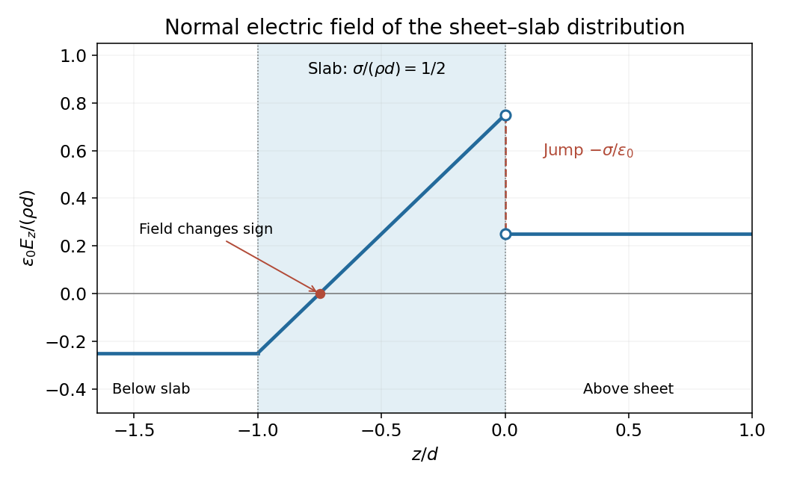

<h1 id="10/c/solution">Solution</h1>

↑ **Parent:** [C](../c.md)

The signed normal-field profile is constant and negative below $z=-d$, rises linearly through the slab, jumps down at the negative sheet, then remains constant and positive above. More explicitly,

$$
E_z(-d^-)=E_z(-d^+)=\frac{\sigma-\rho d}{2\epsilon_0},\quad E_z(0^-)=\frac{\rho d+\sigma}{2\epsilon_0},\quad E_z(0^+)=\frac{\rho d-\sigma}{2\epsilon_0}.
$$

There is no surface charge at the slab's lower face, so the field is continuous there; only its slope changes. At the ideal sheet, the field jump is

$$
\boxed{E_z(0^+)-E_z(0^-)=-\frac\sigma{\epsilon_0}},
$$

exactly the negative-sheet boundary condition. The ideal sheet itself has distinct one-sided fields rather than one common field value.

**[Figure 3](#10/c/image-signed-normal-electric-field-for-a-negative-sheet-above-a-positively-charged-slab). Signed normal electric field for a negative sheet above a positively charged slab**.

The graph uses the illustrative ratio $\sigma/(\rho d)=1/2$, clearly separated from the symbolic general result. The zero occurs inside the lower half of the slab, and the two outside fields have equal magnitude and opposite sign.

## ↑ Ancestors (12)

1. [C](../c.md)
2. [10](../../10.md)
3. [2015 resit](../../../2015-resit-split.md)
4. [Past exam of the physics 2 paper of the University of Oxford](../../../split.md)
5. [Physics 2 paper of the University of Oxford](../../../../physics-2-paper-of-the-university-of-oxford.md)
6. [Year 1 of the physics course of the University of Oxford](../../../../year-1-of-the-physics-course-of-the-university-of-oxford.md)
7. [Physics course of the University of Oxford](../../../../physics-course-of-the-university-of-oxford.md)
8. [Undergraduate course of the University of Oxford](../../../../undergraduate-course-of-the-university-of-oxford.md)
9. [Course of the University of Oxford](../../../../course-of-the-university-of-oxford.md)
10. [University of Oxford](../../../../university-of-oxford-split.md)
11. [List of universities](../../../../list-of-universities.md)
12. [Codex Wiki](../../../../split.md)
