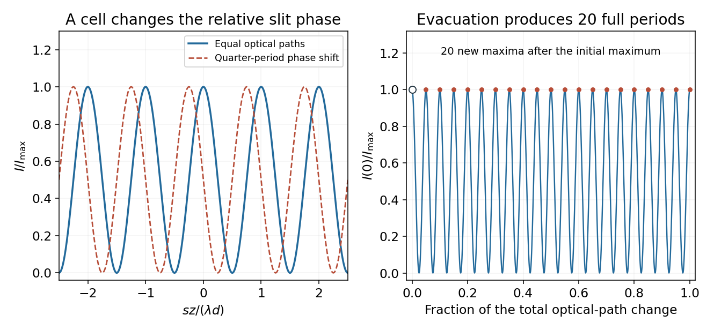

<h1 id="11/c/solution">Solution</h1>

↑ **Parent:** [C](../c.md)

Write $\lambda_0$ for the vacuum [wavelength](../../../../wavelength.md). Initially the identical air-filled boxes add equal optical paths. When the [refractive index](../../../../refractive-index.md) in one box falls from $n_{\rm air}$ to $n(P)$, the extra path in the box that remains full is

$$
\Delta(P)=l[n_{\rm air}-n(P)].
$$

Identical fixed window contributions cancel. At the screen centre the geometric slit-path difference is zero, so, neglecting unequal transmission changes,

$$
I(0,P)=I_{\max}\cos^2\left(\frac{\pi l[n_{\rm air}-n(P)]}{\lambda_0}\right).
$$

Each extra optical path of one [wavelength](../../../../wavelength.md) produces one full intensity period and one new maximum. Taking the stated count in the usual sense of 20 completed fringe periods during evacuation, **excluding the initial maximum**, and using $n(0)=1$ for vacuum gives

$$
N=\frac{l(n_{\rm air}-1)}{\lambda_0},\qquad\boxed{n_{\rm air}=1+\frac{N\lambda_0}{l}}.
$$

Taking $N=20$, vacuum [wavelength](../../../../wavelength.md) $\lambda_0\simeq460\ \mathrm{nm}$ and $l=30\ \mathrm{mm}$,

$$
\boxed{n_{\rm air}-1\simeq3.07\times10^{-4},\qquad n_{\rm air}\simeq1.00031}.
$$

If the quoted $460\ \mathrm{nm}$ instead denotes the [wavelength](../../../../wavelength.md) $\lambda_{\rm air}$ in ambient air, use $\lambda_0=n_{\rm air}\lambda_{\rm air}$ and the exact relation $n_{\rm air}=[1-N\lambda_{\rm air}/l]^{-1}$. It gives $1.00030676$, differing by less than $10^{-7}$ from the vacuum-wavelength estimate, well below one-fringe counting resolution.

The count convention matters: 20 maxima including both the initial and final maxima span only 19 periods, giving approximately $1.000291$. If the final fractional fringe is not measured, an integer count alone has a resolution of order $\lambda_0/l\simeq1.53\times10^{-5}$ in [refractive index](../../../../refractive-index.md). The standard 20-period estimate should therefore not be interpreted as an arbitrarily precise index measurement.

**[Figure 4](#11/c/image-optical-path-phase-shift-and-20-completed-centre-intensity-fringe-periods). Optical-path phase shift and 20 completed centre-intensity fringe periods**.

## ↑ Ancestors (12)

1. [C](../c.md)
2. [11](../../11.md)
3. [2015 resit](../../../2015-resit-split.md)
4. [Past exam of the physics 2 paper of the University of Oxford](../../../split.md)
5. [Physics 2 paper of the University of Oxford](../../../../physics-2-paper-of-the-university-of-oxford.md)
6. [Year 1 of the physics course of the University of Oxford](../../../../year-1-of-the-physics-course-of-the-university-of-oxford.md)
7. [Physics course of the University of Oxford](../../../../physics-course-of-the-university-of-oxford.md)
8. [Undergraduate course of the University of Oxford](../../../../undergraduate-course-of-the-university-of-oxford.md)
9. [Course of the University of Oxford](../../../../course-of-the-university-of-oxford.md)
10. [University of Oxford](../../../../university-of-oxford-split.md)
11. [List of universities](../../../../list-of-universities.md)
12. [Codex Wiki](../../../../split.md)
