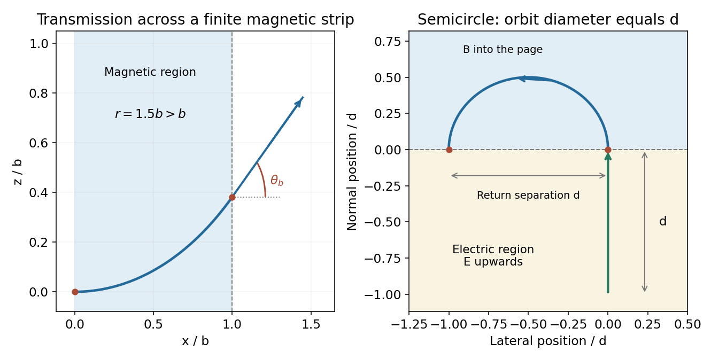

<h1 id="8/b/solution">Solution</h1>

↑ **Parent:** [B](../b.md)

The [electric field](../../../../electric-field-split.md) does work $qEd$ on the initially stationary particle. Thus the entry [speed](../../../../speed.md) into the magnetic region is

$$
v_0=\sqrt{\frac{2qEd}{m}}.
$$

In the source geometry the [magnetic field](../../../../magnetic-field-split.md) is perpendicular to the page, and the particle enters perpendicular to the straight interface. Its return to that interface occurs after a semicircle. The separation between exit and return points is its orbit diameter, so the required separation $d$ gives $r=d/2$. Consequently

$$
\boxed{|\mathbf B|=\frac{2mv_0}{qd}=\sqrt{\frac{8mE}{qd}}}.
$$

For the drawn field into the page and a positive charge entering upwards, the trajectory bends left. Its [speed](../../../../speed.md) is constant while in the [magnetic field](../../../../magnetic-field-split.md), so the time there is the semicircle length divided by $v_0$:

$$
\boxed{t_B=\frac{\pi r}{v_0}=\frac{\pi d}{2v_0}=\pi\sqrt{\frac{md}{8qE}}=\frac{\pi m}{q|\mathbf B|}}.
$$

The last form is half the [cyclotron period](../../../../cyclotron-period.md) and independently checks the geometric calculation.

**[Figure 1](#8/b/image-finite-magnetic-strip-transmission-and-a-semicircular-return-to-the-electric-region). Finite magnetic-strip transmission and a semicircular return to the electric region**.

## ↑ Ancestors (12)

1. [B](../b.md)
2. [8](../../8.md)
3. [2015 resit](../../../2015-resit-split.md)
4. [Past exam of the physics 2 paper of the University of Oxford](../../../split.md)
5. [Physics 2 paper of the University of Oxford](../../../../physics-2-paper-of-the-university-of-oxford.md)
6. [Year 1 of the physics course of the University of Oxford](../../../../year-1-of-the-physics-course-of-the-university-of-oxford.md)
7. [Physics course of the University of Oxford](../../../../physics-course-of-the-university-of-oxford.md)
8. [Undergraduate course of the University of Oxford](../../../../undergraduate-course-of-the-university-of-oxford.md)
9. [Course of the University of Oxford](../../../../course-of-the-university-of-oxford.md)
10. [University of Oxford](../../../../university-of-oxford-split.md)
11. [List of universities](../../../../list-of-universities.md)
12. [Codex Wiki](../../../../split.md)
