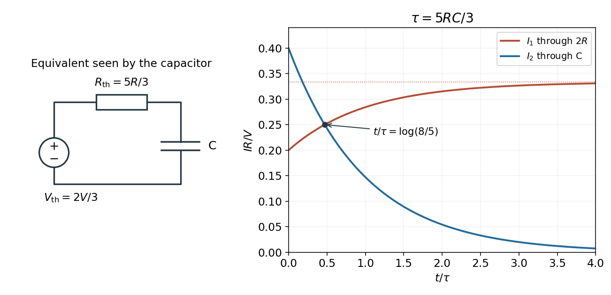

<h1 id="9/b/solution">Solution</h1>

↑ **Parent:** [B](../b.md)

[Kirchhoff's current law](../../../../kirchhoff-node-law.md) at the left [capacitor](../../../../capacitor.md) terminal gives $(V-V_a)/R=V_a/(2R)+I_2$. Since $I_1=V_a/(2R)$,

$$
\boxed{I_1(t)=\frac{V}{3R}-\frac13I_2(t)=\frac{V}{3R}-\frac{2V}{15R}e^{-t/\tau}}.
$$

Thus $I_1$ rises from $V/(5R)$ to $V/(3R)$, whereas $I_2$ falls from $2V/(5R)$ to zero. Their derivatives have opposite signs, and both approach their limiting values on the same time scale $\tau=5RC/3$. The graph uses [electric currents](../../../../electric-current.md) in units of $V/R$ and time in units of $\tau$.

**[Figure 2](#9/b/image-the-capacitor-s-thevenin-equivalent-and-the-two-original-branch-currents). The capacitor's Thevenin equivalent and the two original branch currents**.

## ↑ Ancestors (12)

1. [B](../b.md)
2. [9](../../9.md)
3. [2015 resit](../../../2015-resit-split.md)
4. [Past exam of the physics 2 paper of the University of Oxford](../../../split.md)
5. [Physics 2 paper of the University of Oxford](../../../../physics-2-paper-of-the-university-of-oxford.md)
6. [Year 1 of the physics course of the University of Oxford](../../../../year-1-of-the-physics-course-of-the-university-of-oxford.md)
7. [Physics course of the University of Oxford](../../../../physics-course-of-the-university-of-oxford.md)
8. [Undergraduate course of the University of Oxford](../../../../undergraduate-course-of-the-university-of-oxford.md)
9. [Course of the University of Oxford](../../../../course-of-the-university-of-oxford.md)
10. [University of Oxford](../../../../university-of-oxford-split.md)
11. [List of universities](../../../../list-of-universities.md)
12. [Codex Wiki](../../../../split.md)
