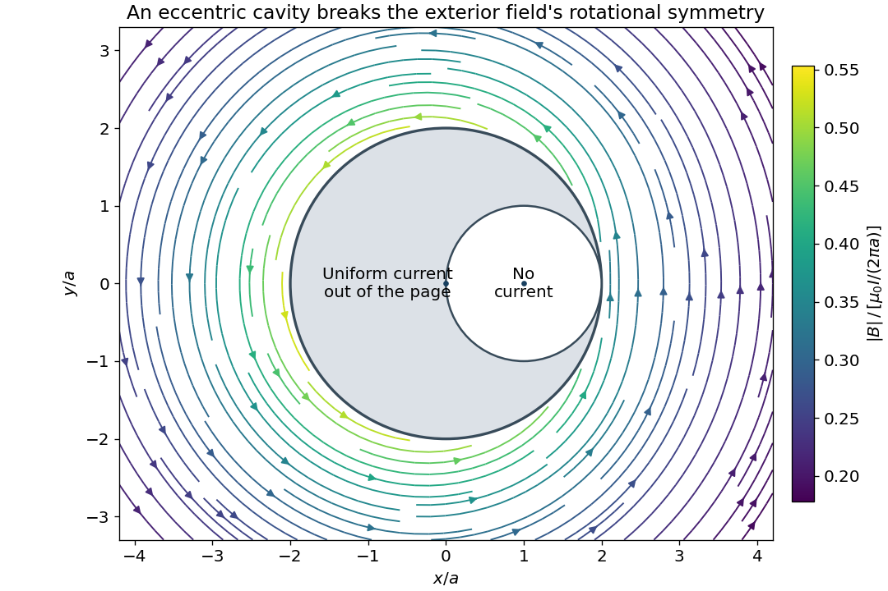
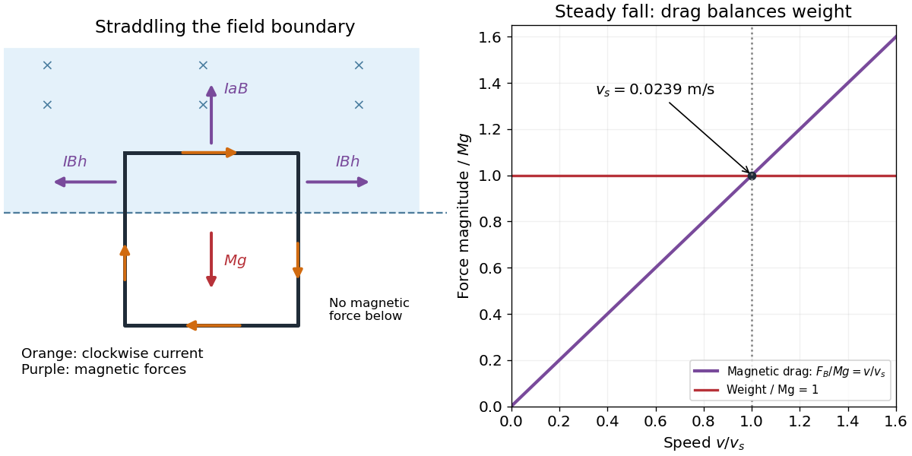
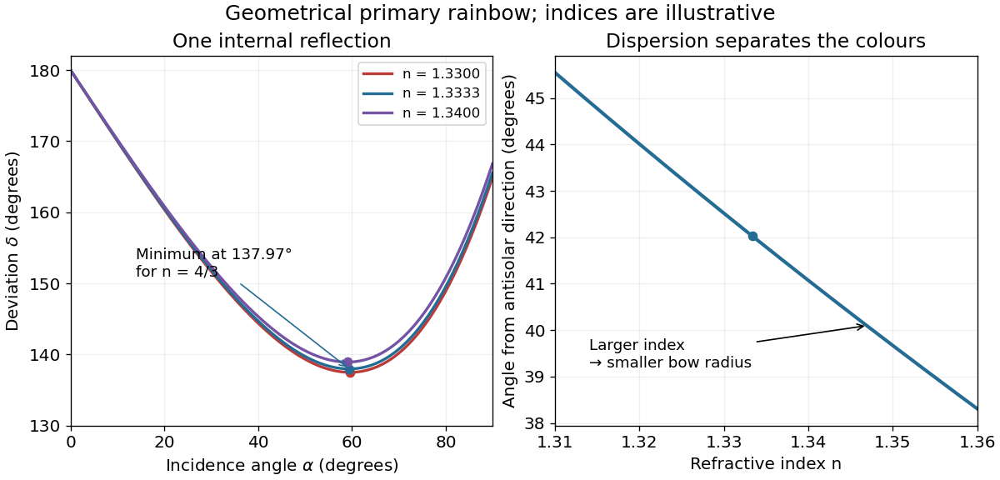

# 2015

↑ **Parent:** [Past exam of the physics 2 paper of the University of Oxford](../past-exam-of-the-physics-2-paper-of-the-university-of-oxford.md)

Source: [public archive](https://www.whatdotheyknow.com/request/physics_preliminary_examinations/response/1162943/attach/3/Twain.7z?cookie_passthrough=1), member `2015/CP2_June_2015.pdf`. The held cover dates this sitting to 9 June 2015. Separate unlettered marked blocks are indexed a, b and so on; all four Section B options are answered.

**Table of contents**

- [1](#1)
  - [Solution](#1/solution)
- [2](#2)
  - [a](#2/a)
    - [Solution](#2/a/solution)
  - [b](#2/b)
    - [Solution](#2/b/solution)
- [3](#3)
  - [Solution](#3/solution)
- [4](#4)
  - [Solution](#4/solution)
- [5](#5)
  - [Solution](#5/solution)
- [6](#6)
  - [Solution](#6/solution)
- [7](#7)
  - [Solution](#7/solution)
- [8](#8)
  - [a](#8/a)
    - [Solution](#8/a/solution)
  - [b](#8/b)
    - [Solution](#8/b/solution)
  - [c](#8/c)
    - [Solution](#8/c/solution)
- [9](#9)
  - [a](#9/a)
    - [Solution](#9/a/solution)
  - [b](#9/b)
    - [Solution](#9/b/solution)
  - [c](#9/c)
    - [Solution](#9/c/solution)
- [10](#10)
  - [a](#10/a)
    - [Solution](#10/a/solution)
  - [b](#10/b)
    - [Solution](#10/b/solution)
  - [c](#10/c)
    - [Solution](#10/c/solution)
  - [d](#10/d)
    - [Solution](#10/d/solution)
- [11](#11)
  - [a](#11/a)
    - [Solution](#11/a/solution)
  - [b](#11/b)
    - [Solution](#11/b/solution)
  - [c](#11/c)
    - [Solution](#11/c/solution)
  - [d](#11/d)
    - [Solution](#11/d/solution)

## 1

↑ **Parent:** [2015](2015.md)

<h3 id="1/solution">Solution</h3>

↑ **Parent:** [1](#1)

Take the [electric potential](../electric-field.md#electric-potential) to vanish at infinity. The [distance](../geometry-and-topology.md#distance) from the centre to each [point charge](../electric-field.md#point-charge) is half the [diagonal of a polygon](../euclidean-geometry.md#diagonal-of-a-polygon) of the [square](../euclidean-geometry.md#square), namely $a/\sqrt2$. The [superposition principle](../vector-space.md#superposition-principle) for the [electric potential](../electric-field.md#electric-potential) therefore gives, for four charges $+q$,

$$
\boxed{V=\frac{1}{4\pi\epsilon_0}\frac{4q}{a/\sqrt2}=\frac{\sqrt2 q}{\pi\epsilon_0a}.}
$$

Strictly, specifying only the _magnitude_ of each [electric charge](../electric-charge.md) leaves its sign undetermined. For signed charges $q_j$, the general answer is $V=\sqrt2\sum_{j=1}^4q_j/(4\pi\epsilon_0a)$. For example, two positive and two negative charges of equal magnitude give zero [electric potential](../electric-field.md#electric-potential) at the centre. The boxed result uses the usual interpretation that all four charges have the same positive sign.

## 2

↑ **Parent:** [2015](2015.md)

<h3 id="2/a">a</h3>

↑ **Parent:** [2](#2)

<h4 id="2/a/solution">Solution</h4>

↑ **Parent:** [A](#2/a)

[Gauss's law](../maxwell-equations.md#gauss-s-law) states that the outward [electric flux](../electric-field.md#electric-flux) through a closed [surface](../topological-surface.md) is the enclosed [electric charge](../electric-charge.md) divided by the [vacuum permittivity](../permittivity.md#vacuum-permittivity):

$$
\oint_S\mathbf E\cdot d\mathbf S=\frac{Q_{\rm enc}}{\epsilon_0},\qquad \nabla\cdot\mathbf E=\frac{\rho}{\epsilon_0}.
$$

In [electrostatics](../electrostatics.md), the [electric field](../electric-field.md) is the negative [gradient](../multivariable-calculus.md#gradient) of the [electrostatic potential](../electric-field.md#electric-potential), $\mathbf E=-\nabla V$. Substitution into the [differential equation](../differential-equation.md) form of [Gauss's law](../maxwell-equations.md#gauss-s-law) gives [Poisson's equation](../partial-differential-equation.md#poisson-s-equation) $\nabla^2V=-\rho/\epsilon_0$. Consequently, in a region containing no [charge density](../electric-charge.md#charge-density),

$$
\boxed{\nabla^2V=0,}
$$

which is [Laplace's equation](../partial-differential-equation.md#laplace-equation). Charges on the bounding [conductors](../electric-charge.md#electrical-conductor) enter through the [boundary conditions](../differential-equation.md#boundary-condition); they need not vanish for [Laplace's equation](../partial-differential-equation.md#laplace-equation) to hold inside the empty gap.

<h3 id="2/b">b</h3>

↑ **Parent:** [2](#2)

<h4 id="2/b/solution">Solution</h4>

↑ **Parent:** [B](#2/b)

Neglect [fringing field](../electric-field.md#fringing-field) near the edges of the [parallel-plate capacitor](../electromagnetism.md#parallel-plate-capacitor). Put the plates at $z=0,d$, with prescribed [electric potentials](../electric-field.md#electric-potential) $V_A,V_B$. [Translational symmetry parallel to a plane](../physics.md#translational-symmetry-parallel-to-a-plane) makes the [electrostatic potential](../electric-field.md#electric-potential) independent of the coordinates parallel to the plates. Thus [Laplace's equation](../partial-differential-equation.md#laplace-equation) reduces to $d^2V/dz^2=0$. Its [general solution](../linear-ordinary-differential-equation.md#general-solution) is $V=A+Bz$, and the two [boundary conditions](../differential-equation.md#boundary-condition) determine both constants:

$$
\boxed{V(z)=V_A+\frac{V_B-V_A}{d}z,\qquad \mathbf E=\frac{V_A-V_B}{d}\hat{\mathbf z}.}
$$

The [electric field](../electric-field.md) is uniform and points toward decreasing [electric potential](../electric-field.md#electric-potential). No plate [voltages](../random-walk.md#voltage) are specified, so a numerical [electric potential](../electric-field.md#electric-potential) cannot be fixed; choosing one plate as the reference only fixes the arbitrary additive constant.

## 3

↑ **Parent:** [2015](2015.md)

<h3 id="3/solution">Solution</h3>

↑ **Parent:** [3](#3)

Use the [geometric cross-section](../classical-mechanics.md#geometric-collision-cross-section) shown in the source: the outer [cylinder](../geometry-and-topology.md#cylinder-geometry) has radius $2a$ and centre $O$, and the circular cavity has radius $a$ and centre $C=a\hat{\mathbf x}$. Let the [electric current](../electric-charge.md#electric-current) be in the $+z$ direction. The conducting [cross-sectional area](../euclidean-geometry.md#cross-sectional-area) is $3\pi a^2$, so the uniform [electric current density](../electric-charge.md#current-density) is $\mathbf J=I\hat{\mathbf z}/(3\pi a^2)$.

To obtain the [exterior magnetic field of a wire with an eccentric cylindrical cavity](../electromagnetism.md#exterior-magnetic-field-of-a-wire-with-an-eccentric-cylindrical-cavity), apply the [superposition principle](../vector-space.md#superposition-principle) to a full [cylinder](../geometry-and-topology.md#cylinder-geometry) of [electric current density](../electric-charge.md#current-density) $\mathbf J$ centred at $O$ and a second [cylinder](../geometry-and-topology.md#cylinder-geometry) of [electric current density](../electric-charge.md#current-density) $-\mathbf J$ centred at $C$. Their [electric currents](../electric-charge.md#electric-current) are $4I/3$ and $-I/3$. This reproduces the actual [electric current density](../electric-charge.md#current-density) everywhere, including zero in the cavity. Outside a long circular [cylinder](../geometry-and-topology.md#cylinder-geometry), [Ampère's law](../maxwell-equations.md#ampere-s-circuital-law) gives $\mathbf B=\mu_0 I_{\rm cyl}\hat{\mathbf z}\times\mathbf r/(2\pi r^2)$. Every point outside the outer boundary is outside both component [cylinders](../geometry-and-topology.md#cylinder-geometry). Consequently, writing $\mathbf r=x\hat{\mathbf x}+y\hat{\mathbf y}$,

$$
\boxed{\mathbf B(x,y)=\frac{\mu_0I}{6\pi}\hat{\mathbf z}\times\left(\frac{4\mathbf r}{r^2}-\frac{\mathbf r-a\hat{\mathbf x}}{|\mathbf r-a\hat{\mathbf x}|^2}\right),\qquad r\geq2a.}
$$

In [Cartesian coordinates](../linear-algebra.md#cartesian-coordinate-system), the same [magnetic flux density](../magnetic-field.md) is

$$
B_x=\frac{\mu_0I}{6\pi}\left(-\frac{4y}{x^2+y^2}+\frac{y}{(x-a)^2+y^2}\right),\qquad B_y=\frac{\mu_0I}{6\pi}\left(\frac{4x}{x^2+y^2}-\frac{x-a}{(x-a)^2+y^2}\right),\qquad B_z=0.
$$

The cavity breaks [rotational symmetry](../linear-algebra.md#rotational-symmetry). Thus the [magnetic flux density](../magnetic-field.md) is generally neither constant in magnitude nor tangential on a circle centred at $O$; replacing its [line integral](../multivariable-calculus.md#line-integral) by $2\pi rB$ would be unjustified. Its [line integral](../multivariable-calculus.md#line-integral) is nevertheless $\mu_0I$, as [Ampère's law](../maxwell-equations.md#ampere-s-circuital-law) requires. At [distances](../geometry-and-topology.md#distance) $r\gg a$, the leading term becomes $\mu_0I\hat{\boldsymbol\phi}/(2\pi r)$, with corrections of order $\mu_0Ia/r^2$.

**[Figure 1](#3/image-exterior-magnetic-flux-density-from-the-two-cylinder-superposition). Exterior magnetic flux density from the two-cylinder superposition**.

## 4

↑ **Parent:** [2015](2015.md)

<h3 id="4/solution">Solution</h3>

↑ **Parent:** [4](#4)

Choose the entry point as $(0,0)$, the initial [velocity](../classical-mechanics.md#velocity) as $v\hat{\mathbf x}$, and the slit as $(d,a)$, with $a,d>0$. A [magnetic field](../magnetic-field.md) perpendicular to the page changes the direction of the [velocity](../classical-mechanics.md#velocity), while the [Lorentz force](../relativistic-electromagnetism.md#lorentz-force) does no [work](../energy.md#work). For positive $q$, an upward initial [force](../force.md) requires the [magnetic flux density](../magnetic-field.md) to point into the page. The resulting [circular motion](../classical-mechanics.md#circular-motion) has centre $(0,r)$, since its initial tangent is horizontal.

The slit must lie on the [circle](../topology.md#circle), giving $d^2+(a-r)^2=r^2$ and hence $r=(d^2+a^2)/(2a)$. Equating the [centripetal force](../classical-mechanics.md#centripetal-force) to the magnetic part of the [Lorentz force](../relativistic-electromagnetism.md#lorentz-force), $mv^2/r=|q|vB$, gives

$$
\boxed{|B|=\frac{2mva}{|q|(d^2+a^2)},\qquad \mathbf B=-\frac{2mva}{q(d^2+a^2)}\hat{\mathbf z}.}
$$

A negative [electric charge](../electric-charge.md) requires the opposite direction of [magnetic flux density](../magnetic-field.md). These expressions assume nonrelativistic [motion](../classical-mechanics.md#motion) and negligible energy loss through [electromagnetic radiation](../electromagnetic-radiation.md).

For an opaque screen, reaching the slit must be the _first_ encounter with $x=d$. The [velocity](../classical-mechanics.md#velocity) there has $v_x/v=(d^2-a^2)/(d^2+a^2)$, so passage from left to right requires $a<d$, as in the drawn arrangement. At $a=d$ the [trajectory](../classical-mechanics.md#trajectory) merely touches the screen. If $a>d$, the same [circle](../topology.md#circle) first meets the screen at height $d^2/a<a$, where the particle is blocked; its later passage through $(d,a)$ does not solve the opaque-screen problem. This qualification distinguishes a geometric [circle](../topology.md#circle) through two points from an accessible slit [trajectory](../classical-mechanics.md#trajectory).

## 5

↑ **Parent:** [2015](2015.md)

<h3 id="5/solution">Solution</h3>

↑ **Parent:** [5](#5)

Take the [divergence](../multivariable-calculus.md#divergence) of the proposed [Ampère's law](../maxwell-equations.md#ampere-s-circuital-law). Since the [divergence of a curl](../multivariable-calculus.md#divergence-of-a-curl) vanishes identically, it implies $\nabla\cdot\mathbf J=0$. However, local [charge conservation](../electric-charge.md#charge-conservation) requires the [continuity equation](../mathematical-physics.md#continuity-equation)

$$
\nabla\cdot\mathbf J=-\frac{\partial\rho}{\partial t}.
$$

For example, [electric current](../electric-charge.md#electric-current) entering a charging [capacitor](../electromagnetism.md#capacitor) accumulates [electric charge](../electric-charge.md) on its plates, so the [charge density](../electric-charge.md#charge-density) is time dependent. The proposed equation cannot describe that process.

From [Gauss's law](../maxwell-equations.md#gauss-s-law), $\nabla\cdot\mathbf E=\rho/\epsilon_0$. Thus $\nabla\cdot(\epsilon_0\partial_t\mathbf E)=\partial_t\rho$, which supplies precisely the missing [divergence](../multivariable-calculus.md#divergence). Adding the [displacement current density](../maxwell-equations.md#displacement-current-density) gives the [Ampère-Maxwell equation](../maxwell-equations.md#ampere-s-circuital-law):

$$
\boxed{\mathbf J_D=\epsilon_0\frac{\partial\mathbf E}{\partial t},\qquad \nabla\times\mathbf B=\mu_0\left(\mathbf J+\epsilon_0\frac{\partial\mathbf E}{\partial t}\right).}
$$

Its [divergence](../multivariable-calculus.md#divergence) now yields the correct [continuity equation](../mathematical-physics.md#continuity-equation). Through a fixed [surface](../topological-surface.md), the associated [displacement current](../maxwell-equations.md#displacement-current) is $I_D=\epsilon_0\,d\Phi_E/dt$, where $\Phi_E$ is the [electric flux](../electric-field.md#electric-flux). In a vacuum [capacitor](../electromagnetism.md#capacitor) gap, this equals the conduction [electric current](../electric-charge.md#electric-current) charging the plates, even though no charges cross the gap. [Charge conservation](../electric-charge.md#charge-conservation) fixes the required [divergence](../multivariable-calculus.md#divergence) of the correction; by itself it does not exclude adding a further [divergence-free vector field](../fluid-mechanics.md#divergence-free-vector-field).

## 6

↑ **Parent:** [2015](2015.md)

<h3 id="6/solution">Solution</h3>

↑ **Parent:** [6](#6)

Let $Q(t)$ denote the [electric charge](../electric-charge.md) on the initially positive [capacitor](../electromagnetism.md#capacitor) plate and define the discharge [electric current](../electric-charge.md#electric-current) by $I=-\dot Q$. [Kirchhoff's voltage law](../random-walk.md#kirchhoff-cycle-law) for the [series RLC circuit](../electrical-circuit.md#series-rlc-circuit) gives the [damped harmonic oscillator](../analysis.md#damped-harmonic-oscillator) equation

$$
L\ddot Q+R\dot Q+\frac{Q}{C}=0.
$$

The initial conditions are $Q(0)=Q_0$ and $\dot Q(0)=0$: the open switch initially prevents [electric current](../electric-charge.md#electric-current), and finite [inductance](../electromagnetism.md#inductance) prevents an instantaneous jump in it. Put $\gamma=R/(2L)$ and $\omega_0^2=1/(LC)$. The two [characteristic roots](../differential-equation.md#characteristic-root-of-a-constant-coefficient-differential-equation) are $s=-\gamma\pm\sqrt{\gamma^2-\omega_0^2}$. An oscillatory [electric current](../electric-charge.md#electric-current) requires a nonzero imaginary part, hence

$$
\boxed{R^2<\frac{4L}{C},\quad\text{or}\quad R<2\sqrt{\frac LC},\qquad \omega_d=\sqrt{\frac1{LC}-\frac{R^2}{4L^2}}.}
$$

For positive $L,C$ and nonnegative $R$, this is the [underdamped](../wave-equation.md#underdamping) regime. The initial conditions give

$$
Q(t)=Q_0e^{-\gamma t}\left(\cos\omega_dt+\frac{\gamma}{\omega_d}\sin\omega_dt\right),\qquad I(t)=\frac{Q_0}{LC\omega_d}e^{-\gamma t}\sin\omega_dt.
$$

At equality there is [critical damping](../wave-equation.md#critical-damping), and above it there is an [overdamped](../wave-equation.md#overdamping) response, with no repeated changes of sign of the discharge [electric current](../electric-charge.md#electric-current). A nonzero initial [electric charge](../electric-charge.md) is understood; if $Q_0=0$, the stated initial conditions give no [electric current](../electric-charge.md#electric-current) at all.

## 7

↑ **Parent:** [2015](2015.md)

<h3 id="7/solution">Solution</h3>

↑ **Parent:** [7](#7)

Use [Fraunhofer diffraction](../physical-optics.md#fraunhofer-diffraction), appropriate to observation in the far field or in the focal plane of a [lens](../geometrical-optics.md#lens-optics), and uniform illumination across the slit. At observation angle $\theta$, points separated by transverse coordinate $u$ acquire a [phase difference](../wave.md#phase-difference) $ku\sin\theta$, where $k=2\pi/\lambda$ is the [wavenumber](../wave-equation.md#wavenumber). The [superposition principle](../vector-space.md#superposition-principle) for the coherent [wave amplitudes](../wave.md#wave-amplitude) gives

$$
A(\theta)\propto\int_{-w/2}^{w/2}e^{iku\sin\theta}\,du=w\frac{\sin\beta}{\beta},\qquad \beta=\frac{\pi w\sin\theta}{\lambda}.
$$

The [intensity](../wave.md#intensity-physics) is proportional to the squared modulus of the [wave amplitude](../wave.md#wave-amplitude), so

$$
\boxed{I(\theta)=I(0)\left(\frac{\sin\beta}{\beta}\right)^2.}
$$

The limit at $\beta=0$ is one. The noncentral zeros satisfy $w\sin\theta=m\lambda$ for nonzero integers $m$ for which the angle is physically allowed. In the [Rayleigh criterion](../point-spread-function.md#rayleigh-criterion), two mutually incoherent point images are just resolved when the central maximum of one [diffraction pattern](../quantum-scattering.md#diffraction-pattern) lies at the first minimum of the other. For [single-slit diffraction](../physical-optics.md#single-slit-diffraction) this gives

$$
\boxed{\Delta\theta_R=\arcsin\left(\frac\lambda w\right)\simeq\frac\lambda w\quad(w\gg\lambda).}
$$

The exact statement here takes one image on the slit normal; for nearby paraxial images the [angular resolution](../astrophysics.md#angular-resolution) is $\lambda/w$. The first propagating minimum exists only for $w\geq\lambda$. The numerical factor $1.22$ belongs to a circular aperture and does not apply to this slit.

## 8

↑ **Parent:** [2015](2015.md)

<h3 id="8/a">a</h3>

↑ **Parent:** [8](#8)

<h4 id="8/a/solution">Solution</h4>

↑ **Parent:** [A](#8/a)

For a linear element in sinusoidal steady state, the [complex impedance](../electrical-circuit.md#electrical-impedance) is the ratio of the [voltage](../random-walk.md#voltage) [phasor](../wave.md#phasor) to the [electric current](../electric-charge.md#electric-current) [phasor](../wave.md#phasor), $Z=\widetilde V/\widetilde I$. Use the convention that the physical signal is the real part of its [phasor](../wave.md#phasor) times $e^{i\omega t}$. Then time [differentiation](../calculus.md#differentiation) becomes multiplication by $i\omega$.

For a [resistor](../electric-charge.md#resistor), [Ohm's law](../electric-charge.md#ohm-s-law) gives $\widetilde V=R\widetilde I$. For a [capacitor](../electromagnetism.md#capacitor), $I=C\dot V$ gives $\widetilde I=i\omega C\widetilde V$. For an [inductor](../electromagnetism.md#inductor), $V=L\dot I$ gives $\widetilde V=i\omega L\widetilde I$. Hence

$$
\boxed{Z_R=R,\qquad Z_C=\frac1{i\omega C}=-\frac{i}{\omega C},\qquad Z_L=i\omega L.}
$$

The imaginary part encodes the relative [phase](../wave.md#phase-waves) of [electric current](../electric-charge.md#electric-current) and [voltage](../random-walk.md#voltage): [electric current](../electric-charge.md#electric-current) leads [voltage](../random-walk.md#voltage) in an ideal [capacitor](../electromagnetism.md#capacitor) and lags it in an ideal [inductor](../electromagnetism.md#inductor).

<h3 id="8/b">b</h3>

↑ **Parent:** [8](#8)

<h4 id="8/b/solution">Solution</h4>

↑ **Parent:** [B](#8/b)

Assume a passive linear [electrical circuit](../electrical-circuit.md) in sinusoidal steady state, with transients absent and $V_0$ the _peak_ [voltage](../random-walk.md#voltage). Write $Z=|Z|e^{i\phi}=R+iX$. The [electric current](../electric-charge.md#electric-current) is $I(t)=I_0\cos(\omega t-\phi)$, with $I_0=V_0/|Z|$. Average the instantaneous [electric power](../energy.md#electric-power) $V(t)I(t)$ over a full period. The double-frequency term averages to zero, leaving

$$
\langle P\rangle=\frac{V_0I_0}{2}\cos\phi,\qquad |Z|^2=R^2+X^2,\qquad \cos\phi=\frac R{|Z|}.
$$

Therefore

$$
\boxed{\langle P\rangle=\frac{V_0^2R}{2(R^2+X^2)}=\frac12 I_0^2R.}
$$

Equivalently, [root mean square](../analysis.md#root-mean-square) values give $\langle P\rangle=V_{\rm rms}I_{\rm rms}\cos\phi$. The [reactance](../electrical-circuit.md#electrical-reactance) exchanges stored [electric field](../electric-field.md) or [magnetic field](../magnetic-field.md) energy with the source, whereas the real part produces [Joule heating](../electric-charge.md#joule-heating). A purely imaginary [complex impedance](../electrical-circuit.md#electrical-impedance) dissipates no mean [electric power](../energy.md#electric-power) under these ideal assumptions.

<h3 id="8/c">c</h3>

↑ **Parent:** [8](#8)

<h4 id="8/c/solution">Solution</h4>

↑ **Parent:** [C](#8/c)

Keep the source diagram's topology: the arm from the left supply node to $X$ contains $R_0$ and $C_0$ in series; the arm from $X$ to the right supply node is $C_1$; the arm from the left node to $Y$ is $R_1$; and the arm from $Y$ to the right node contains $R$ and $C$ in parallel. Their [complex impedances](../electrical-circuit.md#electrical-impedance) are

$$
Z_0=R_0+\frac1{i\omega C_0},\qquad Z_1=\frac1{i\omega C_1},\qquad Z_p=\left(\frac1R+i\omega C\right)^{-1}.
$$

For this [capacitor bridge with series loss and a parallel standard arm](../electrical-circuit.md#capacitor-bridge-with-series-loss-and-a-parallel-standard-arm), the detector carries no [electric current](../electric-charge.md#electric-current) at balance. Taking the right supply node as zero [electric potential](../electric-field.md#electric-potential) and the left one as the source [voltage](../random-walk.md#voltage) $V_s$, the two [voltage dividers](../electrical-engineering.md#voltage-divider) give $V_X=V_sZ_1/(Z_0+Z_1)$ and $V_Y=V_sZ_p/(R_1+Z_p)$. Equality of these complex [voltages](../random-walk.md#voltage) means equality at every time, rather than merely equality of their magnitudes. Cross multiplication yields $R_1Z_1=Z_0Z_p$. Thus

$$
R_0+\frac1{i\omega C_0}=R_1\frac{Z_1}{Z_p}=\frac{R_1C}{C_1}+\frac{R_1}{i\omega RC_1}.
$$

Equating real and imaginary parts gives

$$
\boxed{R_0=\frac{R_1C}{C_1},\qquad C_0=\frac{RC_1}{R_1}.}
$$

The two adjustable standards determine the two components of the unknown [complex impedance](../electrical-circuit.md#electrical-impedance). Treating the lower-right arm as a series combination would give a different and incorrect balance equation for the source circuit. The result also gives the dimensionless [dielectric loss tangent](../permittivity.md#dielectric-loss-tangent) $\omega C_0R_0=\omega RC$ for the series-loss model.

## 9

↑ **Parent:** [2015](2015.md)

<h3 id="9/a">a</h3>

↑ **Parent:** [9](#9)

<h4 id="9/a/solution">Solution</h4>

↑ **Parent:** [A](#9/a)

The [electric dipole moment](../electrostatics.md#electric-dipole-moment) is $\mathbf p=2aq\hat{\mathbf z}$. By the [superposition principle](../vector-space.md#superposition-principle), the exact [electric potential](../electric-field.md#electric-potential) is

$$
V(\mathbf r)=\frac{q}{4\pi\epsilon_0}\left[\frac1{\sqrt{r^2+a^2-2ar\cos\theta}}-\frac1{\sqrt{r^2+a^2+2ar\cos\theta}}\right].
$$

For $a/r\ll1$, the [binomial expansion](../binomial-coefficient.md#binomial-expansion) gives each reciprocal [distance](../geometry-and-topology.md#distance) as $r^{-1}(1\pm(a/r)\cos\theta+O(a^2/r^2))$. The leading $1/r$ terms cancel because the total [electric charge](../electric-charge.md) is zero. The next even terms also cancel between the two signs. Consequently

$$
V(\mathbf r)=\frac{2aq}{4\pi\epsilon_0}\frac{\cos\theta}{r^2}+O\left(\frac{qa^3}{4\pi\epsilon_0r^4}\right),\qquad \boxed{\alpha=\frac{2aq}{4\pi\epsilon_0}=\frac{p}{4\pi\epsilon_0}.}
$$

This is the leading [electric dipole](../electrostatics.md#electric-dipole) term of the [multipole expansion](../electrostatics.md#electric-multipole-expansion); it describes the far field, not the [electric potential](../electric-field.md#electric-potential) arbitrarily close to either [point charge](../electric-field.md#point-charge).

<h3 id="9/b">b</h3>

↑ **Parent:** [9](#9)

<h4 id="9/b/solution">Solution</h4>

↑ **Parent:** [B](#9/b)

Apply the negative [gradient](../multivariable-calculus.md#gradient) to the leading far-field [electric potential](../electric-field.md#electric-potential). In [spherical coordinates](../multivariable-calculus.md#spherical-coordinate-system),

$$
E_r=-\frac{\partial V}{\partial r}=\frac{2\alpha\cos\theta}{r^3},\qquad E_\theta=-\frac1r\frac{\partial V}{\partial\theta}=\frac{\alpha\sin\theta}{r^3},\qquad E_\phi=-\frac1{r\sin\theta}\frac{\partial V}{\partial\phi}=0.
$$

The [electric field](../electric-field.md) therefore has the coordinate-independent form

$$
\boxed{\mathbf E=\frac{3(\mathbf p\cdot\hat{\mathbf r})\hat{\mathbf r}-\mathbf p}{4\pi\epsilon_0r^3}.}
$$

For the [electric dipole](../electrostatics.md#electric-dipole) along $z$, use $V=\alpha z/(x^2+y^2+z^2)^{3/2}$. Direct [partial differentiation](../multivariable-calculus.md#partial-derivative) gives the [vector components](../vector-space.md#coordinate-linear-algebra)

$$
\boxed{E_x=\frac{3\alpha xz}{r^5},\qquad E_y=\frac{3\alpha yz}{r^5},\qquad E_z=\frac{\alpha(3z^2-r^2)}{r^5},\quad r^2=x^2+y^2+z^2.}
$$

On the positive axis the [electric field](../electric-field.md) points along the [electric dipole moment](../electrostatics.md#electric-dipole-moment); in the equatorial plane it points oppositely, providing a useful sign check.

<h3 id="9/c">c</h3>

↑ **Parent:** [9](#9)

<h4 id="9/c/solution">Solution</h4>

↑ **Parent:** [C](#9/c)

First use the usual idealization of a grounded infinite [conducting plane](../electric-charge.md#conducting-plane) at $z=0$, with the real [point charge](../electric-field.md#point-charge) $+q$ at $(0,0,d)$. The [method of images](../mathematics.md#method-of-images) replaces the metal, for purposes of calculating the exterior [electric field](../electric-field.md), by an image charge $-q$ at $(0,0,-d)$. The exact [electric potential](../electric-field.md#electric-potential) in $z>0$ is

$$
V(\rho,z)=\frac{q}{4\pi\epsilon_0}\left[\frac1{\sqrt{\rho^2+(z-d)^2}}-\frac1{\sqrt{\rho^2+(z+d)^2}}\right].
$$

It vanishes on the plane, and the [uniqueness theorem for the electrostatic potential](../electrostatics.md#uniqueness-theorem-for-the-electrostatic-potential) identifies it with the physical exterior solution. The tangential [electric field](../electric-field.md) cancels on the plane, while the normal components add:

$$
\boxed{\mathbf E(\rho,0^+)=-\frac{qd}{2\pi\epsilon_0(\rho^2+d^2)^{3/2}}\hat{\mathbf z}.}
$$

The [electric field](../electric-field.md) inside the [conductor](../electric-charge.md#electrical-conductor) is zero, so the [electrostatic boundary condition](../electrostatics.md#electrostatic-boundary-conditions-at-a-conductor) gives $\sigma=\epsilon_0E_z(0^+)$. Integrating the [surface charge density](../electrostatics.md#surface-charge-density) over the facing plane yields

$$
Q_{\rm face}=\int_0^\infty\frac{-qd}{2\pi(\rho^2+d^2)^{3/2}}2\pi\rho\,d\rho=-qd\left[-\frac1{\sqrt{\rho^2+d^2}}\right]_0^\infty,\qquad \boxed{Q_{\rm face}=-q.}
$$

The exact image expression is essential near the charge: using the far-field [electric dipole](../electrostatics.md#electric-dipole) approximation at $\rho$ comparable with $d$ would be invalid.

**Electrical boundary condition.** The source does not specify grounding or the initial total [electric charge](../electric-charge.md) of the slab. The boxed total is the grounded infinite-plane answer and the large-plane approximation to the charge on its nearby face. An initially neutral, finite, electrically isolated slab retains zero _total_ [electric charge](../electric-charge.md); an approximately $-q$ accumulation near the real charge is then balanced by approximately $+q$ on its remote face and edges. This gives a concrete counterexample to interpreting $-q$ as the unconditional total charge of every large metal slab. The local image formula assumes the infinite-plane limit with no applied background [electric field](../electric-field.md).

## 10

↑ **Parent:** [2015](2015.md)

<h3 id="10/a">a</h3>

↑ **Parent:** [10](#10)

<h4 id="10/a/solution">Solution</h4>

↑ **Parent:** [A](#10/a)

[Faraday's law of induction](../maxwell-equations.md#faraday-s-law-of-induction) states that the induced [electromotive force](../electric-charge.md#electromotive-force) around a material [electrical circuit](../electrical-circuit.md) equals the negative rate of change of its linked [magnetic flux](../magnetic-field.md#magnetic-flux):

$$
\boxed{\mathcal E=\oint_{C(t)}(\mathbf E+\mathbf v\times\mathbf B)\cdot d\boldsymbol\ell=-\frac{d}{dt}\int_{S(t)}\mathbf B\cdot d\mathbf S.}
$$

The [surface](../topological-surface.md) orientation and direction around its boundary are related by the [right-hand rule](../electromagnetism.md#right-hand-rule). [Lenz's law](../maxwell-equations.md#lenz-s-law) supplies the physical meaning of the minus sign: the induced [electric current](../electric-charge.md#electric-current) produces a [magnetic field](../magnetic-field.md) opposing the change in linked [magnetic flux](../magnetic-field.md#magnetic-flux). For a stationary contour the local form is $\nabla\times\mathbf E=-\partial_t\mathbf B$; for this moving wire, the magnetic [Lorentz force](../relativistic-electromagnetism.md#lorentz-force) term is also needed in the [electromotive force](../electric-charge.md#electromotive-force).

<h3 id="10/b">b</h3>

↑ **Parent:** [10](#10)

<h4 id="10/b/solution">Solution</h4>

↑ **Parent:** [B](#10/b)

Write the wire diameter as $d_w$ to distinguish it from other geometric labels. Its [cross-sectional area](../euclidean-geometry.md#cross-sectional-area) is $A_w=\pi d_w^2/4$, and the total wire length is $4a$. From the [electrical resistivity](../electric-charge.md#electrical-resistivity), its [electrical resistance](../electric-charge.md#electrical-resistance) is

$$
R=\frac{4a\rho_c}{A_w}=\frac{16\rho_ca}{\pi d_w^2}.
$$

While the loop straddles the boundary, let $h$ be the height of each vertical side remaining in the [magnetic field](../magnetic-field.md). The linked [magnetic flux](../magnetic-field.md#magnetic-flux) has magnitude $Bah$, with $\dot h=-v$. [Faraday's law](../maxwell-equations.md#faraday-s-law-of-induction) therefore gives $|\mathcal E|=Bav$. Neglecting the loop's [self-inductance](../electromagnetism.md#self-inductance), [Ohm's law](../electric-charge.md#ohm-s-law) gives

$$
\boxed{I=\frac{Bav}{R}=\frac{\pi d_w^2Bv}{16\rho_c}.}
$$

The into-page [magnetic flux](../magnetic-field.md#magnetic-flux) is decreasing, so [Lenz's law](../maxwell-equations.md#lenz-s-law) requires a **clockwise** [electric current](../electric-charge.md#electric-current) as viewed in the diagram. If the loop is wholly inside a uniform [magnetic field](../magnetic-field.md), or wholly outside it, its [magnetic flux](../magnetic-field.md#magnetic-flux) is constant and this induced [electromotive force](../electric-charge.md#electromotive-force) is zero. During a rapid transient one should instead solve $L\dot I+RI=Bav$; at the assumed steady speed the same boxed relation holds.

<h3 id="10/c">c</h3>

↑ **Parent:** [10](#10)

<h4 id="10/c/solution">Solution</h4>

↑ **Parent:** [C](#10/c)

Use $d\mathbf F=I\,d\boldsymbol\ell\times\mathbf B$ for the magnetic [Lorentz force](../relativistic-electromagnetism.md#lorentz-force) on each wire segment. Let $+x$ point right, $+y$ upward and $+z$ out of the page, so $\mathbf B=-B\hat{\mathbf z}$. With clockwise [electric current](../electric-charge.md#electric-current), the four magnetic [forces](../force.md) are

$$
\boxed{\mathbf F_{\rm top}=IaB\hat{\mathbf y},\quad \mathbf F_{\rm bottom}=0,\quad \mathbf F_{\rm right}=IBh\hat{\mathbf x},\quad \mathbf F_{\rm left}=-IBh\hat{\mathbf x}.}
$$

The upper side carries [electric current](../electric-charge.md#electric-current) to the right and experiences an upward [force](../force.md), opposing the fall. The bottom side lies outside the [magnetic field](../magnetic-field.md) and has no magnetic [force](../force.md). On the right side the [electric current](../electric-charge.md#electric-current) is downward and the [force](../force.md) is outward to the right; on the left it is upward and the [force](../force.md) is outward to the left. Each side's in-field vertical length is $h$, so these horizontal [forces](../force.md) cancel in the net [force](../force.md) on the loop.

The wire's total [mass](../classical-mechanics.md#mass) is $M=4a\rho_mA_w$. Uniform wire gives each side a downward [weight](../semisimple-lie-algebra.md#weight-representation-theory) $Mg/4$. Internal mechanical [forces](../force.md) at the corners transmit the unequal loads and maintain the assumed square shape; they cancel for the loop as a whole. The total external vertical [force](../force.md) is therefore $Mg-IaB$ downward.

**[Figure 2](#10/c/image-current-and-magnetic-forces-during-exit-from-the-field-with-terminal-speed-balance). Current and magnetic forces during exit from the field, with terminal-speed balance**.

<h3 id="10/d">d</h3>

↑ **Parent:** [10](#10)

<h4 id="10/d/solution">Solution</h4>

↑ **Parent:** [D](#10/d)

At [terminal velocity](../classical-mechanics.md#terminal-velocity), the upward magnetic [force](../force.md) balances the [weight](../semisimple-lie-algebra.md#weight-representation-theory). Substitute the [electric current](../electric-charge.md#electric-current) from the preceding solution:

$$
Mg=IaB=\frac{B^2a^2}{R}v_s,\qquad M=\rho_m\pi a d_w^2,\qquad R=\frac{16\rho_ca}{\pi d_w^2}.
$$

The geometric factors cancel, giving

$$
\boxed{v_s=\frac{MgR}{B^2a^2}=\frac{16\rho_m\rho_cg}{B^2}=2.39\times10^{-2}\ {\rm m\,s^{-1}}.}
$$

Here $g=9.81\ {\rm m\,s^{-2}}$, $B=1\ {\rm T}$, $\rho_m=8960\ {\rm kg\,m^{-3}}$ and $\rho_c=1.7\times10^{-8}\ {\rm \Omega\,m}$. As numerical checks, the specified $a=0.08\ {\rm m}$ and $d_w=0.001\ {\rm m}$ give $M=2.252\times10^{-3}\ {\rm kg}$, $R=6.926\times10^{-3}\ {\rm \Omega}$ and $I_s=0.276\ {\rm A}$.

The gravitational [power](../energy.md#power) lost, $Mgv_s$, equals the [Joule heating](../electric-charge.md#joule-heating) $I_s^2R$, consistent with [energy conservation](../mathematical-physics.md#conservation-of-energy). This [terminal velocity](../classical-mechanics.md#terminal-velocity) applies only while the top arm remains in the [magnetic field](../magnetic-field.md); after it exits, the magnetic braking ceases, apart from any brief [inductive transient](../electromagnetism.md#inductive-transient).

## 11

↑ **Parent:** [2015](2015.md)

<h3 id="11/a">a</h3>

↑ **Parent:** [11](#11)

<h4 id="11/a/solution">Solution</h4>

↑ **Parent:** [A](#11/a)

Follow the branch of a [light ray](../geometrical-optics.md#light-ray) that undergoes one internal [specular reflection](../optics.md#specular-reflection) in the spherical drop. At entry, [refraction](../optics.md#refraction) turns its direction by $\alpha-\beta$. The internal [specular reflection](../optics.md#specular-reflection) turns it by $\pi-2\beta$, because the radius is the [normal vector](../differential-geometry.md#normal-vector) and the incidence and reflection angles are both $\beta$. At exit the second [refraction](../optics.md#refraction) contributes another $\alpha-\beta$. Thus the total [deviation angle](../geometrical-optics.md#deviation-angle) is

$$
\boxed{\delta=2(\alpha-\beta)+(\pi-2\beta)=\pi+2\alpha-4\beta.}
$$

[Snell's law](../partial-differential-equation.md#snell-s-law) at entry gives $\sin\alpha=n\sin\beta$, taking the surrounding air's [refractive index](../electromagnetic-wave.md#refractive-index) as one. The same internal angle at successive encounters follows from the [isosceles triangles](../euclidean-geometry.md#isosceles-triangle) formed by each chord and the two radii. Internal [specular reflection](../optics.md#specular-reflection) here need not be [total internal reflection](../electromagnetic-wave.md#total-internal-reflection); the transmitted branch at that encounter does not belong to the one-reflection [trajectory](../classical-mechanics.md#trajectory).

<h3 id="11/b">b</h3>

↑ **Parent:** [11](#11)

<h4 id="11/b/solution">Solution</h4>

↑ **Parent:** [B](#11/b)

Regard the [refraction angle](../optics.md#angle-of-refraction) as a function of the [angle of incidence](../optics.md#angle-of-incidence), $\beta=\arcsin(\sin\alpha/n)$. [Implicit differentiation](../multivariable-calculus.md#implicit-differentiation) of [Snell's law](../partial-differential-equation.md#snell-s-law) gives $\beta'=\cos\alpha/(n\cos\beta)$. Differentiating the [deviation angle](../geometrical-optics.md#deviation-angle) gives $\delta'=2-4\beta'$. An interior [stationary point](../calculus-of-variations.md#stationary-point) therefore satisfies

$$
\boxed{\cos\alpha=\frac n2\cos\beta,\qquad A=2.}
$$

The [stationary deviation of a primary rainbow ray](../optics.md#stationary-deviation-of-a-primary-rainbow-ray) is a minimum: differentiating $\cos\alpha=n\cos\beta\,\beta'$ again and using [Snell's law](../partial-differential-equation.md#snell-s-law) gives $\beta''=\tan\beta((\beta')^2-1)$. At the [stationary point](../calculus-of-variations.md#stationary-point), $\beta'=1/2$, and hence $\delta''=-4\beta''=3\tan\beta>0$ for a positive interior [refraction angle](../optics.md#angle-of-refraction). This minimum is responsible for the concentration of emerging [light rays](../geometrical-optics.md#light-ray) near the primary [rainbow](../optics.md#rainbow) direction.

<h3 id="11/c">c</h3>

↑ **Parent:** [11](#11)

<h4 id="11/c/solution">Solution</h4>

↑ **Parent:** [C](#11/c)

Square the stationary condition and eliminate the [angle of incidence](../optics.md#angle-of-incidence) using [Snell's law](../partial-differential-equation.md#snell-s-law):

$$
1-n^2\sin^2\beta=\cos^2\alpha=\frac{n^2}{4}\cos^2\beta=\frac{n^2}{4}(1-\sin^2\beta).
$$

Rearranging yields $3n^2\sin^2\beta=4-n^2$. Taking the positive root for a physical incident [light ray](../geometrical-optics.md#light-ray),

$$
\boxed{\sin\beta=\sqrt{\frac{4-n^2}{3n^2}}.}
$$

An interior minimum exists for $1<n<2$, which includes water at visible [wavelengths](../wave-equation.md#wavelength). For illustration, $n=4/3$ gives $\beta=40.20^\circ$, $\alpha=59.39^\circ$ and $\delta_{\min}=137.97^\circ$. The corresponding angle from the antisolar direction is $180^\circ-\delta_{\min}=42.03^\circ$. At $n=2$ the stationary solution reaches the endpoint, and for $n>2$ the displayed square root is not real; the water result is not a formula for every possible [refractive index](../electromagnetic-wave.md#refractive-index).

**[Figure 3](#11/c/image-stationary-deviation-for-the-one-reflection-rainbow-branch-and-its-dispersion). Stationary deviation for the one-reflection rainbow branch and its dispersion**.

<h3 id="11/d">d</h3>

↑ **Parent:** [11](#11)

<h4 id="11/d/solution">Solution</h4>

↑ **Parent:** [D](#11/d)

With the Sun behind the observer and raindrops ahead, the one-reflection branch sends many [light rays](../geometrical-optics.md#light-ray) toward directions close to the minimum [deviation angle](../geometrical-optics.md#deviation-angle). Nearby values of the [angle of incidence](../optics.md#angle-of-incidence) produce nearly the same outgoing direction there, forming a [wave caustic](../geometrical-optics.md#wave-caustic). For water the resulting cone is approximately $42^\circ$ from the antisolar direction. The observer sees the intersecting drops as a circular [rainbow](../optics.md#rainbow), or the part of that circle visible above the ground.

[Normal dispersion](../geometrical-optics.md#normal-dispersion) makes the [refractive index](../electromagnetic-wave.md#refractive-index) larger for violet than for red [light](../optics.md#light). At the minimum, increasing the [refractive index](../electromagnetic-wave.md#refractive-index) increases the [deviation angle](../geometrical-optics.md#deviation-angle), and therefore decreases the viewing angle $\pi-\delta_{\min}$. Red is on the outer edge of the primary [rainbow](../optics.md#rainbow), violet on the inner edge. The internal [specular reflection](../optics.md#specular-reflection) is partial: with $n=4/3$, the relevant $\beta\simeq40.2^\circ$ is below the [critical angle](../electromagnetic-wave.md#critical-angle-for-total-internal-reflection) $\arcsin(1/n)\simeq48.6^\circ$. [Diffraction](../quantum-scattering.md#diffraction) and the finite angular size of the Sun smooth the geometrical concentration; the physical [intensity](../wave.md#intensity-physics) does not actually become infinite.

## ↑ Ancestors (9)

1. [Past exam of the physics 2 paper of the University of Oxford](../past-exam-of-the-physics-2-paper-of-the-university-of-oxford.md)
2. [Physics 2 paper of the University of Oxford](../university-of-oxford.md#physics-2-paper-of-the-university-of-oxford)
3. [Year 1 of the physics course of the University of Oxford](../university-of-oxford.md#year-1-of-the-physics-course-of-the-university-of-oxford)
4. [Physics course of the University of Oxford](../university-of-oxford.md#physics-course-of-the-university-of-oxford)
5. [Undergraduate course of the University of Oxford](../university-of-oxford.md#undergraduate-course-of-the-university-of-oxford)
6. [Course of the University of Oxford](../university-of-oxford.md#course-of-the-university-of-oxford)
7. [University of Oxford](../university-of-oxford.md)
8. [List of universities](../README.md#list-of-universities)
9. [Codex Wiki](../README.md)
