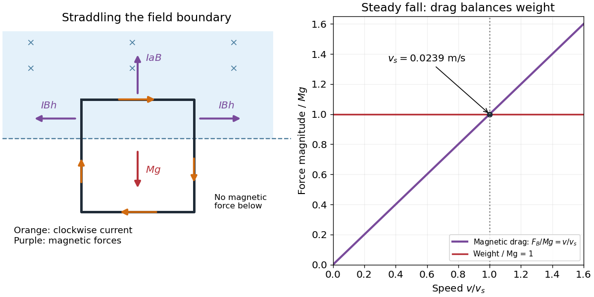

<h1 id="10/c/solution">Solution</h1>

↑ **Parent:** [C](../c.md)

Use $d\mathbf F=I\,d\boldsymbol\ell\times\mathbf B$ for the magnetic [Lorentz force](../../../../lorentz-force.md) on each wire segment. Let $+x$ point right, $+y$ upward and $+z$ out of the page, so $\mathbf B=-B\hat{\mathbf z}$. With clockwise [electric current](../../../../electric-current.md), the four magnetic [forces](../../../../force-split.md) are

$$
\boxed{\mathbf F_{\rm top}=IaB\hat{\mathbf y},\quad \mathbf F_{\rm bottom}=0,\quad \mathbf F_{\rm right}=IBh\hat{\mathbf x},\quad \mathbf F_{\rm left}=-IBh\hat{\mathbf x}.}
$$

The upper side carries [electric current](../../../../electric-current.md) to the right and experiences an upward [force](../../../../force-split.md), opposing the fall. The bottom side lies outside the [magnetic field](../../../../magnetic-field-split.md) and has no magnetic [force](../../../../force-split.md). On the right side the [electric current](../../../../electric-current.md) is downward and the [force](../../../../force-split.md) is outward to the right; on the left it is upward and the [force](../../../../force-split.md) is outward to the left. Each side's in-field vertical length is $h$, so these horizontal [forces](../../../../force-split.md) cancel in the net [force](../../../../force-split.md) on the loop.

The wire's total [mass](../../../../mass.md) is $M=4a\rho_mA_w$. Uniform wire gives each side a downward [weight](../../../../weight-representation-theory.md) $Mg/4$. Internal mechanical [forces](../../../../force-split.md) at the corners transmit the unequal loads and maintain the assumed square shape; they cancel for the loop as a whole. The total external vertical [force](../../../../force-split.md) is therefore $Mg-IaB$ downward.

**[Figure 2](#10/c/image-current-and-magnetic-forces-during-exit-from-the-field-with-terminal-speed-balance). Current and magnetic forces during exit from the field, with terminal-speed balance**.

## ↑ Ancestors (12)

1. [C](../c.md)
2. [10](../../10.md)
3. [2015](../../../2015-split.md)
4. [Past exam of the physics 2 paper of the University of Oxford](../../../split.md)
5. [Physics 2 paper of the University of Oxford](../../../../physics-2-paper-of-the-university-of-oxford.md)
6. [Year 1 of the physics course of the University of Oxford](../../../../year-1-of-the-physics-course-of-the-university-of-oxford.md)
7. [Physics course of the University of Oxford](../../../../physics-course-of-the-university-of-oxford.md)
8. [Undergraduate course of the University of Oxford](../../../../undergraduate-course-of-the-university-of-oxford.md)
9. [Course of the University of Oxford](../../../../course-of-the-university-of-oxford.md)
10. [University of Oxford](../../../../university-of-oxford-split.md)
11. [List of universities](../../../../list-of-universities.md)
12. [Codex Wiki](../../../../split.md)
