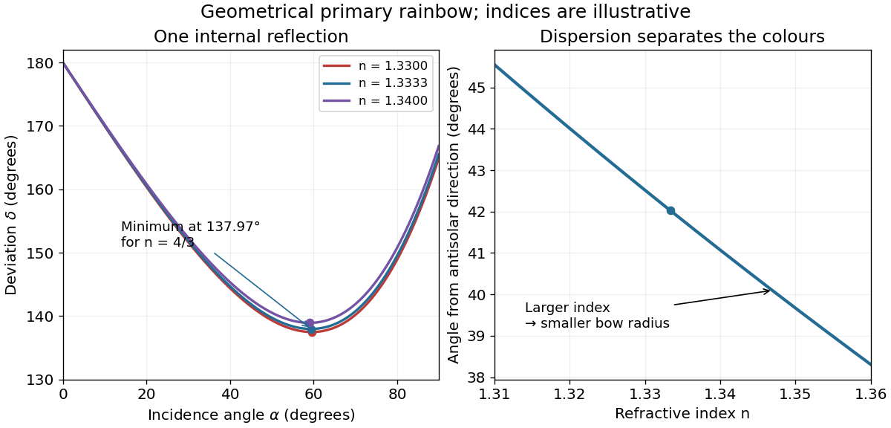

<h1 id="11/c/solution">Solution</h1>

↑ **Parent:** [C](../c.md)

Square the stationary condition and eliminate the [angle of incidence](../../../../angle-of-incidence.md) using [Snell's law](../../../../snell-s-law.md):

$$
1-n^2\sin^2\beta=\cos^2\alpha=\frac{n^2}{4}\cos^2\beta=\frac{n^2}{4}(1-\sin^2\beta).
$$

Rearranging yields $3n^2\sin^2\beta=4-n^2$. Taking the positive root for a physical incident [light ray](../../../../light-ray.md),

$$
\boxed{\sin\beta=\sqrt{\frac{4-n^2}{3n^2}}.}
$$

An interior minimum exists for $1<n<2$, which includes water at visible [wavelengths](../../../../wavelength.md). For illustration, $n=4/3$ gives $\beta=40.20^\circ$, $\alpha=59.39^\circ$ and $\delta_{\min}=137.97^\circ$. The corresponding angle from the antisolar direction is $180^\circ-\delta_{\min}=42.03^\circ$. At $n=2$ the stationary solution reaches the endpoint, and for $n>2$ the displayed square root is not real; the water result is not a formula for every possible [refractive index](../../../../refractive-index.md).

**[Figure 3](#11/c/image-stationary-deviation-for-the-one-reflection-rainbow-branch-and-its-dispersion). Stationary deviation for the one-reflection rainbow branch and its dispersion**.

## ↑ Ancestors (12)

1. [C](../c.md)
2. [11](../../11.md)
3. [2015](../../../2015-split.md)
4. [Past exam of the physics 2 paper of the University of Oxford](../../../split.md)
5. [Physics 2 paper of the University of Oxford](../../../../physics-2-paper-of-the-university-of-oxford.md)
6. [Year 1 of the physics course of the University of Oxford](../../../../year-1-of-the-physics-course-of-the-university-of-oxford.md)
7. [Physics course of the University of Oxford](../../../../physics-course-of-the-university-of-oxford.md)
8. [Undergraduate course of the University of Oxford](../../../../undergraduate-course-of-the-university-of-oxford.md)
9. [Course of the University of Oxford](../../../../course-of-the-university-of-oxford.md)
10. [University of Oxford](../../../../university-of-oxford-split.md)
11. [List of universities](../../../../list-of-universities.md)
12. [Codex Wiki](../../../../split.md)
