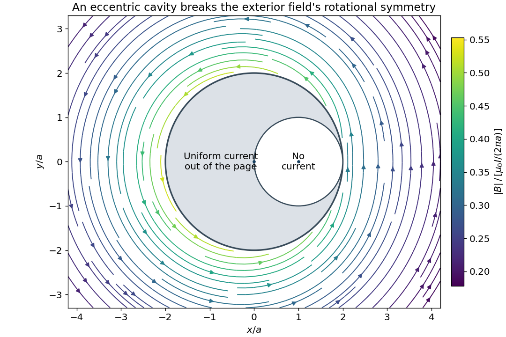

<h1 id="3/solution">Solution</h1>

↑ **Parent:** [3](../3.md)

Use the [geometric cross-section](../../../geometric-collision-cross-section.md) shown in the source: the outer [cylinder](../../../cylinder-geometry.md) has radius $2a$ and centre $O$, and the circular cavity has radius $a$ and centre $C=a\hat{\mathbf x}$. Let the [electric current](../../../electric-current.md) be in the $+z$ direction. The conducting [cross-sectional area](../../../cross-sectional-area.md) is $3\pi a^2$, so the uniform [electric current density](../../../current-density.md) is $\mathbf J=I\hat{\mathbf z}/(3\pi a^2)$.

To obtain the [exterior magnetic field of a wire with an eccentric cylindrical cavity](../../../exterior-magnetic-field-of-a-wire-with-an-eccentric-cylindrical-cavity.md), apply the [superposition principle](../../../superposition-principle.md) to a full [cylinder](../../../cylinder-geometry.md) of [electric current density](../../../current-density.md) $\mathbf J$ centred at $O$ and a second [cylinder](../../../cylinder-geometry.md) of [electric current density](../../../current-density.md) $-\mathbf J$ centred at $C$. Their [electric currents](../../../electric-current.md) are $4I/3$ and $-I/3$. This reproduces the actual [electric current density](../../../current-density.md) everywhere, including zero in the cavity. Outside a long circular [cylinder](../../../cylinder-geometry.md), [Ampère's law](../../../ampere-s-circuital-law.md) gives $\mathbf B=\mu_0 I_{\rm cyl}\hat{\mathbf z}\times\mathbf r/(2\pi r^2)$. Every point outside the outer boundary is outside both component [cylinders](../../../cylinder-geometry.md). Consequently, writing $\mathbf r=x\hat{\mathbf x}+y\hat{\mathbf y}$,

$$
\boxed{\mathbf B(x,y)=\frac{\mu_0I}{6\pi}\hat{\mathbf z}\times\left(\frac{4\mathbf r}{r^2}-\frac{\mathbf r-a\hat{\mathbf x}}{|\mathbf r-a\hat{\mathbf x}|^2}\right),\qquad r\geq2a.}
$$

In [Cartesian coordinates](../../../cartesian-coordinate-system.md), the same [magnetic flux density](../../../magnetic-field-split.md) is

$$
B_x=\frac{\mu_0I}{6\pi}\left(-\frac{4y}{x^2+y^2}+\frac{y}{(x-a)^2+y^2}\right),\qquad B_y=\frac{\mu_0I}{6\pi}\left(\frac{4x}{x^2+y^2}-\frac{x-a}{(x-a)^2+y^2}\right),\qquad B_z=0.
$$

The cavity breaks [rotational symmetry](../../../rotational-symmetry.md). Thus the [magnetic flux density](../../../magnetic-field-split.md) is generally neither constant in magnitude nor tangential on a circle centred at $O$; replacing its [line integral](../../../line-integral.md) by $2\pi rB$ would be unjustified. Its [line integral](../../../line-integral.md) is nevertheless $\mu_0I$, as [Ampère's law](../../../ampere-s-circuital-law.md) requires. At [distances](../../../distance.md) $r\gg a$, the leading term becomes $\mu_0I\hat{\boldsymbol\phi}/(2\pi r)$, with corrections of order $\mu_0Ia/r^2$.

**[Figure 1](#3/image-exterior-magnetic-flux-density-from-the-two-cylinder-superposition). Exterior magnetic flux density from the two-cylinder superposition**.

## ↑ Ancestors (11)

1. [3](../3.md)
2. [2015](../../2015-split.md)
3. [Past exam of the physics 2 paper of the University of Oxford](../../split.md)
4. [Physics 2 paper of the University of Oxford](../../../physics-2-paper-of-the-university-of-oxford.md)
5. [Year 1 of the physics course of the University of Oxford](../../../year-1-of-the-physics-course-of-the-university-of-oxford.md)
6. [Physics course of the University of Oxford](../../../physics-course-of-the-university-of-oxford.md)
7. [Undergraduate course of the University of Oxford](../../../undergraduate-course-of-the-university-of-oxford.md)
8. [Course of the University of Oxford](../../../course-of-the-university-of-oxford.md)
9. [University of Oxford](../../../university-of-oxford-split.md)
10. [List of universities](../../../list-of-universities.md)
11. [Codex Wiki](../../../split.md)
