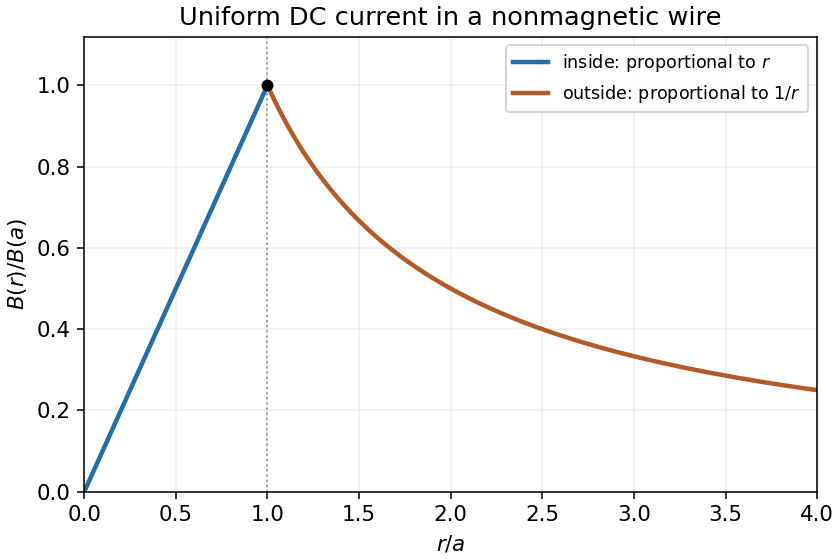
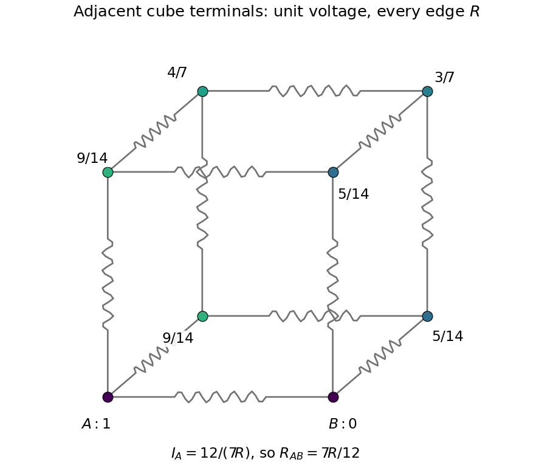
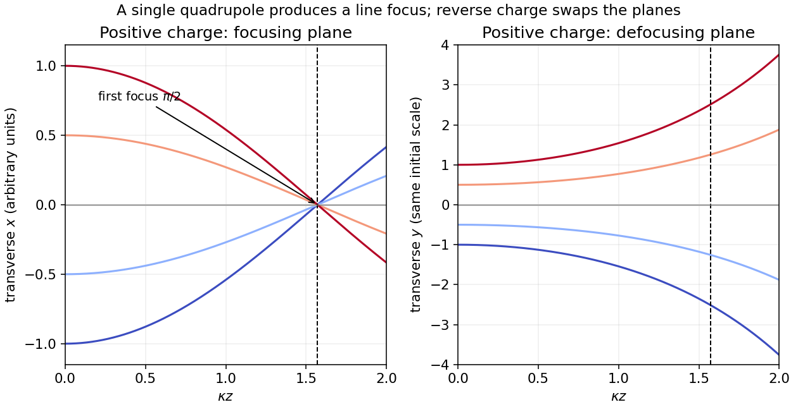
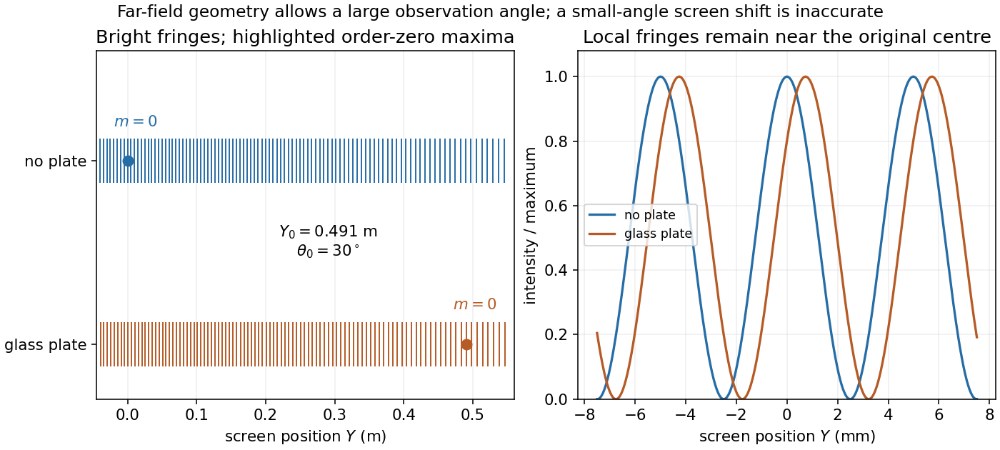
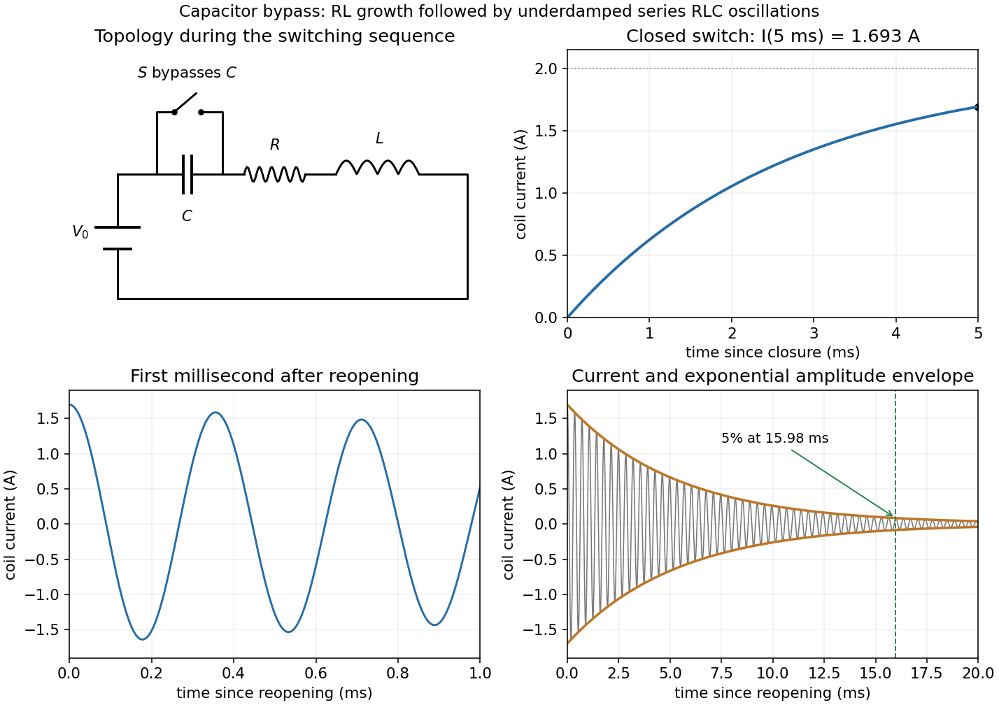

# 2016 resit

↑ **Parent:** [Past exam of the physics 2 paper of the University of Oxford](../past-exam-of-the-physics-2-paper-of-the-university-of-oxford.md)

Source paper: [https://www.whatdotheyknow.com/request/physics_past_exam_papers_2015_16/response/973997/attach/3/Cowell%20Attachment.zip?cookie_passthrough=1](https://www.whatdotheyknow.com/request/physics_past_exam_papers_2015_16/response/973997/attach/3/Cowell%20Attachment.zip?cookie_passthrough=1)

**Table of contents**

- [1](#1)
  - [Solution](#1/solution)
- [2](#2)
  - [Solution](#2/solution)
- [3](#3)
  - [Solution](#3/solution)
- [4](#4)
  - [Solution](#4/solution)
- [5](#5)
  - [i](#5/i)
    - [Solution](#5/i/solution)
  - [ii](#5/ii)
    - [Solution](#5/ii/solution)
- [6](#6)
  - [Solution](#6/solution)
- [7](#7)
  - [Solution](#7/solution)
- [8](#8)
  - [Solution](#8/solution)
- [9](#9)
  - [Solution](#9/solution)
- [10](#10)
  - [Solution](#10/solution)
- [11](#11)
  - [i](#11/i)
    - [Solution](#11/i/solution)
  - [ii](#11/ii)
    - [Solution](#11/ii/solution)

## 1

↑ **Parent:** [2016 resit](2016-resit.md)

<h3 id="1/solution">Solution</h3>

↑ **Parent:** [1](#1)

The integral [Gauss law](../maxwell-equations.md#gauss-s-law) in vacuum is $\oint_{\partial V}\mathbf E\cdot d\mathbf S=Q_{\mathrm{enc}}/\epsilon_0$. A single isolated [point charge](../electric-field.md#point-charge) has spherical symmetry, so its [electric field](../electric-field.md) is radial and constant in magnitude on a centred sphere. The flux is $4\pi r^2E_r$, giving [Coulomb's law](../electrostatics.md#coulomb-s-law)

$$
\boxed{\mathbf E(\mathbf r)=\frac{q}{4\pi\epsilon_0r^2}\hat{\mathbf r}.}
$$

In [electrostatic equilibrium](../electrostatics.md#electrostatic-equilibrium), a conductor is an [equipotential](../electric-field.md#equipotential): a tangential [electric field](../electric-field.md) would move its mobile charges. The [electric field](../electric-field.md) inside the conducting material is zero. A thin pillbox straddling its surface therefore gives $E_nA=\sigma A/\epsilon_0$, hence

$$
\boxed{\mathbf E_{\mathrm{out}}=\frac\sigma{\epsilon_0}\hat{\mathbf n}.}
$$

Here $\sigma$ is the charge density on the particular face and $\hat{\mathbf n}$ points into vacuum. For an isolated thin plate with total charge divided equally between two faces, each face instead has half that total areal density. The local boundary result must not be confused with the $\sigma/(2\epsilon_0)$ field of an isolated nonconducting infinite charged sheet.

## 2

↑ **Parent:** [2016 resit](2016-resit.md)

<h3 id="2/solution">Solution</h3>

↑ **Parent:** [2](#2)

Introduce cylinder length $\ell$ and line charge density $\lambda=Q/\ell$; only charge per length matters in the long-cylinder approximation. A coaxial cylindrical [Gaussian surface](../maxwell-equations.md#gaussian-surface) gives $E_r2\pi r\ell=Q/\epsilon_0$. Choosing the outer cylinder's [electric potential](../electric-field.md#electric-potential) to be zero,

$$
\boxed{\mathbf E(r)=\frac{\lambda}{2\pi\epsilon_0r}\hat{\mathbf r},\quad V(r)=\frac{\lambda}{2\pi\epsilon_0}\ln\frac br,\quad a<r<b.}
$$

The [capacitance per unit length](../electromagnetism.md#capacitance-per-unit-length) follows from $C=Q/[V(a)-V(b)]$:

$$
\boxed{\frac C\ell=\frac{2\pi\epsilon_0}{\ln(b/a)}.}
$$

If $Q$ is intended as a line charge rather than a finite total charge, replace $\lambda$ by that $Q$. Neglecting end effects, equal opposite cylinder charges make the exterior [electric field](../electric-field.md) vanish; the potential difference between the conductors remains the quantity defining their [capacitance](../electromagnetism.md#capacitance).

## 3

↑ **Parent:** [2016 resit](2016-resit.md)

<h3 id="3/solution">Solution</h3>

↑ **Parent:** [3](#3)

Define $\mathbf d$ to point from the negative charge to the positive charge. The [electric dipole moment](../electrostatics.md#electric-dipole-moment) is $\mathbf p=q\mathbf d$. In a uniform [electric field](../electric-field.md), the two [forces](../force.md) cancel, so **the net force is zero**. They nevertheless form a [couple](../momentum.md#couple-mechanics) with [torque](../momentum.md#torque)

$$
\boxed{\boldsymbol\tau=\mathbf p\times\mathbf E,\qquad |\boldsymbol\tau|=pE|\sin\theta|.}
$$

For a positive angular displacement increasing $\theta$, the restoring torque component is $-pE\sin\theta$. Thus $dU/d\theta=pE\sin\theta$ and

$$
\boxed{U=-\mathbf p\cdot\mathbf E=-pE\cos\theta,}
$$

with the additive constant chosen to make $U=0$ at $\theta=\pi/2$. Alignment is a stable minimum and antialignment an unstable maximum. The zero-force result uses a uniform field; a field gradient can exert a net [force](../force.md) on a dipole.

## 4

↑ **Parent:** [2016 resit](2016-resit.md)

<h3 id="4/solution">Solution</h3>

↑ **Parent:** [4](#4)

[Faraday's law of induction](../maxwell-equations.md#faraday-s-law-of-induction) gives the [electromotive force](../electric-charge.md#electromotive-force) $\mathcal E=-d\Phi_B/dt$. For a fixed circuit, $\mathcal E=\oint\mathbf E\cdot d\mathbf l$; for moving material wire, include the motional term $\mathbf u\times\mathbf B$ in that line integral. [Lenz's law](../maxwell-equations.md#lenz-s-law) fixes the sign: the induced response opposes the change of linked flux, rather than necessarily opposing the field itself.

For the long solenoid, [Ampère's law](../maxwell-equations.md#ampere-s-circuital-law) gives $B\simeq\mu_0nI$ inside and negligible exterior field away from the ends. With $N=nD$ turns and area $\pi a^2$, the linked flux is $N\Phi_B=\mu_0n^2D\pi a^2I$. Hence the [self-inductance](../electromagnetism.md#self-inductance) is

$$
\boxed{L=\frac{N\Phi_B}{I}=\mu_0n^2\pi a^2D.}
$$

This assumes $D\gg a$, closely spaced turns, negligible end fringing and an air core with relative [magnetic permeability](../maxwell-equations.md#permeability-electromagnetism) close to one. A finite core permeability or significant fringing changes the answer.

## 5

↑ **Parent:** [2016 resit](2016-resit.md)

<h3 id="5/i">i</h3>

↑ **Parent:** [5](#5)

<h4 id="5/i/solution">Solution</h4>

↑ **Parent:** [I](#5/i)

For a steady uniform [current density](../electric-charge.md#current-density) in a nonmagnetic wire, the enclosed [electric current](../electric-charge.md#electric-current) at radius $r<a$ is $I_{\mathrm{enc}}=Ir^2/a^2$. A circular [Amperian loop](../maxwell-equations.md#amperian-loop) and [Ampère's law](../maxwell-equations.md#ampere-s-circuital-law) then give

$$
\boxed{B(r)=\frac{\mu_0Ir}{2\pi a^2},\qquad 0\leq r<a.}
$$

The [magnetic field](../magnetic-field.md) circles the wire according to the [right-hand rule](../electromagnetism.md#right-hand-rule) relative to the current direction. Its magnitude increases linearly from zero on the axis. The uniform-current assumption excludes [skin effect](../electric-charge.md#skin-effect).

<h3 id="5/ii">ii</h3>

↑ **Parent:** [5](#5)

<h4 id="5/ii/solution">Solution</h4>

↑ **Parent:** [Ii](#5/ii)

Outside the wire, the [Amperian loop](../maxwell-equations.md#amperian-loop) encloses the entire [electric current](../electric-charge.md#electric-current), so

$$
\boxed{B(r)=\frac{\mu_0I}{2\pi r},\qquad r>a.}
$$

Its direction is again azimuthal, fixed by the [right-hand rule](../electromagnetism.md#right-hand-rule). The inside and outside formulas join continuously at the maximum $B(a)=\mu_0I/(2\pi a)$. The outer branch decays as $1/r$.

**[Figure 1](#5/ii/image-magnetic-field-magnitude-inside-and-outside-a-uniformly-conducting-cylindrical-wire). Magnetic-field magnitude inside and outside a uniformly conducting cylindrical wire**.

## 6

↑ **Parent:** [2016 resit](2016-resit.md)

<h3 id="6/solution">Solution</h3>

↑ **Parent:** [6](#6)

The [adjacent-corner resistance of a resistor cube](../random-walk.md#adjacent-corner-resistance-of-a-resistor-cube) follows from [Kirchhoff's current law](../random-walk.md#kirchhoff-node-law) and cube symmetries. Hold adjacent corners $A=(0,0,0)$ and $B=(1,0,0)$ at potentials $V$ and zero. The two corners $(0,1,0),(0,0,1)$ have a common potential $x$; their neighbours $(1,1,0),(1,0,1)$ have $V-x$. Write the remaining two potentials as $z,V-z$.

At a corner of the first pair and at $(0,1,1)$, [Kirchhoff's current law](../random-walk.md#kirchhoff-node-law) gives

$$
3x=V+(V-x)+z,\qquad3z=2x+(V-z).
$$

Thus $4x-z=2V$ and $4z-2x=V$, yielding $x=9V/14$, $z=4V/7$. The supplied current at $A$ is

$$
I=\frac VR+2\frac{V-x}{R}=\frac{12V}{7R},\qquad\boxed{R_{\mathrm{eq}}=\frac VI=\frac{7R}{12}.}
$$

The direct edge between the terminals is one of three current paths leaving $A$; treating the other eleven resistors as a single obvious series chain would miss the branching.

**[Figure 2](#6/image-cube-network-potentials-for-unit-applied-voltage-between-adjacent-corners-each-edge-has-the-same-resistance). Cube network potentials for unit applied voltage between adjacent corners; each edge has the same resistance**.

## 7

↑ **Parent:** [2016 resit](2016-resit.md)

<h3 id="7/solution">Solution</h3>

↑ **Parent:** [7](#7)

[Huygens' principle](../physical-optics.md#huygens-principle) treats every point of an advancing [wavefront](../physical-optics.md#wavefront) as a source of secondary wavelets; their common envelope forms the next wavefront. Consider two points of an incident plane wave reaching the interface at different times. During the same interval $\Delta t$, the remaining incident portion travels $v_1\Delta t$ while the first transmitted wavelet expands a distance $v_2\Delta t$. The two wavefront right triangles share their interface segment, so

$$
\frac{\sin\theta_1}{\sin\theta_2}=\frac{v_1}{v_2}=\frac{n_2}{n_1},\qquad\boxed{n_1\sin\theta_1=n_2\sin\theta_2.}
$$

This is [Snell's law](../partial-differential-equation.md#snell-s-law), with both angles measured from the surface normal. The speeds are phase velocities at the common frequency in stationary isotropic media. If the equation requires $|\sin\theta_2|>1$, there is no propagating refracted ray and [total internal reflection](../electromagnetic-wave.md#total-internal-reflection) applies instead.

## 8

↑ **Parent:** [2016 resit](2016-resit.md)

<h3 id="8/solution">Solution</h3>

↑ **Parent:** [8](#8)

In vacuum, with possible sources $\rho$ and $\mathbf J$, [Maxwell's equations](../maxwell-equations.md) are

$$
\nabla\cdot\mathbf E=\rho/\epsilon_0,\quad\nabla\cdot\mathbf B=0,\quad\nabla\times\mathbf E=-\partial_t\mathbf B,\quad\nabla\times\mathbf B=\mu_0\mathbf J+\mu_0\epsilon_0\partial_t\mathbf E.
$$

Their integral forms, with compatible orientations and fixed surfaces, are

$$
\begin{aligned}
\oint_{\partial V}\mathbf E\cdot d\mathbf S&=\frac1{\epsilon_0}\int_V\rho\,dV,&\quad\oint_{\partial V}\mathbf B\cdot d\mathbf S&=0,\\
\oint_{\partial S}\mathbf E\cdot d\mathbf l&=-\frac d{dt}\int_S\mathbf B\cdot d\mathbf S,&\quad\oint_{\partial S}\mathbf B\cdot d\mathbf l&=\mu_0\int_S\mathbf J\cdot d\mathbf S+\mu_0\epsilon_0\frac d{dt}\int_S\mathbf E\cdot d\mathbf S.
\end{aligned}
$$

Charge- and current-free space additionally sets $\rho=0$, $\mathbf J=0$. Vacuum constitutive constants alone do not imply that no charges exist.

Take the [curl](../multivariable-calculus.md#curl) of the source-free [Ampere-Maxwell law](../maxwell-equations.md#ampere-s-circuital-law), use [Faraday's law of induction](../maxwell-equations.md#faraday-s-law-of-induction) and $\nabla\cdot\mathbf B=0$:

$$
\nabla\times(\nabla\times\mathbf B)=-\nabla^2\mathbf B=-\mu_0\epsilon_0\partial_t^2\mathbf B.
$$

Consequently

$$
\boxed{\nabla^2\mathbf B-\frac1{c^2}\partial_t^2\mathbf B=0,\qquad c=\frac1{\sqrt{\mu_0\epsilon_0}}.}
$$

For the specified complex [plane wave](../wave-function.md#plane-wave), the [wavevector](../elasticity-physics.md#wavevector) is $k\hat{\mathbf z}$ and $\omega=ck$. [Faraday's law of induction](../maxwell-equations.md#faraday-s-law-of-induction) fixes

$$
\boxed{\mathbf B=\frac{E_0}{c}e^{i(\omega t-kz)}\hat{\mathbf y}.}
$$

The physical fields are the real parts. They are in phase and their [Poynting vector](../electromagnetic-wave.md#poynting-vector) points along $+z$.

The instantaneous electric and magnetic [energy densities](../statistical-physics.md#energy-density) are $u_E=\epsilon_0E^2/2$ and $u_B=B^2/(2\mu_0)$. Since $E=cB$, they are equal for this ideal travelling plane wave, and so are their cycle averages: **$\langle u_E\rangle/\langle u_B\rangle=1$**. For real peak amplitude $E_0$, each average is $\epsilon_0E_0^2/4$. The [Poynting vector](../electromagnetic-wave.md#poynting-vector) and mean intensity satisfy

$$
\mathbf S=\frac1{\mu_0}\mathbf E\times\mathbf B,\qquad\boxed{\mathcal I=\langle S\rangle=\frac12\epsilon_0cE_0^2,\quad B_0=E_0/c.}
$$

It represents transported energy per area per time, in $\mathrm{W\,m^{-2}}$.

For the numerical moonlight estimate, adopt $L_\odot=3.828\times10^{26}\,\mathrm W$ and lunar mean radius $R_M=1.7374\times10^6\,\mathrm m$. These additional astronomical inputs give solar irradiance at the Moon of $\mathcal I_\odot=L_\odot/(4\pi d_\odot^2)\simeq1361\,\mathrm{W\,m^{-2}}$.[Bulk parameters: luminosity 382.8 in units of 10^24 J/s](../physics-bibliography.md#sun-fact-sheet-by-national-aeronautics-and-space-administration)[Bulk parameters: volumetric mean radius 1737.4 km and solar irradiance 1361 W/m^2](../physics-bibliography.md#moon-fact-sheet-by-national-aeronautics-and-space-administration)

Under the simple isotropic point-reflector approximation, the intercepted power is $\pi R_M^2\mathcal I_\odot$, of which fraction $A=0.12$ is redistributed over $4\pi$ steradians. Thus

$$
\mathcal I_M=\frac{A\mathcal I_\odot R_M^2}{4d_M^2}\simeq8.34\times10^{-4}\,\mathrm{W\,m^{-2}},\qquad\boxed{E_0\simeq0.793\,\mathrm{V\,m^{-1}},\quad B_0\simeq2.65\,\mathrm{nT}.}
$$

These are equivalent sinusoidal peak amplitudes; the corresponding [root mean square](../analysis.md#root-mean-square) fields are smaller by $\sqrt2$. Actual moonlight is broadband and incoherent.

A total reflected fraction alone does not specify the directional brightness of a full Moon. For a [Lambertian sphere at full phase](../optics.md#lambertian-sphere-at-full-phase), with the same total reflectance $A$, integrating its radiance gives $\mathcal I_M=(2A/3)\mathcal I_\odot(R_M/d_M)^2$, instead giving $E_0\simeq1.30\,\mathrm{V\,m^{-1}}$ and $B_0\simeq4.32\,\mathrm{nT}$. If 0.12 is instead the [geometric albedo](../exoplanet.md#geometric-albedo), the full-phase formula is $\mathcal I_M=0.12\mathcal I_\odot(R_M/d_M)^2$, giving $E_0\simeq1.59\,\mathrm{V\,m^{-1}}$. NASA's table itself distinguishes [Bond albedo](../exoplanet.md#bond-albedo) from [geometric albedo](../exoplanet.md#geometric-albedo).[Bulk parameters list Bond albedo 0.11 and geometric albedo 0.12](../physics-bibliography.md#moon-fact-sheet-by-national-aeronautics-and-space-administration) The numerical estimate therefore needs an explicit reflection convention; the first boxed values use the stated isotropic approximation.

## 9

↑ **Parent:** [2016 resit](2016-resit.md)

<h3 id="9/solution">Solution</h3>

↑ **Parent:** [9](#9)

The [Lorentz force](../relativistic-electromagnetism.md#lorentz-force) is $\mathbf F=q(\mathbf E+\mathbf v\times\mathbf B)$. With no [electric field](../electric-field.md), the exact nonrelativistic component equations for the given quadrupole are

$$
m\ddot x=-qA\dot z\,x,\qquad m\ddot y=qA\dot z\,y,\qquad m\ddot z=qA(x\dot x-y\dot y).
$$

The magnetic [force](../force.md) does no work, so the total speed stays constant. In the [paraxial approximation](../partial-differential-equation.md#paraxial-approximation), $\dot z\simeq v$ and its small change is second order in the transverse motion. For $q>0$, put $\kappa=\sqrt{qA/(mv)}$. Initial travel parallel to the $z$ axis means zero entrance slopes, yielding

$$
\boxed{x(z)=x_0\cos(\kappa z),\qquad y(z)=y_0\cosh(\kappa z).}
$$

Thus $x$ is focused while $y$ is defocused. The first focus in the focusing plane occurs at

$$
\boxed{z_f=\frac\pi{2\kappa}=\frac\pi2\sqrt{\frac{mv}{qA}}.}
$$

For negative $q$, interchange the focusing and defocusing planes and use $|q|$ in $\kappa$. A single [quadrupole magnet](../particle-accelerator.md#quadrupole-magnet) gives a line focus of a general beam, not simultaneous focusing of both transverse coordinates onto one point. The magnet must extend at least to the computed focus, and the slopes must remain small. For a relativistic beam, the corresponding paraxial factor is $\kappa^2=|q|A/p$, with $p$ the longitudinal [relativistic momentum](../momentum.md#relativistic-momentum).

**[Figure 3](#9/image-parallel-incident-rays-focus-in-one-quadrupole-plane-and-spread-in-the-other-the-first-focus-is-at-kappa-z-equal-to-pi-over-two). Parallel incident rays focus in one quadrupole plane and spread in the other; the first focus is at kappa z equal to pi over two**.

## 10

↑ **Parent:** [2016 resit](2016-resit.md)

<h3 id="10/solution">Solution</h3>

↑ **Parent:** [10](#10)

[Monochromatic light](../wave.md#monochromatic-light) has one frequency, or a bandwidth sufficiently narrow for the intended measurement. A lamp can illuminate the experiment through a narrow spectral filter or [monochromator](../optical-instrument.md#monochromator), followed by a small source aperture at the focus of a collimating [lens](../geometrical-optics.md#lens-optics). The aperture supplies [spatial coherence](../physical-optics.md#spatial-optical-coherence) across the slits; the lens supplies approximately parallel incident wavefronts. Two independently illuminated incoherent slits would not provide a stationary fringe pattern.

In the [Fraunhofer approximation](../physical-optics.md#fraunhofer-approximation), the optical path difference at observation angle $\theta$ is $s\sin\theta$. For equal single-slit intensities $\mathcal I_s$, adding the two wave amplitudes gives

$$
\boxed{\mathcal I(\theta)=4\mathcal I_s\cos^2\left(\frac{\pi s\sin\theta}{\lambda}\right),\qquad\sin\theta=\frac{Y}{\sqrt{D^2+Y^2}}.}
$$

The thin-slit idealization suppresses the individual diffraction envelope. If additionally $|Y|\ll D$, then $\sin\theta\simeq Y/D$ and $\mathcal I(Y)\simeq4\mathcal I_s\cos^2(\pi sY/(\lambda D))$. The far-field condition does not by itself impose this small observation angle.

For order $m=10$ at $Y=0.05\,\mathrm m$,

$$
\boxed{\lambda=\frac{s}{10}\frac{Y}{\sqrt{D^2+Y^2}}\simeq5.87\times10^{-7}\,\mathrm m.}
$$

The paraxial estimate is $sY/(10D)=5.88\times10^{-7}\,\mathrm m$, consistent to the precision of the data.

Let the upper slit contain the glass plate and take positive $Y$ towards that slit. The extra [optical path length](../physical-optics.md#optical-path-length) is $\Delta=(n_g-n_a)t=5.0\times10^{-5}\,\mathrm m$. Its total upper-minus-lower path difference is $\Delta-s\sin\theta$. The order-zero fringe therefore satisfies

$$
\boxed{\sin\theta_0=\frac\Delta s=\frac12,\qquad\theta_0=30^\circ,\qquad Y_0=D\tan\theta_0=0.491\,\mathrm m.}
$$

It moves **towards the covered slit**. Using $Y_0\simeq D\Delta/s=0.425\,\mathrm m$ here is a poor small-angle approximation: $30^\circ$ is not small. The order-zero fringe is being tracked as the optical delay is introduced; because the pattern is periodic in phase, many other bright fringes still lie near the original centre. Neglecting unequal glass transmission changes visibility but not the zero-path-difference condition.

**[Figure 4](#10/image-finite-angle-fringe-shift-from-a-glass-plate-with-the-order-zero-fringe-at-thirty-degrees-and-local-fringes-near-the-original-centre). Finite-angle fringe shift from a glass plate, with the order-zero fringe at thirty degrees and local fringes near the original centre**.

## 11

↑ **Parent:** [2016 resit](2016-resit.md)

<h3 id="11/i">i</h3>

↑ **Parent:** [11](#11)

<h4 id="11/i/solution">Solution</h4>

↑ **Parent:** [I](#11/i)

Initially the open switch leaves a series capacitor-resistor-inductor circuit driven by the battery. After a long time the [electric current](../electric-charge.md#electric-current) is zero and the [capacitor voltage](../electromagnetism.md#capacitor-voltage) is $V_0$. Closing the switch bypasses and, under the stated idealization, instantaneously discharges the capacitor. The inductor current remains continuous at zero.

The remaining [RL circuit](../electrical-circuit.md#rl-circuit) obeys $L\dot I+RI=V_0$, so

$$
I(t)=\frac{V_0}{R}\left(1-e^{-Rt/L}\right),\qquad\boxed{I(0.005\,\mathrm s)=2(1-e^{-1.875})\simeq1.69\,\mathrm A.}
$$

The capacitor's impulsive discharge through the ideal short is distinct from the finite [electric current](../electric-charge.md#electric-current) through the coil. A finite switch resistance would resolve that separate fast transient.

<h3 id="11/ii">ii</h3>

↑ **Parent:** [11](#11)

<h4 id="11/ii/solution">Solution</h4>

↑ **Parent:** [Ii](#11/ii)

Put $t_1=0.005\,\mathrm s$, $\tau=t-t_1$, and $I_1=2(1-e^{-1.875})$. When the switch reopens, the circuit again contains the battery and all three series elements. [Inductor current continuity](../electromagnetism.md#inductor-current-continuity) and [capacitor voltage continuity](../electromagnetism.md#capacitor-voltage-continuity) give

$$
I(0^+)=I_1,\qquad V_C(0^+)=0,\qquad L I'+RI+V_C=V_0,\qquad C V_C'=I.
$$

Thus $I'(0^+)=(V_0-RI_1)/L\simeq115.0\,\mathrm{A\,s^{-1}}$, not zero. Differentiating the loop equation gives the homogeneous current equation

$$
I''+\frac RL I'+\frac1{LC}I=0.
$$

The battery is still connected; its constant voltage disappears on differentiating, and the eventual capacitor voltage is $V_0$.

With $\alpha=R/(2L)=187.5\,\mathrm{s^{-1}}$ and $\omega_0=1/\sqrt{LC}$, the inequality $\alpha<\omega_0$ makes the circuit underdamped. The damped [angular frequency](../lagrangian-mechanics.md#angular-frequency) and ordinary [frequency](../wave.md#frequency) are

$$
\boxed{\omega_d=\sqrt{\frac1{LC}-\frac{R^2}{4L^2}}\simeq1.7677\times10^4\,\mathrm{rad\,s^{-1}},\qquad f_d=\frac{\omega_d}{2\pi}\simeq2.813\,\mathrm{kHz}.}
$$

The full current satisfying both initial conditions is

$$
I(\tau)=e^{-\alpha\tau}\left[I_1\cos(\omega_d\tau)+\frac{I'(0^+)+\alpha I_1}{\omega_d}\sin(\omega_d\tau)\right].
$$

Its amplitude envelope decays as $e^{-\alpha\tau}$. Therefore

$$
\boxed{\tau_{5\%}=\frac{\ln20}{\alpha}=\frac{2L}{R}\ln20\simeq0.01598\,\mathrm s.}
$$

This is measured after reopening; on the clock starting with the first closure it is $t\simeq0.02098\,\mathrm s$. An instantaneous current zero is not an amplitude decay measurement.

**[Figure 5](#11/ii/image-capacitor-bypass-and-reopening-rl-current-growth-the-first-oscillations-and-the-decaying-rlc-amplitude-envelope). Capacitor bypass and reopening: RL current growth, the first oscillations, and the decaying RLC amplitude envelope**.

## ↑ Ancestors (9)

1. [Past exam of the physics 2 paper of the University of Oxford](../past-exam-of-the-physics-2-paper-of-the-university-of-oxford.md)
2. [Physics 2 paper of the University of Oxford](../university-of-oxford.md#physics-2-paper-of-the-university-of-oxford)
3. [Year 1 of the physics course of the University of Oxford](../university-of-oxford.md#year-1-of-the-physics-course-of-the-university-of-oxford)
4. [Physics course of the University of Oxford](../university-of-oxford.md#physics-course-of-the-university-of-oxford)
5. [Undergraduate course of the University of Oxford](../university-of-oxford.md#undergraduate-course-of-the-university-of-oxford)
6. [Course of the University of Oxford](../university-of-oxford.md#course-of-the-university-of-oxford)
7. [University of Oxford](../university-of-oxford.md)
8. [List of universities](../README.md#list-of-universities)
9. [Codex Wiki](../README.md)
