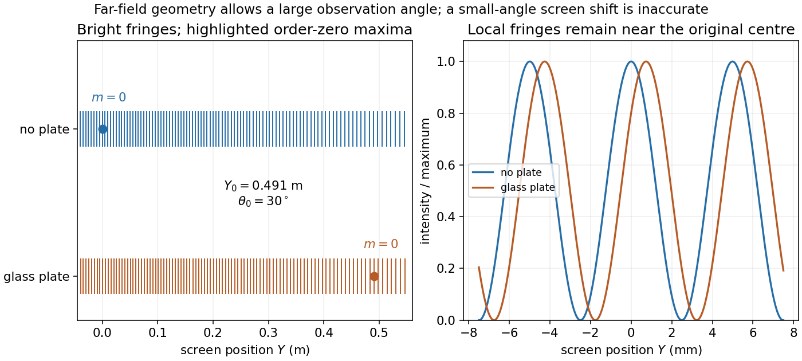

<h1 id="10/solution">Solution</h1>

↑ **Parent:** [10](../10.md)

[Monochromatic light](../../../monochromatic-light.md) has one frequency, or a bandwidth sufficiently narrow for the intended measurement. A lamp can illuminate the experiment through a narrow spectral filter or [monochromator](../../../monochromator.md), followed by a small source aperture at the focus of a collimating [lens](../../../lens-optics.md). The aperture supplies [spatial coherence](../../../spatial-optical-coherence.md) across the slits; the lens supplies approximately parallel incident wavefronts. Two independently illuminated incoherent slits would not provide a stationary fringe pattern.

In the [Fraunhofer approximation](../../../fraunhofer-approximation.md), the optical path difference at observation angle $\theta$ is $s\sin\theta$. For equal single-slit intensities $\mathcal I_s$, adding the two wave amplitudes gives

$$
\boxed{\mathcal I(\theta)=4\mathcal I_s\cos^2\left(\frac{\pi s\sin\theta}{\lambda}\right),\qquad\sin\theta=\frac{Y}{\sqrt{D^2+Y^2}}.}
$$

The thin-slit idealization suppresses the individual diffraction envelope. If additionally $|Y|\ll D$, then $\sin\theta\simeq Y/D$ and $\mathcal I(Y)\simeq4\mathcal I_s\cos^2(\pi sY/(\lambda D))$. The far-field condition does not by itself impose this small observation angle.

For order $m=10$ at $Y=0.05\,\mathrm m$,

$$
\boxed{\lambda=\frac{s}{10}\frac{Y}{\sqrt{D^2+Y^2}}\simeq5.87\times10^{-7}\,\mathrm m.}
$$

The paraxial estimate is $sY/(10D)=5.88\times10^{-7}\,\mathrm m$, consistent to the precision of the data.

Let the upper slit contain the glass plate and take positive $Y$ towards that slit. The extra [optical path length](../../../optical-path-length.md) is $\Delta=(n_g-n_a)t=5.0\times10^{-5}\,\mathrm m$. Its total upper-minus-lower path difference is $\Delta-s\sin\theta$. The order-zero fringe therefore satisfies

$$
\boxed{\sin\theta_0=\frac\Delta s=\frac12,\qquad\theta_0=30^\circ,\qquad Y_0=D\tan\theta_0=0.491\,\mathrm m.}
$$

It moves **towards the covered slit**. Using $Y_0\simeq D\Delta/s=0.425\,\mathrm m$ here is a poor small-angle approximation: $30^\circ$ is not small. The order-zero fringe is being tracked as the optical delay is introduced; because the pattern is periodic in phase, many other bright fringes still lie near the original centre. Neglecting unequal glass transmission changes visibility but not the zero-path-difference condition.

**[Figure 4](#10/image-finite-angle-fringe-shift-from-a-glass-plate-with-the-order-zero-fringe-at-thirty-degrees-and-local-fringes-near-the-original-centre). Finite-angle fringe shift from a glass plate, with the order-zero fringe at thirty degrees and local fringes near the original centre**.

## ↑ Ancestors (11)

1. [10](../10.md)
2. [2016 resit](../../2016-resit-split.md)
3. [Past exam of the physics 2 paper of the University of Oxford](../../split.md)
4. [Physics 2 paper of the University of Oxford](../../../physics-2-paper-of-the-university-of-oxford.md)
5. [Year 1 of the physics course of the University of Oxford](../../../year-1-of-the-physics-course-of-the-university-of-oxford.md)
6. [Physics course of the University of Oxford](../../../physics-course-of-the-university-of-oxford.md)
7. [Undergraduate course of the University of Oxford](../../../undergraduate-course-of-the-university-of-oxford.md)
8. [Course of the University of Oxford](../../../course-of-the-university-of-oxford.md)
9. [University of Oxford](../../../university-of-oxford-split.md)
10. [List of universities](../../../list-of-universities.md)
11. [Codex Wiki](../../../split.md)
