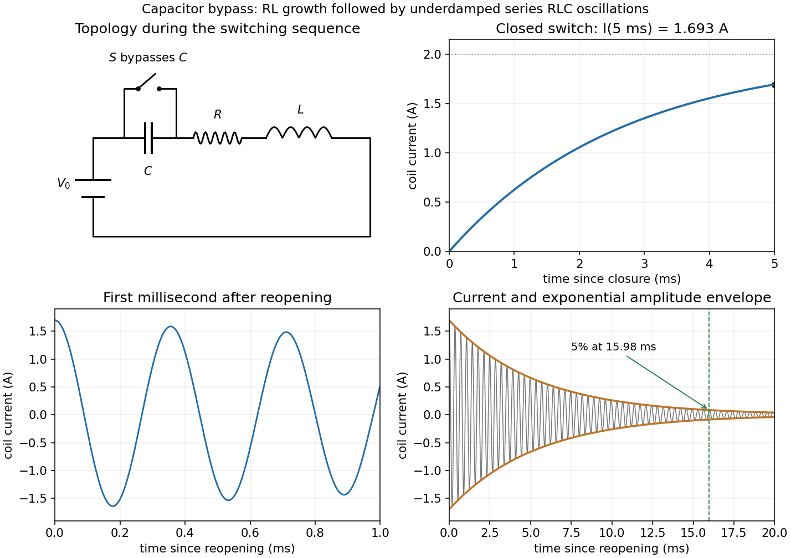

<h1 id="11/ii/solution">Solution</h1>

↑ **Parent:** [Ii](../ii.md)

Put $t_1=0.005\,\mathrm s$, $\tau=t-t_1$, and $I_1=2(1-e^{-1.875})$. When the switch reopens, the circuit again contains the battery and all three series elements. [Inductor current continuity](../../../../inductor-current-continuity.md) and [capacitor voltage continuity](../../../../capacitor-voltage-continuity.md) give

$$
I(0^+)=I_1,\qquad V_C(0^+)=0,\qquad L I'+RI+V_C=V_0,\qquad C V_C'=I.
$$

Thus $I'(0^+)=(V_0-RI_1)/L\simeq115.0\,\mathrm{A\,s^{-1}}$, not zero. Differentiating the loop equation gives the homogeneous current equation

$$
I''+\frac RL I'+\frac1{LC}I=0.
$$

The battery is still connected; its constant voltage disappears on differentiating, and the eventual capacitor voltage is $V_0$.

With $\alpha=R/(2L)=187.5\,\mathrm{s^{-1}}$ and $\omega_0=1/\sqrt{LC}$, the inequality $\alpha<\omega_0$ makes the circuit underdamped. The damped [angular frequency](../../../../angular-frequency.md) and ordinary [frequency](../../../../frequency.md) are

$$
\boxed{\omega_d=\sqrt{\frac1{LC}-\frac{R^2}{4L^2}}\simeq1.7677\times10^4\,\mathrm{rad\,s^{-1}},\qquad f_d=\frac{\omega_d}{2\pi}\simeq2.813\,\mathrm{kHz}.}
$$

The full current satisfying both initial conditions is

$$
I(\tau)=e^{-\alpha\tau}\left[I_1\cos(\omega_d\tau)+\frac{I'(0^+)+\alpha I_1}{\omega_d}\sin(\omega_d\tau)\right].
$$

Its amplitude envelope decays as $e^{-\alpha\tau}$. Therefore

$$
\boxed{\tau_{5\%}=\frac{\ln20}{\alpha}=\frac{2L}{R}\ln20\simeq0.01598\,\mathrm s.}
$$

This is measured after reopening; on the clock starting with the first closure it is $t\simeq0.02098\,\mathrm s$. An instantaneous current zero is not an amplitude decay measurement.

**[Figure 5](#11/ii/image-capacitor-bypass-and-reopening-rl-current-growth-the-first-oscillations-and-the-decaying-rlc-amplitude-envelope). Capacitor bypass and reopening: RL current growth, the first oscillations, and the decaying RLC amplitude envelope**.

## ↑ Ancestors (12)

1. [Ii](../ii.md)
2. [11](../../11.md)
3. [2016 resit](../../../2016-resit-split.md)
4. [Past exam of the physics 2 paper of the University of Oxford](../../../split.md)
5. [Physics 2 paper of the University of Oxford](../../../../physics-2-paper-of-the-university-of-oxford.md)
6. [Year 1 of the physics course of the University of Oxford](../../../../year-1-of-the-physics-course-of-the-university-of-oxford.md)
7. [Physics course of the University of Oxford](../../../../physics-course-of-the-university-of-oxford.md)
8. [Undergraduate course of the University of Oxford](../../../../undergraduate-course-of-the-university-of-oxford.md)
9. [Course of the University of Oxford](../../../../course-of-the-university-of-oxford.md)
10. [University of Oxford](../../../../university-of-oxford-split.md)
11. [List of universities](../../../../list-of-universities.md)
12. [Codex Wiki](../../../../split.md)
