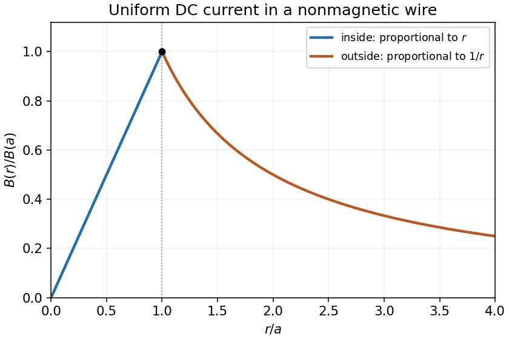

<h1 id="5/ii/solution">Solution</h1>

↑ **Parent:** [Ii](../ii.md)

Outside the wire, the [Amperian loop](../../../../amperian-loop.md) encloses the entire [electric current](../../../../electric-current.md), so

$$
\boxed{B(r)=\frac{\mu_0I}{2\pi r},\qquad r>a.}
$$

Its direction is again azimuthal, fixed by the [right-hand rule](../../../../right-hand-rule.md). The inside and outside formulas join continuously at the maximum $B(a)=\mu_0I/(2\pi a)$. The outer branch decays as $1/r$.

**[Figure 1](#5/ii/image-magnetic-field-magnitude-inside-and-outside-a-uniformly-conducting-cylindrical-wire). Magnetic-field magnitude inside and outside a uniformly conducting cylindrical wire**.

## ↑ Ancestors (12)

1. [Ii](../ii.md)
2. [5](../../5.md)
3. [2016 resit](../../../2016-resit-split.md)
4. [Past exam of the physics 2 paper of the University of Oxford](../../../split.md)
5. [Physics 2 paper of the University of Oxford](../../../../physics-2-paper-of-the-university-of-oxford.md)
6. [Year 1 of the physics course of the University of Oxford](../../../../year-1-of-the-physics-course-of-the-university-of-oxford.md)
7. [Physics course of the University of Oxford](../../../../physics-course-of-the-university-of-oxford.md)
8. [Undergraduate course of the University of Oxford](../../../../undergraduate-course-of-the-university-of-oxford.md)
9. [Course of the University of Oxford](../../../../course-of-the-university-of-oxford.md)
10. [University of Oxford](../../../../university-of-oxford-split.md)
11. [List of universities](../../../../list-of-universities.md)
12. [Codex Wiki](../../../../split.md)
