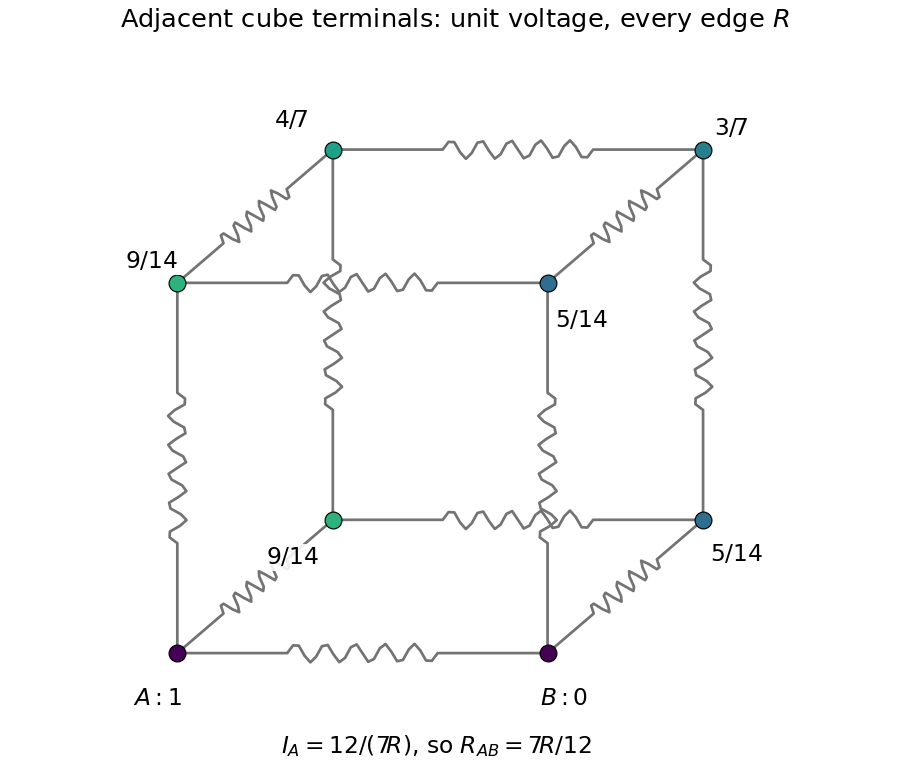

<h1 id="6/solution">Solution</h1>

↑ **Parent:** [6](../6.md)

The [adjacent-corner resistance of a resistor cube](../../../adjacent-corner-resistance-of-a-resistor-cube.md) follows from [Kirchhoff's current law](../../../kirchhoff-node-law.md) and cube symmetries. Hold adjacent corners $A=(0,0,0)$ and $B=(1,0,0)$ at potentials $V$ and zero. The two corners $(0,1,0),(0,0,1)$ have a common potential $x$; their neighbours $(1,1,0),(1,0,1)$ have $V-x$. Write the remaining two potentials as $z,V-z$.

At a corner of the first pair and at $(0,1,1)$, [Kirchhoff's current law](../../../kirchhoff-node-law.md) gives

$$
3x=V+(V-x)+z,\qquad3z=2x+(V-z).
$$

Thus $4x-z=2V$ and $4z-2x=V$, yielding $x=9V/14$, $z=4V/7$. The supplied current at $A$ is

$$
I=\frac VR+2\frac{V-x}{R}=\frac{12V}{7R},\qquad\boxed{R_{\mathrm{eq}}=\frac VI=\frac{7R}{12}.}
$$

The direct edge between the terminals is one of three current paths leaving $A$; treating the other eleven resistors as a single obvious series chain would miss the branching.

**[Figure 2](#6/image-cube-network-potentials-for-unit-applied-voltage-between-adjacent-corners-each-edge-has-the-same-resistance). Cube network potentials for unit applied voltage between adjacent corners; each edge has the same resistance**.

## ↑ Ancestors (11)

1. [6](../6.md)
2. [2016 resit](../../2016-resit-split.md)
3. [Past exam of the physics 2 paper of the University of Oxford](../../split.md)
4. [Physics 2 paper of the University of Oxford](../../../physics-2-paper-of-the-university-of-oxford.md)
5. [Year 1 of the physics course of the University of Oxford](../../../year-1-of-the-physics-course-of-the-university-of-oxford.md)
6. [Physics course of the University of Oxford](../../../physics-course-of-the-university-of-oxford.md)
7. [Undergraduate course of the University of Oxford](../../../undergraduate-course-of-the-university-of-oxford.md)
8. [Course of the University of Oxford](../../../course-of-the-university-of-oxford.md)
9. [University of Oxford](../../../university-of-oxford-split.md)
10. [List of universities](../../../list-of-universities.md)
11. [Codex Wiki](../../../split.md)
