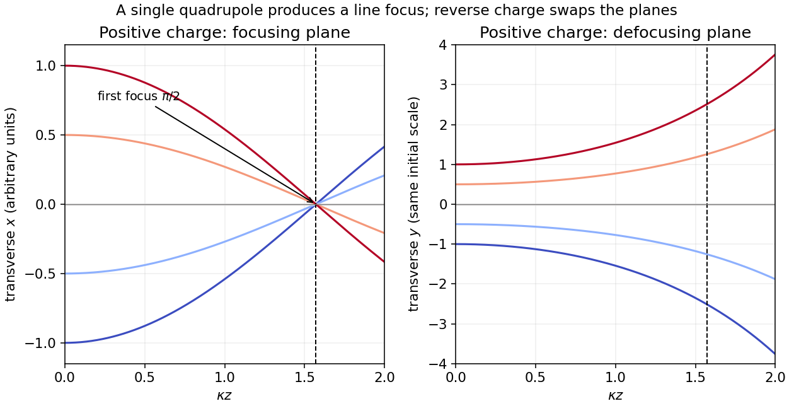

<h1 id="9/solution">Solution</h1>

↑ **Parent:** [9](../9.md)

The [Lorentz force](../../../lorentz-force.md) is $\mathbf F=q(\mathbf E+\mathbf v\times\mathbf B)$. With no [electric field](../../../electric-field-split.md), the exact nonrelativistic component equations for the given quadrupole are

$$
m\ddot x=-qA\dot z\,x,\qquad m\ddot y=qA\dot z\,y,\qquad m\ddot z=qA(x\dot x-y\dot y).
$$

The magnetic [force](../../../force-split.md) does no work, so the total speed stays constant. In the [paraxial approximation](../../../paraxial-approximation.md), $\dot z\simeq v$ and its small change is second order in the transverse motion. For $q>0$, put $\kappa=\sqrt{qA/(mv)}$. Initial travel parallel to the $z$ axis means zero entrance slopes, yielding

$$
\boxed{x(z)=x_0\cos(\kappa z),\qquad y(z)=y_0\cosh(\kappa z).}
$$

Thus $x$ is focused while $y$ is defocused. The first focus in the focusing plane occurs at

$$
\boxed{z_f=\frac\pi{2\kappa}=\frac\pi2\sqrt{\frac{mv}{qA}}.}
$$

For negative $q$, interchange the focusing and defocusing planes and use $|q|$ in $\kappa$. A single [quadrupole magnet](../../../quadrupole-magnet.md) gives a line focus of a general beam, not simultaneous focusing of both transverse coordinates onto one point. The magnet must extend at least to the computed focus, and the slopes must remain small. For a relativistic beam, the corresponding paraxial factor is $\kappa^2=|q|A/p$, with $p$ the longitudinal [relativistic momentum](../../../relativistic-momentum.md).

**[Figure 3](#9/image-parallel-incident-rays-focus-in-one-quadrupole-plane-and-spread-in-the-other-the-first-focus-is-at-kappa-z-equal-to-pi-over-two). Parallel incident rays focus in one quadrupole plane and spread in the other; the first focus is at kappa z equal to pi over two**.

## ↑ Ancestors (11)

1. [9](../9.md)
2. [2016 resit](../../2016-resit-split.md)
3. [Past exam of the physics 2 paper of the University of Oxford](../../split.md)
4. [Physics 2 paper of the University of Oxford](../../../physics-2-paper-of-the-university-of-oxford.md)
5. [Year 1 of the physics course of the University of Oxford](../../../year-1-of-the-physics-course-of-the-university-of-oxford.md)
6. [Physics course of the University of Oxford](../../../physics-course-of-the-university-of-oxford.md)
7. [Undergraduate course of the University of Oxford](../../../undergraduate-course-of-the-university-of-oxford.md)
8. [Course of the University of Oxford](../../../course-of-the-university-of-oxford.md)
9. [University of Oxford](../../../university-of-oxford-split.md)
10. [List of universities](../../../list-of-universities.md)
11. [Codex Wiki](../../../split.md)
