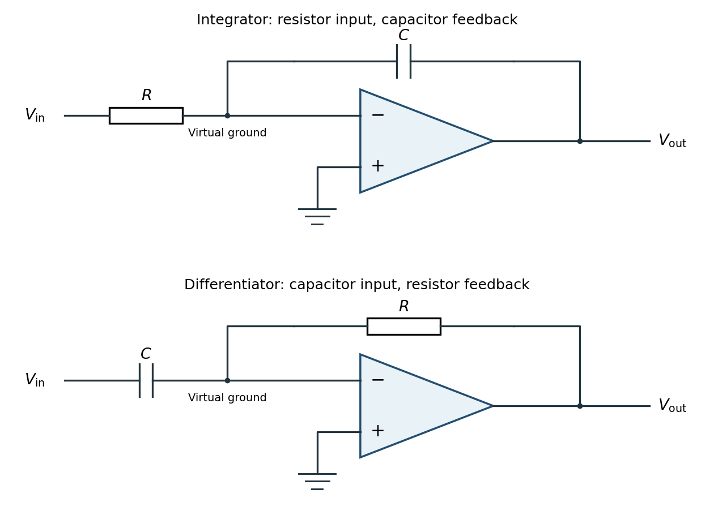
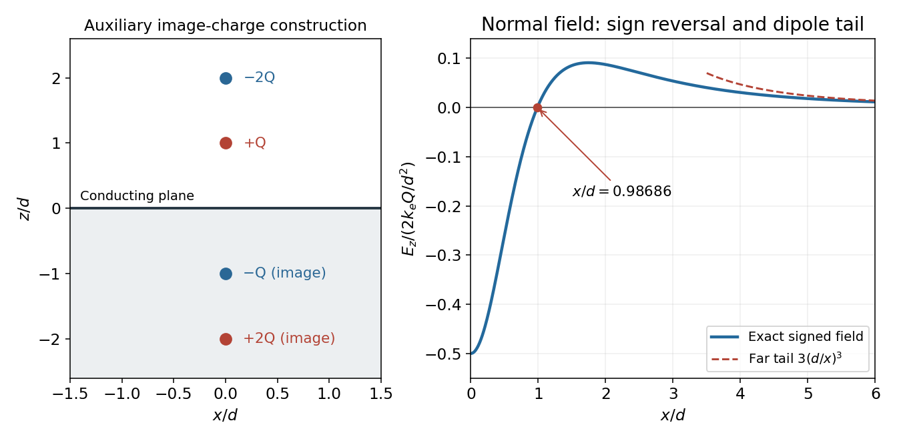
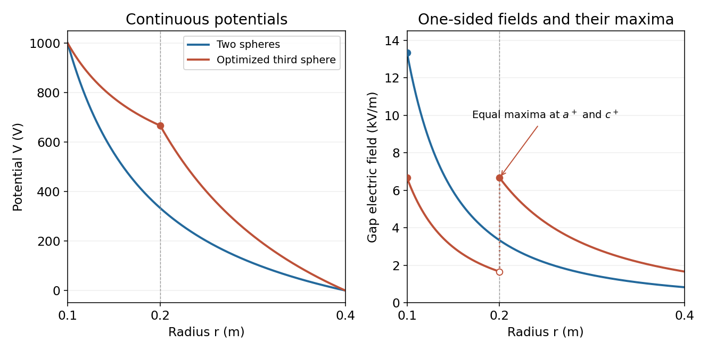
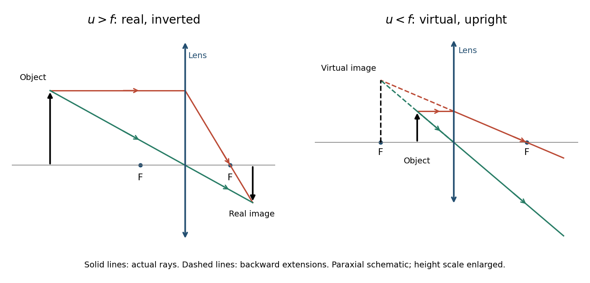
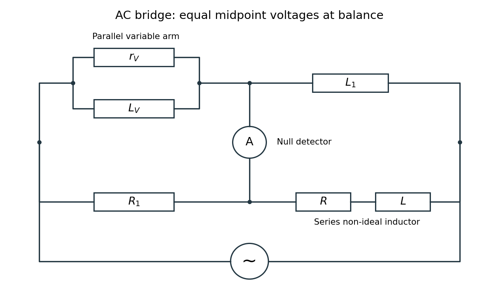

# 2016

↑ **Parent:** [Past exam of the physics 2 paper of the University of Oxford](../past-exam-of-the-physics-2-paper-of-the-university-of-oxford.md)

Source paper: [Oxford source archive](https://www.whatdotheyknow.com/request/physics_past_exam_papers_2015_16/response/973997/attach/3/Cowell%20Attachment.zip?cookie_passthrough=1), member `Prelims papers/CP2_June_2016.pdf`. The cover dates this ordinary paper to 7 June 2016. Unlettered marked blocks are indexed a, b and so on; all four Section B options are treated.

**Table of contents**

- [1](#1)
  - [a](#1/a)
    - [Solution](#1/a/solution)
  - [b](#1/b)
    - [Solution](#1/b/solution)
- [2](#2)
  - [Solution](#2/solution)
- [3](#3)
  - [a](#3/a)
    - [Solution](#3/a/solution)
  - [b](#3/b)
    - [Solution](#3/b/solution)
- [4](#4)
  - [a](#4/a)
    - [Solution](#4/a/solution)
  - [b](#4/b)
    - [Solution](#4/b/solution)
- [5](#5)
  - [Solution](#5/solution)
- [6](#6)
  - [a](#6/a)
    - [Solution](#6/a/solution)
  - [b](#6/b)
    - [Solution](#6/b/solution)
- [7](#7)
  - [a](#7/a)
    - [Solution](#7/a/solution)
  - [b](#7/b)
    - [Solution](#7/b/solution)
- [8](#8)
  - [a](#8/a)
    - [Solution](#8/a/solution)
  - [b](#8/b)
    - [Solution](#8/b/solution)
  - [c](#8/c)
    - [Solution](#8/c/solution)
  - [d](#8/d)
    - [Solution](#8/d/solution)
- [9](#9)
  - [a](#9/a)
    - [Solution](#9/a/solution)
  - [b](#9/b)
    - [Solution](#9/b/solution)
  - [c](#9/c)
    - [Solution](#9/c/solution)
  - [d](#9/d)
    - [Solution](#9/d/solution)
- [10](#10)
  - [a](#10/a)
    - [Solution](#10/a/solution)
  - [b](#10/b)
    - [Solution](#10/b/solution)
  - [c](#10/c)
    - [Solution](#10/c/solution)
  - [d](#10/d)
    - [Solution](#10/d/solution)
- [11](#11)
  - [i](#11/i)
    - [Solution](#11/i/solution)
    - [a](#11/i/a)
      - [Solution](#11/i/a/solution)
    - [b](#11/i/b)
      - [Solution](#11/i/b/solution)
  - [ii](#11/ii)
    - [Solution](#11/ii/solution)

## 1

↑ **Parent:** [2016](2016.md)

<h3 id="1/a">a</h3>

↑ **Parent:** [1](#1)

<h4 id="1/a/solution">Solution</h4>

↑ **Parent:** [A](#1/a)

Take the [electrostatic potential energy](../electrostatics.md#electrostatic-energy) to vanish for infinitely separated [point charges](../electric-field.md#point-charge), and write $k_e=1/(4\pi\epsilon_0)$. The first charge costs no work to place. Bringing the second to distance $a$ costs $k_eq^2/a$; the third is distance $a$ from both existing charges and costs $2k_eq^2/a$. Thus the external quasistatic assembly work is

$$
\boxed{W=U=\frac{3q^2}{4\pi\epsilon_0a}}.
$$

Equivalently, sum over the three distinct pairs in the [equilateral triangle](../euclidean-geometry.md#equilateral-triangle). Counting both ordered pairs without a compensating factor of one half would double the answer. The positive result applies to either sign of $q$, since all three [electric charges](../electric-charge.md) have the same sign.

<h3 id="1/b">b</h3>

↑ **Parent:** [1](#1)

<h4 id="1/b/solution">Solution</h4>

↑ **Parent:** [B](#1/b)

By symmetry, the resultant [Coulomb force](../electrostatics.md#coulomb-force) on each charge points along the line from the [centroid](../euclidean-geometry.md#centroid) to its vertex. Their [accelerations](../classical-mechanics.md#acceleration) and subsequent [speeds](../classical-mechanics.md#speed) are equal, so the [centroid](../euclidean-geometry.md#centroid) remains fixed and the [equilateral triangle](../euclidean-geometry.md#equilateral-triangle) expands without rotating. Each charge follows a straight radial trajectory; the separation grows and the repulsive [force](../force.md) decreases.

For example, if the instantaneous side is $s$ and the centroid-to-charge distance is $r=s/\sqrt3$, the two pair forces have a $60^\circ$ angle between them. Their resultant is $\sqrt3k_eq^2/s^2=k_eq^2/(\sqrt3r^2)$, along the outward radius. This confirms that the symmetric shape persists.

Assuming release from rest, nonrelativistic motion and negligible radiation losses, [energy conservation](../mathematical-physics.md#conservation-of-energy) gives

$$
\frac32mv_\infty^2=\frac{3k_eq^2}{a},\qquad\boxed{v_\infty=\sqrt{\frac{2k_eq^2}{ma}}=\sqrt{\frac{q^2}{2\pi\epsilon_0ma}}}.
$$

The three velocity vectors sum to zero, consistent with [momentum conservation](../momentum.md#momentum-conservation). Their magnitudes approach the displayed value as the remaining [electrostatic potential energy](../electrostatics.md#electrostatic-energy) tends to zero.

## 2

↑ **Parent:** [2016](2016.md)

<h3 id="2/solution">Solution</h3>

↑ **Parent:** [2](#2)

The [Lorentz force](../relativistic-electromagnetism.md#lorentz-force) is

$$
\boxed{\mathbf F=q(\mathbf E+\mathbf v\times\mathbf B)}.
$$

For $\mathbf E=0$, the magnetic part is perpendicular to the [velocity](../classical-mechanics.md#velocity), so its instantaneous [power](../energy.md#power) $\mathbf F\cdot\mathbf v$ vanishes. The [speed](../classical-mechanics.md#speed) and [kinetic energy](../energy.md#kinetic-energy) therefore remain constant. Decompose the initial [velocity](../classical-mechanics.md#velocity) into $v_\parallel$ along the uniform [magnetic field](../magnetic-field.md) and $v_\perp$ perpendicular to it. The parallel component is unchanged, while the perpendicular component rotates uniformly.

For a nonrelativistic particle with $qB\ne0$, the resulting helical motion has

$$
\boxed{r_L=\frac{mv_\perp}{|q|B},\qquad\omega_c=\frac{|q|B}{m},\qquad T=\frac{2\pi m}{|q|B},\qquad h=v_\parallel T}.
$$

Here $r_L$ is the [Larmor radius](../relativistic-electromagnetism.md#gyroradius), $\omega_c$ the [cyclotron frequency](../quantum-theory.md#cyclotron-frequency) in angular units, and $h$ the axial advance per turn. Opposite signs of [electric charge](../electric-charge.md) give opposite senses of rotation. Pure perpendicular motion gives a circle; pure parallel motion gives a straight line. If $q=0$ or $B=0$, there is no magnetic deflection. At relativistic [speeds](../classical-mechanics.md#speed), replace $m$ in the radius and period by $\gamma m$; $\gamma$ stays constant because the magnetic [force](../force.md) does no work.

## 3

↑ **Parent:** [2016](2016.md)

<h3 id="3/a">a</h3>

↑ **Parent:** [3](#3)

<h4 id="3/a/solution">Solution</h4>

↑ **Parent:** [A](#3/a)

Translational and reflection symmetry parallel to the slabs imply $\mathbf E=E_x(x)\hat{\mathbf x}$. The differential [Gauss's law](../maxwell-equations.md#gauss-s-law) is $dE_x/dx=\rho/\epsilon_0$. Starting at the left boundary with $E_x(-a)=0$ gives

$$
E_x(x)=-\frac{C}{\epsilon_0a}(x+a),\qquad -a\le x\le0.
$$

There is no singular [surface charge](../electric-charge.md#surface-charge) at $x=0$, so the normal [electric field](../electric-field.md) is continuous there: $E_x(0)=-C/\epsilon_0$. Integrating through the positive slab gives

$$
\boxed{\mathbf E(x)=\begin{cases}
-\dfrac{C(x+a)}{\epsilon_0a}\hat{\mathbf x},&-a\le x\le0,\\
-\dfrac{C(b-x)}{\epsilon_0b}\hat{\mathbf x},&0\le x\le b,\\
0,&x<-a\text{ or }x>b.
\end{cases}}
$$

The second expression indeed returns to zero at $x=b$, because the two total charges per unit area are $-C$ and $+C$. For $C>0$, the [electric field](../electric-field.md) throughout the interior points from the positive slab towards the negative slab, along $-x$; reversing $C$ reverses the directions. The piecewise linear profile is a useful consequence of the uniform volume [charge density](../electric-charge.md#charge-density).

<h3 id="3/b">b</h3>

↑ **Parent:** [3](#3)

<h4 id="3/b/solution">Solution</h4>

↑ **Parent:** [B](#3/b)

Define the requested [electric potential difference](../electric-field.md#electric-potential-difference) as $\Delta V=V(b)-V(-a)$. Since $E_x=-dV/dx$,

$$
\begin{aligned}
\Delta V&=-\int_{-a}^{b}E_x(x)\,dx\\
&=\frac{C}{\epsilon_0a}\int_{-a}^{0}(x+a)\,dx+\frac{C}{\epsilon_0b}\int_0^b(b-x)\,dx,
\end{aligned}
$$

so

$$
\boxed{V(b)-V(-a)=\frac{C(a+b)}{2\epsilon_0}}.
$$

Geometrically, the integral is the area of two triangles under the signed [electric field](../electric-field.md) profile. For $C>0$, the right-hand plane is at higher [electric potential](../electric-field.md#electric-potential). Choosing $V(-a)=0$, a continuous interior [electric potential](../electric-field.md#electric-potential) is $V=C(x+a)^2/(2\epsilon_0a)$ in the first slab and $V=Ca/(2\epsilon_0)+C(x-x^2/(2b))/\epsilon_0$ in the second. These expressions also verify the boundary values directly.

## 4

↑ **Parent:** [2016](2016.md)

<h3 id="4/a">a</h3>

↑ **Parent:** [4](#4)

<h4 id="4/a/solution">Solution</h4>

↑ **Parent:** [A](#4/a)

Let $A=\pi r^2$ and choose the rotating area normal to coincide initially with $+z$. At time $t$ its angle to the applied [magnetic field](../magnetic-field.md) is $\omega t$, so the external [magnetic flux](../magnetic-field.md#magnetic-flux) is $\Phi_B=BA\cos\omega t$. [Faraday's law](../maxwell-equations.md#faraday-s-law-of-induction) therefore gives

$$
\boxed{\mathcal E(t)=-\frac{d\Phi_B}{dt}=B\pi r^2\omega\sin\omega t}.
$$

In the high-[electrical resistance](../electric-charge.md#electrical-resistance) approximation, neglecting the loop's [self-inductance](../electromagnetism.md#self-inductance), [Ohm's law](../electric-charge.md#ohm-s-law) gives

$$
\boxed{I(t)=\frac{B\pi r^2\omega}{R}\sin\omega t}.
$$

The displayed signs specify positive circulation by the chosen normal; reversing the reference circulation reverses both signs. The high-[electrical resistance](../electric-charge.md#electrical-resistance) assumption is quantitatively $\omega L\ll R$ if the loop has [self-inductance](../electromagnetism.md#self-inductance) $L$. Otherwise the current lags the induced [electromotive force](../electric-charge.md#electromotive-force) and must be obtained from $L\dot I+RI=\mathcal E$.

<h3 id="4/b">b</h3>

↑ **Parent:** [4](#4)

<h4 id="4/b/solution">Solution</h4>

↑ **Parent:** [B](#4/b)

The [magnetic dipole moment](../electromagnetism.md#magnetic-dipole-moment) is $\boldsymbol\mu=IA\hat{\mathbf n}$ and its magnetic [torque](../momentum.md#torque) is $\boldsymbol\tau_{\rm mag}=\boldsymbol\mu\times\mathbf B$. Its component along the rotation axis opposes the imposed rotation. For positive $\omega$, the external driving [torque](../momentum.md#torque) needed to keep the [angular velocity](../rigid-body-dynamics.md#angular-velocity) constant is

$$
\tau_{\rm drive}(t)=IAB\sin\omega t=\frac{B^2A^2\omega}{R}\sin^2\omega t.
$$

Averaging over a complete rotation, with $\langle\sin^2\omega t\rangle=1/2$, gives

$$
\boxed{\langle\tau_{\rm drive}\rangle=\frac{B^2\pi^2r^4\omega}{2R}}.
$$

As an independent sign and dimension check, $\omega\langle\tau_{\rm drive}\rangle=R\langle I^2\rangle$. Thus the mechanical input [power](../energy.md#power) equals the mean [Joule heating](../electric-charge.md#joule-heating); a passive loop cannot supply a sustained driving [torque](../momentum.md#torque). This average assumes the same negligible-[self-inductance](../electromagnetism.md#self-inductance) approximation as the current expression.

## 5

↑ **Parent:** [2016](2016.md)

<h3 id="5/solution">Solution</h3>

↑ **Parent:** [5](#5)

The magnetostatic [Ampère's law](../maxwell-equations.md#ampere-s-circuital-law), in vacuum, is

$$
\boxed{\oint_{\partial S}\mathbf B\cdot d\boldsymbol\ell=\mu_0I_{\rm enc},\qquad\nabla\times\mathbf B=\mu_0\mathbf J}.
$$

The path direction and surface normal are related by the right-hand rule. Taking the [divergence](../multivariable-calculus.md#divergence) of the differential law gives $\nabla\cdot\mathbf J=0$, since the [divergence](../multivariable-calculus.md#divergence) of a [curl](../multivariable-calculus.md#curl) vanishes. However, [charge conservation](../electric-charge.md#charge-conservation) requires the [continuity equation](../mathematical-physics.md#continuity-equation) $\nabla\cdot\mathbf J=-\partial\rho/\partial t$, which need not vanish during charging.

Using [Gauss's law](../maxwell-equations.md#gauss-s-law), $\nabla\cdot\mathbf E=\rho/\epsilon_0$, the combination $\mathbf J+\epsilon_0\partial\mathbf E/\partial t$ has zero [divergence](../multivariable-calculus.md#divergence). Replacing $\mathbf J$ by this conserved total current density gives the [Ampère-Maxwell equation](../maxwell-equations.md#ampere-s-circuital-law):

$$
\boxed{\nabla\times\mathbf B=\mu_0\mathbf J+\mu_0\epsilon_0\frac{\partial\mathbf E}{\partial t}}.
$$

Its integral form is $\oint\mathbf B\cdot d\boldsymbol\ell=\mu_0[I_{\rm enc}+\epsilon_0\,d\Phi_E/dt]$. The extra term is the [displacement current](../maxwell-equations.md#displacement-current). In a charging parallel-plate [capacitor](../electromagnetism.md#capacitor), a surface cutting the wire encloses a conduction current $dQ/dt$, while a surface through the vacuum gap encloses no conduction current but has $\epsilon_0d\Phi_E/dt=dQ/dt$. This modification makes the magnetic circulation independent of which spanning surface is chosen. The vacuum [displacement current](../maxwell-equations.md#displacement-current) represents a changing [electric field](../electric-field.md), not literal transport of charge across the gap.

## 6

↑ **Parent:** [2016](2016.md)

<h3 id="6/a">a</h3>

↑ **Parent:** [6](#6)

<h4 id="6/a/solution">Solution</h4>

↑ **Parent:** [A](#6/a)

Under the [Rayleigh criterion](../point-spread-function.md#rayleigh-criterion), two equally bright, mutually incoherent [point sources](../fluid-mechanics.md#point-source) are just resolved when the central maximum of one [diffraction pattern](../quantum-scattering.md#diffraction-pattern) lies at the first minimum of the other. Their [intensities](../wave.md#intensity-physics), rather than their electric-field amplitudes, add. For an ideal circular aperture of diameter $D$, the first dark ring of the [Airy disk](../point-spread-function.md#airy-disk) gives

$$
\boxed{\theta_R\simeq1.22\frac{\lambda}{D}}.
$$

The angle is in radians in the small-angle limit. This is a conventional resolution criterion for a specified aperture and [wavelength](../wave-equation.md#wavelength); it is not an absolute prohibition on estimating a source separation by fitting noisy data under additional assumptions.

<h3 id="6/b">b</h3>

↑ **Parent:** [6](#6)

<h4 id="6/b/solution">Solution</h4>

↑ **Parent:** [B](#6/b)

With $D=5\ \mathrm{mm}$, the circular-aperture [diffraction limit](../optics.md#diffraction-limit) is $\theta_R=244\lambda$ when $\lambda$ is in metres. No [wavelength](../wave-equation.md#wavelength) is specified, so a unique numerical diffraction angle cannot be deduced. Taking representative visible light at $\lambda=550\ \mathrm{nm}$ gives

$$
\theta_R=1.34\times10^{-4}\ \mathrm{rad}\simeq0.46\ \mathrm{arcmin}.
$$

For a roughly square receptor arrangement with surface density $n=10^5\ \mathrm{mm}^{-2}$, the characteristic receptor pitch is $s\simeq n^{-1/2}=3.16\ \mathrm{micrometres}$. With the retina $f_{\rm eye}=17\ \mathrm{mm}$ behind the lens, that pitch subtends

$$
\boxed{\theta_{\rm pitch}\simeq\frac{s}{f_{\rm eye}}=1.86\times10^{-4}\ \mathrm{rad}\simeq0.64\ \mathrm{arcmin}}.
$$

This is an order-of-magnitude estimate of the point-separation scale from retinal sampling. A periodic intensity pattern needs at least two samples per period under the [Nyquist–Shannon sampling theorem](../fourier-analysis.md#nyquist-shannon-sampling-theorem), giving a corresponding period angle of about $3.72\times10^{-4}\ \mathrm{rad}$ or $1.28\ \mathrm{arcmin}$. A different receptor packing changes the pitch by an order-one geometric factor; density alone does not specify a full sampling lattice or a contrast threshold.

At a $5\ \mathrm{mm}$ pupil and the chosen visible [wavelength](../wave-equation.md#wavelength), the optical [diffraction limit](../optics.md#diffraction-limit) is somewhat finer than the receptor pitch. The supplied model is therefore not purely diffraction limited: retinal sampling is comparable to, and slightly more restrictive than, ideal aperture diffraction. Real [optical aberrations](../geometrical-optics.md#optical-aberration) and neural processing can further reduce resolution. Different [wavelengths](../wave-equation.md#wavelength) or a smaller pupil can change which effect dominates.

## 7

↑ **Parent:** [2016](2016.md)

<h3 id="7/a">a</h3>

↑ **Parent:** [7](#7)

<h4 id="7/a/solution">Solution</h4>

↑ **Parent:** [A](#7/a)

Use an [ideal operational amplifier](../electrical-circuit.md#ideal-operational-amplifier) with its non-inverting terminal grounded, an input [resistor](../electric-charge.md#resistor) $R$ and a feedback [capacitor](../electromagnetism.md#capacitor) $C$, as in the upper circuit. Stable unsaturated [negative feedback](../signal-transduction.md#negative-feedback) holds the inverting terminal at [virtual ground](../electrical-circuit.md#virtual-ground), while the input current into the amplifier itself vanishes.

**[Figure 1](#7/a/image-inverting-operational-amplifier-integrator-and-differentiator-circuits). Inverting operational-amplifier integrator and differentiator circuits**.

Applying [Kirchhoff's current law](../random-walk.md#kirchhoff-node-law) at the inverting node gives

$$
\frac{V_{\rm in}}{R}=C\frac{d(0-V_{\rm out})}{dt},\qquad\boxed{V_{\rm out}(t)=V_{\rm out}(t_0)-\frac1{RC}\int_{t_0}^{t}V_{\rm in}(t')\,dt'}.
$$

Thus the circuit is an inverting [op amp integrator](../electrical-circuit.md#op-amp-integrator), with its integration constant set by the initial [capacitor charge](../electromagnetism.md#capacitor-charge). A constant input makes the output ramp until a real amplifier reaches a supply rail. A practical low-frequency design usually adds a large feedback [resistor](../electric-charge.md#resistor) to limit drift; the ideal integral relation applies where the feedback [capacitor](../electromagnetism.md#capacitor) dominates.

<h3 id="7/b">b</h3>

↑ **Parent:** [7](#7)

<h4 id="7/b/solution">Solution</h4>

↑ **Parent:** [B](#7/b)

Interchange the input and feedback components: put the [capacitor](../electromagnetism.md#capacitor) $C$ between the input and the inverting terminal, and the [resistor](../electric-charge.md#resistor) $R$ between the output and the inverting terminal. Keep the non-inverting terminal grounded, as in the lower circuit above. For an [ideal operational amplifier](../electrical-circuit.md#ideal-operational-amplifier) under unsaturated [negative feedback](../signal-transduction.md#negative-feedback), the inverting node remains at [virtual ground](../electrical-circuit.md#virtual-ground).

The input [capacitor current](../electromagnetism.md#capacitor-current) is $I_C=C\,dV_{\rm in}/dt$. It flows through the feedback [resistor](../electric-charge.md#resistor), giving

$$
C\frac{dV_{\rm in}}{dt}=\frac{0-V_{\rm out}}R,\qquad\boxed{V_{\rm out}=-RC\frac{dV_{\rm in}}{dt}}.
$$

This is an inverting [op amp differentiator](../electrical-circuit.md#op-amp-differentiator). Its ideal gain magnitude increases with [frequency](../wave.md#frequency), so it strongly amplifies high-frequency noise. Practical differentiators include components that restrict the useful band and stabilize feedback; that qualification does not change the displayed ideal low-amplitude relation within the operating band.

## 8

↑ **Parent:** [2016](2016.md)

<h3 id="8/a">a</h3>

↑ **Parent:** [8](#8)

<h4 id="8/a/solution">Solution</h4>

↑ **Parent:** [A](#8/a)

The [method of images](../mathematics.md#method-of-images) replaces a conducting boundary by fictitious [point charges](../electric-field.md#point-charge) placed outside the physical region being solved. Choose their positions and strengths so that the resulting [electric potential](../electric-field.md#electric-potential) has the required constant value on each conductor. The [uniqueness theorem for the electrostatic potential](../electrostatics.md#uniqueness-theorem-for-the-electrostatic-potential) then guarantees that this solution equals the physical solution in the allowed region, provided the other boundary conditions are also satisfied.

For a plane held at zero [electric potential](../electric-field.md#electric-potential), a real charge $q$ a height $d$ above the plane has an image $-q$ the same distance below it. The pair's [electric potential](../electric-field.md#electric-potential) vanishes everywhere on the plane. Its tangential [electric field](../electric-field.md) consequently vanishes there, as required in [electrostatic equilibrium](../electrostatics.md#electrostatic-equilibrium). The image is a mathematical representation of the induced [surface charge](../electric-charge.md#surface-charge), not a physical charge placed inside the conductor. Forces on the real charge can be computed from the image field, but total physical [electrostatic energy](../electrostatics.md#electrostatic-energy) must account for the conductor's induced response rather than simply counting a full real-plus-image pair energy.

<h3 id="8/b">b</h3>

↑ **Parent:** [8](#8)

<h4 id="8/b/solution">Solution</h4>

↑ **Parent:** [B](#8/b)

Use the standard infinite-plane boundary condition: the sheet is an [equipotential](../electric-field.md#equipotential), with no imposed uniform background [electric field](../electric-field.md) and the [electric potential](../electric-field.md#electric-potential) tending to zero far from the localized charges. The images of $+Q$ at $z=d$ and $-2Q$ at $z=2d$ are $-Q$ at $z=-d$ and $+2Q$ at $z=-2d$.

At the point $z=0^+$ directly below the real charges, horizontal components vanish. The first real-image pair contributes $-2k_eQ/d^2$ along $z$, while the second contributes $+2k_e(2Q)/(2d)^2=+k_eQ/d^2$. Therefore

$$
\boxed{\mathbf E(0,0,0^+)=-\frac{Q}{4\pi\epsilon_0d^2}\hat{\mathbf z}}.
$$

For $Q>0$, the [electric field](../electric-field.md) points downwards into the sheet. The expression is the one-sided vacuum limit; the [electric field](../electric-field.md) inside the conducting material is zero. A prescribed uniform background field would be an additional boundary condition and would change this result.

<h3 id="8/c">c</h3>

↑ **Parent:** [8](#8)

<h4 id="8/c/solution">Solution</h4>

↑ **Parent:** [C](#8/c)

Let $x\ge0$ denote the radial distance from the axis in the plane, and write $r_h=(x^2+h^2)^{1/2}$. A charge $q$ at height $h$ and its image $-q$ give a combined normal [electric field](../electric-field.md) $-2k_eqh/r_h^3$ at $z=0^+$; the tangential components cancel. Superposing the two pairs yields

$$
\boxed{\mathbf E(x,0,0^+)=\frac{Qd}{2\pi\epsilon_0}\left[\frac4{(x^2+4d^2)^{3/2}}-\frac1{(x^2+d^2)^{3/2}}\right]\hat{\mathbf z}}.
$$

The conductor boundary condition gives $\sigma=\epsilon_0E_z$, so

$$
\boxed{\sigma(x)=\frac{Qd}{2\pi}\left[\frac4{(x^2+4d^2)^{3/2}}-\frac1{(x^2+d^2)^{3/2}}\right]}.
$$

To integrate the induced [surface charge](../electric-charge.md#surface-charge), use concentric annuli of area $2\pi x\,dx$. Since $\int_0^\infty x(x^2+h^2)^{-3/2}\,dx=1/h$,

$$
Q_{\rm sheet}=Qd\left(\frac4{2d}-\frac1d\right)=\boxed{+Q}.
$$

The local [surface charge density](../electrostatics.md#surface-charge-density) is negative near the origin but positive farther out; integrating only the negative patch would miss the total. The total real charge is $-Q$, so the induced $+Q$ also agrees with the sum of the two image charges. An isolated finite plate constrained to zero net charge would require a different global boundary-value problem; the formula is the infinite-plane solution just specified.

<h3 id="8/d">d</h3>

↑ **Parent:** [8](#8)

<h4 id="8/d/solution">Solution</h4>

↑ **Parent:** [D](#8/d)

Set the normal [electric field](../electric-field.md) to zero and cancel its nonzero overall factor:

$$
\frac4{(x^2+4d^2)^{3/2}}=\frac1{(x^2+d^2)^{3/2}}.
$$

Taking the power $2/3$ gives $4^{2/3}(x^2+d^2)=x^2+4d^2$, hence

$$
\boxed{x=d\sqrt{\frac{4-4^{2/3}}{4^{2/3}-1}}\simeq0.98686d=0.98686\ \mathrm m}.
$$

The numerical value is independent of the nonzero magnitude of $Q$. Beyond this radius the signed normal [electric field](../electric-field.md) is positive. Thus its magnitude first falls to zero, rises again and eventually decays; it is not globally monotone.

For $x\gg d$, expanding each denominator gives

$$
E_z=\frac{Qd}{2\pi\epsilon_0x^3}\left[3-\frac{45}{2}\frac{d^2}{x^2}+O\!\left(\frac{d^4}{x^4}\right)\right],\qquad\boxed{E_z\sim\frac{3Qd}{2\pi\epsilon_0x^3}>0}.
$$

This is a dipole rather than a monopole tail. The real-plus-image charge distribution has zero total charge and dipole moment $p_z=-6Qd$; in its equatorial plane a dipole produces $E_z=-k_ep_z/x^3$, confirming the coefficient and sign.

**[Figure 2](#8/d/image-image-charges-and-the-sign-changing-normal-field-above-an-infinite-conducting-plane). Image charges and the sign-changing normal field above an infinite conducting plane**.

## 9

↑ **Parent:** [2016](2016.md)

<h3 id="9/a">a</h3>

↑ **Parent:** [9](#9)

<h4 id="9/a/solution">Solution</h4>

↑ **Parent:** [A](#9/a)

Spherical symmetry and the vacuum [Gauss's law](../maxwell-equations.md#gauss-s-law) imply $\mathbf E=A\hat{\mathbf r}/r^2$ in the gap, where $A$ is constant. Integrating the [electric field](../electric-field.md) between the two [equipotentials](../electric-field.md#equipotential) gives

$$
V_1=V(a)-V(b)=\int_a^b\frac{A}{r^2}\,dr=A\left(\frac1a-\frac1b\right).
$$

Consequently

$$
\boxed{\mathbf E(r)=\frac{V_1ab}{(b-a)r^2}\hat{\mathbf r},\qquad a<r<b}.
$$

The inner charge is $Q=4\pi\epsilon_0A$, which reproduces the [spherical capacitor](../electromagnetism.md#spherical-capacitor) [capacitance](../electromagnetism.md#capacitance) $4\pi\epsilon_0ab/(b-a)$. The radial direction is outward for positive $V_1$ and inward for negative $V_1$; the formula represents the signed field, not just its magnitude.

<h3 id="9/b">b</h3>

↑ **Parent:** [9](#9)

<h4 id="9/b/solution">Solution</h4>

↑ **Parent:** [B](#9/b)

The [electric field](../electric-field.md) magnitude falls as $1/r^2$ throughout the vacuum gap, so its maximum occurs just outside the inner sphere:

$$
E_{\max}=\frac{|V_1|b}{a(b-a)}=\frac{10^3\times0.4}{0.1(0.4-0.1)}.
$$

Thus

$$
\boxed{E_{\max}=1.333\times10^4\ \mathrm{V\,m^{-1}},\qquad r=a^+}.
$$

Inside the metal the [electric field](../electric-field.md) is zero. The one-sided gap value is the relevant value for dielectric breakdown; the ideal zero-thickness conducting boundary itself should not be assigned a single field value across its surface-charge discontinuity.

<h3 id="9/c">c</h3>

↑ **Parent:** [9](#9)

<h4 id="9/c/solution">Solution</h4>

↑ **Parent:** [C](#9/c)

Inserting an independently biased conducting sphere makes two vacuum gaps, each with its own constant radial [electric flux](../electric-field.md#electric-flux). Let $A_1$ and $A_2$ be the coefficients of $1/r^2$. The two potential drops are

$$
V_1-V_2=A_1\left(\frac1a-\frac1c\right),\qquad V_2=A_2\left(\frac1c-\frac1b\right).
$$

Therefore

$$
\boxed{\mathbf E(r)=\begin{cases}
\dfrac{(V_1-V_2)ac}{(c-a)r^2}\hat{\mathbf r},&a<r<c,\\
\dfrac{V_2bc}{(b-c)r^2}\hat{\mathbf r},&c<r<b.
\end{cases}}
$$

The middle conductor can carry net [electric charge](../electric-charge.md), so $A_1$ and $A_2$ need not be equal. Its charge is $4\pi\epsilon_0(A_2-A_1)$, consistent with the jump in the normal [electric field](../electric-field.md). For $0<V_2<V_1$ both fields point outwards; outside that interval one of the gap fields reverses direction.

<h3 id="9/d">d</h3>

↑ **Parent:** [9](#9)

<h4 id="9/d/solution">Solution</h4>

↑ **Parent:** [D](#9/d)

The largest field in each gap lies at that gap's smaller radius. Thus the quantity to minimize is

$$
E_{\max}(V_2)=\max\left\{\frac{c|V_1-V_2|}{a(c-a)},\frac{b|V_2|}{c(b-c)}\right\}.
$$

For positive $V_1$, projecting any $V_2$ outside $[0,V_1]$ back to that interval reduces both absolute potential drops, so the optimum lies inside it. Within the interval, one candidate maximum decreases linearly with $V_2$ and the other increases linearly. Their maximum is minimized at their intersection, not by making the potential drops equal.

With $a=0.1\ \mathrm m$, $c=0.2\ \mathrm m$, $b=0.4\ \mathrm m$ and $V_1=1000\ \mathrm V$, the two maxima are $20(1000-V_2)$ and $10V_2$ in $\mathrm{V\,m^{-1}}$. Equating them gives

$$
\boxed{V_2=\frac{2000}{3}\ \mathrm V\simeq666.7\ \mathrm V,\qquad E_{\max}=\frac{20000}{3}\ \mathrm{V\,m^{-1}}\simeq6667\ \mathrm{V\,m^{-1}}}.
$$

The maximum is halved relative to the two-sphere system and is attained at both $a^+$ and $c^+$. At $c^-$ and $b^-$ the optimized field is only about $1667\ \mathrm{V\,m^{-1}}$; at $c$ the charged middle shell produces a jump.

For plotting, the two-sphere [electric potential](../electric-field.md#electric-potential) is $V^{(2)}(r)=V_1(1/r-1/b)/(1/a-1/b)$. In the three-sphere system it is

$$
V^{(3)}(r)=\begin{cases}
V_2+(V_1-V_2)\dfrac{1/r-1/c}{1/a-1/c},&a\le r\le c,\\
V_2\dfrac{1/r-1/b}{1/c-1/b},&c\le r\le b.
\end{cases}
$$

The [electric potential](../electric-field.md#electric-potential) remains continuous at $c$, while its radial derivative changes there. The graphs show both the continuous potentials and the one-sided gap fields; the marked endpoints identify all maxima.

**[Figure 3](#9/d/image-potential-and-electric-field-before-and-after-optimized-intermediate-sphere-bias). Potential and electric field before and after optimized intermediate-sphere bias**.

## 10

↑ **Parent:** [2016](2016.md)

<h3 id="10/a">a</h3>

↑ **Parent:** [10](#10)

<h4 id="10/a/solution">Solution</h4>

↑ **Parent:** [A](#10/a)

Adopt positive object and real-image distances $u$ and $v$ measured from a converging [thin lens](../geometrical-optics.md#thin-lens), with the object on the left. A ray through the lens centre is undeviated in the thin-lens approximation. For object height $h$ and signed image height $h'$, similar triangles give $h'/h=-v/u$.

A second ray leaves the object parallel to the axis, reaches the lens at height $h$ and then passes through the far [focal point](../geodesic-congruence.md#focal-point-of-a-hypersurface). Its height at distance $v$ is $h'=h(1-v/f)$. Equating the two descriptions gives

$$
-\frac vu=1-\frac vf,\qquad\boxed{\frac1u+\frac1v=\frac1f}.
$$

The signed transverse [magnification](../optics.md#magnification) is $\boxed{m=h'/h=-v/u}$. Since a real image has $v>0$ for $u>0$, $m<0$: it is inverted. Its size relative to the object is $|m|=v/u$.

**[Figure 4](#10/a/image-paraxial-ray-construction-for-real-inverted-and-virtual-upright-lens-images). Paraxial ray construction for real inverted and virtual upright lens images**.

The derivation assumes the [paraxial approximation](../partial-differential-equation.md#paraxial-approximation), a negligible lens thickness and a [focal length](../geometrical-optics.md#focal-length) defined in the surrounding medium. The ray diagrams show actual paths as solid lines and backward extrapolations as dashed lines.

<h3 id="10/b">b</h3>

↑ **Parent:** [10](#10)

<h4 id="10/b/solution">Solution</h4>

↑ **Parent:** [B](#10/b)

For a real image, $u>f$ and $v=fu/(u-f)>0$. The object-to-image separation is

$$
D=u+v=\frac{u^2}{u-f}.
$$

Its excess above $4f$ factors into a nonnegative expression:

$$
D-4f=\frac{u^2-4f(u-f)}{u-f}=\frac{(u-2f)^2}{u-f}\ge0.
$$

Therefore

$$
\boxed{D_{\min}=4f,\qquad u=v=2f}.
$$

At this minimum the image is inverted and has unit absolute [magnification](../optics.md#magnification). The restriction to a real object and a real image matters: the positive separation used here is not the same quantity as a signed distance to a virtual image.

<h3 id="10/c">c</h3>

↑ **Parent:** [10](#10)

<h4 id="10/c/solution">Solution</h4>

↑ **Parent:** [C](#10/c)

A [real image](../optics.md#real-image) is a point where the actual outgoing rays converge; a screen placed there can intercept the focused light. A [virtual image](../optics.md#virtual-image) is a point from which the outgoing rays appear to diverge: only their backward extensions intersect, so a screen at that apparent point does not receive a focused real image from the same rays.

For a converging [thin lens](../geometrical-optics.md#thin-lens) with $f>0$ and a real object a distance $u>0$ away, the lens relation gives $v=fu/(u-f)$. If $u>f$, then $v>0$: the image is real, on the opposite side, and inverted. If $0<u<f$, then $v<0$: the image is virtual, on the same side as the object, upright and enlarged, with $m=-v/u=f/(f-u)>1$.

At $u=f$, the emergent rays are parallel and the image is at infinity; there is no finite focused image. For an object very far away, $v\to f$ from above. These are conditions for a real object in the stated lens convention, rather than claims about all systems with virtual incident objects.

<h3 id="10/d">d</h3>

↑ **Parent:** [10](#10)

<h4 id="10/d/solution">Solution</h4>

↑ **Parent:** [D](#10/d)

For a lens between an object and a screen, $u+v=D$ and the [thin lens](../geometrical-optics.md#thin-lens) relation requires $uv=fD$. Eliminating $v$ gives the quadratic equation

$$
u^2-Du+fD=0,\qquad u_\pm=\frac{D\pm\sqrt{D^2-4fD}}2.
$$

For $D>4f$, both roots lie between $0$ and $D$, and they exchange the object and image distances. Both therefore focus the image on the same screen, with reciprocal absolute [magnifications](../optics.md#magnification). The distance between lens positions is

$$
\boxed{l=|u_+-u_-|=\sqrt{D^2-4fD}=\sqrt{D(D-4f)}}.
$$

The existence qualification is essential: for $D=4f$ the two roots coincide and there is only one distinct position; for $D<4f$ there is none. For example, $D=3f$ makes the discriminant negative, providing a concrete counterexample to an unconditional assertion of two positions. This is the basis of the [Bessel lens displacement method](../geometrical-optics.md#bessel-lens-displacement-method), with $f=(D^2-l^2)/(4D)$ when two distinct positions can be measured.

## 11

↑ **Parent:** [2016](2016.md)

<h3 id="11/i">i</h3>

↑ **Parent:** [11](#11)

<h4 id="11/i/solution">Solution</h4>

↑ **Parent:** [I](#11/i)

Choose the [phasor](../wave.md#phasor) convention $V(t)=\operatorname{Re}(\widetilde V e^{i\omega t})$ and similarly for the [electric current](../electric-charge.md#electric-current). In a linear sinusoidal steady state, differentiation becomes multiplication by $i\omega$, and [complex impedance](../electrical-circuit.md#electrical-impedance) is $Z=\widetilde V/\widetilde I$. [Kirchhoff's current law](../random-walk.md#kirchhoff-node-law) and [Kirchhoff's voltage law](../random-walk.md#kirchhoff-cycle-law) then become algebraic equations that retain both amplitude and [phase](../wave.md#phase-waves) information.

For a [resistor](../electric-charge.md#resistor), $V=RI$, so $Z_R=R$. For a [capacitor](../electromagnetism.md#capacitor), $I=C\dot V$, while an [inductor](../electromagnetism.md#inductor) obeys $V=L\dot I$. Therefore

$$
\boxed{Z_R=R,\qquad Z_C=\frac1{i\omega C}=-\frac{i}{\omega C},\qquad Z_L=i\omega L}.
$$

The resistor's [electric potential difference](../electric-field.md#electric-potential-difference) and current are in [phase](../wave.md#phase-waves). The inductor's [electric potential difference](../electric-field.md#electric-potential-difference) leads its current by $\pi/2$; the capacitor's current leads its [electric potential difference](../electric-field.md#electric-potential-difference) by $\pi/2$. Replacing $e^{i\omega t}$ by $e^{-i\omega t}$ conjugates every impedance but leaves these physical lead-and-lag statements unchanged. The [phasor](../wave.md#phasor) method describes the steady state; switch-on transients must be added separately when initial conditions are relevant.

<h4 id="11/i/a">a</h4>

↑ **Parent:** [I](#11/i)

<h5 id="11/i/a/solution">Solution</h5>

↑ **Parent:** [A](#11/i/a)

A series connection has the same [electric current](../electric-charge.md#electric-current) through each element, so [complex impedances](../electrical-circuit.md#electrical-impedance) add:

$$
\boxed{Z_{\rm s}=R+i\left(\omega L-\frac1{\omega C}\right)}.
$$

For $R>0$, define $\phi=\arg\widetilde V-\arg\widetilde I=\arg Z_{\rm s}$. Then

$$
\phi=\tan^{-1}\left(\frac{\omega L-1/(\omega C)}R\right).
$$

Above resonance, the circuit is inductive and [electric potential difference](../electric-field.md#electric-potential-difference) leads current; below resonance it is capacitive and [electric potential difference](../electric-field.md#electric-potential-difference) lags current. At

$$
\boxed{\omega_0=\frac1{\sqrt{LC}},\qquad f_0=\frac1{2\pi\sqrt{LC}}},
$$

the inductive and capacitive [reactances](../electrical-circuit.md#electrical-reactance) cancel and $Z_{\rm s}=R$ is purely resistive. The same resonance condition holds for an ideal series circuit independent of the drive amplitude.

<h4 id="11/i/b">b</h4>

↑ **Parent:** [I](#11/i)

<h5 id="11/i/b/solution">Solution</h5>

↑ **Parent:** [B](#11/i/b)

A parallel connection has the same [electric potential difference](../electric-field.md#electric-potential-difference) across each element, so the [electrical admittances](../electrical-circuit.md#electrical-admittance) add. With $G=1/R$ and $B=\omega C-1/(\omega L)$,

$$
Y_{\rm p}=G+iB,\qquad\boxed{Z_{\rm p}=\left[\frac1R+i\left(\omega C-\frac1{\omega L}\right)\right]^{-1}=\frac{G-iB}{G^2+B^2}}.
$$

For a prescribed sinusoidal current, $\widetilde V=Z_{\rm p}\widetilde I$. Thus the voltage-minus-current [phase](../wave.md#phase-waves) is

$$
\phi=-\tan^{-1}\left[R\left(\omega C-\frac1{\omega L}\right)\right].
$$

Below $\omega_0=1/\sqrt{LC}$ the circuit is inductive, so [electric potential difference](../electric-field.md#electric-potential-difference) leads current; above it the circuit is capacitive, so [electric potential difference](../electric-field.md#electric-potential-difference) lags current. At $\omega_0$, the reactive branch currents cancel, $Y_{\rm p}=1/R$ and $\boxed{Z_{\rm p}=R}$. This is the impedance maximum for positive finite $R$, whereas the series circuit has its impedance minimum at the same [frequency](../wave.md#frequency). It does not mean that either individual reactive branch current vanishes.

<h3 id="11/ii">ii</h3>

↑ **Parent:** [11](#11)

<h4 id="11/ii/solution">Solution</h4>

↑ **Parent:** [Ii](#11/ii)

The source's variable inductor and variable resistor are in **parallel**. Let their combined [complex impedance](../electrical-circuit.md#electrical-impedance) be

$$
Z_V=\frac{i\omega L_Vr_V}{r_V+i\omega L_V}.
$$

Use the left and right source terminals as the drive nodes. The upper divider has arms $Z_V$ and $i\omega L_1$; the lower divider has arms $R_1$ and $R+i\omega L$. At bridge balance, the detector draws no [electric current](../electric-charge.md#electric-current) and the divider midpoint [electric potential differences](../electric-field.md#electric-potential-difference) agree, so

$$
\frac{Z_V}{i\omega L_1}=\frac{R_1}{R+i\omega L},\qquad Z_V(R+i\omega L)=i\omega L_1R_1.
$$

Substitution and cancellation at a nonzero drive [frequency](../wave.md#frequency) give

$$
L_Vr_V(R+i\omega L)=L_1R_1(r_V+i\omega L_V).
$$

Equating real and imaginary parts yields

$$
\boxed{R=\frac{R_1L_1}{L_V},\qquad L=\frac{R_1L_1}{r_V}}.
$$

The first expression has units of resistance and the second units of [inductance](../electromagnetism.md#inductance). Both are independent of the drive amplitude and, for ideal frequency-independent components, of the chosen nonzero drive [frequency](../wave.md#frequency). At zero [frequency](../wave.md#frequency) the ideal inductors short their arms and the cancellation would not be valid as a measurement of $L$.

**[Figure 5](#11/ii/image-bridge-topology-with-a-parallel-variable-arm-and-a-series-lossy-inductor-arm). Bridge topology with a parallel variable arm and a series lossy-inductor arm**.

Two applications are precision comparison of an unknown [electrical resistance](../electric-charge.md#electrical-resistance) with calibrated standards in a [Wheatstone bridge](../electrical-engineering.md#wheatstone-bridge), and detecting small resistance changes in a [strain gauge](../electric-charge.md#strain-gauge) or resistance [thermometer](../temperature.md#thermometer). Alternating-current bridges additionally compare [capacitance](../electromagnetism.md#capacitance), [inductance](../electromagnetism.md#inductance) and dielectric losses; this particular bridge determines the two parameters of a non-ideal [inductor](../electromagnetism.md#inductor) from a null measurement.

## ↑ Ancestors (9)

1. [Past exam of the physics 2 paper of the University of Oxford](../past-exam-of-the-physics-2-paper-of-the-university-of-oxford.md)
2. [Physics 2 paper of the University of Oxford](../university-of-oxford.md#physics-2-paper-of-the-university-of-oxford)
3. [Year 1 of the physics course of the University of Oxford](../university-of-oxford.md#year-1-of-the-physics-course-of-the-university-of-oxford)
4. [Physics course of the University of Oxford](../university-of-oxford.md#physics-course-of-the-university-of-oxford)
5. [Undergraduate course of the University of Oxford](../university-of-oxford.md#undergraduate-course-of-the-university-of-oxford)
6. [Course of the University of Oxford](../university-of-oxford.md#course-of-the-university-of-oxford)
7. [University of Oxford](../university-of-oxford.md)
8. [List of universities](../README.md#list-of-universities)
9. [Codex Wiki](../README.md)
